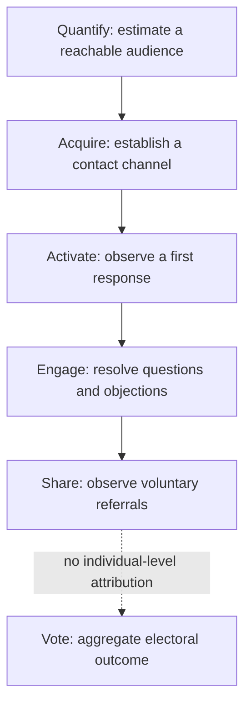
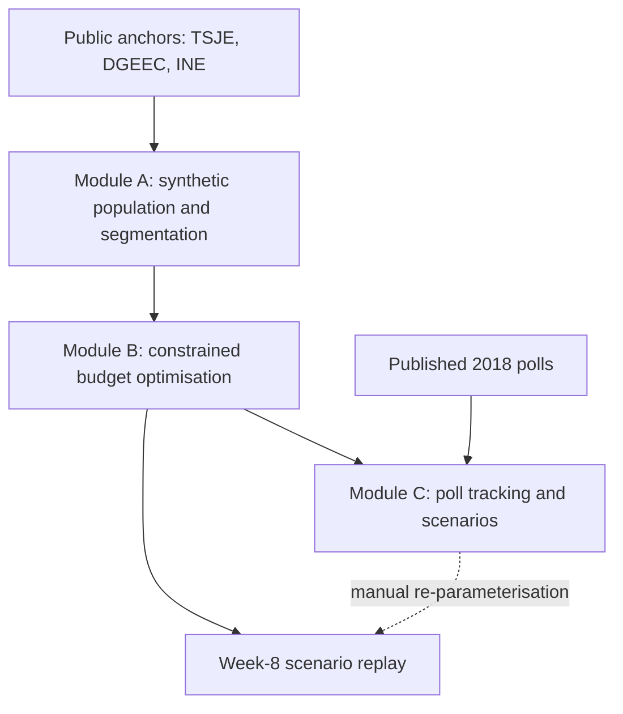

# From campaign instinct to decision analytics: lessons from Paraguay’s 2018 presidential election

In 2018 I travelled to Paraguay with enough clothes for one week. I expected a short consulting assignment: a few meetings, a diagnosis of the campaign’s marketing operation and a set of recommendations. I stayed to help direct the strategy of a presidential campaign.

On 22 April 2018, Mario Abdo Benítez won Paraguay’s presidential election with 1,206,067 votes against 1,110,464 for his principal opponent, Efraín Alegre: a margin of about 3.70 percentage points. I had come from outside professional politics, with a background in data-driven marketing, audience analysis and growth strategy.

The assignment was one of the most demanding of my career. It also exposed a distinction that has shaped my work since: **using data to justify a decision is not the same as using data to make a better decision.** The first is easy. The second requires understanding the problem, naming the available choices, estimating their consequences and accepting uncertainty.

This essay describes how I approached those questions during the campaign, what I learned from the decisions taken, and why I returned to the experience years later to build a reproducible [decision-analytics reconstruction](/en/work/decision-analytics-reconstruction/).

## The problem was resource allocation, not a lack of campaigning

The political situation was more complex than a contest between an incumbent party and its opposition. Mario Abdo Benítez had won the Colorado Party’s presidential primary in December 2017, defeating Santiago Peña, the candidate backed by the outgoing president, Horacio Cartes. Abdo was an experienced senator, but his victory challenged the sitting president’s preferred succession.

Winning the nomination did not resolve the wider electoral problem. The Colorado Party was divided. The political environment was marked by institutional distrust, disputes over corruption and governance, and a competitive opposition coalition led by Efraín Alegre.

The campaign also faced a substantial resource constraint. In my original 2019 account, I described the working budget as dramatically smaller than what I believed a conventional campaign would need. That was an operational assessment, not an audited comparison, and I would not present it today as a verified cost advantage. What mattered was the implication: matching competitors’ spending, visibility or established practice was neither feasible nor obviously desirable.

The question was therefore not how to communicate more. It was how to allocate limited resources among competing activities when the outcome was uncertain, the deadline immovable and the cost of a poor decision unrecoverable. That is a decision-analytics problem.

## A whiteboard changed the assignment

I arrived at campaign headquarters expecting to present my proposal and return home. In an early meeting it became clear that the team and I were thinking about the campaign in different ways. The discussion revolved around familiar marketing questions: media exposure, visibility, communication channels and the resources needed to compete.

I took a marker from my backpack and started drawing on the glass walls of the meeting room. Venn diagrams for overlapping voter populations, charts of audience composition, probability distributions for uncertainty: the relationships between potential voter groups, the channels that could reach them and the channels competitors already used.

The argument was simple. **A campaign does not need to reach every voter with the same intensity. It needs to know where additional resources are likely to change the outcome.** A large audience is not necessarily a valuable one. A cheap impression is not necessarily a useful contact. A channel with great reach may add little when competing campaigns already dominate it.

The discussion moved from what the campaign should produce to what it should prioritise. As I recall it, the person leading the meeting cancelled my return arrangements and asked what I needed to carry out the proposal. I asked for decision-making autonomy, and the consulting assignment became a much broader operational responsibility.

I remember the episode less for its drama than for what it illustrates, something I have met repeatedly in analytics work since: **a useful model can change a discussion before anyone writes a line of code.** Sometimes the most consequential analytical work is finding a better way to frame the decision.

## Getting outside the data

One of my first decisions was to spend less time with campaign reports. I moved around the city, often by taxi, changing destinations and drivers through the day. I spoke to people, listened to radio broadcasts, watched political advertising and noted what appeared in public spaces.

Taxi drivers were particularly informative. They spend their working days with people from different neighbourhoods and occupations, hearing unsolicited opinions about candidates, public services and everyday concerns. This was not a representative survey. The people I met were selected by convenience, geography and availability, and the drivers’ accounts carried their own experience and memory. Those conversations could not estimate national voting intention. They were valuable for something else: finding questions the campaign’s quantitative reporting had not addressed. I was looking for inconsistencies between the campaign’s assumptions and what was observable.

One observation stood out. In several places the candidate’s billboards stood close to those of competing campaigns. The campaign was paying for visibility exactly where competitors were also investing heavily. That did not make those placements ineffective by itself: outdoor advertising offers repeated exposure, and its effect depends on audience overlap, location, creative and objective. But it raised an allocation question worth testing. Was the campaign buying incremental exposure, or adding one more message to a saturated environment? If an additional dollar on a billboard buys less relevant incremental reach than the same dollar elsewhere, the billboard is the worse allocation even when its reported audience is larger.

The observation became part of a wider reassessment of media spending, and a principle I still hold: **qualitative research and quantitative analysis should challenge each other, not compete for authority.** Field observation pointed to possible weaknesses in the assumptions; quantitative evidence was needed to show whether those weaknesses mattered.

## From population size to reachable, actionable audiences

My background in digital marketing shaped how I thought about the electorate. Campaign planning often begins with territories, demographic groups, voting history and available media inventory. Those dimensions matter, but none of them shows whether a communication strategy is economically efficient.

I was interested in the intersection of three things: the size and characteristics of an audience, the campaign’s practical ability to reach it, and the likelihood that contact would produce a meaningful, measurable response. An audience could be large but hard to reach. Another could be small but accessible through inexpensive channels. A third might already hold firm preferences, leaving little room for persuasion. Each difference changes the expected value of the next unit of spending.

A compact way to state the planning question, without pretending its parameters were known, is:

$$
\text{Marginal efficiency of an intervention}
=\frac{\mathbb{E}[\text{incremental meaningful outcomes}]}{\text{incremental cost}}
$$

Here $\mathbb{E}$ is an *expected value*, not an observed result. Neither the numerator nor the denominator was established experimentally for any 2018 activity. The expression is a decision heuristic, **not an equation from an audited historical campaign model**, and it is not votes won per dollar.

My first strategic reasoning borrowed ideas from search-engine optimisation: competition, underserved demand, and the advantage of concentrating resources where competitors’ coverage was weak. In my original account I illustrated the argument with a normal distribution of political preferences. With hindsight, that illustration was too simple. Preferences are not distributed normally along one ideological axis; voters hold positions that vary across economic, social, geographic and institutional questions. The size of an ideological group does not establish its electoral availability, and an apparent gap in competitors’ coverage does not prove an opportunity.

The useful idea was not the shape of the distribution. It was the question underneath it: **where does the next unit of spending make the largest expected contribution to the objective?**

## Building a measurable communication process

The second part of the approach concerned the gap between exposure and action. In digital marketing I had worked extensively with acquisition funnels, such as the AARRR framework (acquisition, activation, retention, referral, revenue), which is designed around product and customer behaviour. An election needed a different conceptual model, so I developed a six-stage framework, QAAECV: quantify, acquire, activate, engage, share, vote.

The diagram redraws the model from my original campaign account. The last link is dashed on purpose: intermediate communication events do not reveal how anyone voted. Each stage has an analytical purpose and a limit:

| Stage | Analytical purpose | What the observation cannot establish |
|---|---|---|
| **Quantify** | Estimate the relevant audience | That the whole audience can be reached |
| **Acquire** | Establish a reachable contact channel | That a contact is a supporter |
| **Activate** | Observe a first meaningful response | That engagement changes preference |
| **Engage** | Understand questions, objections and continuing interest | That dialogue causes persuasion |
| **Share** | Observe voluntary redistribution or referrals | That redistribution generates votes |
| **Vote** | Observe the final outcome where reliable measurement is possible | Individual causal attribution under a secret ballot |

The model organised operational work; it did not claim that every voter followed a linear journey. The hardest measurement problem was the last stage. A campaign can measure a message delivered, a response received or a person volunteering. None of these proves that the person then voted for the candidate: the secret ballot prevents attribution at the individual level, and self-reported intentions add their own uncertainty. Intermediate metrics can still locate operational bottlenecks.

I put considerable weight on two-way communication, particularly WhatsApp and Facebook Messenger. Broadcast media generated exposure; interactive channels offered something else, observable responses and a chance to understand how people reacted. At the time I used **total responses per hour** as a key operational metric. It captured the campaign’s capacity to handle interactions, but today I would keep it apart from any outcome metric. A high response volume can mean effective engagement. It can equally mean confusion, controversy, automation or a mass of low-value interactions. A stronger framework would also track response quality, unique participants, duplication, cost per meaningful interaction, retention and how much of the activity was incremental.

Optimising a convenient metric can produce an impressive dashboard without improving the decision that matters.

## Why the budget mattered more than the channel

Campaign marketing makes opportunity cost unusually visible. Money committed to television cannot fund field operations. Staff assigned to one territory are unavailable in another. Creative production consumes time that grows more valuable as election day approaches. Activities that perform well one by one can still form an inefficient combination.

A more rigorous formulation follows: choose allocations under cost, reach, geographic, timing and operational constraints so as to maximise expected decision-relevant value. In practice the problem is harder than that sentence. Channel responses are uncertain. Audiences overlap. Effects diminish with repeated exposure. Some channels complement each other rather than substitute. Preferences change, and the information behind a decision may already be out of date.

During the 2018 campaign, my work rested on segmentation, operational feedback, field observation and repeated allocation decisions. I did **not** have the fully specified optimisation system I later built for the reconstruction, and it would be misleading to project that later system backwards onto the campaign. But the decision problem was already there: how much attention and money to commit, where, through which channels, and with what confidence. That was the structure I eventually wanted to make explicit.

## Election results are evidence of an outcome, not proof of its causes

On 22 April 2018, Mario Abdo Benítez won the presidency.

> [!bars] Fig. 02-03-1 · Verified result
> Abdo won by 95,603 votes, about 3.70 percentage points.
> - Abdo — 46.43
> - Alegre — 42.73
>
> scale: 0–50 · unit: %
> caption: Preference share of Mario Abdo Benítez and Efraín Alegre, 22 April 2018 (1,206,067 and 1,110,464 votes); scale 0–50%. An outcome comparison, not evidence of any campaign activity’s incremental effect.
> source: TSJE final returns, Series A, as recorded in the reconstruction’s numeric source of truth.

National turnout was 61.25%. It was a narrow victory, given the Colorado Party’s historical dominance and its divisions before the general election. The result was real. My part in the campaign was real, and so were the operational work, the difficult decisions and the pressure.

What the result cannot show is the causal effect of my contribution. The victory depended on the candidate, the party organisation, grassroots mobilisation, alliances, economic conditions, the opposition’s performance, many campaign teams and voters’ own preferences. A win does not establish that every strategic decision was right, nor that the campaign would have lost without any particular intervention.

Even a sequence of improving polls would not establish causality: a rise in support after an advertising push might reflect the advertising, a political event, changing turnout expectations, the opponent’s actions, sampling error or some combination. And the published polls **do not show a smooth, steadily rising curve** in the first place.

> [!bars] Fig. 02-03-2 · Published polls
> Eight published polls disagreed by up to 36 points on the margin.
> - 1 Feb — 13.2
> - 1 Mar — 31.2
> - 15 Mar — −4.5
> - 18 Mar — 31.4
> - 26 Mar — 24.4
> - 6 Apr — 26.3
> - 10 Apr — 24.3
> - 18 Apr — −4.5
> - Result — 3.7
>
> scale: −40–40 · unit: pp · centre: yes · accent: Result
> caption: Abdo’s margin over Alegre in percentage points, by publication date, as the direct difference of the reported shares (no adjustment for undecided voters or house effects); scale −40 to +40. Each poll is one publication by a different firm with its own methods; they are not samples from one tracking panel. Outlets in date order: ABC Color, ABC Color, La Nación, Última Hora, La Nación, ABC Color, Última Hora, Radio Ñandutí. The election result of 22 April is shown for reference.
> source: the eight tracking rows of the reconstruction’s poll fixture (polls_raw_fixture.csv); result from TSJE, Series A.

Two published polls in March and April put Alegre ahead; others reported Abdo leads above 30 points. In that environment, treating any single poll as a precise measurement could lead to a poor allocation. Election observers also documented serious limits to the reliability of pre-election polling, and not only statistical noise: fieldwork, transparency, sampling and institutional incentives all changed how a poll should be read.

My earlier writing was more confident about the link between campaign strategy and the result than the evidence allowed. I would not make those claims today. **The election establishes what happened. Showing why it happened needs a different standard of evidence.**

## Returning to the problem with a different toolkit

Years later I revisited the election as a data-science project. The aim was not to reproduce the campaign operation or to show that an algorithm had won an election. It was to examine how a formal decision-support system could approach the same underlying problem with documented assumptions, public information and reproducible methods. The result is the open-source [Decision analytics reconstruction](/en/work/decision-analytics-reconstruction/) of the 2018 election.

The diagram shows the architecture of the **2026 reconstruction**, not of any system used in the 2018 campaign. The dotted route to the week-8 replay is a separate, manual re-parameterisation, not an automated feedback loop from the poll tracker to the allocator. The reconstruction has three connected components:

- **Population segmentation and turnout (Module A).** A synthetic population, calibrated in aggregate against published electoral and demographic figures, with clustering to explore population profiles and a probabilistic model of turnout propensity.
- **Constrained resource allocation (Module B).** Budget allocation as a mixed-integer linear program across departments, communication channels and campaign weeks, under budget, reach and operational constraints.
- **Probabilistic polling and scenarios (Module C).** A Bayesian model of the uncertainty in the polls, followed by Monte Carlo simulation of scenarios.

The line between historical evidence and reconstructed data is explicit. The default run holds 50,000 synthetic voter records; the allocator considers 18 departments, 11 channels and 14 modelled weeks, 2,772 allocation cells in all. No synthetic record represents a real person. The models describe what an analytical system could do under the assumptions supplied to it, not what the campaign achieved with those techniques in 2018. The project tags every number with the kind of claim it can carry:

| Evidence type | Examples in the project | What can reasonably be claimed |
|---|---|---|
| **Verified** | Official election returns and published aggregate statistics | Agreement with independently checkable records |
| **Calibrated** | Synthetic population aggregates matched to public anchors | Agreement with those aggregates, **not** voter-level accuracy |
| **Simulated** | Synthetic individual records, allocations, routing outputs | Conditional results under documented assumptions |
| **Illustrative** | Sparse-fixture tracking posterior and scenario replay | How a decision-support method behaves, **not** a validated forecast or causal effect |

The repository’s [epistemic register](https://github.com/RafaelBraga-Kribitz/decision-analytics-reconstruction/blob/main/reports/epistemic_boundaries.md) sets out these boundaries in detail.

### Optimisation is not impact

In the reconstruction, the allocator produces about **54.77% more linearised persuasion-adjusted contacts** than a department-uniform baseline, under the model’s budget and reach assumptions. That is an interesting computational result: the allocation problem contains exploitable differences between alternatives under the modelled conditions. It does **not** show that optimising the real 2018 campaign would have produced 54.77% more votes, more persuaded citizens or any particular change in the margin. The quantity optimised is a modelled proxy, not a verified electoral outcome.

A second exercise shows why uncertainty matters. In a retrospective week-8 scenario, the system updates one allocation assumption in response to a modelled change in the polling margin and re-solves the budget. At the scenario’s posterior mean, about $766,000 moves away from six competitive departments, and the model’s persuasion-weighted objective improves by about 1.2% against keeping the original allocation.

> [!bars] Fig. 02-03-3 · Week-8 reallocation
> At the week-8 mean, the model moves money from the swing departments to Central and Asunción.
> - Central — 322.5
> - Asunción — 174.5
> - Paraguarí — 50.3
> - Concepción — 49.6
> - Cordillera — 48.3
> - Guairá — 45.4
> - Amambay — −53.8
> - Canindeyú — −57.8
> - San Pedro — −106.1
> - Caaguazú — −144.0
> - Itapúa — −149.6
> - Alto Paraná — −255.0
>
> scale: −350–350 · centre: yes
> caption: Change against the baseline plan in thousands of US dollars, the 12 largest of 18 departments; scale −350 to +350. The six swing departments give up $766,285 in total, and the gains balance it within the budget envelope. Simulated allocations on synthetic reach, not campaign financial records or measured electoral effects.
> source: week-8 decision replay (decision_replay_results.json), reconstruction repository.

The scenario’s response rule is disclosed:

$$
w_{\mathrm{swing}}(m)
=1.10\times\operatorname{clip}\!\left(\frac{8.56}{m},\frac{1}{3},3\right)
$$

Here $m$ is the modelled polling margin in percentage points, 8.56 the modelled margin at planning time, 1.10 the original weight of the swing departments, and $\operatorname{clip}(x,a,b)$ restricts $x$ to the interval $[a,b]$. The rule was **chosen for the 2026 scenario**, not fitted as a causal relationship to 2018 observations. It is worth showing because it exposes an assumption a black-box optimisation chart would hide: a larger assumed lead lowers the weight of the swing territories, a smaller one raises it, within the bounds.

At the pessimistic end of the uncertainty interval, the preferred direction of reallocation reverses.

> [!bars] Fig. 02-03-4 · Alto Paraná under uncertainty
> At the pessimistic margin, the decision for Alto Paraná reverses.
> - Optimistic — 527.7
> - Week-8 mean — 528.8
> - Baseline — 783.8
> - Pessimistic — 1151.4
>
> scale: 0–1200 · accent: Pessimistic
> caption: Allocation to Alto Paraná in thousands of US dollars, re-solved at the week-8 mean margin (+17.65 pp) and at both ends of its 94% credible interval (optimistic +30.80 pp, pessimistic +3.53 pp), against the baseline plan; scale 0–1,200. The interval ends are scenario inputs, not an uncertainty interval for the dollars. All values belong to the reconstruction.
> source: week-8 decision replay (decision_replay_results.json), reconstruction repository.

This is more informative than a single optimal solution: it shows that the decision depends materially on an uncertain input. An optimiser finds the best allocation under stated assumptions. It cannot show that the assumptions are right, and for a decision-maker that distinction can matter more than the optimiser’s nominal gain.

### Testing whether a model deserves confidence

The reconstruction also forced me to confront weaknesses in model evaluation. A predictive model trained on synthetic data calibrated to known aggregates can show strong discrimination metrics; if its features and target share the same calibration information, those metrics say nothing about its ability to generalise to real, unseen voters. A Bayesian model can likewise converge computationally and still be poorly calibrated to the process it describes.

In the project’s sparse polling evaluation, only **three of six held-out poll waves** fell inside the nominal 95% predictive interval. Six waves are far too few to assess forecasting performance, but the result gives no basis for calling the model externally validated. That is why the project separates verified observations, calibrated aggregates, simulated values and illustrative outputs: the distinction decides what conclusions the analysis can support. The repository carries the modelling assumptions, validation reports, reproduction instructions and known limitations, so that readers can inspect the evidence rather than take my interpretation on trust.

## What I would challenge in my own 2018 approach

Looking back, several decisions were directionally useful but methodologically incomplete. I was good at spotting operational inefficiencies and questioning conventional assumptions. I was less systematic about establishing whether the resulting improvements caused the outcomes I attributed to them. I also underestimated how easily a useful heuristic becomes an unjustified generalisation. Concentrating resources on underserved segments remains a sound allocation principle; political preference still cannot be reduced to one distribution, and contact volume is no substitute for evidence of persuasion or turnout.

Another lesson concerns adversarial environments. My original account discussed cybersecurity, information attacks and manipulative practices in political campaigns. These deserve serious attention, but alleged interference should not be confused with verified incidents, and describing a tactic establishes neither its effectiveness nor its legitimacy. Today I would put more weight on documented incidents, lawful data acquisition, privacy, transparency and independently verifiable campaign processes.

Political analytics works where the consequences reach beyond commercial performance: its methods affect democratic participation, individual autonomy and public trust. A system that optimises engagement while ignoring those consequences can be operationally effective and still be a poor system. That is not a contradiction. An objective function is only as defensible as the values and constraints used to build it.

## What the experience changed

The most useful result of the campaign, professionally, was not a growth tactic or a channel strategy. It was learning to work when information was incomplete, the stakes were high and decisions could not wait for perfect evidence.

The assignment demanded several levels of reasoning at once. Strategically, deciding what problem the campaign was trying to solve. Analytically, separating evidence from assumption and finding the variables that mattered. Operationally, turning those conclusions into allocations, communication priorities and measurable activity. And in evaluation, facing the difference between observing a successful outcome and showing that the decisions caused it.

None of this is unique to elections. A company allocating its marketing budget faces many of the same problems; so does a business planning sales territories, distributing inventory, prioritising retention or deciding whether an analytics project is worth building. The domains differ; the structure recurs: heterogeneous populations, constrained resources, noisy observations, uncertain outcomes and a limited window to act. That is the connection I draw between my earlier work in marketing and my current focus on data analytics and data science. I do not regard the campaign as evidence that I had already mastered the methods of the later reconstruction. I regard it as the experience that made those methods worth learning.

## The value of knowing what the data cannot tell you

I first described this experience under the title *Hacking the system: how I helped elect a president*. The title reflected how I understood the work in 2019: unconventional tactics, high pressure, limited resources and an outcome that seemed to vindicate the strategy. I would frame it differently today.

The strongest analytical contribution was not a secret formula for winning an election. It was questioning the allocation of resources, looking for evidence outside the established reports, identifying operational constraints and changing decisions when the existing approach looked inefficient. The reconstruction made those questions formal, and it also exposed how much of the original experience cannot be independently measured. That is a useful outcome in itself. A good analytical system should not only produce recommendations; it should make its assumptions visible, quantify uncertainty where it can, and name the evidence that would change its conclusions.

In Paraguay I learned to make decisions under uncertainty. Reconstructing the experience taught me to be precise about what those decisions, and the available evidence, can actually prove. **The first lesson was about using data to act. The second was about knowing when the data cannot justify a claim.** Both remain central to how I work.

## Sources and methodological notes

The reconstruction is a separate analytical exercise, not a reproduction of the 2018 campaign operation. Its scope is limited by contractual non-disclosure obligations and respect for the client’s confidential information, including proprietary data, internal processes and operational decisions. It therefore relies on public evidence, documented assumptions and synthetic data, and its numerical outputs are illustrative: they are not historically observed campaign performance or causal estimates of votes gained.

This essay combines my first-hand recollection of the 2018 campaign with independently documented election results and the later reconstruction. Statements about my meetings, field observations, responsibilities and reasoning are personal accounts, not audited findings. The identity of the election is public; confidential engagement material is not reproduced here. The figures were drawn for this essay in 2026; those built on reconstructed model outputs are not historical campaign dashboards.

- [Tribunal Superior de Justicia Electoral (TSJE): electoral report and statistics, 2018 general elections](https://tsje.gov.py/noticias/leer/8533-memoria-y-estadistica-electoral-de-las-elecciones-generales-2018--disponible-en-formato-digital.html). Official results and candidate vote totals.
- [La Nación, 23 May 2018: definitive TSJE results](https://www.lanacion.com.py/politica_edicion_impresa/2018/05/23/resultados-oficiales-del-tsje-revalidan-que-no-hubo-diferencias-con-el-trep/). Contemporary reporting of the final totals, 1,206,067 against 1,110,464.
- [European Union Election Observation Mission, Paraguay 2018](https://www.eeas.europa.eu/node/43439_en). Independent observations on the electoral environment and on polling.
- [Decision analytics reconstruction, repository](https://github.com/RafaelBraga-Kribitz/decision-analytics-reconstruction). Code, methodology, reproduction instructions and limitations.
- [Reconstruction case study](https://github.com/RafaelBraga-Kribitz/decision-analytics-reconstruction/blob/main/reports/CASE_STUDY.md). Segmentation, allocation, scenarios and the week-8 replay.
- [Numeric source of truth](https://github.com/RafaelBraga-Kribitz/decision-analytics-reconstruction/blob/main/reports/NUMERIC_SSOT.md). Official anchors and the canonical results of the reconstruction.
- [Epistemic boundaries and data provenance](https://github.com/RafaelBraga-Kribitz/decision-analytics-reconstruction/blob/main/reports/epistemic_boundaries.md). Verified, calibrated, simulated and illustrative evidence.
- [Poll fixture and publication metadata](https://github.com/RafaelBraga-Kribitz/decision-analytics-reconstruction/blob/main/module_c_forecasting_scenarios/tests/fixtures/polls_raw_fixture.csv). The eight tracking polls, with incomplete metadata for some waves.
- [Leave-one-wave-out evaluation](https://github.com/RafaelBraga-Kribitz/decision-analytics-reconstruction/blob/main/reports/module_c/walk_forward_loo_report.md). The limits of out-of-sample polling performance in a sparse dataset.
