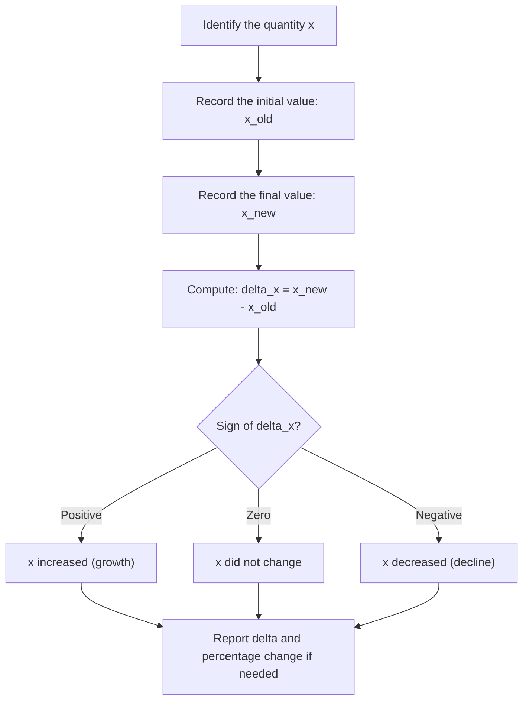

# Change Delta

$$
\Delta
$$

## Deep Breakdown

What it tells me *(Situation Awareness)*:
$\Delta$ (uppercase Greek letter delta) means **change** or **difference**. It is the standard symbol for "how much did this quantity move?" In DA/DS you encounter it constantly: week-over-week revenue change, gradient descent (weights are updated by $\Delta w$), time series differencing, feature engineering (lagged differences), and financial deltas. Any time a stakeholder asks "compared to last period," the answer is a $\Delta$.

## Flowchart



## Real-world use

### Where it is used

Measuring KPI movement (revenue, active users, churn rate) between periods, gradient-based optimization in ML, time series first-differencing to remove trends, and any situation where the change in a variable is more informative than its absolute value.

### Problem it solves

Reporting "revenue is $500k$" is less useful than "revenue grew by $\Delta = +\$80k$ (+19%) compared to last month." The stakeholder needs the change, not just the current state. Additionally, in ML, the optimizer does not jump directly to the minimum: it moves in small steps of $\Delta w$ determined by the gradient.

### How it solves the problem

$\Delta x = x_{\text{new}} - x_{\text{old}}$ provides a signed, interpretable measure of movement. Positive means growth, negative means decline, zero means no change. The sign carries information that absolute values would destroy.

### Example in a business

A weekly sales dashboard shows $\Delta \text{Revenue} = \text{Revenue}_{\text{this week}} - \text{Revenue}_{\text{last week}}$. If this week's revenue is $\$480k$ and last week's was $\$500k$, then $\Delta \text{Revenue} = -\$20k$. The negative sign immediately signals a decline. The dashboard color codes it red.

## The formula, piece by piece

Breaking the notation:

- $\Delta$: uppercase Greek letter delta. In Greek, delta ($\delta$/$\Delta$) represents the letter "D." In mathematics, it conventionally means "difference" or "change."
- $x$: any variable (revenue, weight, position, temperature, probability).
- Core formula: $\Delta x = x_{\text{new}} - x_{\text{old}}$, equivalently $\Delta x = x_2 - x_1$.

Related uses of $\Delta$:
- Gradient descent weight update: $\Delta w = -\eta \cdot \nabla_w L$ (where $\eta$ is the learning rate and $\nabla_w L$ is the gradient of the loss)
- Finite difference approximation of a derivative: $\frac{\Delta y}{\Delta x} = \frac{y_2 - y_1}{x_2 - x_1}$ (slope of a secant line, precursor to the derivative)
- Time series differencing: $\Delta y_t = y_t - y_{t-1}$ (first difference, used to achieve stationarity) Lowercase $\delta$ is used for infinitesimally small changes (calculus), while uppercase $\Delta$ is used for finite, measurable changes.

## The formula in words

"Delta-x equals the new value of $x$ minus the old value of $x$. It is the signed change: how much $x$ moved, and in which direction. Positive means it went up. Negative means it went down." Percentage change (the relative version): $\frac{\Delta x}{x_{\text{old}}} \times 100\%$. This normalizes the delta by the starting value so you can compare changes across different scales.

## Critical Concepts

1. **Order matters**: $\Delta x = x_{\text{new}} - x_{\text{old}}$, not the reverse. Getting this backward flips the sign and the interpretation.
2. **Signed quantity**: $\Delta$ can be positive, negative, or zero. Never take the absolute value of a delta unless you explicitly want magnitude without direction.
3. **Finite vs. infinitesimal**: $\Delta x$ is a measurable finite change. When it shrinks to an infinitesimally small amount, it becomes $dx$ in calculus notation. The derivative $dy/dx$ is the limit of $\Delta y / \Delta x$ as $\Delta x \to 0$.
4. **Percentage change**: $\Delta\% = (\Delta x / x_{\text{old}}) \times 100\%$. Always divide by the old value, not the new one.
5. **In ML (gradient descent)**: $\Delta w$ is the update step.

The learning rate $\eta$ controls how large each $\Delta w$ is. Too large: overshoot. Too small: slow convergence.

## Step-by-step calculation (tiny example)

Input: last month revenue = $500$, this month revenue = $580$.

*Step 1: Identify old and new values*
$x_{\text{old}} = 500$, $x_{\text{new}} = 580$.

*Step 2: Compute the absolute change*
$\Delta x = x_{\text{new}} - x_{\text{old}} = 580 - 500 = +80$.
The positive sign confirms this is growth.

*Step 3: Compute the percentage change*
$\Delta\% = \frac{\Delta x}{x_{\text{old}}} \times 100\% = \frac{80}{500} \times 100\% = 16\%$. Report: "Revenue increased by $\Delta = +80$ units, a $+16\%$ growth month over month."

## Code examples

### Beginner example (Python)

```python
# Simple delta calculation
revenue_last_month = 500
revenue_this_month = 580
delta = revenue_this_month - revenue_last_month
pct_change = (delta / revenue_last_month) * 100
print(f"Delta revenue: {delta:+}")   # +80 (the + format shows sign explicitly)
print(f"Percentage change: {pct_change:+.1f}%")   # +16.0%
```

### Beginner example (R)

```r
revenue_last_month <- 500
revenue_this_month <- 580
delta <- revenue_this_month - revenue_last_month
pct_change <- (delta / revenue_last_month) * 100
cat("Delta revenue: ", delta, "\n")  # 80
cat("Percentage change: ", pct_change, "%\n")  # 16 %
```

### Professional example (Python)

```python
import pandas as pd
import numpy as np   # Time series: compute week-over-week deltas and percentage changes for a KPI dashboard
data = { "week": ["2024-W01", "2024-W02", "2024-W03", "2024-W04", "2024-W05"], "revenue": [480_000, 500_000, 475_000, 530_000, 558_000],
}
df = pd.DataFrame(data)   # First difference (delta)
df["delta_revenue"] = df["revenue"].diff()   # NaN for first row (no prior period) # Percentage change
df["pct_change"] = df["revenue"].pct_change() * 100   # Direction indicator
df["direction"] = np.where( df["delta_revenue"] > 0, "up", np.where(df["delta_revenue"] < 0, "down", "flat") )
print(df.to_string(index=False))   # Output (approx):
# week revenue delta_revenue pct_change direction
# 2024-W01 480000 NaN NaN flat
# 2024-W02 500000 20000.0 4.166667 up
# 2024-W03 475000 -25000.0 -5.000000 down
# 2024-W04 530000 55000.0 15.789474 up
# 2024-W05 558000 28000.0 5.283019 up
```

### Professional example (R)

```r
# Time series: week-over-week deltas and percentage changes for a KPI dashboard
df <- data.frame( week = c("2024-W01", "2024-W02", "2024-W03", "2024-W04", "2024-W05"), revenue = c(480000, 500000, 475000, 530000, 558000), stringsAsFactors = FALSE
)  # First difference (delta)
df$delta_revenue <- c(NA, diff(df$revenue))  # Percentage change
df$pct_change <- c(NA, round(100 * diff(df$revenue) / df$revenue[-nrow(df)], 6))  # Direction indicator
df$direction <- ifelse(df$delta_revenue > 0, "up", ifelse(df$delta_revenue < 0, "down", "flat"))
print(df)
```

---

*Source: 1300 p. 21*
