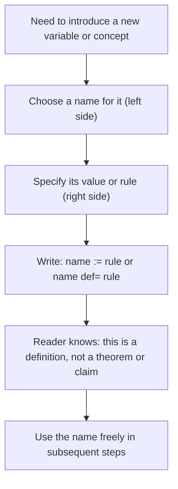

# Equal by definition

$$
\triangleq
$$

or $:=$

## Deep Breakdown

What it tells me *(Situation Awareness)*:
$\triangleq$ and $:=$ both mean **"is defined to be equal to"** or **"is assigned the value of by definition."** They are stronger than $=$: they do not just say two things happen to be equal, they say the left side is being created and named right now by the right side. In DA/DS you see $:=$ constantly in pseudocode, algorithm papers, and technical documentation where a new variable or concept is being formally introduced. It prevents the reader from thinking "is this a claim to verify?" because it answers: "no, this is a definition."

## Flowchart



## Real-world use

### Where it is used

Introducing new variables in algorithm descriptions, defining custom metrics or loss functions in model documentation, writing formal proofs or derivations where each symbol must be explicitly declared, and in pseudocode for data pipelines.

### Problem it solves

The plain $=$ sign is ambiguous in context: it could mean "equals (as a fact to verify)," "is assigned to (as in code)," or "is defined as." When a textbook or paper writes $f(x) \triangleq x^2 + 1$, it removes all ambiguity: this is a definition, not a proposition.

### How it solves the problem

$\triangleq$ and $:=$ carry the explicit message: "I am creating this name and binding it to this expression right now." Everything that follows in the argument can rely on this binding unconditionally.

### Example in a business

In a model documentation file: "Let $\hat{y}_i \triangleq \sigma(\mathbf{w}^\top \mathbf{x}_i + b)$ be the predicted probability for observation $i$, where $\sigma$ is the sigmoid function." This tells any reader: $\hat{y}_i$ is being defined here, not derived. They do not need to verify it.

## The formula, piece by piece

Breaking the notation:

- $\triangleq$: a triangle on top of an equals sign. The triangle suggests "defined" (triangle = delta = change/definition in some traditions). Pronounced "is defined as" or "is defined to equal."
- $:=$: colon followed by equals sign. Used heavily in computer science and algorithm papers. The colon signals assignment/definition. Pronounced the same way.
- $\equiv$: triple equals bar.

Used for identities (true for all values of the variable) and for modular congruence. Sometimes used synonymously with $\triangleq$ in informal math writing. Comparison of related equality symbols:

| Symbol | Meaning | Example |
|---|---|---|
| $=$ | Is equal to (claim) | $2 + 2 = 4$ |
| $\triangleq$ or $:=$ | Is defined to be | $\text{MAE} \triangleq \frac{1}{n}\sum |

y_i - \hat{y}_i|$ |
| $\equiv$ | Identically equal (for all values) | $\sin^2\theta + \cos^2\theta \equiv 1$ |
| $\approx$ | Approximately equal | $\pi \approx 3.14159$ |

## The formula in words

"$A \triangleq B$ means: the symbol $A$ is being given a name for the first time, and its value or meaning is exactly $B$ by this definition. No proof is needed. This is a choice the author is making." $:=$ is the programming-influenced version of the same idea. In many languages (Pascal, Ada, some pseudocode styles), $:=$ is literally the assignment operator. In mathematics it carries the same flavor: a binding is happening.

## Critical Concepts

1. **Definitional vs. propositional equality**: $a = b$ can require proof; $a \triangleq b$ does not, it is stipulation.
2. **Directionality**: $:=$ implies direction (right side defines the left side). $\triangleq$ is sometimes used bidirectionally (both sides are identified by definition), but in practice it is usually left $\triangleq$ right.
3. **Scope**: a definition introduced with $\triangleq$ or $:=$ is valid within the context (paper, proof, function, module) where it is stated. Outside that context, the symbol has no guaranteed meaning.
4. **In code**: Python uses `=` for assignment, which behaves like $:=$ mathematically. Some languages (like Walrus operator in Python 3.8+) use `:=` literally.
5. **Do not confuse with `==`**: in programming, `==` tests equality (like mathematical $=$), while `=` assigns (like mathematical $:=$).

This is a constant source of bugs for beginners.

## Step-by-step calculation (tiny example)

Task: formally define the residual $e_i$ in a regression model.

*Step 1: Identify what needs a name*
The difference between the actual value and the predicted value for observation $i$. We want to name this quantity cleanly.

*Step 2: Write the definition*
$e_i \triangleq y_i - \hat{y}_i$ where $y_i$ is the actual value and $\hat{y}_i$ is the predicted value.

*Step 3: Use the definition*
In subsequent derivations: "The sum of squared residuals is $\text{SSR} \triangleq \sum_{i=1}^{n} e_i^2 = \sum_{i=1}^{n} (y_i - \hat{y}_i)^2$." Because $e_i$ was defined in Step 2, substituting it is valid.

## Code examples

### Beginner example (Python)

```python
# In Python, = is assignment (equivalent to := in math notation)
# Define MAE as a function (this is a definition, not a claim)

def mean_absolute_error(y_true, y_pred):
    """MAE := (1/n) * sum(|y_i - y_hat_i|)"""
    n = len(y_true)
    return sum(abs(yt - yp) for yt, yp in zip(y_true, y_pred)) / n
y_true = [120, 90, 75]
y_pred = [100, 95, 80]
mae = mean_absolute_error(y_true, y_pred)
print(f"MAE := {mae:.2f}")   # MAE := 10.00
```

### Beginner example (R)

```r
# In R, <- is the canonical assignment operator (equivalent to := in math) # Define MAE as a function
mean_absolute_error <- function(y_true, y_pred) {  # MAE := (1/n) * sum(|y_i - y_hat_i|)
  n <- length(y_true) sum(abs(y_true - y_pred)) / n
}
y_true <- c(120, 90, 75)
y_pred <- c(100, 95, 80)
mae <- mean_absolute_error(y_true, y_pred)
cat("MAE :=", mae, "\n")  # MAE := 10
```

### Professional example (Python)

```python
# Scenario: documenting a custom composite metric definition in a model evaluation module
import numpy as np

def weighted_mae(y_true: np.ndarray, y_pred: np.ndarray, weights: np.ndarray) -> float:
    """ Weighted Mean Absolute Error. Definition: WMAE := (1 / sum(weights)) * sum(weights_i * |y_i - y_hat_i|) This is a definitional function: WMAE is created here. Not derived from first principles in this scope. Parameters ---------- y_true : array of actual values y_pred : array of predicted values weights : array of non-negative observation weights Returns ------- float: the weighted MAE value """
    absolute_errors = np.abs(y_true - y_pred)
    return np.dot(weights, absolute_errors) / np.sum(weights)   # Higher weights on recent observations (recency weighting)
y_true = np.array([120.0, 90.0, 75.0, 200.0, 55.0])
y_pred = np.array([100.0, 95.0, 80.0, 185.0, 60.0])
weights = np.array([1.0, 1.5, 2.0, 2.5, 3.0])   # more recent = higher weight
wmae = weighted_mae(y_true, y_pred, weights)
print(f"WMAE := {wmae:.4f}")
```

### Professional example (R)

```r
# Scenario: documenting a custom composite metric definition (WMAE := ...) # Weighted Mean Absolute Error:
# WMAE := (1 / sum(weights)) * sum(weights_i * |y_i - y_hat_i|)
weighted_mae <- function(y_true, y_pred, weights) { absolute_errors <- abs(y_true - y_pred) sum(weights * absolute_errors) / sum(weights)
}  # Higher weights on recent observations (recency weighting)
y_true <- c(120, 90, 75, 200, 55)
y_pred <- c(100, 95, 80, 185, 60)
weights <- c(1, 1.5, 2, 2.5, 3)
wmae <- weighted_mae(y_true, y_pred, weights)
cat(sprintf("WMAE := %.4f\n", wmae))
```

---

*Source: MML1 p. 6*
