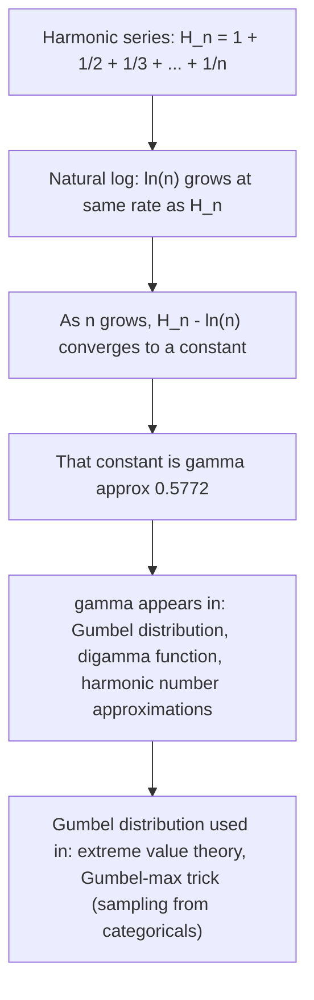

# Euler-Mascheroni constant

$$
\gamma \approx 0.5772156649\dots
$$

## Deep Breakdown

What it tells me *(Situation Awareness)*:
$\gamma \approx 0.5772$ is the **Euler-Mascheroni constant**, a fundamental constant in analysis and number theory. It appears when the harmonic series (sum of $1/n$) is compared to the natural logarithm. In DA/DS you will encounter $\gamma$ mostly in theoretical contexts: the Gumbel distribution (used in extreme value theory and the Gumbel-max trick in ML), the digamma function (used in Bayesian methods), and approximations involving harmonic numbers. It is less "everyday" than $e$ or $\pi$, but it shows up when you push into more advanced statistical theory.

## Flowchart



## Real-world use

### Where it is used

Advanced statistical modeling involving extreme values (maximum or minimum over many trials), Bayesian inference with Dirichlet/Gamma priors (via the digamma function), approximating harmonic sums in algorithm complexity analysis, and the Gumbel-max trick in differentiable ML sampling.

### Problem it solves

The harmonic series $H_n = 1 + 1/2 + 1/3 + \cdots + 1/n$ grows without bound, but it grows very slowly. How slowly? It trails the natural logarithm by a nearly-constant gap. That gap converges to $\gamma$. This makes $\gamma$ the "correction term" whenever you approximate a harmonic sum with $\ln(n)$: $H_n \approx \ln(n) + \gamma$.

### How it solves the problem

Instead of summing all $n$ terms of the harmonic series, you compute $\ln(n) + \gamma$ for a very good approximation. The error decreases as $n$ grows. This approximation appears in algorithm analysis (e.g., the expected number of coupon types you need to collect all $n$ distinct coupons involves $H_n \approx \ln(n) + \gamma$).

### Example in a business

**Gumbel-max trick**: sampling from a categorical distribution in ML. If you add independent Gumbel-distributed noise to log-probabilities and take the argmax, you get a sample from the categorical distribution. The Gumbel distribution's mean is $\gamma$ and its CDF involves $e^{-e^{-x}}$. This technique is used in neural network architectures (Gumbel-Softmax) for differentiable discrete sampling.

## The formula, piece by piece

Breaking the definition:

- $\gamma$: lowercase Greek letter gamma (not to be confused with the Gamma function $\Gamma(n) = (n-1)!$).
- $H_n$: the $n$-th harmonic number, $H_n = \sum_{k=1}^{n} \frac{1}{k}$.
- $\ln(n)$: natural logarithm of $n$.

Full definition:

$$
\gamma = \lim_{n \to \infty} \left( H_n - \ln(n) \right) = \lim_{n \to \infty} \left( \sum_{k=1}^{n} \frac{1}{k} - \ln(n) \right) \approx 0.5772156649\dots
$$

Connection to the Gumbel distribution:

$$
\text{If } X \sim \text{Gumbel}(\mu=0, \beta=1), \text{ then } \mathbb{E}[X] = \gamma
$$

The digamma function: $\psi(1) = -\gamma$, where $\psi = \frac{d}{dn} \ln \Gamma(n)$. This appears in Bayesian inference with Dirichlet distributions.

## The formula in words

"$\gamma$ is the limit of the difference between the harmonic sum (adding $1/1 + 1/2 + 1/3 + \ldots$) and the natural log of the number of terms. As you add more and more terms, the harmonic sum always stays about $0.5772$ above $\ln(n)$. That gap stabilizes at $\gamma$." Think of it like this: the harmonic series and $\ln(n)$ are racing at the same speed, but the harmonic series has a head start of exactly $\gamma \approx 0.5772$.

## Critical Concepts

1. **Not proven rational or irrational**: despite centuries of study, it is still unknown whether $\gamma$ is rational or irrational. One of the most embarrassing open questions in mathematics.
2. **Harmonic number approximation**: $H_n \approx \ln(n) + \gamma + \frac{1}{2n}$. Used in algorithm complexity (coupon collector problem, birthday problem analysis).
3. **Gumbel distribution**: mean is $\gamma$, variance is $\pi^2/6$. Appears in extreme value statistics and Gumbel-Softmax.
4. **Digamma function**: $\psi(1) = -\gamma$. The digamma function is the log-derivative of the Gamma function and appears in Bayesian inference.
5. **Distinguished from Gamma function**: $\Gamma(n)$ (capital) is the generalized factorial. $\gamma$ (lowercase) is this constant.

They are different objects with superficially similar symbols.

## Step-by-step calculation (tiny example)

Task: estimate $\gamma$ numerically by computing $H_n - \ln(n)$ for increasing $n$.

*Step 1: Compute H_5 and ln(5)*
$H_5 = 1 + 0.5 + 0.333 + 0.25 + 0.2 = 2.283$
$\ln(5) \approx 1.609$
$H_5 - \ln(5) \approx 0.674$. Still above the limit; $n$ is too small.

*Step 2: Compute H_100 and ln(100)*
$H_{100} \approx 5.187$ (harmonic number grows slowly)
$\ln(100) \approx 4.605$
$H_{100} - \ln(100) \approx 0.582$. Getting closer to $0.5772$.

*Step 3: Observe convergence*
As $n \to \infty$, the difference $H_n - \ln(n) \to \gamma \approx 0.5772$. Convergence is slow (like $1/(2n)$ correction term), but the limit is real.

## Code examples

### Beginner example (Python)

```python
import math
import numpy as np   # Approximate gamma by computing H_n -
ln(n)
for increasing n

def harmonic_number(n: int) -> float:
    """Compute H_n = sum of 1/k for k=1 to n."""
    return sum(1.0 / k for k in range(1, n + 1))
for n in [10, 100, 1_000, 10_000, 100_000]:
    h_n = harmonic_number(n)
approximation = h_n - math.log(n)
print(f"n = {n:>7}: H_n - ln(n) = {approximation:.6f}")   # True value of gamma
print(f"\nTrue gamma (from scipy): ", end="")
from scipy.special import digamma
print(f"{-digamma(1):.6f}")   # digamma(1) = -gamma
```

### Beginner example (R)

```r
# Approximate gamma numerically in R
harmonic_number <- function(n) sum(1 / seq_len(n))
for (n in c(10, 100, 1000, 10000)) { h_n <- harmonic_number(n)
  approx_gamma <- h_n - log(n)  # log() in R is natural log by default
  cat(sprintf("n = %6d: H_n - ln(n) = %.6f\n", n, approx_gamma))
}  # R provides Euler-Mascheroni via the digamma function
# digamma(1) = -gamma
cat("True gamma (from digamma):", -digamma(1), "\n")
```

### Professional example (Python)

```python
import numpy as np
from scipy.stats import gumbel_r   # Scenario: understanding the Gumbel distribution in extreme value analysis
# gamma is the mean of the standard Gumbel distribution (mu=0, beta=1) EULER_MASCHERONI = 0.5772156649015329
# Theoretical mean of Gumbel(0, 1) = gamma
theoretical_mean = EULER_MASCHERONI   # Empirical verification via sampling
np.random.seed(42)
samples = gumbel_r.rvs(loc=0, scale=1, size=100_000)
empirical_mean = np.mean(samples)
print(f"Theoretical mean of Gumbel(0,1): {theoretical_mean:.6f} (= gamma)")
print(f"Empirical mean (100k samples): {empirical_mean:.6f}")
print(f"Difference: {abs(theoretical_mean - empirical_mean):.6f}")   # The Gumbel-max trick: sample from a categorical distribution
# by adding Gumbel noise to log-probabilities
log_probs = np.log(np.array([0.1, 0.3, 0.4, 0.2]))   # log probabilities of 4 classes
gumbel_noise = gumbel_r.rvs(loc=0, scale=1, size=(10_000, 4))
samples_argmax = np.argmax(log_probs + gumbel_noise, axis=1)
class_counts = np.bincount(samples_argmax, minlength=4) / 10_000
print(f"\nExpected proportions: {np.exp(log_probs)}")
print(f"Sampled proportions: {class_counts}")
# Should be close to [0.1, 0.3, 0.4, 0.2]
```

### Professional example (R)

```r
# Scenario: Gumbel distribution in extreme value analysis
# gamma is the mean of the standard Gumbel(0, 1)
EULER_MASCHERONI <- 0.5772156649015329
theoretical_mean <- EULER_MASCHERONI  # Empirical verification via sampling (use evd or extraDistr for Gumbel)
set.seed(42)
# Inverse CDF:
G = -log(-log(U)), U ~ Uniform(0,1)
u <- runif(100000)
samples <- -log(-log(u))
empirical_mean <- mean(samples)
cat(sprintf("Theoretical mean of Gumbel(0,1): %.6f (= gamma)\n", theoretical_mean))
cat(sprintf("Empirical mean (100k samples): %.6f\n", empirical_mean))
cat(sprintf("Difference: %.6f\n", abs(theoretical_mean - empirical_mean)))  # Gumbel-max trick: sample categorical via log-probs + Gumbel noise
log_probs <- log(c(0.1, 0.3, 0.4, 0.2))
gumbel_noise <- matrix(-log(-log(runif(10000 * 4))), 10000, 4)
samples_argmax <- max.col(log_probs + gumbel_noise, ties.method = "first")
class_counts <- table(factor(samples_argmax, levels = 1:4)) / 10000
cat("Expected proportions:", exp(log_probs), "\n")
cat("Sampled proportions: ", as.numeric(class_counts), "\n")
```

---

*Source: domain knowledge*
