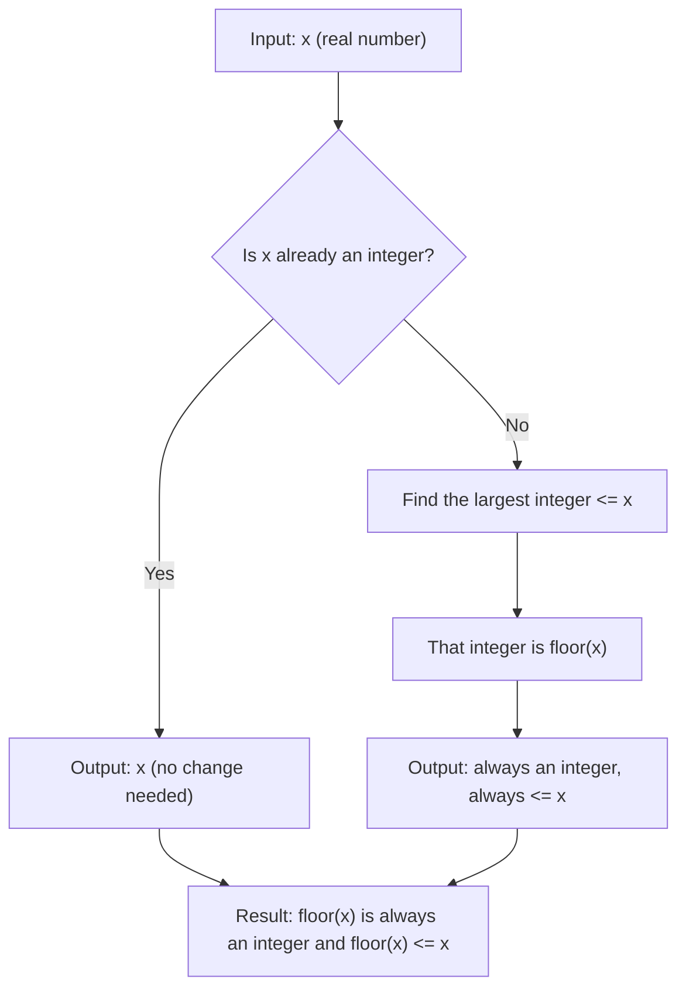

# Floor brackets

$$
\lfloor x \rfloor
$$

## Deep Breakdown

What it tells me *(Situation Awareness)*:
The floor function $\lfloor x \rfloor$ **rounds a number down to the nearest integer**, always toward negative infinity. It is the complement of the ceiling function. You use it when you need the "maximum whole number that fits within a quantity." Classic uses in DA/DS: computing which bin a value falls into (histogram binning), integer division, converting a continuous time value to a discrete time step index, and computing row/column indices in matrix operations.

## Flowchart



## Real-world use

### Where it is used

Histogram bin assignment (which bin does a value fall into?), converting a fractional age/time to complete units (a 3.7-year-old customer is in the "3 years" age bracket, not "4"), integer division, array index computation, and epoch/step counting in training loops.

### Problem it solves

You have a continuous age variable (e.g., $3.7$ years). You want to map it to a discrete age bracket (e.g., "3 years old"). You cannot round: $\text{round}(3.7) = 4$, which would misplace the customer in the "4 years" bracket. You need the integer part only. Floor gives $\lfloor 3.7 \rfloor = 3$.

### How it solves the problem

$\lfloor x \rfloor$ always moves toward $-\infty$ (lower on the number line). It never overshoots the value. You always get the largest integer that does not exceed $x$.

### Example in a business

Computing histogram bin indices: if your bins are of width $w = 5$ and you have a value $x = 17.3$, the bin index is $\lfloor 17.3 / 5 \rfloor = \lfloor 3.46 \rfloor = 3$. This is exactly how `pd.cut()` and `np.histogram()` compute bin assignments internally.

## The formula, piece by piece

Breaking the notation:

- $\lfloor$ and $\rfloor$: floor brackets. They look like square brackets with only the bottom bar, pointing downward. Visual hint: "round down."
- $x$: any real number.
- Full definition: $\lfloor x \rfloor = \max\{n \in \mathbb{Z} \mid n \leq x\}$ Read: "the floor of $x$ is the largest integer $n$ that is less than or equal to $x$." Contrast with ceiling: $\lceil x \rceil = \min\{n \in \mathbb{Z} \mid n \geq x\}$ (round up).

Always true: $\lfloor x \rfloor \leq x < \lfloor x \rfloor + 1$. Integer division in most programming languages: `a // b` (Python) and `%/%` (R) compute $\lfloor a/b \rfloor$ for positive values.

## The formula in words

"Walk along the number line starting at $x$, heading left (toward $-\infty$). The first integer you hit is the floor of $x$." Examples at a glance:
- $\lfloor 3.7 \rfloor = 3$
- $\lfloor 7.0 \rfloor = 7$ (already an integer)
- $\lfloor -2.3 \rfloor = -3$ (heading left from $-2.3$, the first integer is $-3$, not $-2$)
- $\lfloor -7.0 \rfloor = -7$ Critical difference from ceiling: for negatives, floor is more negative (further from zero).

## Critical Concepts

1. **Direction is always toward $-\infty$**: floor never rounds toward zero or toward $+\infty$.
2. **Negative numbers behave counterintuitively**: $\lfloor -2.3 \rfloor = -3$, not $-2$. "Down" for a negative number means more negative (further from zero).
3. **Integer division**: in Python, `a // b` is floor division for positive numbers. Watch out for negative operands: `(-7) // 2 = -4` (floor), not $-3$ (truncation toward zero).
4. **Truncation vs. floor**: truncation toward zero (used in C, JavaScript) differs from floor for negative numbers. `trunc(-2.3) = -2` but `floor(-2.3) = -3`.
5. **Binning formula**: for a continuous value $x$, bin width $w$, and starting point $a$: bin index = $\lfloor (x - a) / w \rfloor$.

## Step-by-step calculation (tiny example)

Input: $x = -2.3$, compute $\lfloor -2.3 \rfloor$.

*Step 1: Identify direction*
Floor rounds toward $-\infty$ (more negative). Starting at $-2.3$, walk left on the number line.

*Step 2: Find the first integer to the left*
Moving left from $-2.3$: ..., $-4$, $-3$, $-2.3$, $-2$, $-1$, $0$, ...
The first integer to the left (i.e., $\leq -2.3$) is $-3$.

*Step 3: Verify*
$\lfloor -2.3 \rfloor = -3$. Check: is $-3 \leq -2.3$? Yes. Is $-3$ the largest integer with this property? Yes, because $-2 > -2.3$. Contrast: $\lceil -2.3 \rceil = -2$ (ceiling: first integer to the right of $-2.3$).

## Code examples

### Beginner example (Python)

```python
import math

# math.floor() is Python's floor function
print(math.floor(3.7))   # 3
print(math.floor(7.0))   # 7 (already integer)
print(math.floor(-2.3))  # -3 (negative: rounds away from zero)
print(math.floor(-7.0))  # -7

# Integer division uses floor semantics for positive numbers
print(17 // 5)   # 3 (= floor(17/5) = floor(3.4) = 3)

# Warning: negative floor division
print(-7 // 2)   # -4 (floor(-3.5) = -4, NOT -3)
print(math.trunc(-7 / 2))   # -3 (truncation toward zero = different!)
```

### Beginner example (R)

```r
# floor() is base R
print(floor(3.7))  # 3
print(floor(7.0))  # 7
print(floor(-2.3))  # -3
print(floor(-7.0))  # -7

# Integer division in R uses %/% operator
print(17 %/% 5)  # 3
print(-7 %/% 2)  # -4 (floor semantics)

# Comparison with ceiling and round
x <- 3.7
cat("floor:", floor(x), "\n")  # 3
cat("ceiling:", ceiling(x), "\n")  # 4
cat("round:", round(x), "\n")  # 4 (rounds to nearest)
```

### Professional example (Python)

```python
import numpy as np
import pandas as pd

# Scenario: bin continuous revenue values into $1000-wide brackets for a histogram analysis
np.random.seed(42)
revenue = np.random.normal(loc=5000, scale=1500, size=500)
revenue = np.clip(revenue, 0, 10_000)   # clip to valid range
BIN_WIDTH = 1000
BIN_START = 0

# Compute bin index using floor: bin_index = floor((x - start) / width)
bin_indices = np.floor((revenue - BIN_START) / BIN_WIDTH).astype(int)
bin_labels = [f"${int(i * BIN_WIDTH)}-${int((i + 1) * BIN_WIDTH)}" for i in range(11)]
df = pd.DataFrame({
    "revenue": np.round(revenue, 2),
    "bin_index": bin_indices,
})
df["bin_label"] = df["bin_index"].map(lambda i: bin_labels[min(i, 10)])
print("Revenue bin distribution:")
print(df["bin_label"].value_counts().sort_index())

# This is exactly what pd.cut() does internally with floor arithmetic
df["pandas_bin"] = pd.cut(revenue, bins=range(0, 12_000, 1_000), right=False)
print("\nVerify with pd.cut():")
print(df["pandas_bin"].value_counts().sort_index().head())
```

### Professional example (R)

```r
# Scenario: bin continuous revenue into $1000-wide brackets using floor
set.seed(42)
revenue <- pmax(0, pmin(10000, rnorm(500, mean = 5000, sd = 1500)))
BIN_WIDTH <- 1000
BIN_START <- 0
bin_indices <- floor((revenue - BIN_START) / BIN_WIDTH)
bin_labels <- paste0("$", (0:10) * BIN_WIDTH, "-$", (1:11) * BIN_WIDTH)
df <- data.frame(
  revenue = round(revenue, 2),
  bin_index = bin_indices
)
df$bin_label <- bin_labels[pmin(df$bin_index + 1, 11)]
cat("Revenue bin distribution:\n")
print(table(df$bin_label))

# Verify with cut() (right=FALSE for [a,b) style)
df$cut_bin <- cut(revenue, breaks = seq(0, 12000, 1000), right = FALSE)
cat("\nVerify with cut():\n")
print(head(table(df$cut_bin)))
```

---

*Source: AIO p. 30 of 286*
