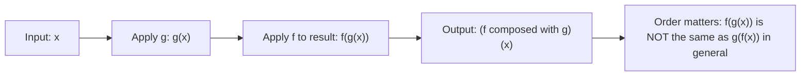

# Function composition

$$
(f \circ g)(x) = f(g(x))
$$

## Deep Breakdown

What it tells me *(Situation Awareness)*:
$(f \circ g)(x) = f(g(x))$ is **function composition**: applying one function to the output of another. The $\circ$ symbol means "pipe the output of the right function into the input of the left function." In DA/DS this is everywhere: ML pipelines (scale then transform then predict), chain-of-operations in feature engineering, the chain rule in calculus (which underpins backpropagation), and functional programming patterns in Python and R. Every time you chain operations, you are composing functions.

## Flowchart



## Real-world use

### Where it is used

ML model pipelines (StandardScaler then LogisticRegression), data preprocessing chains (fill nulls, then encode, then scale), the chain rule in gradient computation (backpropagation), and any workflow where the output of one step is the input of the next.

### Problem it solves

Real-world transformations rarely happen in a single step. Raw data goes through: missing value imputation, categorical encoding, feature scaling, dimensionality reduction, and finally a model prediction. Each step is a function. Composition formalizes "apply step 1, feed result to step 2, feed result to step 3."

### How it solves the problem

Instead of tracking intermediate variables explicitly, composition lets you define a single combined function that encodes the full chain. The notation $f \circ g$ says: $g$ first, then $f$. This matches how pipelines work: apply the inner (rightmost) function first.

### Example in a business

A prediction pipeline: let $g(x)$ = StandardScaler (normalize features), $f(z)$ = LogisticRegression predict (output a probability). Then $(f \circ g)(x) = f(g(x))$ = apply scaler then predict. Scikit-learn's `Pipeline` object literally implements function composition.

## The formula, piece by piece

Breaking the notation:

- $f$: the outer (second-applied) function.
- $\circ$: the composition operator (a small circle). Pronounced "composed with" or "of." $f \circ g$ means "f composed with g" or "f of g."
- $g$: the inner (first-applied) function.
- $x$: the input to the entire composed function. Full formula: $(f \circ g)(x) = f(g(x))$ Read step by step:
1. Compute $g(x)$: apply $g$ to the raw input.
2. Take that result as input to $f$.
3.

Compute $f(g(x))$: apply $f$ to the output of $g$. Domain constraint: $g$'s output must be in $f$'s domain. If $g: \mathbb{R} \to \mathbb{R}^+$ and $f: \mathbb{R}^+ \to \mathbb{R}$ (e.g., $f = \ln$), then $f \circ g$ is valid wherever $g(x) > 0$.

## The formula in words

"$(f \circ g)(x)$ means: first apply $g$ to $x$ to get an intermediate result, then apply $f$ to that intermediate result. The final output is $f$ of ($g$ of $x$)." **Important**: the reading order is right-to-left.

The rightmost function acts first:
$(f \circ g \circ h)(x) = f(g(h(x)))$: apply $h$ first, then $g$, then $f$. This trips people up. Remember: compose reads right-to-left, just like the nesting in $f(g(h(x)))$.

## Critical Concepts

1. **Order is not commutative**: $f \circ g \neq g \circ f$ in general. $\text{scale}(\text{log}(x)) \neq \text{log}(\text{scale}(x))$. This is a major source of pipeline bugs.
2. **Right-to-left execution**: the rightmost function in a composition chain executes first.
3. **Chain rule is composition**: $\frac{d}{dx}[f(g(x))] = f'(g(x)) \cdot g'(x)$. Backpropagation is composed chain rule applications.
4. **Domain compatibility**: the output type of $g$ must match the input type of $f$.
5. **Associativity**: $(f \circ g) \circ h = f \circ (g \circ h)$. Composition is associative even though it is not commutative.
6. **Identity function**: $\text{id}(x) = x$. $f \circ \text{id} = f$ and $\text{id} \circ f = f$.

The identity is the "neutral element" for composition.

## Step-by-step calculation (tiny example)

Let $g(x) = x^2$ and $f(z) = z + 3$. Compute $(f \circ g)(4)$.

*Step 1: Apply g to the input x = 4*
$g(4) = 4^2 = 16$

*Step 2: Apply f to the result of g*
$f(g(4)) = f(16) = 16 + 3 = 19$

*Step 3: Verify order matters*
Now compute $(g \circ f)(4)$: apply $f$ first, then $g$.
$f(4) = 4 + 3 = 7$, then $g(7) = 7^2 = 49$.
$(g \circ f)(4) = 49 \neq 19 = (f \circ g)(4)$. Confirmed: order matters.

## Code examples

### Beginner example (Python)

```python
# Function composition: f(g(x))

def g(x: float) -> float:
    """Inner function: square the input."""
    return x ** 2

def f(z: float) -> float:
    """Outer function: add 3."""
    return z + 3

# f composed with g: apply g first, then f
def compose_f_g(x: float) -> float:
    """(f o g)(x) = f(g(x))"""
    return f(g(x))

print(compose_f_g(4))   # f(g(4)) = f(16) = 19

# Using functools.reduce for general composition
from functools import reduce

def compose(*functions):
    """Compose multiple functions: rightmost is applied first."""
    return reduce(lambda f_outer, g_inner: lambda x: f_outer(g_inner(x)), functions)

pipeline = compose(f, g)   # f(g(x))
print(pipeline(4))   # 19

# Reverse: g composed with f
reverse_pipeline = compose(g, f)   # g(f(x))
print(reverse_pipeline(4))   # g(f(4)) = g(7) = 49
```

### Beginner example (R)

```r
# Function composition in R
g <- function(x) x^2  # inner function
f <- function(z) z + 3  # outer function

# Manual composition
f_of_g <- function(x) f(g(x))
print(f_of_g(4))  # 19

# Using magrittr pipe for composition (pipeline style, left-to-right)
library(magrittr)
result <- 4 %>% g() %>% f()  # apply g first, then f
print(result)  # 19

# Native R pipe (R 4.1+) - same semantics
result_native <- 4 |> g() |> f()
print(result_native)  # 19
```

### Professional example (Python)

```python
from sklearn.pipeline import Pipeline
from sklearn.preprocessing import StandardScaler, PowerTransformer
from sklearn.linear_model import LogisticRegression
from sklearn.datasets import make_classification
from sklearn.model_selection import train_test_split
import numpy as np

# Scikit-learn Pipeline IS function composition:
# pipeline(x) = model(power_transform(scale(x)))
np.random.seed(42)
X, y = make_classification(n_samples=500, n_features=10, random_state=42)
X_train, X_test, y_train, y_test = train_test_split(X, y, test_size=0.2, random_state=42)

# Define the composed pipeline: step 1 -> step 2 -> step 3 (left to right = outer to inner)
# Note: Pipeline applies steps left to right, which is g -> f order (left = first applied)
pipeline = Pipeline([
    ("scaler", StandardScaler()),           # g: standardize features
    ("transformer", PowerTransformer()),    # h: stabilize variance
    ("classifier", LogisticRegression()),   # f: classify
])

# fit() and predict() apply the composition chain internally
pipeline.fit(X_train, y_train)
accuracy = pipeline.score(X_test, y_test)
print(f"Pipeline accuracy: {accuracy:.4f}")
print(f"Composed chain: predict(power_transform(scale(x)))")
print(f"= (f ∘ h ∘ g)(x) applied to each row of X_test")
```

### Professional example (R)

```r
# Pipeline as function composition: pipeline(x) = predict(transform(scale(x)))

# Compose two functions: (f ∘ g)(x) = f(g(x))
compose2 <- function(f, g) function(x) f(g(x))

# Compose many: rightmost applied first
compose <- function(...) {
  fns <- list(...)
  Reduce(compose2, fns)
}

# Example: scale -> clip -> round (data prep pipeline)
scale_01 <- function(x) (x - min(x)) / (max(x) - min(x))
clip_01 <- function(x) pmin(pmax(x, 0), 1)
round_2 <- function(x) round(x, 2)
pipeline <- compose(round_2, clip_01, scale_01)
raw <- c(10, 20, 30, 40, 50)
cat("Raw: ", raw, "\n")
cat("Pipeline:", pipeline(raw), "\n")  # 0 0.25 0.5 0.75 1
cat("Composed chain: round(clip(scale(x))) = (f ∘ h ∘ g)(x)\n")
```

---

*Source: AIO p. 30 of 286*
