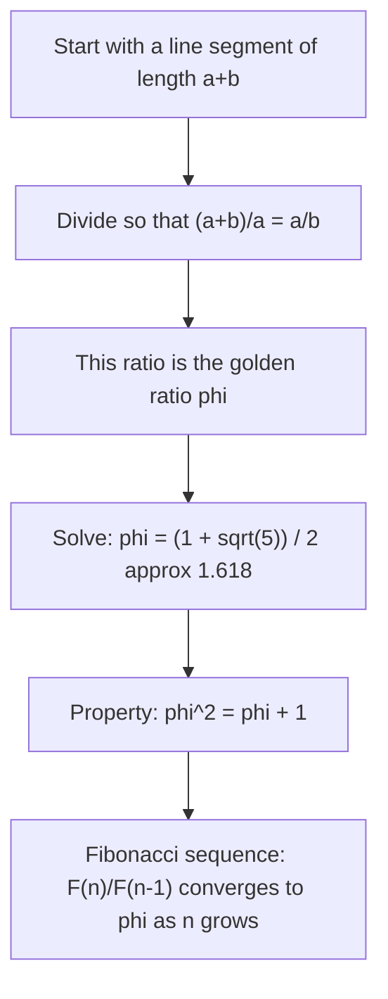

# Golden ratio

$$
\varphi = \frac{1 + \sqrt{5}}{2}
$$

## Deep Breakdown

What it tells me *(Situation Awareness)*:
$\varphi = (1 + \sqrt{5})/2 \approx 1.618$ is the **golden ratio**, also called the **divine proportion**. It appears in geometry, art, nature (spiral growth patterns), and algorithm design. In DA/DS its most direct applications are: the Fibonacci sequence (consecutive Fibonacci numbers converge to $\varphi$), as a step size in Fibonacci search (a derivative of binary search), and occasionally in visualization (the "golden rectangle" for aspect ratios). It is less operationally critical than $e$ or $\pi$ in daily data work, but you will encounter it in algorithm analysis and it is worth knowing its origin.

## Flowchart



## Real-world use

### Where it is used

Fibonacci search algorithm (unimodal function minimization), analysis of Fibonacci heaps (advanced data structure), aspect ratio selection in data visualization, and appearing naturally in combinatorial growth models.

### Problem it solves

In search and optimization, the golden ratio provides an optimal way to reduce a search interval. Fibonacci search minimizes the number of function evaluations when searching for the minimum of a unimodal function over an interval. It is the precursor to the golden section search method.

### How it solves the problem

Because $\varphi^2 = \varphi + 1$, two successive evaluations within an interval preserve a consistent ratio when one is discarded. This self-similarity makes Fibonacci / golden section search efficient.

### Example in a business

**Golden section search**: finding the optimal learning rate for a model within a range $[a, b]$ without a closed-form gradient. You evaluate the loss function at two interior points dividing the interval in golden ratio proportions, discard the worse half, and repeat. Converges faster than a uniform grid search.

## The formula, piece by piece

Breaking the notation:

- $\varphi$: lowercase Greek letter phi. (Sometimes $\phi$ or $\Phi$ is used instead.)
- $1$: unity.
- $\sqrt{5}$: the square root of 5.
- $2$: the denominator.

Derivation from the defining proportion: if $a/b = (a+b)/a = \varphi$, then $\varphi = 1 + 1/\varphi$, which gives $\varphi^2 = \varphi + 1$. Solving the quadratic $\varphi^2 - \varphi - 1 = 0$:

$$
\varphi = \frac{1 + \sqrt{5}}{2} \approx 1.6180339887\dots
$$

(The negative root is $\psi = (1 - \sqrt{5})/2 \approx -0.618$, used in the Fibonacci closed form.) Closed-form Fibonacci (Binet's formula): $F(n) = \frac{\varphi^n - \psi^n}{\sqrt{5}}$, where $\psi = (1-\sqrt{5})/2$.

## The formula in words

"The golden ratio is the unique positive number such that if you add 1 to it, you get its square. Put differently: $\varphi = 1 + 1/\varphi$. It is the ratio of a line segment such that the whole to the larger part equals the larger part to the smaller part." The self-similar property $\varphi^2 = \varphi + 1$ is why it appears everywhere: any time a structure is built from smaller copies of itself with the same proportions, $\varphi$ emerges.

## Critical Concepts

1. **Fibonacci connection**: $\lim_{n \to \infty} F(n+1)/F(n) = \varphi$. Consecutive Fibonacci numbers converge to the golden ratio.
2. **Irrational**: $\varphi$ is irrational and in fact the "most irrational" number (hardest to approximate by rationals), which is why it appears in phyllotaxis and plant growth where packing efficiency is maximized.
3. **Golden section search**: optimization method for unimodal functions using $\varphi$ to place evaluation points.
4. **Self-referential**: $\varphi = 1 + 1/\varphi$ means the continued fraction representation is $[1; 1, 1, 1, \ldots]$, the simplest possible infinite continued fraction.
5. **In coding**: not directly used as a constant like $e$ or $\pi$, but Fibonacci-based algorithms appear in heaps, search, and hashing.

## Step-by-step calculation (tiny example)

Task: compute $\varphi$ directly from the formula and verify $\varphi^2 = \varphi + 1$.

*Step 1: Compute the formula*
$\varphi = (1 + \sqrt{5})/2$.
$\sqrt{5} \approx 2.2360679...$
$1 + 2.2360679 = 3.2360679$
$3.2360679 / 2 = 1.6180339...$

*Step 2: Verify phi squared equals phi plus 1*
$\varphi^2 = 1.6180339^2 \approx 2.6180339$
$\varphi + 1 = 1.6180339 + 1 = 2.6180339$. Confirmed: $\varphi^2 = \varphi + 1$.

*Step 3: Verify the Fibonacci ratio convergence*
Fibonacci sequence: 1, 1, 2, 3, 5, 8, 13, 21, 34, 55, ...
Ratios: 1/1=1, 2/1=2, 3/2=1.5, 5/3=1.667, 8/5=1.6, 13/8=1.625, 21/13=1.615, ...
These converge toward $\varphi \approx 1.618$.

## Code examples

### Beginner example (Python)

```python
import math   # Compute the golden ratio
phi = (1 + math.sqrt(5)) / 2
print(f"phi = {phi:.10f}")   # 1.6180339887 # Verify phi^2 = phi + 1
print(f"phi^2 = {phi**2:.10f}")   # 2.6180339887
print(f"phi + 1 = {phi+1:.10f}")   # 2.6180339887 (same) # Fibonacci sequence and convergence

def fibonacci(n: int) -> list[int]:
    """Generate first n Fibonacci numbers."""
    seq = [1, 1]
    for _ in range(n - 2):
        seq.append(seq[-1] + seq[-2])
    return seq
fib = fibonacci(20)
print("\nFibonacci ratios converging to phi:")
for i in range(2, 15):
    ratio = fib[i] / fib[i - 1]
print(f" F({i+1})/F({i}) = {fib[i]}/{fib[i-1]} = {ratio:.6f}")
```

### Beginner example (R)

```r
# Compute the golden ratio
phi <- (1 + sqrt(5)) / 2
cat("phi =", phi, "\n")  # 1.618034 # Verify phi^2 = phi + 1
cat("phi^2 =", phi^2, "\n")  # 2.618034
cat("phi + 1 =", phi + 1, "\n")  # 2.618034 # Fibonacci sequence
fibonacci <- function(n) { seq <- c(1, 1)
  for (i in seq(3, n))
  seq <- c(seq, seq[i-1] + seq[i-2]) seq
}
fib <- fibonacci(20)
ratios <- fib[3:20] / fib[2:19]
cat("Fibonacci ratios:", round(ratios, 5), "\n")
cat("True phi: ", round(phi, 5), "\n")
```

### Professional example (Python)

```python
import math   # Golden section search: find the minimum of a unimodal function over [a, b]
# Uses phi to place interior evaluation points optimally

def golden_section_search(f, a: float, b: float, tolerance: float = 1e-5) -> float:
    """ Find the minimum of a unimodal function f on [a, b]. Uses the golden ratio to minimize the number of function evaluations. Returns the approximate x location of the minimum. """
    phi = (1 + math.sqrt(5)) / 2
    resphi = 2 - phi   # = 1 / phi^2 = 0.3819...
    x1 = a + resphi * (b - a)
    x2 = b - resphi * (b - a)
    f1 = f(x1)
    f2 = f(x2)
    iterations = 0
    while abs(b - a) > tolerance:
        if f1 < f2:
            b, x2, f2 = x2, x1, f1
            x1 = a + resphi * (b - a)
            f1 = f(x1)
        else:
            a, x1, f1 = x1, x2, f2
        x2 = b - resphi * (b - a)
    f2 = f(x2)
    iterations += 1
    minimum_x = (a + b) / 2
    return minimum_x, iterations   # Test: find the minimum of f(x) = (x - 3)^2 + 1, which is at
x = 3
f = lambda x: (x - 3) ** 2 + 1
x_min, n_iter = golden_section_search(f, 0, 10)
print(f"Minimum found at x = {x_min:.6f}")   # Should be ~3.0
print(f"f(x_min) = {f(x_min):.6f}")   # Should be ~1.0
print(f"Iterations: {n_iter}")
```

### Professional example (R)

```r
# Golden section search: minimize unimodal f on [a, b] using phi
golden_section_search <- function(f, a, b, tolerance = 1e-5) { phi <- (1 + sqrt(5)) / 2
  resphi <- 2 - phi
  x1 <- a + resphi * (b - a)
  x2 <- b - resphi * (b - a)
  f1 <- f(x1)
  f2 <- f(x2)
  iterations <- 0
  while (abs(b - a) > tolerance) { if (f1 < f2) { b <- x2; x2 <- x1; f2 <- f1
      x1 <- a + resphi * (b - a)
      f1 <- f(x1)
    }
    else { a <- x1; x1 <- x2; f1 <- f2
      x2 <- b - resphi * (b - a)
      f2 <- f(x2)
    }
    iterations <- iterations + 1
  } list(x_min = (a + b) / 2, iterations = iterations)
}
f <- function(x) (x - 3)^2 + 1
out <- golden_section_search(f, 0, 10)
cat(sprintf("Minimum found at x = %.6f\n", out$x_min))
cat(sprintf("f(x_min) = %.6f\n", f(out$x_min)))
cat("Iterations:", out$iterations, "\n")
```

---

*Source: AIO p. 57 of 286*
