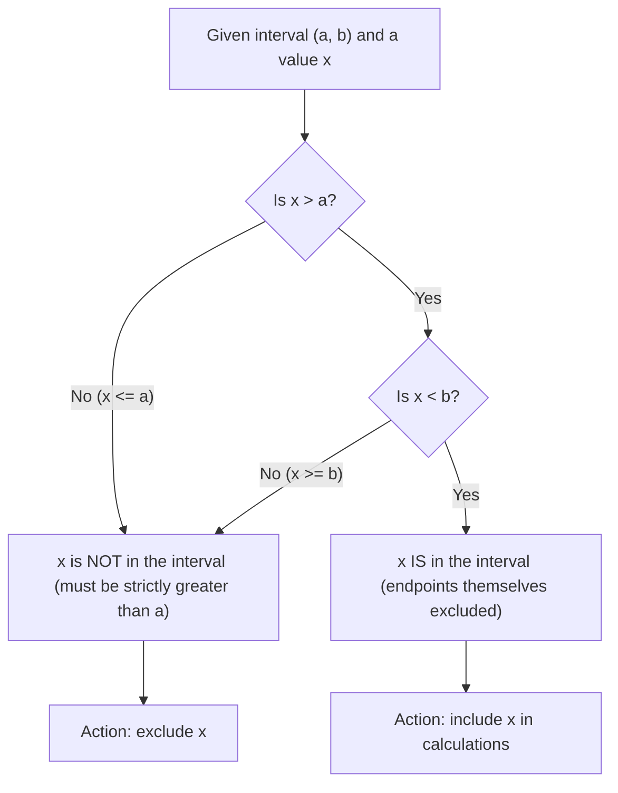

# Open interval

$$
(a,b) \triangleq \{ x \mid a < x < b \}
$$

## Deep Breakdown

What it tells me *(Situation Awareness)*:
An open interval $(a, b)$ contains all real numbers strictly between $a$ and $b$, **excluding both endpoints**. The parentheses signal that the boundaries are open, like a door that is left ajar: you can get arbitrarily close but never quite touch the edge. In DA/DS you encounter open intervals in mathematical proofs (where dividing by a quantity requires it to be strictly nonzero), in strict inequality filters, in the domain of functions like $\ln(x)$ which require $x > 0$ (not $x \geq 0$), and in gradient descent convergence proofs.

## Flowchart



## Real-world use

### Where it is used

Strict inequality filters, defining the valid domain of functions (e.g., $\ln$ requires $x \in (0, +\infty)$), probability density function supports (the Uniform distribution on $(0, 1)$ excludes 0 and 1), and proofs where dividing by a quantity requires it to be strictly nonzero.

### Problem it solves

The function $f(x) = \ln(x)$ is undefined at $x = 0$ and for $x < 0$. Its domain is the open interval $(0, +\infty)$: you can get as close to 0 as you like, but $x = 0$ itself is forbidden. A closed interval $[0, +\infty)$ would be incorrect because $\ln(0)$ is undefined ($\ln(0) = -\infty$). The open interval specifies the true domain precisely.

### How it solves the problem

$(a, b)$ uses parentheses to signal strict inequalities: $a < x < b$. The endpoint values are excluded. This is exactly the condition you need when equality would cause a mathematical problem (undefined, division by zero, etc.).

### Example in a business

The logistic function $\sigma(z) = 1/(1 + e^{-z})$ maps any real $z$ to the open interval $(0, 1)$. It never outputs exactly 0 or exactly 1 (only approaches them asymptotically). When computing cross-entropy loss $-\ln(\hat{y})$, this matters: if $\hat{y}$ could equal 0, you would have $-\ln(0) = +\infty$ and the loss would be infinite. The open interval $(0, 1)$ guarantees this never happens for finite inputs.

## The formula, piece by piece

Breaking the notation:

- $($ (open parenthesis on left): "open at the lower bound" — exclude $a$.
- $a$: the lower bound (not included in the interval).
- $b$: the upper bound (not included in the interval).
- $)$ (close parenthesis on right): "open at the upper bound" — exclude $b$.
- $\mid$: "such that." Full set-builder definition:

$$
(a, b) \triangleq \{ x \in \mathbb{R} \mid a < x < b \}
$$

Read: "The open interval from $a$ to $b$ is the set of all real numbers $x$ such that $x$ is strictly greater than $a$ AND strictly less than $b$. Neither $a$ nor $b$ itself is included." Interval comparison summary:

| Notation | Meaning | $a$ included? | $b$ included? |
|---|---|---|---|
| $(a, b)$ | Open | No | No |
| $[a, b]$ | Closed | Yes | Yes |
| $[a, b)$ | Left-closed, right-open | Yes | No |
| $(a, b]$ | Left-open, right-closed | No | Yes |

Note: in some countries and older textbooks, $]a, b[$ is used for the open interval. The parenthesis convention is now standard in most modern math and CS literature.

## The formula in words

"$x \in (a, b)$ means: $x$ is strictly greater than $a$ (cannot equal $a$) AND strictly less than $b$ (cannot equal $b$). Both conditions must hold. The boundary values themselves are forbidden." Think of a rope stretched between two poles: the closed interval $[a, b]$ includes the poles; the open interval $(a, b)$ includes only the rope between the poles, not the poles themselves.

## Critical Concepts

1. **Parenthesis = exclude**: $($ and $)$ always mean the endpoint is NOT part of the set.
2. **Critical for domains**: many functions (log, square root, reciprocal) have natural open-interval domains. $\ln$ is defined on $(0, +\infty)$, $\sqrt{x}$ is defined on $[0, +\infty)$, $1/x$ is defined on $(-\infty, 0) \cup (0, +\infty)$.
3. **Probability distributions**: the Uniform distribution on $(0, 1)$ is technically open. The distinction rarely matters in practice, but it prevents $P(X = 0) > 0$ for a continuous variable.
4. **Python's `range(a, b)` is half-open**: $[a, b)$: includes $a$, excludes $b$. Parentheses vs. brackets map directly to this.
5. **Numerical epsilon clipping**: in code, to avoid $\ln(0)$, you clip values to $(\varepsilon, 1 - \varepsilon)$ for some small $\varepsilon > 0$, which is an open interval approximated numerically.

## Step-by-step calculation (tiny example)

Input: interval $(2, 5)$. Determine which of $\{2, 2.001, 3.7, 5, 4.999\}$ are members.

*Step 1: Write the strict membership condition*
$x \in (2, 5)$ requires $2 < x < 5$. Both strict inequalities must hold.

*Step 2: Test each value*
- $x = 2$: $2 < 2$? No. Not in the interval (boundary excluded).
- $x = 2.001$: $2 < 2.001 < 5$? Yes. In the interval.
- $x = 3.7$: $2 < 3.7 < 5$? Yes. In the interval.
- $x = 5$: $5 < 5$? No. Not in the interval (boundary excluded).
- $x = 4.999$: $2 < 4.999 < 5$? Yes. In the interval.

*Step 3: Contrast with the closed version*
In $[2, 5]$, both $2$ and $5$ would be included. In $(2, 5)$ they are not.

## Code examples

### Beginner example (Python)

```python
# Check strict membership in an open interval (a, b)
a = 2
b = 5
test_values = [2.0, 2.001, 3.7, 5.0, 4.999]
for x in test_values:
    in_interval = a < x < b   # strict: both < (not <=) print(f"x = {x}: in ({a}, {b}) ? {in_interval}") # x = 2.0: in (2, 5) ? False (boundary excluded)
# x = 2.001: in (2, 5) ? True
# x = 3.7: in (2, 5) ? True
# x = 5.0: in (2, 5) ? False (boundary excluded)
# x = 4.999: in (2, 5) ? True
```

### Beginner example (R)

```r
a <- 2
b <- 5
test_values <- c(2.0, 2.001, 3.7, 5.0, 4.999)  # Strict inequalities: both > and <
in_interval <- test_values > a & test_values < b
names(in_interval) <- test_values
print(in_interval)
# 2 2.001 3.7 5 4.999
# FALSE TRUE TRUE FALSE TRUE
```

### Professional example (Python)

```python
import numpy as np

# Scenario: safe computation of cross-entropy loss
# Predictions must be in (0, 1) - open interval - to avoid log(0) = -infinity

def safe_cross_entropy(y_true: np.ndarray, y_pred: np.ndarray, epsilon: float = 1e-12) -> float:
    """
    Binary cross-entropy loss with numerical safety clipping.

    Clips y_pred to the open interval (epsilon, 1-epsilon) to ensure we never
    compute log(0), which would be -infinity.

    L = -mean(y * log(p) + (1-y) * log(1-p))

    Parameters
    ----------
    y_true : true binary labels (0 or 1)
    y_pred : predicted probabilities (should be in (0, 1))
    epsilon : small value defining the open interval lower/upper bound

    Returns
    -------
    float: mean cross-entropy loss
    """
    # Clip to open interval (epsilon, 1-epsilon)
    # Without this, log(0) = -inf and log(1) = 0 which can cause issues
    p = np.clip(y_pred, epsilon, 1 - epsilon)
    return -np.mean(y_true * np.log(p) + (1 - y_true) * np.log(1 - p))
y_true = np.array([1, 0, 1, 1, 0])
y_pred_good = np.array([0.9, 0.1, 0.8, 0.7, 0.2])
y_pred_extreme = np.array([1.0, 0.0, 0.9, 0.8, 0.1])   # has exact 0 and 1
print(f"Good predictions loss: {safe_cross_entropy(y_true, y_pred_good):.4f}")
print(f"Extreme predictions loss: {safe_cross_entropy(y_true, y_pred_extreme):.4f}")
# Without clipping, y_pred_extreme would produce log(0) = -inf => loss = inf
```

### Professional example (R)

```r
# Safe cross-entropy: clip predictions to (epsilon, 1-epsilon) to avoid log(0)
safe_cross_entropy <- function(y_true, y_pred, epsilon = 1e-12) {
  p <- pmin(pmax(y_pred, epsilon), 1 - epsilon)
  -mean(y_true * log(p) + (1 - y_true) * log(1 - p))
}
y_true <- c(1, 0, 1, 1, 0)
y_pred_good <- c(0.9, 0.1, 0.8, 0.7, 0.2)
y_pred_extreme <- c(1.0, 0.0, 0.9, 0.8, 0.1)
cat(sprintf("Good predictions loss: %.4f\n", safe_cross_entropy(y_true, y_pred_good)))
cat(sprintf("Extreme predictions loss: %.4f\n", safe_cross_entropy(y_true, y_pred_extreme)))
```

---

*Source: 1300 p. 13*
