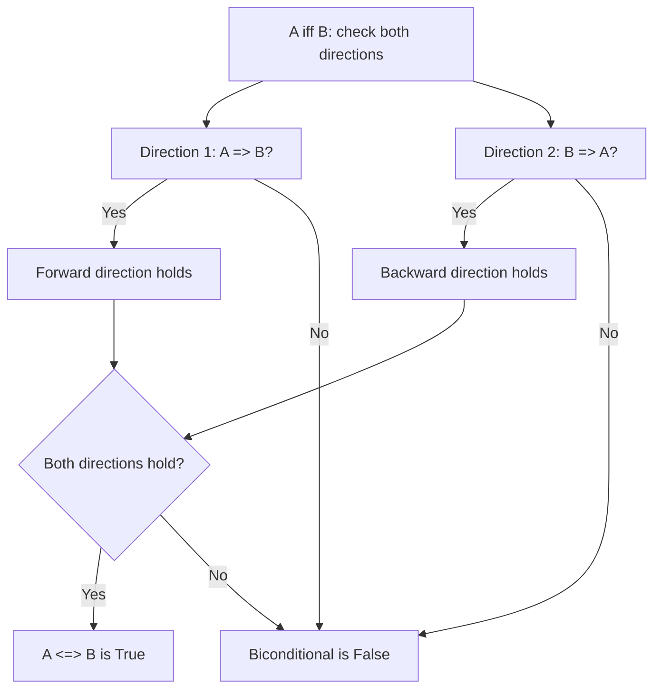

# Equivalent iff

$$
\iff
$$

## Deep Breakdown

What it tells me *(Situation Awareness)*:
$\iff$ means **"if and only if"** (abbreviated "iff"). It is a **biconditional**: $A \iff B$ is true when $A$ and $B$ have the same truth value, both true or both false. Unlike the one-directional implication $\implies$, which only guarantees "if $A$ then $B$," the biconditional guarantees both directions simultaneously: $A \implies B$ and $B \implies A$. In DA/DS you encounter $\iff$ in precise characterizations of conditions (necessary and sufficient conditions), in equivalence proofs ("minimizing the loss is equivalent to solving the normal equations"), in feature engineering rules where two events are exactly co-occurring, and whenever you state that two formulations are interchangeable without loss of generality.

## Flowchart



## Real-world use

### Where it is used

Stating necessary and sufficient conditions for a result to hold, declaring that two optimization problems are equivalent, expressing feature co-occurrence rules in business logic ("a user is premium iff they have an active subscription"), and in algorithm proofs where you need to show that two formulations are interchangeable.

### Problem it solves

Many mathematical statements require precise characterization: is a condition just sufficient (it guarantees the outcome) or is it also necessary (without it, the outcome cannot occur)? $\iff$ says "both": the condition is sufficient AND necessary. This precision matters in ML because you need to know when an optimization shortcut is always safe, not just sometimes safe.

### How it solves the problem

$A \iff B$ is logically equivalent to $(A \implies B) \land (B \implies A)$. To prove a biconditional, you prove both directions independently. To disprove it, you find a case where $A$ holds without $B$, or $B$ holds without $A$.

### Example in a business

In linear algebra and OLS: "$(X^\top X)$ is invertible $\iff$ the columns of $X$ are linearly independent." This is a biconditional because invertibility requires and is guaranteed by full column rank. Knowing $\iff$ tells you: if you check one condition, you know both. If you detect multicollinearity (columns are not linearly independent), you know immediately that $X^\top X$ is singular. The two problems are the same problem.

## The formula, piece by piece

Breaking the notation:

- $A$: first statement (either side of the biconditional).
- $\iff$: the double-headed arrow. Also written $\Leftrightarrow$, or in text as "iff." Unicode: U+21D4. Pronounced "if and only if."
- $B$: second statement.

Truth table for $A \iff B$:

| $A$ | $B$ | $A \iff B$ |
|-----|-----|------------|
| T | T | **T** (both true: match) |
| T | F | **F** (mismatch) |
| F | T | **F** (mismatch) |
| F | F | **T** (both false: match) |

$A \iff B$ is true when $A$ and $B$ agree. It is false when they disagree. Decomposition: $A \iff B \equiv (A \implies B) \land (B \implies A)$. Logical equivalence: $A \iff B \equiv \lnot(A \oplus B)$ (true when XOR is false, i.e., when they are not different).

## The formula in words

"$A \iff B$ means: $A$ and $B$ are equivalent. $A$ is true exactly when $B$ is true, and $A$ is false exactly when $B$ is false. Knowing the truth value of either one tells you the truth value of the other. There is no scenario where one holds without the other."

## Critical Concepts

1. **Both directions required**: to prove $A \iff B$, you must prove $A \implies B$ AND $B \implies A$. Proving only one direction proves a one-way implication, not equivalence.
2. **Necessary and sufficient**: $B$ is a necessary condition for $A$ if $A \implies B$ (you cannot have $A$ without $B$). $B$ is a sufficient condition for $A$ if $B \implies A$ (having $B$ guarantees $A$). $A \iff B$ means $B$ is both necessary and sufficient for $A$.
3. **In code**: $\iff$ corresponds to `a == b` for booleans, or `if a then b and if b then a` in logical conditions. In SQL, it is `(condition_a AND condition_b) OR (NOT condition_a AND NOT condition_b)`.
4. **Logical equivalence vs. biconditional**: in formal logic, $A \iff B$ as a formula (evaluated in a specific context) is the biconditional. When we say two formulas are logically equivalent (true in all contexts), we write $A \equiv B$. The distinction is subtle but matters in formal proofs.
5. **XOR complement**: $A \iff B \equiv \lnot(A \oplus B)$.

The biconditional is true when XOR is false, i.e., when the two values are not different.

## Step-by-step calculation (tiny example)

Task: verify the truth table for $A \iff B$ by decomposing it into two implications.

*Step 1: Recall the definition*
$A \iff B$ is true exactly when both $A \implies B$ and $B \implies A$ are true.

*Step 2: Check each row using the decomposition*
$A=T, B=T$: $T \implies T$ is T, $T \implies T$ is T. Both hold. $A \iff B = T$.
$A=T, B=F$: $T \implies F$ is F. One direction fails. $A \iff B = F$.
$A=F, B=T$: $F \implies T$ is T (vacuous), but $T \implies F$ is F. One direction fails. $A \iff B = F$.
$A=F, B=F$: $F \implies F$ is T (vacuous), $F \implies F$ is T. Both hold. $A \iff B = T$.

*Step 3: Confirm the pattern*
$A \iff B$ is true in the two rows where $A$ and $B$ agree (both T or both F), and false in the two rows where they disagree. This is exactly "same truth value."

## Code examples

### Beginner example (Python)

```python
# A iff B in Python: a == b (for booleans)
# Equivalently: (a and b) or (not a and not b)
# Or: not (a ^ b) using XOR

def biconditional(a: bool, b: bool) -> bool:
    """A iff B: true when A and B have the same truth value."""
    return a == b   # cleanest form for booleans # Truth table
print(f"{'A':<8} {'B':<8} {'A <=> B'}")
print("-" * 24)
for a in [True, False]:
    for b in [True, False]:
        result = biconditional(a, b)
    print(f"{str(a):<8} {str(b):<8} {result}")
print()
# Business logic: "user is premium iff they have an active subscription"
users = [ {"user_id": 1, "labeled_premium": True, "active_subscription": True},   # T iff T: consistent
    {"user_id": 2, "labeled_premium": True, "active_subscription": False},   # T iff F: inconsistency
    {"user_id": 3, "labeled_premium": False, "active_subscription": True},   # F iff T: inconsistency
    {"user_id": 4, "labeled_premium": False, "active_subscription": False},   # F iff F: consistent
]
print("Check: labeled_premium iff active_subscription")
for user in users:
    consistent = biconditional(user["labeled_premium"], user["active_subscription"])
status = "OK" if consistent else "INCONSISTENCY"
print(f" User {user['user_id']}: {status}")
```

### Beginner example (R)

```r
# A iff B in R: a == b for logicals
biconditional <- function(a, b) a == b  # Truth table
cat(sprintf("%-8s %-8s %-10s\n", "A", "B", "A <=> B"))
cat(strrep("-", 26), "\n")
for (a in c(TRUE, FALSE)) { for (b in c(TRUE, FALSE)) { cat(sprintf("%-8s %-8s %-10s\n", a, b, biconditional(a, b)))
  }
}
cat("\n")
# Consistency check: premium label iff active subscription
users <- data.frame( user_id = 1:4, labeled_premium = c(TRUE, TRUE, FALSE, FALSE), active_subscription = c(TRUE, FALSE, TRUE, FALSE)
)
users$consistent <- biconditional(users$labeled_premium, users$active_subscription)
users$status <- ifelse(users$consistent, "OK", "INCONSISTENCY")
print(users)
```

### Professional example (Python)

```python
import numpy as np
import pandas as pd   # Scenario: verifying that two feature definitions are logically equivalent
# in a customer dataset.
# Claim: "user is churned iff no activity in last 90 days"
# We check: is churned_label iff (days_since_last_activity >= 90)?
np.random.seed(42)
N_USERS = 1_000
days_inactive = np.random.exponential(scale=60, size=N_USERS).astype(int)   # Ground-truth churn: 90-day inactivity threshold
is_inactive_90d = days_inactive >= 90   # Simulated churn label (with intentional noise: some labeling errors)
churn_label = is_inactive_90d.copy()
noise_idx = np.random.choice(N_USERS, size=30, replace=False)
churn_label[noise_idx] = ~churn_label[noise_idx]   # flip 30 labels
df = pd.DataFrame({ "days_inactive": days_inactive, "churn_label": churn_label, "inactive_90d": is_inactive_90d,
})   # Biconditional check: churn_label <=> inactive_90d
# True when both agree (both True or both False)
df["biconditional_holds"] = df["churn_label"] == df["inactive_90d"]
inconsistencies = df[~df["biconditional_holds"]]
print("Biconditional: churn_label <=> (days_inactive >= 90)")
print(f" Total users: {len(df)}")
print(f" Consistent rows: {df['biconditional_holds'].sum()}")
print(f" Inconsistencies: {len(inconsistencies)}")
print(f" Inconsistency rate: {len(inconsistencies) / len(df):.1%}")
print()
print(" Breakdown of inconsistency types:")
# labeled churned but not inactive
false_positives = inconsistencies[ inconsistencies["churn_label"] & ~inconsistencies["inactive_90d"] ]
false_negatives = inconsistencies[ ~inconsistencies["churn_label"] & inconsistencies["inactive_90d"] ]
print(f" Labeled churned but active (<90d inactive): {len(false_positives)}")
print(f" Not labeled churned but inactive (>=90d): {len(false_negatives)}")
print()
print(" If the biconditional held perfectly, both numbers would be 0.")
print(" The 30 flipped labels break the logical equivalence.")
```

### Professional example (R)

```r
# Churned iff days_since_last_activity >= 90: check logical equivalence
set.seed(42)
N_USERS <- 1000
days_inactive <- as.integer(rexp(N_USERS, rate = 1/60))
churn_label <- days_inactive >= 90
inactive_90d <- days_inactive >= 90
# Flip ~30 labels to create inconsistencies
flip <- sample(seq_len(N_USERS), 30)
churn_label[flip] <- !churn_label[flip]
consistent <- (churn_label == inactive_90d)
n_consistent <- sum(consistent)
n_inconsistent <- sum(!consistent)
cat("Churned label iff inactive >= 90 days\n")
cat(" Consistent rows: ", n_consistent, "\n")
cat(" Inconsistent: ", n_inconsistent, "\n")
false_pos <- sum(churn_label & !inactive_90d)
false_neg <- sum(!churn_label & inactive_90d)
cat(" Labeled churned but active: ", false_pos, "\n")
cat(" Not churned but inactive: ", false_neg, "\n")
cat(" If biconditional held, both would be 0.\n")
```

---

*Source: 1300 p. 24*
