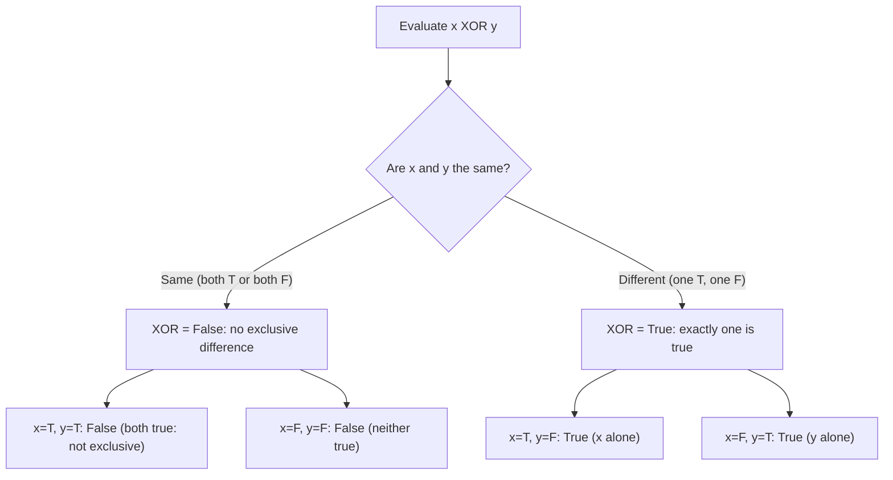

# Exclusive OR

$$
x \oplus y
$$

## Deep Breakdown

What it tells me *(Situation Awareness)*:
$x \oplus y$ is **exclusive OR** (XOR). It is true when exactly one of $x$ or $y$ is true, and false when both are true or both are false. The "exclusive" part distinguishes it from regular OR (which is also true when both hold): XOR requires exactly one, not one-or-both. In DA/DS and software engineering, XOR appears in bitwise operations for hashing and data encoding, in parity checks for error detection, in feature engineering for mutually exclusive categorical flags, and in the biconditional: $A \iff B \equiv \lnot(A \oplus B)$.

## Flowchart



## Real-world use

### Where it is used

Bitwise XOR for hash mixing and checksums (`hash_a ^ hash_b`), detecting when exactly one of two mutually exclusive conditions holds in feature engineering ("user is new but not yet verified, or verified but not yet active"), parity bits for data integrity (the XOR of all bits equals 0 if there are an even number of 1s), and logic puzzles where "either A or B but not both" is required.

### Problem it solves

Regular OR ($A \lor B$) is ambiguous: it includes the case where both $A$ and $B$ hold. When the business rule genuinely requires "one or the other but not both" (mutually exclusive alternatives), you need XOR. In feature engineering, flags for mutually exclusive categories must satisfy XOR: a user can be in segment A or segment B but not both.

### How it solves the problem

$x \oplus y$ is false when $x = y$ (both true or both false) and true when $x \neq y$ (they differ). This is exactly the "not equal" condition for booleans. In Python: `x ^ y` for booleans, or `x != y`. For integers it performs bitwise XOR on each bit position independently.

### Example in a business

Hashing for consistent cross-validation splits: `fold_assignment = (user_id_hash_a ^ user_id_hash_b) % K_FOLDS`. XOR combines two hash functions to produce a more uniform distribution, reducing the chance of systematic bias in fold assignment. Mutually exclusive segment check: "a customer is either a 'first-time buyer' (FB) or a 'returning buyer' (RB), never both." Validation: `(FB_flag XOR RB_flag)` must be True for every row. If it is False, either both flags are set (data error) or neither is set (another data error).

## The formula, piece by piece

Breaking the notation:

- $\oplus$: the XOR symbol. A circle with a plus inside. Unicode: U+2295. Pronounced "XOR" or "exclusive or."
- $x$: first boolean operand.
- $y$: second boolean operand.

Truth table for $x \oplus y$:

| $x$ | $y$ | $x \oplus y$ |
|-----|-----|--------------|
| T | T | **F** (both true: not exclusive) |
| T | F | **T** (only $x$) |
| F | T | **T** (only $y$) |
| F | F | **F** (neither) |

Equivalent formulations:
- $x \oplus y \equiv (x \lor y) \land \lnot(x \land y)$: OR but not AND.
- $x \oplus y \equiv (x \land \lnot y) \lor (\lnot x \land y)$: exactly one holds.
- $x \oplus y \equiv x \neq y$: the values differ (for booleans).
- $A \iff B \equiv \lnot(A \oplus B)$: biconditional is the negation of XOR.

Bitwise XOR on integers: operates on each bit independently.
$5 \oplus 3 = 0101_2 \oplus 0011_2 = 0110_2 = 6$.

## The formula in words

"$x \oplus y$ means 'either $x$ or $y$, but not both.' If $x$ and $y$ are the same (both true or both false), XOR is false: there is no exclusive difference between them. If they differ, XOR is true: exactly one of them is true. Think of it as detecting a disagreement between two boolean values."

## Critical Concepts

1. **OR vs. XOR**: OR is true when at least one holds (including both). XOR is true only when exactly one holds. XOR is strictly narrower.
2. **XOR as inequality**: for booleans, $x \oplus y$ is equivalent to $x \neq y$. True when they differ, false when they agree.
3. **XOR and biconditional**: $A \iff B = \lnot(A \oplus B)$. The biconditional is true when the two values agree (XOR is false). This is an important identity connecting XOR and equivalence.
4. **Bitwise XOR in computing**: for integers, XOR operates bit by bit. Used in hash mixing, cryptographic operations, swap-without-temp trick (`a ^= b; b ^= a; a ^= b`), and parity computation.
5. **Self-inverse property**: $x \oplus x = 0$ (XOR of a value with itself is zero/false).

And $x \oplus 0 = x$ (XOR with zero is identity). These properties make XOR useful in cryptography: $(\text{ciphertext}) \oplus \text{key} = \text{plaintext}$, and $(\text{plaintext} \oplus \text{key}) \oplus \text{key} = \text{plaintext}$.

## Step-by-step calculation (tiny example)

Task: compute $5 \oplus 3$ using binary (bitwise XOR).

*Step 1: Convert both numbers to binary*
$5 = 0101_2$ (4-bit). $3 = 0011_2$ (4-bit).

*Step 2: Apply XOR bit by bit*
- Bit 3 (leftmost): $0 \oplus 0 = 0$ (same: false).
- Bit 2: $1 \oplus 0 = 1$ (different: true).
- Bit 1: $0 \oplus 1 = 1$ (different: true).
- Bit 0 (rightmost): $1 \oplus 1 = 0$ (same: false). Result: $0110_2$.

*Step 3: Convert back to decimal*
$0110_2 = 0 \cdot 8 + 1 \cdot 4 + 1 \cdot 2 + 0 \cdot 1 = 4 + 2 = 6$. So $5 \oplus 3 = 6$. Verify: $6 \oplus 3 = 0110 \oplus 0011 = 0101 = 5$. XOR is self-inverse: $(5 \oplus 3) \oplus 3 = 5$.

## Code examples

### Beginner example (Python)

```python
# XOR in Python: x ^ y (for booleans and integers)
# Boolean XOR truth table
print(f"{'x':<8} {'y':<8} {'x XOR y'}")
print("-" * 24)
for x in [True, False]:
    for y in [True, False]:
        result = x ^ y
    print(f"{str(x):<8} {str(y):<8} {result}")
print()
# Equivalent formulations
x, y = True, False
print(f"x XOR y: {x ^ y}")
print(f"(x or y) and not(x and y): {(x or y) and not (x and y)}")
print(f"x != y: {x != y}")   # all three are equivalent
print()
# Integer bitwise XOR
a, b = 5, 3
print(f"5 = {bin(a)}")
print(f"3 = {bin(b)}")
print(f"5 XOR 3 = {a ^ b} = {bin(a ^ b)}")   # Self-inverse: (a XOR b) XOR
b = a
print(f"(5 XOR 3) XOR 3 = {(a ^ b) ^ b}")   # back to 5
```

### Beginner example (R)

```r
# XOR in R: xor(x, y) # Truth table
cat(sprintf("%-8s %-8s %-10s\n", "x", "y", "x XOR y"))
cat(strrep("-", 26), "\n")
for (x in c(TRUE, FALSE)) { for (y in c(TRUE, FALSE)) { cat(sprintf("%-8s %-8s %-10s\n", x, y, xor(x, y)))
  }
}
cat("\n")
# Equivalent formulations
x <- TRUE; y <- FALSE
cat("xor(x,y): ", xor(x, y), "\n")
cat("(x|y) & !(x&y): ", (x | y) & !(x & y), "\n")
cat("x != y: ", x != y, "\n")  # Bitwise XOR on integers
a <- 5L; b <- 3L
cat(sprintf("\n%d XOR %d = %d\n", a, b, bitwXor(a, b)))  # 6
cat(sprintf("(%d XOR %d) XOR %d = %d\n", a, b, b, bitwXor(bitwXor(a, b), b)))  # 5
```

### Professional example (Python)

```python
import pandas as pd
import numpy as np   # Scenario 1: mutually exclusive segment validation with XOR
# Segment rule: each user must be in exactly one of {new, returning}
# i.e., is_new XOR is_returning must be True for every row
np.random.seed(42)
N_USERS = 1_000
is_new = np.random.rand(N_USERS) > 0.6
is_returning = ~is_new   # clean data: perfectly exclusive
df = pd.DataFrame({"user_id": range(N_USERS), "is_new": is_new, "is_returning": is_returning})   # Introduce deliberate violations
df.loc[5, "is_new"] = True; df.loc[5, "is_returning"] = True   # both True: violation
df.loc[10, "is_new"] = False; df.loc[10, "is_returning"] = False   # both False: violation # XOR validation
df["xor_valid"] = df["is_new"] ^ df["is_returning"]   # must be True for all rows
violations = df[~df["xor_valid"]]
print("Segment XOR validation: is_new XOR is_returning must be True")
print(f" Total users: {len(df)}")
print(f" Valid rows: {df['xor_valid'].sum()}")
print(f" Violations: {len(violations)}")
print(violations[["user_id", "is_new", "is_returning", "xor_valid"]].to_string(index=False))
print()   # Scenario 2: hash mixing with bitwise XOR for fold assignment
user_ids = np.arange(1_000)
# Two independent hash functions
hash_a = np.array([hash(f"salt_a_{uid}") for uid in user_ids])
hash_b = np.array([hash(f"salt_b_{uid}") for uid in user_ids])   # Mix hashes with XOR for better uniformity
mixed_hash = hash_a ^ hash_b
fold_assignment = mixed_hash % 5   # 5-fold CV
fold_counts = pd.Series(fold_assignment).value_counts().sort_index()
print("5-fold CV fold distribution (via XOR hash mixing):")
print(fold_counts.to_string())
print("Even distribution confirms XOR mixing reduces systematic bias.")
```

### Professional example (R)

```r
# Mutually exclusive segment: is_new XOR is_returning; then XOR hash mixing for CV
set.seed(42)
N_USERS <- 1000
is_new <- runif(N_USERS) > 0.6
is_returning <- !is_new
xor_valid <- xor(is_new, is_returning)
cat("Segment rule: is_new XOR is_returning\n")
cat(" All rows satisfy XOR:", all(xor_valid), "\n")  # XOR hash mixing for 5-fold CV
hash_a <- sample(0:2147483647, N_USERS, replace = TRUE)
hash_b <- sample(0:2147483647, N_USERS, replace = TRUE)
mixed_hash <- bitwXor(hash_a, hash_b)
fold_assignment <- mixed_hash %% 5
cat("\n5-fold CV fold distribution (XOR hash mixing):\n")
print(table(fold_assignment))
```

---

*Source: domain knowledge*
