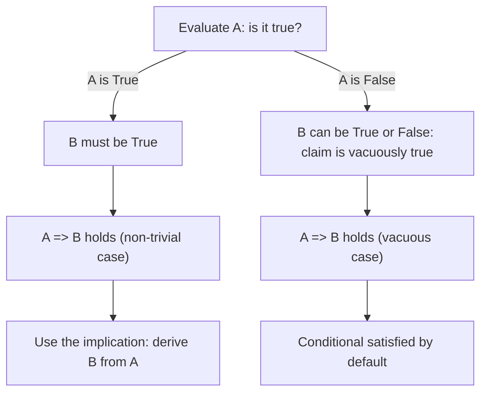

# Implies

$$
\implies
$$

## Deep Breakdown

What it tells me *(Situation Awareness)*:
$\implies$ means **"implies"** or **"if ... then ..."** It expresses a one-directional conditional relationship: if $A$ is true, then $B$ must also be true. It does not say that $A$ and $B$ are equivalent (that requires $\iff$), only that the truth of $A$ guarantees the truth of $B$. In DA/DS you encounter $\implies$ in model assumption documentation ("if the loss is convex $\implies$ gradient descent converges to a global minimum"), data integrity rules ("if a session has a purchase event $\implies$ a transaction record must exist"), and formal derivations in proofs.

## Flowchart



## Real-world use

### Where it is used

Stating model assumptions and their consequences ("convexity $\implies$ unique global minimum"), expressing data integrity constraints ("foreign key violation $\implies$ query returns NULL"), documenting the logical chain in proofs, and writing business rules ("churn label = 1 $\implies$ customer had no activity in 90 days").

### Problem it solves

When you need to express a one-way logical dependence, you need a symbol that is stronger than a correlation but does not claim symmetry. $\implies$ precisely captures "whenever the antecedent holds, the consequent is guaranteed." This is exactly the kind of reasoning used when deriving algorithm properties from assumptions.

### How it solves the problem

$A \implies B$ is equivalent to $\lnot A \lor B$: either $A$ is false, or $B$ is true (or both). The only way the implication fails is when $A$ is true but $B$ is false. To prove an implication, you assume $A$ and derive $B$. To disprove it, you exhibit one counterexample where $A$ is true and $B$ is false.

### Example in a business

In model validation: "strict convexity of the loss $\implies$ gradient descent finds the unique global minimum." Knowing the logical structure lets you check whether the premise (strict convexity) actually holds before trusting the conclusion. As a data quality rule: "if `order_date IS NOT NULL` $\implies$ `customer_id IS NOT NULL`." This translates directly into a SQL assertion or a pandas validation check to catch data integrity violations before they corrupt an analysis.

## The formula, piece by piece

Breaking the notation:

- $A$: the antecedent (the "if" part, the condition or premise).
- $\implies$: the implication arrow. Also written $\rightarrow$ or $\supset$ depending on the field. Unicode: U+21D2. Pronounced "implies" or "if $A$ then $B$."
- $B$: the consequent (the "then" part, the result or conclusion).

Truth table for $A \implies B$:

| $A$ | $B$ | $A \implies B$ |
|-----|-----|----------------|
| T | T | **T** |
| T | F | **F** (only false case) |
| F | T | **T** (vacuously true) |
| F | F | **T** (vacuously true) |

Equivalent formulations:
- $A \implies B \equiv \lnot A \lor B$ (disjunction form).
- $A \implies B \equiv \lnot B \implies \lnot A$ (contrapositive, always logically equivalent).

## The formula in words

"$A \implies B$ means: if $A$ is true, then $B$ is guaranteed to be true. If you know $A$, you can conclude $B$. The implication makes no claim about what happens when $A$ is false: $B$ might be true or false, and the implication is satisfied either way. The only scenario that breaks the promise is: $A$ is true but $B$ turns out to be false."

## Critical Concepts

1. **One-directional**: $A \implies B$ does not mean $B \implies A$. "All squares are rectangles" does not mean "all rectangles are squares."
2. **Vacuous truth**: if $A$ is always false (an impossible premise), then $A \implies B$ is trivially true for any $B$. Logically correct, but sometimes counterintuitive.
3. **Contrapositive**: $A \implies B$ is logically equivalent to $\lnot B \implies \lnot A$. This is powerful: to prove "if $A$ then $B$," you can equivalently prove "if not $B$ then not $A$."
4. **Different from $\iff$**: $A \implies B$ is a one-way street. $A \iff B$ requires both $A \implies B$ and $B \implies A$.
5. **In code**: Python's `if condition: do_something` is the computational counterpart to $\implies$.

The body executes only when the antecedent is True.

## Step-by-step calculation (tiny example)

Task: evaluate $A \implies B$ for all four combinations of truth values.

*Step 1: Evaluate the two cases where A is True*
$A = T, B = T$: "If True, then True." The promise is kept. Result: **True**.
$A = T, B = F$: "If True, then False." The promise is broken. Result: **False** (the only failure case).

*Step 2: Evaluate the two vacuous cases where A is False*
$A = F, B = T$: $A$ never fired, so the promise was never broken. Result: **True** (vacuously).
$A = F, B = F$: Same reasoning. The condition was never triggered. Result: **True** (vacuously).

*Step 3: State the key takeaway*
$A \implies B$ is false in exactly one row: when $A$ is True and $B$ is False. This is the definition of a counterexample to an implication. To disprove any conditional claim, you need to find exactly this pattern.

## Code examples

### Beginner example (Python)

```python
# A => B in Python: implemented as (not A) or B

def logical_implies(a: bool, b: bool) -> bool:
    """Logical implication: A => B. False only when A is True and B is False."""
    return (not a) or b   # Truth table
print(f"{'A':<8} {'B':<8} {'A => B'}")
print("-" * 24)
for a in [True, False]:
    for b in [True, False]:
        result = logical_implies(a, b)
    print(f"{str(a):<8} {str(b):<8} {result}")
print()
# Data integrity rule: order_date not null => customer_id not null
records = [ {"order_date": "2024-01-01", "customer_id": 42},   # T => T: valid
    {"order_date": "2024-01-02", "customer_id": None},   # T => F: VIOLATION
    {"order_date": None, "customer_id": 99},   # F => T: valid
    {"order_date": None, "customer_id": None},   # F => F: valid
]
print("Data integrity: order_date not null => customer_id not null")
for i, record in enumerate(records):
    antecedent = record["order_date"] is not None
consequent = record["customer_id"] is not None
rule_holds = logical_implies(antecedent, consequent)
status = "OK" if rule_holds else "VIOLATION"
print(f" Row {i}: {status} {record}")
```

### Beginner example (R)

```r
# Logical implication:
A => B is (!A) | B
logical_implies <- function(a, b) (!a) | b  # Truth table
cat(sprintf("%-8s %-8s %-10s\n", "A", "B", "A => B"))
cat(strrep("-", 26), "\n")
for (a in c(TRUE, FALSE)) { for (b in c(TRUE, FALSE)) { cat(sprintf("%-8s %-8s %-10s\n", a, b, logical_implies(a, b)))
  }
}
cat("\n")
# Data integrity check
records <- list( list(order_date = "2024-01-01", customer_id = 42), list(order_date = "2024-01-02", customer_id = NA),  # violation list(order_date = NA,
customer_id = 99), list(order_date = NA, customer_id = NA)
) cat("Integrity check: order_date not NA => customer_id not NA\n")
for (i in seq_along(records)) { r <- recordsi
  antecedent <- !is.na(r$order_date)
  consequent <- !is.na(r$customer_id)
  rule_holds <- logical_implies(antecedent, consequent)
  status <- if (rule_holds) "OK"
  else "VIOLATION"
  cat(sprintf(" Row %d: %s\n", i, status))
}
```

### Professional example (Python)

```python
import pandas as pd
import numpy as np   # Scenario: validating implication constraints in a business dataset
# Rule: "if a user converted => account_id must not be null"
np.random.seed(42)
N_ROWS = 500
account_ids = np.where( np.random.rand(N_ROWS) > 0.05, np.random.randint(1000, 9999, N_ROWS).astype(object), None )
converted = np.random.rand(N_ROWS) > 0.7   # ~30% converted
df = pd.DataFrame({"account_id": account_ids, "converted": converted})   # Introduce deliberate violations: converted=True but
account_id=None
violation_idx = np.where(converted)[0][:5]
df.loc[violation_idx, "account_id"] = None   # Evaluate: converted => account_id is not null
# A => B is (~A) | B
df["antecedent"] = df["converted"]
df["consequent"] = df["account_id"].notna()
df["rule_holds"] = (~df["antecedent"]) | df["consequent"]
violations = df[~df["rule_holds"]]
total_converted = df["antecedent"].sum()
print("Implication: converted => account_id is not null")
print(f" Total rows: {len(df)}")
print(f" Total converted: {total_converted}")
print(f" Violations: {len(violations)}")
print(f" Violation rate: {len(violations) / total_converted:.1%} of converted rows")
if not violations.empty:
    print("\n Violation details:")
print(violations[["account_id", "converted", "rule_holds"]].head())
print("\n These rows are counterexamples to the implication.")
print(" They prove A => B is NOT universally true in this dataset.")
```

### Professional example (R)

```r
# Implication:
converted => account_id is not null (A => B is (!A) | B)
set.seed(42)
N_ROWS <- 500
account_ids <- 1000 + seq_len(N_ROWS)
converted <- runif(N_ROWS) > 0.7
df <- data.frame(account_id = account_ids, converted = converted)
idx_violation <- which(converted)[1:5]
df$account_id[idx_violation] <- NA
df$antecedent <- df$converted
df$consequent <- !is.na(df$account_id)
df$rule_holds <- (!df$antecedent) | df$consequent
violations <- df[!df$rule_holds, ]
cat("Implication: converted => account_id is not null\n")
cat(" Total rows: ", nrow(df), "\n")
cat(" Total converted:", sum(df$antecedent), "\n")
cat(" Violations: ", nrow(violations), "\n")
if (sum(df$antecedent) > 0) { cat(" Violation rate: ", round(100 * nrow(violations) / sum(df$antecedent), 1), "% of converted\n")
}
if (nrow(violations) > 0)
cat(" These rows are counterexamples to A => B.\n")
```

---

*Source: 1300 p. 16*
