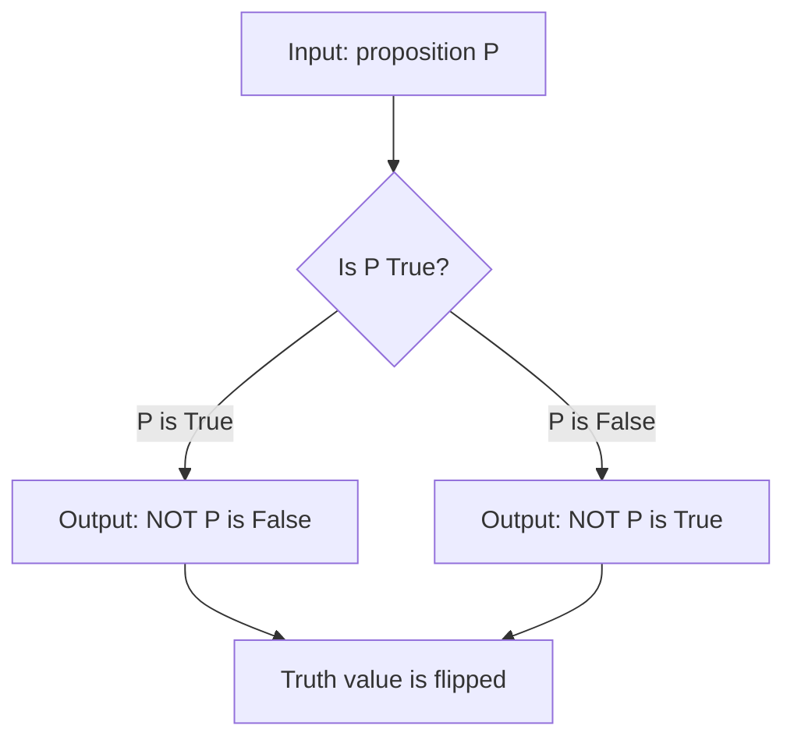

# Negation

$$
\lnot x
$$

or $\sim x$

## Deep Breakdown

What it tells me *(Situation Awareness)*:
$\lnot x$ (or $\sim x$) is **logical negation**, read as **"not $x$."** It flips the truth value of a proposition: if $x$ is true, $\lnot x$ is false; if $x$ is false, $\lnot x$ is true. Negation is the most fundamental logical operation, the building block from which all other connectives can be derived in combination with AND or OR. In DA/DS you encounter negation constantly: in boolean filter conditions (`~df["is_churned"]`), in De Morgan's law transformations when simplifying complex SQL WHERE clauses, in probability ("the probability that at least one event occurs equals 1 minus the probability that none occur"), and in proof strategies (proof by contradiction assumes $\lnot$ of what you want to prove, then derives a contradiction).

## Flowchart



## Real-world use

### Where it is used

Boolean indexing in DataFrames (selecting rows where a condition does NOT hold), De Morgan's law simplification for complex filter logic, computing complement probabilities ($P(\text{event}) = 1 - P(\lnot \text{event})$), writing WHERE clauses in SQL with NOT, and proof by contradiction (assume the negation of a goal, then derive a contradiction).

### Problem it solves

In data filtering, you often know what you want to exclude but find it easier to state the exclusion condition than the inclusion condition. Negation lets you flip: instead of listing all valid cases, list the invalid case and negate it. This is cleaner and less error-prone when the invalid condition is simpler to state.

### How it solves the problem

$\lnot P$ returns the opposite truth value. Combined with De Morgan's laws: $\lnot(A \land B) = \lnot A \lor \lnot B$ and $\lnot(A \lor B) = \lnot A \land \lnot B$, negation lets you push "NOT" inward through compound conditions, which is essential for SQL query optimization and for generating complement sets.

### Example in a business

Filtering active customers: `active_customers = df[~df["is_churned"]]`. The tilde `~` is numpy/pandas negation of a boolean Series. Equivalent SQL: `WHERE NOT is_churned`. Complement probability in anomaly detection: "The probability that a transaction is normal = 1 - P(anomaly)." Once you have P(anomaly) from a model, negation gives you P(normal) immediately. De Morgan in SQL: `NOT (A AND B)` = `(NOT A) OR (NOT B)`. This equivalence is used to simplify query logic and can affect query planner performance.

## The formula, piece by piece

Breaking the notation:

- $\lnot$: the logical NOT symbol. Looks like an angular checkmark or a reversed "L." Unicode: U+00AC. Pronounced "not."
- $\sim$: tilde used as negation in some texts. Context-dependent: in logic it means NOT; in probability/statistics it means "distributed as."
- $x$: a proposition (a statement that is either true or false).

Truth table for $\lnot x$:

| $x$ | $\lnot x$ |
|-----|-----------|
| T | **F** |
| F | **T** |

De Morgan's laws (negation of compound statements):
- $\lnot(A \land B) \equiv \lnot A \lor \lnot B$
- $\lnot(A \lor B) \equiv \lnot A \land \lnot B$ Quantifier negation:
- $\lnot(\forall x: P(x)) \equiv \exists x: \lnot P(x)$
- $\lnot(\exists x: P(x)) \equiv \forall x: \lnot P(x)$ Double negation: $\lnot(\lnot x) \equiv x$.

Negating twice returns to the original.

## The formula in words

"$\lnot x$ means 'not $x$.' If $x$ is the statement 'the user is active,' then $\lnot x$ is the statement 'the user is not active.' Negation flips the truth value. True becomes false, false becomes true. Two negations cancel out: not-not-active means active."

## Critical Concepts

1. **Double negation**: $\lnot(\lnot x) = x$. Negating twice is the identity. In Python, `not not True` is `True`.
2. **De Morgan's laws**: the most important identity involving negation. When you negate an AND condition, it becomes OR with each part negated (and vice versa). Memorize: "NOT(A AND B) = (NOT A) OR (NOT B)."
3. **~ vs $\lnot$ vs not**: in Python `not x` is the boolean negation. `~x` on a boolean is bitwise NOT (equivalent to `not x` for a single boolean but works element-wise on numpy arrays and pandas Series). In math, both $\lnot$ and $\sim$ are used.
4. **Complement in probability**: $P(\lnot A) = 1 - P(A)$. The probability of an event not happening is 1 minus the probability it does happen.
5. **Proof by contradiction**: assume $\lnot(\text{what you want to prove})$.

Derive a logical contradiction ($A \land \lnot A$). Conclude that the assumption $\lnot(\text{goal})$ must be false, so the goal must be true.

## Step-by-step calculation (tiny example)

Task: apply De Morgan's law to simplify $\lnot(x > 0 \land y > 0)$.

*Step 1: Identify the compound expression*
The condition is $A \land B$ where $A = (x > 0)$ and $B = (y > 0)$. We are negating the whole thing.

*Step 2: Apply De Morgan's first law*
$\lnot(A \land B) = \lnot A \lor \lnot B$.
Substituting: $\lnot(x > 0) \lor \lnot(y > 0) = (x \leq 0) \lor (y \leq 0)$.

*Step 3: Verify with a concrete example*
Let $x = -1, y = 3$. Original condition: $(-1 > 0) \land (3 > 0) = F \land T = F$. Negation of F is T.
Simplified: $(-1 \leq 0) \lor (3 \leq 0) = T \lor F = T$. Same result. Confirmed.

## Code examples

### Beginner example (Python)

```python
# Logical negation in Python
# Basic boolean NOT
x = True
print(f"x = {x}")
print(f"not x = {not x}")   # False (negation)
print(f"not (not x) = {not not x}")   # True (double negation) # De Morgan's law: NOT(A AND B) = (NOT A) OR (NOT B)
a = True
b = False
print(f"\nA={a}, B={b}")
print(f"NOT(A AND B): {not (a and b)}")   # NOT(T AND F) = NOT(F) = True
print(f"(NOT A) OR (NOT B): {(not a) or (not b)}")   # (F) OR (T) = True
print(f"They match: {not (a and b) == ((not a) or (not b))}")   # Pandas negation: ~ on a boolean Series
import pandas as pd
df = pd.DataFrame({"is_churned": [True, False, True, False, False]})
df["is_active"] = ~df["is_churned"]   # negation with tilde
print("\n", df)
```

### Beginner example (R)

```r
# Logical negation in R: !x
x <- TRUE
cat("x =", x, "\n")
cat("!x =", !x, "\n")  # FALSE
cat("!!x =", !!x, "\n")  # TRUE (double negation) # De Morgan's law: !(A & B) == (!A | !B)
a <- TRUE
b <- FALSE
cat(sprintf("\nA=%s, B=%s\n", a, b))
cat("!(A & B): ", !(a & b), "\n")  # !FALSE = TRUE
cat("(!A) | (!B): ", (!a) | (!b), "\n")  # FALSE |
TRUE = TRUE
cat("They match: ", !(a & b) == ((!a) | (!b)), "\n")  # Negation on a data frame column
df <- data.frame(is_churned = c(TRUE, FALSE, TRUE, FALSE, FALSE))
df$is_active <- !df$is_churned
print(df)
```

### Professional example (Python)

```python
import pandas as pd
import numpy as np   # Scenario: applying De Morgan's law to simplify a complex
# data quality filter, and using negation in a complement probability calculation.
np.random.seed(42)
N_ROWS = 1_000
df = pd.DataFrame({ "user_id": range(N_ROWS), "age": np.random.randint(18, 80, size=N_ROWS), "amount": np.random.exponential(50, size=N_ROWS), "is_verified": np.random.rand(N_ROWS) > 0.2,
})   # Introduce some violations
df.loc[5, "age"] = -1
df.loc[10, "amount"] = -5
df.loc[15, "is_verified"] = False   # Original compound condition (valid row):
# age > 0 AND amount > 0 AND is_verified
valid_condition = (df["age"] > 0) & (df["amount"] > 0) & df["is_verified"]   # De Morgan negation: invalid row is NOT (all conditions hold)
# NOT (A AND B AND C) = (NOT A) OR (NOT B) OR (NOT C)
invalid_condition_demorgan = ( (df["age"] <= 0) | (df["amount"] <= 0) | ~df["is_verified"] )   # Both must produce the same result
assert (invalid_condition_demorgan == ~valid_condition).all(), "De Morgan's law violated!"
invalid_rows = df[~valid_condition]
valid_rows = df[valid_condition]
print("Data validation using negation and De Morgan's law")
print(f" Total rows: {len(df)}")
print(f" Valid rows: {len(valid_rows)}")
print(f" Invalid rows: {len(invalid_rows)}")
print()   # Complement probability:
# P(valid row) = 1 - P(invalid row)
p_invalid = len(invalid_rows) / len(df)
p_valid_from_complement = 1 - p_invalid
p_valid_direct = len(valid_rows) / len(df)
print("Complement probability: P(valid) = 1 - P(invalid)")
print(f" P(invalid): {p_invalid:.4f}")
print(f" 1 - P(invalid): {p_valid_from_complement:.4f}")
print(f" P(valid) direct: {p_valid_direct:.4f}")
print(f" Match: {abs(p_valid_from_complement - p_valid_direct) < 1e-10}")
```

### Professional example (R)

```r
# Data validation using negation and De Morgan:
valid = verified & (amount > 0)
set.seed(42)
df <- data.frame( id = 1:100, is_verified = sample(c(TRUE, FALSE), 100, replace = TRUE, prob = c(0.7, 0.3)), amount = runif(100, -5, 50)
)
valid_condition <- df$is_verified & (df$amount > 0)
invalid_demorgan <- (!df$is_verified) | (!(df$amount > 0))
stopifnot(identical(invalid_demorgan, !valid_condition))
valid_rows <- df[valid_condition, ]
invalid_rows <- df[!valid_condition, ]
cat("Data validation using negation and De Morgan\n")
cat(" Total rows: ", nrow(df), "\n")
cat(" Valid: ", nrow(valid_rows), "\n")
cat(" Invalid: ", nrow(invalid_rows), "\n")
p_invalid <- nrow(invalid_rows) / nrow(df)
cat(" P(valid) = 1 - P(invalid):", 1 - p_invalid, "=", nrow(valid_rows) / nrow(df), "\n")
```

---

*Source: domain knowledge*
