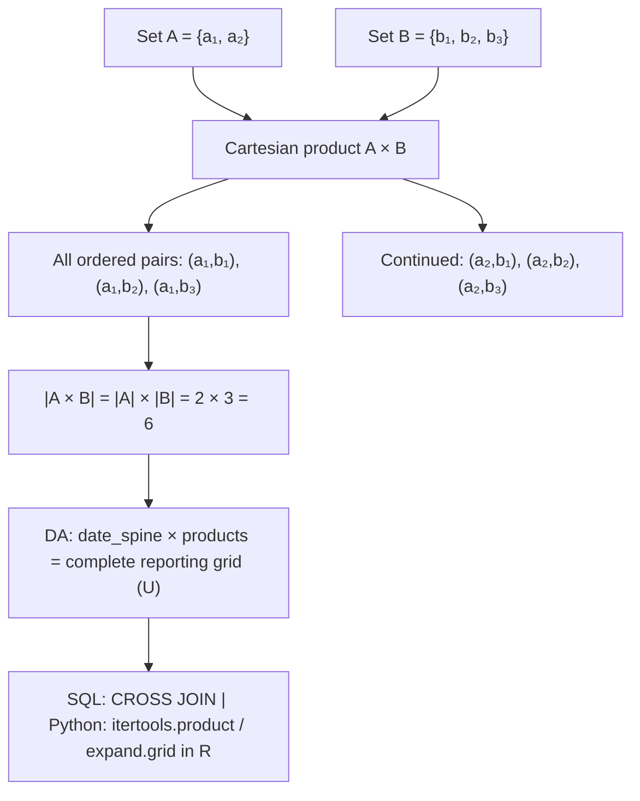

# Cartesian product

$$
A \times B
$$

## Deep Breakdown

What it tells me *(Situation Awareness)*:
The **Cartesian product** $A \times B$ is the set of all possible ordered pairs $(a, b)$ where $a \in A$ and $b \in B$. It generates every combination of one element from each set. The name comes from René Descartes, who used the same idea to define coordinate geometry: the real plane $\mathbb{R}^2 = \mathbb{R} \times \mathbb{R}$ is the Cartesian product of the real line with itself. In DA/DS, Cartesian products appear constantly: building complete reporting grids (all date × product combinations), SQL `CROSS JOIN`, `itertools.product`, `pd.MultiIndex.from_product`, and feature interaction matrices. The Cartesian product is also the theoretical foundation of relational databases — a table is a subset of the Cartesian product of its column domains.

## Flowchart



## Real-world use

### Where it is used

Building complete reporting spines: you have 31 dates and 5 products, and you need a row for every date-product combination even when there was no sale. SQL `CROSS JOIN`, Python `itertools.product`, and R `expand.grid` all implement $\text{dates} \times \text{products}$. Hyperparameter grid search: all combinations of learning rates × depths × estimators. Feature interaction terms: pair-wise combinations of categorical levels. Multi-index DataFrames: row index = customer × month.

### Problem it solves

Without the Cartesian product, a report based on actual transactions will silently omit combinations where no event occurred — missing dates, missing product rows, zero-sales periods. Downstream charts show gaps, aggregations undercount, and time-series models break. $A \times B$ forces the complete universe into existence before joining real data.

### How it solves the problem

$A \times B = \{(a, b) : a \in A \land b \in B\}$. Every element of $A$ is paired with every element of $B$. The resulting set has cardinality $|A| \times |B|$. You then LEFT JOIN the actual data onto this complete grid: unmatched combinations get zero / NULL, which you fill with a known default.

### Example in a business

Monthly sales report: $A$ = all 12 months of the year, $B$ = all 6 product categories. $A \times B = 72$ rows. After a `LEFT JOIN` on actual sales, any month-category combination with no sales appears with `revenue = 0` rather than being absent. The report now shows complete coverage — "Product X had zero sales in March" is a real data point, not a missing row.

## The formula, piece by piece

Breaking the notation:

- $A$: first set (e.g., set of dates, set of row labels)
- $\times$: the Cartesian product operator. Read "cross" or "times." Unicode: U+00D7. Named after René Descartes.
- $B$: second set (e.g., set of products, set of column labels)
- $(a, b)$: an **ordered pair** — order matters. $(a, b) \neq (b, a)$ unless $a = b$.
- $A \times B$: the set of ALL ordered pairs, one element drawn from each set. Cardinality: $|A \times B| = |A| \times |B|$.

Generalizations:
- $A \times B \times C = \{(a, b, c) : a \in A, b \in B, c \in C\}$ — triples. $|A \times B \times C| = |A| \cdot |B| \cdot |C|$.
- $A^n = A \times A \times \cdots \times A$ ($n$ times) — e.g., $\mathbb{R}^2 = \mathbb{R} \times \mathbb{R}$ is the 2D coordinate plane.

## The formula in words

"$A \times B$ is the set of all possible pairs where you pick one item from $A$ and one from $B$, in that order. If $A$ has 3 elements and $B$ has 4, you get $3 \times 4 = 12$ pairs. None are repeated, none are skipped. Every combination exists exactly once. In SQL this is `CROSS JOIN`. In Python it is `itertools.product(A, B)`. In R it is `expand.grid(A, B)`."

## Critical Concepts

1. **Order matters**: $A \times B \neq B \times A$ in general. $(a, b)$ and $(b, a)$ are different pairs. A date-product pair is not the same as a product-date pair as a conceptual object, even though the data would be the same.
2. **Cardinality explosion**: $|A \times B| = |A| \times |B|$. If $A$ has 365 days and $B$ has 10,000 products, the grid has 3.65 million rows. Always estimate size before materializing a Cartesian product in SQL — unbounded `CROSS JOIN` is one of the most common causes of query explosions.
3. **SQL `CROSS JOIN`**: in SQL, `SELECT * FROM A CROSS JOIN B` is the explicit Cartesian product. An accidental `CROSS JOIN` (a `FROM A, B` without a `JOIN` condition) is a silent query bomb. Always use explicit `JOIN` conditions.
4. **Foundation of relational algebra**: a SQL table is formally a subset of the Cartesian product of its column domains. A `WHERE` clause is a filter that selects a subset of $D_1 \times D_2 \times \cdots \times D_n$.
5. **Grid search in ML**: `sklearn.model_selection.GridSearchCV` builds a Cartesian product of hyperparameter values and evaluates every combination. `ParameterGrid({'n': [50, 100], 'lr': [0.01, 0.1]})` generates all 4 combinations.

## Step-by-step calculation (tiny example)

Task: build a complete sales grid for $A = \{\text{Jan}, \text{Feb}\}$ and $B = \{\text{Product_X}, \text{Product_Y}, \text{Product_Z}\}$.

*Step 1: Identify sizes*
$|A| = 2$ (months), $|B| = 3$ (products). Expected grid size: $2 \times 3 = 6$ rows.

*Step 2: Form all ordered pairs*
$(Jan, X), (Jan, Y), (Jan, Z), (Feb, X), (Feb, Y), (Feb, Z)$.

*Step 3: LEFT JOIN actual data*
Actual sales: $(Jan, X): 100$, $(Jan, Z): 50$, $(Feb, Y): 200$.
After join: $(Jan, X): 100$, $(Jan, Y): 0$, $(Jan, Z): 50$, $(Feb, X): 0$, $(Feb, Y): 200$, $(Feb, Z): 0$.
Four zero-fill rows were added by the Cartesian product that would have been invisible without it.

## Code examples

### Beginner example (Python)

```python
# A × B: Cartesian product import itertools
# Basic example: months × products
months = ["Jan", "Feb", "Mar"]
products = ["Widget_A", "Widget_B"]
cartesian = list(itertools.product(months, products))
print(f"|A| = {len(months)}, |B| = {len(products)}")
print(f"|A × B| = {len(cartesian)}")
print("\nAll ordered pairs (A × B):")
for pair in cartesian:
    print(f" {pair}")   # Verify cardinality rule
assert len(cartesian) == len(months) * len(products), "Cardinality rule violated"   # Pandas: build complete date × product grid and fill missing revenue
import pandas as pd
import numpy as np
np.random.seed(42)
date_spine = pd.date_range("2024-01-01", periods=5, freq="D")
product_list = ["Widget_A", "Widget_B", "Widget_C"]   # Cartesian product as a DataFrame
grid_df = pd.DataFrame( list(itertools.product(date_spine, product_list)), columns=["date", "product"],
)
print(f"\nGrid size: {len(grid_df)} rows ({len(date_spine)} dates × {len(product_list)} products)")   # Simulate sparse actual data (subset of the grid)
actual_df = pd.DataFrame({ "date": [date_spine[0], date_spine[1], date_spine[3]], "product": ["Widget_A", "Widget_C", "Widget_B"], "revenue": [120.0, 85.0, 200.0],
})   # LEFT JOIN: missing combinations get
revenue = 0
complete_df = grid_df.merge(actual_df, on=["date", "product"], how="left").fillna({"revenue": 0.0})
print("\nComplete reporting grid (zeros for missing combos):")
print(complete_df.to_string(index=False))
print(f"\nActual rows: {(complete_df['revenue'] > 0).sum()}")
print(f"Zero-fill rows: {(complete_df['revenue'] == 0).sum()}")
```

### Beginner example (R)

```r
# Cartesian product in R: expand.grid()
months <- c("Jan", "Feb", "Mar")
products <- c("Widget_A", "Widget_B")
grid <- expand.grid(month = months, product = products, stringsAsFactors = FALSE)
cat(sprintf("|A| = %d, |B| = %d\n", length(months), length(products)))
cat(sprintf("|A × B| = %d rows\n", nrow(grid)))
print(grid)  # Date × product reporting grid
library(tidyr)
library(dplyr)
dates <- seq.Date(as.Date("2024-01-01"), by = "day", length.out = 5)
products <- c("Widget_A", "Widget_B", "Widget_C")
complete_grid <- expand.grid(date = dates, product = products, stringsAsFactors = FALSE)  # Actual sales (sparse)
actual_sales <- data.frame( date = as.Date(c("2024-01-01", "2024-01-02", "2024-01-04")), product = c("Widget_A", "Widget_C", "Widget_B"), revenue = c(120.0, 85.0, 200.0), stringsAsFactors = FALSE
)  # LEFT JOIN
complete_report <- complete_grid %>% left_join(actual_sales, by = c("date", "product")) %>% mutate(revenue = replace_na(revenue, 0))
cat(sprintf("\nGrid: %d rows (%d dates × %d products)\n", nrow(complete_report), length(dates), length(products)))
cat(sprintf("Non-zero revenue rows: %d\n", sum(complete_report$revenue > 0)))
cat(sprintf("Zero-fill rows: %d\n", sum(complete_report$revenue == 0)))
print(complete_report)
```

### Professional example (Python)

```python
import pandas as pd
import numpy as np
import itertools
from sklearn.model_selection import ParameterGrid   # Scenario 1: complete multi-dimensional reporting grid
# U = dates × products × channels (Cartesian product as the universal set)
np.random.seed(42)
DATES = pd.date_range("2024-01-01", "2024-01-07", freq="D")
PRODUCTS = ["Widget_A", "Widget_B", "Widget_C"]
CHANNELS = ["organic", "paid", "email"]   # Build universal grid: |U| = 7 × 3 × 3 = 63 rows
full_grid = pd.DataFrame( list(itertools.product(DATES, PRODUCTS, CHANNELS)), columns=["date", "product", "channel"],
)   # Simulate sparse actual data
n_actual = 25
actual = pd.DataFrame({ "date": np.random.choice(DATES, n_actual), "product": np.random.choice(PRODUCTS, n_actual), "channel": np.random.choice(CHANNELS, n_actual), "revenue": np.random.uniform(10, 500, n_actual).round(2),
}).drop_duplicates(subset=["date", "product", "channel"])   # Merge: complete grid with zero-fill
report = full_grid.merge(actual, on=["date", "product", "channel"], how="left").fillna({"revenue": 0.0})
filled_rows = (report["revenue"] == 0.0).sum()
actual_rows = (report["revenue"] > 0.0).sum()
print("Reporting Grid (A × B × C)")
print("=" * 44)
print(f" |dates|: {len(DATES):>4} ×")
print(f" |products|: {len(PRODUCTS):>4} ×")
print(f" |channels|: {len(CHANNELS):>4} =")
print(f" |grid|: {len(full_grid):>4} rows")
print(f"\n Actual data rows: {actual_rows:>4}")
print(f" Zero-fill rows: {filled_rows:>4}")
print(f" Coverage: {actual_rows/len(full_grid):.1%}")
print()   # Scenario 2: hyperparameter grid search using Cartesian product
PARAM_GRID = { "n_estimators": [50, 100, 200], "max_depth": [3, 5, 10], "learning_rate": [0.01, 0.1, 0.3],
}
all_combos = list(ParameterGrid(PARAM_GRID))
print("Hyperparameter Grid (A × B × C)")
print("=" * 44)
print(f" n_estimators: {len(PARAM_GRID['n_estimators'])} values")
print(f" max_depth: {len(PARAM_GRID['max_depth'])} values")
print(f" learning_rate: {len(PARAM_GRID['learning_rate'])} values")
print(f" Total combos: {len(all_combos)} ({len(PARAM_GRID['n_estimators'])} × {len(PARAM_GRID['max_depth'])} × {len(PARAM_GRID['learning_rate'])})")
print(f"\n First 3 combos:")
for combo in all_combos[:3]:
    print(f" {combo}")
```

### Professional example (R)

```r
# Hyperparameter grid as Cartesian product A × B × C
n_estimators <- c(50, 100, 200)
max_depth <- c(3, 5, 10)
learning_rate <- c(0.01, 0.1, 0.3)
all_combos <- expand.grid( n_estimators = n_estimators, max_depth = max_depth, learning_rate = learning_rate
) cat("Hyperparameter Grid (A × B × C)\n")
cat(sprintf(" n_estimators: %d values\n", length(n_estimators)))
cat(sprintf(" max_depth: %d values\n", length(max_depth)))
cat(sprintf(" learning_rate: %d values\n", length(learning_rate)))
cat(sprintf(" Total combos: %d\n", nrow(all_combos)))
cat(" First 3 combos:\n")
print(head(all_combos, 3))
```

---

*Source: AIO p. 30 of 286*
