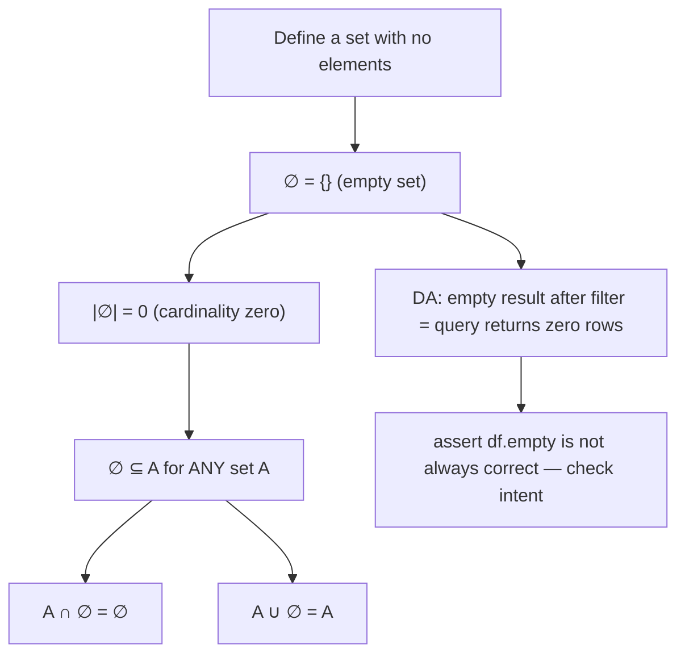

# Empty set

$$
\emptyset
$$

## Deep Breakdown

What it tells me *(Situation Awareness)*:
The **empty set** $\emptyset$ (also written $\{\}$) is the unique set that contains no elements. It has zero members. Every other set contains at least one element; the empty set is the only exception. It is to sets what zero is to numbers — the "nothing" baseline. In DA/DS, the empty set appears as: a query returning zero rows, an empty DataFrame after filtering, a Python `set()` after all elements are removed, a degenerate case in set operations ($A \cap B = \emptyset$ means A and B share no elements), and in assertions that validate a dataset has no invalid values.

## Flowchart



## Real-world use

### Where it is used

Checking whether a filter returns any results: `if df[df['status'] == 'error'].empty`. Verifying disjoint sets: if `set_A.intersection(set_B) == set()`, the two groups are mutually exclusive (e.g., train set and test set should not overlap). Handling no-result scenarios: `result = query() or []` (empty list ≈ empty set). Asserting data quality: "the set of null user IDs must be empty."

### Problem it solves

Without the concept of an empty set, you cannot cleanly express "nothing was found," "no violations exist," or "the two collections share no elements." The empty set provides a consistent, well-defined answer to operations that yield no results, rather than null or error.

### How it solves the problem

$\emptyset$ is a valid set — it just has zero elements. Set operations on $\emptyset$ are well-defined: $A \cup \emptyset = A$, $A \cap \emptyset = \emptyset$, $A \setminus \emptyset = A$. This means you can compose set operations without special-casing "no results" — the math handles it uniformly.

### Example in a business

Train/test split integrity check: after splitting a dataset, verify the split is clean. `assert set(train_ids) & set(test_ids) == set()` — the intersection of training IDs and test IDs must be empty (disjoint sets). If it is not empty, data leakage is present.

## The formula, piece by piece

Breaking the notation:

- $\emptyset$: the Danish/Norwegian letter "ø" used as the symbol for the empty set (introduced by André Weil, 1939). Also written $\{\}$.
- $|\emptyset| = 0$: the cardinality (size) of the empty set is zero.
- $\emptyset \subseteq A$: the empty set is a subset of every set — vacuously true (there are no elements in $\emptyset$ that could violate the subset condition).
- $\emptyset \neq \{\emptyset\}$: the empty set and the set containing the empty set are different! $\{\emptyset\}$ has one element; $\emptyset$ has none.

Key properties:
- $A \cup \emptyset = A$ (union with nothing changes nothing)
- $A \cap \emptyset = \emptyset$ (intersection with nothing gives nothing)
- $A \setminus \emptyset = A$ (removing nothing changes nothing)
- $\emptyset \setminus A = \emptyset$ (removing from nothing gives nothing)
- $A \times \emptyset = \emptyset$ (no pairs possible if one set is empty)

## The formula in words

"$\emptyset$ is the empty collection — a set with nothing in it. Zero rows, zero elements, zero members. It is the result when no element passes the filter. Every set contains $\emptyset$ as a subset. It is not null — it is a real, concrete mathematical object that happens to contain nothing."

## Critical Concepts

1. **`set()` vs `None`**: in Python, `set()` is the empty set — a valid, iterable object. `None` means "no value." Do not confuse them. An empty set returned from a database lookup means "found nothing"; `None` means "the query was never run."
2. **`df.empty` in pandas**: `df.empty` is True if the DataFrame has no rows OR no columns. An empty DataFrame after filtering does not mean an error — it means no rows matched. Always check `df.empty` before proceeding with downstream logic.
3. **Disjoint sets**: $A \cap B = \emptyset$ means $A$ and $B$ share no elements. In DA this is critical for train/test splits (no leakage), feature groups (no duplication), and segmentation (mutually exclusive audiences).
4. **SQL empty result**: a query that returns zero rows is not an error — it is a valid result equivalent to $\emptyset$.

An empty result set is different from NULL, and different from a missing table.

## Step-by-step calculation (tiny example)

Task: verify train and test sets are disjoint.

*Step 1: Define the sets*
$\text{Train} = \{1, 2, 3, 4, 5, 6, 7\}$, $\text{Test} = \{8, 9, 10\}$

*Step 2: Compute intersection*
$\text{Train} \cap \text{Test} = \{\}= \emptyset$

*Step 3: Interpret*
$|\text{Train} \cap \text{Test}| = 0$ — no overlap. Disjoint. No data leakage. *Counterexample*: $\text{Train} = \{1, 2, 3, 5\}$, $\text{Test} = \{4, 5, 6\}$:
$\text{Train} \cap \text{Test} = \{5\} \neq \emptyset$ — leakage! ID 5 appears in both splits.

## Code examples

### Beginner example (Python)

```python
# ∅ — the empty set
# Creating and checking empty sets
empty_via_literal = set()
empty_via_constructor = set()
print(f"Empty set: {empty_via_literal}")
print(f"Cardinality: {len(empty_via_literal)}")
print(f"Is empty: {len(empty_via_literal) == 0}")
print(f"WARNING: {{}} creates an empty dict, not set: {type({})}")
print(f" set() creates an empty set: {type(set())}")   # Set operations involving ∅
A = {1, 2, 3}
empty = set()
print(f"\nA ∪ ∅ = {A | empty} (unchanged)")
print(f"A ∩ ∅ = {A & empty} (empty)")
print(f"A \\ ∅ = {A - empty} (unchanged)")
print(f"∅ ⊆ A: {empty.issubset(A)} (always true)")   # DA use: disjoint train/test check
import numpy as np
np.random.seed(42)
all_ids = np.arange(1, 101)
train_ids = set(np.random.choice(all_ids, 80, replace=False))
test_ids = all_ids[~np.isin(all_ids, list(train_ids))]
test_ids = set(test_ids)
overlap = train_ids & test_ids   # should be ∅
print(f"\nTrain size: {len(train_ids)}, Test size: {len(test_ids)}")
print(f"Overlap (should be ∅): {overlap}")
print(f"Disjoint (overlap == ∅): {overlap == set()}")   # DA use: empty DataFrame after filter
import pandas as pd
df = pd.DataFrame({"status": ["active", "active", "inactive"], "val": [1, 2, 3]})
error_rows = df[df["status"] == "error"]
print(f"\nFilter for 'error' rows: df.empty = {error_rows.empty}")
print(f"Shape: {error_rows.shape} ← 0 rows = ∅")
```

### Beginner example (R)

```r
# Empty set in R
empty_set <- character(0)  # empty character vector
cat("Empty set:", empty_set, "\n")
cat("Length: ", length(empty_set), "\n")
cat("Is empty: ", length(empty_set) == 0, "\n")  # Set operations with empty set
A <- c(1, 2, 3)
cat(sprintf("\nA ∪ ∅ = %s\n", paste(union(A, integer(0)), collapse=",")))
cat(sprintf("A ∩ ∅ = %s\n", paste(intersect(A, integer(0)), collapse=",")))
cat(sprintf("∅ ⊆ A: %s\n", all(integer(0) %in% A)))  # vacuously TRUE # Train/test disjoint check
set.seed(42)
all_ids <- 1:100
train_ids <- sample(all_ids, 80)
test_ids <- setdiff(all_ids, train_ids)
overlap <- intersect(train_ids, test_ids)
cat(sprintf("\nTrain: %d, Test: %d\n", length(train_ids), length(test_ids)))
cat(sprintf("Overlap: %d elements (should be ∅)\n", length(overlap)))
cat(sprintf("Disjoint: %s\n", length(overlap) == 0))
```

### Professional example (Python)

```python
import pandas as pd
import numpy as np
from sklearn.model_selection import train_test_split   # Scenario: comprehensive empty-set checks across a modeling pipeline
np.random.seed(42)
N = 1000
df = pd.DataFrame({ "id": range(1, N + 1), "feature1": np.random.randn(N), "feature2": np.random.uniform(0, 100, N), "label": np.random.randint(0, 2, N),
})   # ---- 1. Train/test split — check for leakage (overlap = ∅) ----
train_df, test_df = train_test_split(df, test_size=0.2, random_state=42)
train_ids = set(train_df["id"])
test_ids = set(test_df["id"])
overlap = train_ids & test_ids
print("Pipeline Empty-Set Checks (∅ = clean)")
print("=" * 44)
print(f"\n1. Train/Test overlap:")
print(f" Overlap = {overlap if overlap else '∅'} (size = {len(overlap)})")
print(f" {'PASS' if overlap == set() else 'FAIL — DATA LEAKAGE'}")   # ---- 2. Missing values after imputation (should be ∅) ----
df_imputed = df.fillna(df.median(numeric_only=True))
null_ids = set(df_imputed.columns[df_imputed.isnull().any()])
print(f"\n2. Columns with nulls after imputation:")
print(f" Columns = {null_ids if null_ids else '∅'} (size = {len(null_ids)})")
print(f" {'PASS' if null_ids == set() else 'FAIL — nulls remain'}")   # ---- 3. Duplicate IDs (should be ∅) ----
seen = set()
dup_ids = {x for x in df["id"] if x in seen or seen.add(x)}
print(f"\n3. Duplicate IDs in dataset:")
print(f" Duplicates = {dup_ids if dup_ids else '∅'} (size = {len(dup_ids)})")
print(f" {'PASS' if dup_ids == set() else 'FAIL — duplicates found'}")   # ---- 4. Empty DataFrame guards ----
high_risk = df[df["feature1"] > 10]   # likely empty for standard normal
if high_risk.empty:
    print("\n4. High-risk rows (feature1 > 10): ∅ — no such rows (expected for N(0,1))")
else:
    print(f"\n4. High-risk rows: {len(high_risk)} rows found")
```

### Professional example (R)

```r
# Data quality checks where "empty set" (∅) means PASS
set.seed(42)
df <- data.frame(id = 1:100, feature1 = rnorm(100))
null_ids <- df$id[is.na(df$id)]
dup_ids <- df$id[duplicated(df$id)]
high_risk <- df[df$feature1 > 10, ]
cat("1. Null IDs: ", if (length(null_ids) == 0) "∅ (PASS)" else "FAIL", "\n")
cat("2. Duplicate IDs: ", if (length(dup_ids) == 0) "∅ (PASS)" else "FAIL", "\n")
cat("3. High-risk (feature1 > 10): ", if (nrow(high_risk) == 0) "∅ — no such rows" else paste(nrow(high_risk), "rows"), "\n")
```

---

*Source: 1300 p. 13*
