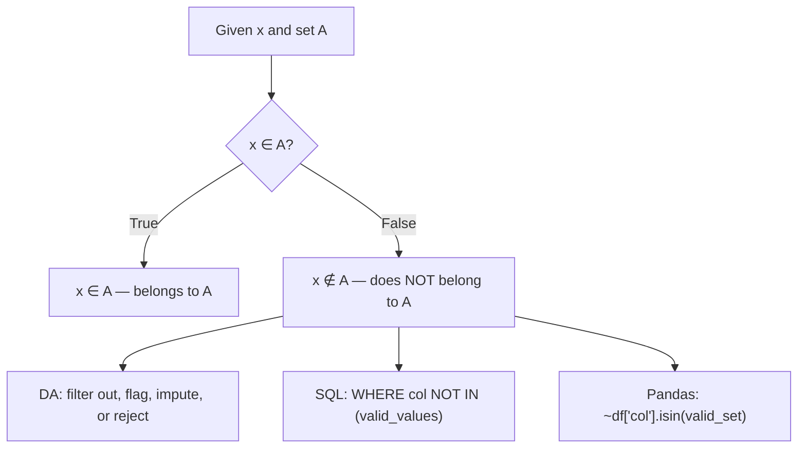

# Not an element of

$$
x \notin A
$$

## Deep Breakdown

What it tells me *(Situation Awareness)*:
The symbol $x \notin A$ means "$x$ is NOT a member (element) of set $A$" — the negation of $x \in A$. It is simply $\lnot(x \in A)$: the membership test returned False. In DA/DS this is the foundation of: exclusion filters (`NOT IN`, `~isin()`), outlier and anomaly detection (values outside the expected domain), null/missing detection when None is not in the valid set, and guard clauses that block invalid values from entering a pipeline.

## Flowchart



## Real-world use

### Where it is used

Exclusion filters: `WHERE country NOT IN ('XX', 'ZZ')`. Anomaly detection: revenue values outside expected range `{x | x ∈ ℝ, 0 < x ≤ MAX_REVENUE}`. Blocklist filtering: removing known bot IPs or banned user IDs. Finding rows with unrecognized category values. Complement set operations: $A^c = \{x \in U \mid x \notin A\}$.

### Problem it solves

Often it is easier to define what is invalid or excluded than what is valid. A blocklist (`NOT IN`) or an exclusion filter is the natural dual of an allowlist (`IN`). $x \notin A$ formalizes this negation cleanly, making it clear you are computing the complement.

### How it solves the problem

$x \notin A$ is the boolean complement of $x \in A$. In Python: `x not in my_set`. In pandas: `~df['col'].isin(valid_set)` (tilde is bitwise NOT on boolean Series). In SQL: `col NOT IN (...)` or `col NOT IN (SELECT ... FROM ...)`. All return True for values outside the allowed domain.

### Example in a business

Bot traffic exclusion: `df_clean = df[~df['user_agent'].isin(known_bot_agents)]`. All rows where `user_agent ∉ known_bot_agents` are kept; bot rows are dropped. Same logic in SQL: `WHERE session_id NOT IN (SELECT session_id FROM bot_sessions)`.

## The formula, piece by piece

Breaking the notation:

- $x \notin A$: the $\in$ symbol with a diagonal strikethrough — "NOT element of."
- Equivalent to: $\lnot(x \in A)$ — the logical negation of membership.
- $x \notin A \iff x \in A^c$ — $x$ not in $A$ iff $x$ is in the complement of $A$ (relative to the universal set $U$).

Relationship:
| Statement | Meaning | Python |
|-----------|---------|--------|
| $x \in A$ | $x$ is in $A$ | `x in A` |
| $x \notin A$ | $x$ is NOT in $A$ | `x not in A` |
| $\forall x \in A$: $P(x)$ | For every element of $A$, property $P$ holds | `all(P(x) for x in A)` |
| $\exists x \in A$: $P(x)$ | Some element of $A$ satisfies $P$ | `any(P(x) for x in A)` |

## The formula in words

"$x \notin A$ reads: $x$ does not belong to $A$. The value is outside the collection. In code: `x not in collection`. In data: a row that fails a domain check. The complement view: everything NOT in the allowlist is in the blocklist."

## Critical Concepts

1. **`NOT IN` with NULLs in SQL**: `WHERE col NOT IN (1, 2, NULL)` returns NO rows — because `NULL` comparisons are unknown in SQL, making the entire `NOT IN` unknown. Always use `WHERE col NOT IN (1, 2) AND col IS NOT NULL` when the list might contain NULLs.
2. **Pandas `~isin()` with NaN**: `~df['col'].isin(valid_set)` marks NaN values as True (not in the valid set) — which is usually correct behavior for flagging invalid rows, but may need separate null handling.
3. **Complement notation**: $A^c$ or $\overline{A}$ denotes all elements of the universal set $U$ that are not in $A$. In pandas: `df[~mask]` is the complement of `df[mask]`.
4. **De Morgan**: $x \notin A \cup B \iff x \notin A \land x \notin B$.

Useful when optimizing complex NOT IN filters across multiple sets.

## Step-by-step calculation (tiny example)

Task: find all transactions with currencies NOT in the accepted set.

*Step 1: Define accepted set*
$A = \{\text{"EUR"}, \text{"USD"}, \text{"GBP"}\}$

*Step 2: Check each transaction currency*
| Transaction | Currency | $\in A$? | $\notin A$? |
|-------------|----------|----------|-------------|
| T001 | EUR | True | False |
| T002 | BTC | False | **True** |
| T003 | USD | True | False |
| T004 | XYZ | False | **True** |

*Step 3: Filter*
Transactions where currency $\notin A$: T002 (BTC), T004 (XYZ) — flag for manual review.

## Code examples

### Beginner example (Python)

```python
# x ∉ A: not an element of
# Basic negation
A = {"approved", "pending", "rejected"}
values = ["approved", "PENDING", "rejected", "cancelled", None, "pending"]
print("Membership negation check:")
for v in values:
    in_set = v in A
    not_in = v not in A
    print(f" {str(v):>12} ∈ A: {str(in_set):>5} ∉ A: {str(not_in):>5}")

import pandas as pd
import numpy as np

np.random.seed(42)
VALID_CURRENCIES = {"EUR", "USD", "GBP", "CHF"}
df = pd.DataFrame({
    "transaction_id": range(1, 9),
    "currency": ["EUR", "USD", "BTC", "GBP", None, "XYZ", "CHF", "ETH"],
    "amount": np.random.uniform(100, 5000, 8).round(2),
})

# x ∉ A: flag invalid currencies
df["is_invalid_currency"] = ~df["currency"].isin(VALID_CURRENCIES)
print("\nCurrency validation (∉ VALID_CURRENCIES = flagged):")
print(df.to_string(index=False))
invalid_rows = df[df["is_invalid_currency"]]
print(f"\nInvalid rows ({len(invalid_rows)}):")
print(invalid_rows[["transaction_id", "currency", "amount"]].to_string(index=False))
```

### Beginner example (R)

```r
# x ∉ A in R: !(x %in% A)
valid_currencies <- c("EUR", "USD", "GBP", "CHF")
currencies <- c("EUR", "USD", "BTC", "GBP", NA, "XYZ", "CHF", "ETH")
not_in_valid <- !(currencies %in% valid_currencies)
cat("Currency membership check:\n")
for (i in seq_along(currencies)) {
  cat(sprintf(" %-8s ∈ A: %-5s ∉ A: %-5s\n",
              ifelse(is.na(currencies[i]), "NA", currencies[i]),
              !not_in_valid[i], not_in_valid[i]))
}

# Filter invalid rows
df <- data.frame(
  transaction_id = 1:8,
  currency = currencies,
  amount = round(runif(8, 100, 5000), 2),
  stringsAsFactors = FALSE
)
df$is_invalid <- !(df$currency %in% valid_currencies)
cat("\nTransactions with invalid currency (∉ valid set):\n")
print(df[df$is_invalid, ])
```

### Professional example (Python)

```python
import pandas as pd
import numpy as np

# Scenario: multi-level exclusion filtering (∉ A pattern)
# Use case: clean a web analytics dataset
np.random.seed(42)
N = 500
KNOWN_BOTS = {"googlebot", "bingbot", "scrapy", "wget", "curl"}
EXCLUDED_COUNTRIES = {"XX", "ZZ", "??"}  # placeholder/invalid country codes
VALID_EVENTS = {"pageview", "click", "purchase", "signup"}

raw_df = pd.DataFrame({
    "session_id": range(1, N + 1),
    "user_agent": np.random.choice(
        ["chrome", "firefox", "safari", "googlebot", "scrapy", "curl"], N,
        p=[0.4, 0.25, 0.2, 0.08, 0.04, 0.03],
    ),
    "country": np.random.choice(["AT", "DE", "US", "XX", "ZZ", "GB"], N,
                                p=[0.3, 0.25, 0.2, 0.1, 0.1, 0.05]),
    "event_type": np.random.choice(
        ["pageview", "click", "purchase", "signup", "unknown", "bot_ping"], N,
        p=[0.4, 0.3, 0.1, 0.1, 0.05, 0.05],
    ),
    "revenue": np.where(
        np.random.rand(N) < 0.1,
        np.random.uniform(10, 500, N).round(2),
        0.0,
    ),
})


def apply_exclusion_filters(df: pd.DataFrame) -> tuple[pd.DataFrame, dict]:
    """Apply exclusion filters based on set non-membership (x ∉ A).

    Args:
        df: Raw DataFrame.

    Returns:
        Cleaned DataFrame and a dict of per-filter exclusion counts.
    """
    initial_count = len(df)
    exclusion_log: dict[str, int] = {}

    # x ∉ KNOWN_BOTS
    bot_mask = df["user_agent"].isin(KNOWN_BOTS)
    exclusion_log["bots (user_agent ∉ allowed)"] = int(bot_mask.sum())
    df = df[~bot_mask]

    # x ∉ EXCLUDED_COUNTRIES
    country_mask = df["country"].isin(EXCLUDED_COUNTRIES)
    exclusion_log["invalid country (∉ valid codes)"] = int(country_mask.sum())
    df = df[~country_mask]

    # x ∉ VALID_EVENTS
    event_mask = ~df["event_type"].isin(VALID_EVENTS)
    exclusion_log["unknown events (∉ valid types)"] = int(event_mask.sum())
    df = df[~event_mask]
    exclusion_log["total excluded"] = initial_count - len(df)
    exclusion_log["total remaining"] = len(df)
    return df.reset_index(drop=True), exclusion_log


clean_df, log = apply_exclusion_filters(raw_df)
print("Exclusion Filter Report (x ∉ A pattern)")
print("=" * 46)
for reason, count in log.items():
    print(f" {reason:<40} {count}")
```

### Professional example (R)

```r
# Exclusion filter: drop rows where x ∉ valid set
VALID_EVENTS <- c("click", "purchase", "view")
set.seed(42)
raw_df <- data.frame(
  event_id = 1:200,
  event_type = sample(c("click", "purchase", "view", "spam", "unknown"), 200, replace = TRUE)
)
initial_count <- nrow(raw_df)
event_mask <- !raw_df$event_type %in% VALID_EVENTS
clean_df <- raw_df[!event_mask, ]
exclusion_log <- list(
  "unknown events (∉ valid types)" = sum(event_mask),
  "total excluded" = initial_count - nrow(clean_df),
  "total remaining" = nrow(clean_df)
)
cat("Exclusion Filter Report (x ∉ A pattern)\n")
for (reason in names(exclusion_log)) {
  cat(" ", reason, ": ", exclusion_log[[reason]], "\n", sep = "")
}
```

---

*Source: 1300 p. 15*
