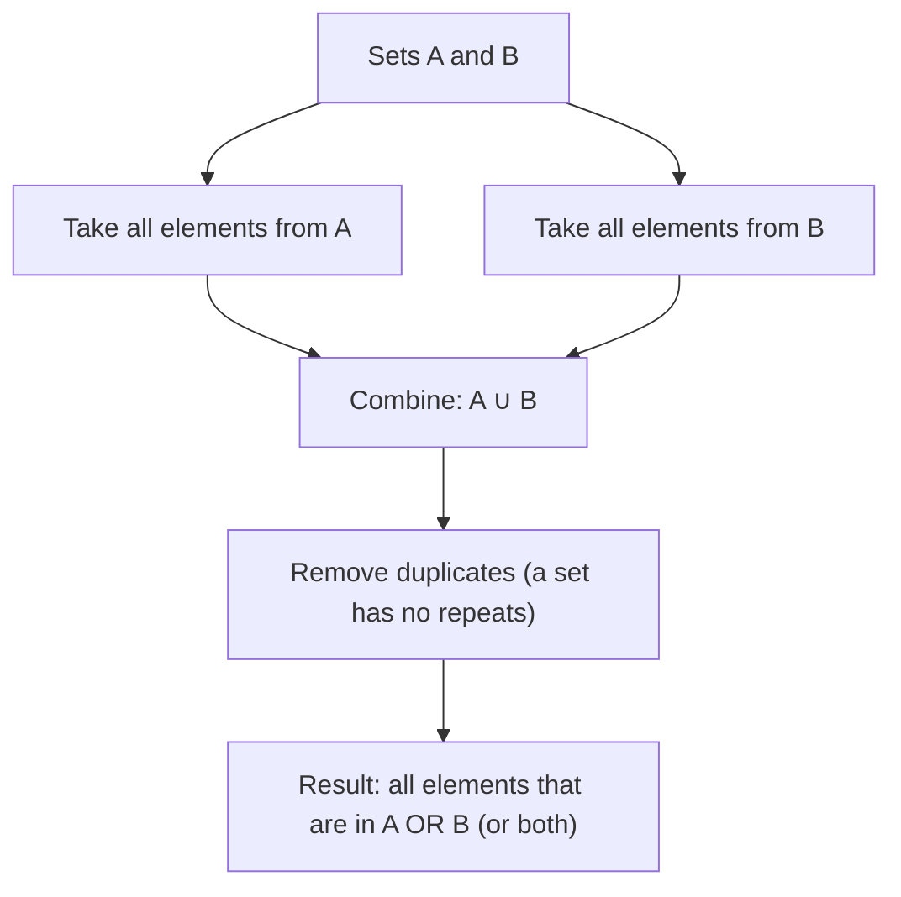

# Union

$$
A \cup B
$$

## Deep Breakdown

What it tells me *(Situation Awareness)*:
$A \cup B$ is the **union** of sets $A$ and $B$: the set of all elements that belong to $A$, or to $B$, or to both. It is the "combine everything" operation. In DA/DS, union appears every time you merge or stack datasets: combining training data from two sources, computing the set of all users who appeared in either dataset, SQL UNION clauses, and Python's `pd.concat()`. The key distinction from the intersection ($A \cap B$) is that union includes everything from both sides, not just what they share.

## Flowchart



## Real-world use

### Where it is used

Combining two lists of customer IDs from different systems (all customers in system A OR system B), SQL `UNION` and `UNION ALL` operations, stacking multiple DataFrames with `pd.concat()`, computing reach metrics ("users who saw ad A OR ad B"), building feature vocabularies by merging token sets from multiple text sources.

### Problem it solves

When data comes from multiple sources, you need to combine them without losing any records from either source. The union guarantees that no record is dropped: if an element appears in either set, it appears in the union. This is the "OR" logic for data combination.

### How it solves the problem

$A \cup B = \{x : x \in A \text{ or } x \in B\}$. Every element in either set is included. Elements in both sets appear only once in the result (sets have no duplicates). The size satisfies $|A \cup B| = |A| + |B| - |A \cap B|$ (inclusion-exclusion: subtract the overlap to avoid double-counting).

### Example in a business

Campaign reach analysis: set $A$ = users who clicked email campaign, set $B$ = users who clicked display campaign. $A \cup B$ = all users reached by either campaign. $|A \cup B|$ is the total unique reach. The complement $|A| + |B| - |A \cup B| = |A \cap B|$ tells you how many users received both, which helps calculate incremental lift.

## The formula, piece by piece

Breaking the notation:

- $A$: the first set.
- $\cup$: the union symbol. A "cup" shape opening upward. Unicode: U+222A. Pronounced "union" or "or."
- $B$: the second set.
- $A \cup B$: the set containing all elements from $A$ or $B$ (or both). Formal definition: $A \cup B = \{x : x \in A \lor x \in B\}$.

Properties:
- Commutative: $A \cup B = B \cup A$.
- Associative: $(A \cup B) \cup C = A \cup (B \cup C)$.
- Identity: $A \cup \emptyset = A$ (union with empty set does nothing).
- Idempotent: $A \cup A = A$ (union with itself is itself).
- With universal set: $A \cup U = U$.
- Distributive: $A \cup (B \cap C) = (A \cup B) \cap (A \cup C)$.

Inclusion-exclusion for cardinality: $|A \cup B| = |A| + |B| - |A \cap B|$.

## The formula in words

"$A \cup B$ is the collection of everything in $A$ plus everything in $B$, with duplicates removed. If an element is in one set, it is in the union. If it is in both, it still appears only once. Think of it as a full outer join that returns all rows from both sides."

## Critical Concepts

1. **Union vs. UNION ALL in SQL**: $A \cup B$ removes duplicates. SQL `UNION` does the same. SQL `UNION ALL` is a multiset union that keeps duplicates.
2. **Inclusion-exclusion**: to count $|A \cup B|$ without listing elements, use $|A| + |B| - |A \cap B|$. Subtracting the intersection prevents double-counting.
3. **pd.concat() vs. merge()**: `pd.concat([df_a, df_b])` stacks rows (union of rows, retaining duplicates unless deduplicated). `df_a.merge(df_b, how='outer')` is the join equivalent of union for relational data.
4. **Complement**: $\overline{A \cup B} = \overline{A} \cap \overline{B}$ (De Morgan's law for sets). Everything NOT in $A \cup B$ is the set of things in neither $A$ nor $B$.
5. **Generalizing to many sets**: $\bigcup_{i=1}^{n} A_i$ is the union of $n$ sets.

Used when combining training data from $n$ sources.

## Step-by-step calculation (tiny example)

Task: find $A \cup B$ for $A = \{1, 2, 3\}$ and $B = \{2, 3, 4, 5\}$. Verify $|A \cup B|$ with inclusion-exclusion.

*Step 1: List all elements from A*
From $A$: $1, 2, 3$.

*Step 2: Add elements from B that are not already included*
From $B$: $2$ (already in), $3$ (already in), $4$ (new), $5$ (new).

*Step 3: Verify with inclusion-exclusion*
$A \cup B = \{1, 2, 3, 4, 5\}$, so $|A \cup B| = 5$.
Check: $|A| + |B| - |A \cap B| = 3 + 4 - 2 = 5$. Confirmed. ($A \cap B = \{2, 3\}$, $|A \cap B| = 2$.)

## Code examples

### Beginner example (Python)

```python
# Set union in Python: A | B or A.union(B)
A = {1, 2, 3}
B = {2, 3, 4, 5}
union_result = A | B
print(f"A = {A}")
print(f"B = {B}")
print(f"A ∪ B = {union_result}")  # {1, 2, 3, 4, 5}

# Cardinality via inclusion-exclusion
print(f"\nInclusion-exclusion:")
print(f"|A| = {len(A)}, |B| = {len(B)}, |A ∩ B| = {len(A & B)}")
print(f"|A ∪ B| = {len(A)} + {len(B)} - {len(A & B)} = {len(A) + len(B) - len(A & B)}")
print(f"Direct count: {len(union_result)}")

# String sets (categorical values)
users_email = {"alice", "bob", "carol"}
users_app = {"bob", "carol", "dave", "eve"}
all_users = users_email | users_app
print(f"\nAll users (email ∪ app): {all_users}")
print(f"Total reach: {len(all_users)}")
```

### Beginner example (R)

```r
# Set union in R: union(A, B)
A <- c(1, 2, 3)
B <- c(2, 3, 4, 5)
union_result <- union(A, B)
cat("A =", A, "\n")
cat("B =", B, "\n")
cat("A ∪ B =", union_result, "\n")  # 1 2 3 4 5

# Inclusion-exclusion for cardinality
cat(sprintf("|A|=%d, |B|=%d, |A∩B|=%d\n", length(A), length(B), length(intersect(A, B))))
cat(sprintf("|A ∪ B| = %d + %d - %d = %d\n", length(A), length(B), length(intersect(A, B)), length(A) + length(B) - length(intersect(A, B))))

# String sets
users_email <- c("alice", "bob", "carol")
users_app <- c("bob", "carol", "dave", "eve")
all_users <- union(users_email, users_app)
cat("\nAll users (email ∪ app):", all_users, "\n")
cat("Total reach:", length(all_users), "\n")
```

### Professional example (Python)

```python
import pandas as pd
import numpy as np   # Scenario: campaign reach analysis using set union
# Compute total unique reach, overlap, and incremental contribution of each channel
np.random.seed(42)
ALL_USERS = list(range(1, 10_001))   # 10,000 users in the universe # Email campaign reached 3,000 users
email_users = set(np.random.choice(ALL_USERS, size=3_000, replace=False))   # Display campaign reached 4,000 users
display_users = set(np.random.choice(ALL_USERS, size=4_000, replace=False))   # Set operations
union_users = email_users | display_users
intersection_users = email_users & display_users
email_only = email_users - display_users
display_only = display_users - email_users   # Inclusion-exclusion verification
ie_count = len(email_users) + len(display_users) - len(intersection_users)
assert ie_count == len(union_users), "Inclusion-exclusion mismatch"
print("Campaign Reach Analysis")
print("=" * 40)
print(f" Email reach: {len(email_users):>6,}")
print(f" Display reach: {len(display_users):>6,}")
print(f" Total unique reach: {len(union_users):>6,} (A ∪ B)")
print(f" Overlap (both): {len(intersection_users):>6,} (A ∩ B)")
print(f" Email only: {len(email_only):>6,}")
print(f" Display only: {len(display_only):>6,}")
print()
print(f" Inclusion-exclusion: {len(email_users)} + {len(display_users)} - {len(intersection_users)} = {ie_count}")
print()   # Pandas: union of two DataFrames (stack + deduplicate)
df_email = pd.DataFrame({"user_id": list(email_users), "source": "email"})
df_display = pd.DataFrame({"user_id": list(display_users), "source": "display"})
df_all = ( pd.concat([df_email, df_display], ignore_index=True) .drop_duplicates(subset="user_id", keep="first") )
print(f" pd.concat + dedup unique users: {len(df_all):,} (matches set union: {len(df_all) == len(union_users)})")
```

### Professional example (R)

```r
# Campaign reach analysis using set union
set.seed(42)
ALL_USERS <- 1:10000
email_users <- sample(ALL_USERS, 3000)
display_users <- sample(ALL_USERS, 4000)
union_users <- union(email_users, display_users)
intersection_users <- intersect(email_users, display_users)
email_only <- setdiff(email_users, display_users)
display_only <- setdiff(display_users, email_users)
cat("Campaign Reach Analysis\n")
cat(sprintf(" Email reach: %6d\n", length(email_users)))
cat(sprintf(" Display reach: %6d\n", length(display_users)))
cat(sprintf(" Total unique: %6d (A ∪ B)\n", length(union_users)))
cat(sprintf(" Overlap (both): %6d (A ∩ B)\n", length(intersection_users)))  # data.frame union: rbind + unique
df_email <- data.frame(user_id = email_users, source = "email")
df_display <- data.frame(user_id = display_users, source = "display")
df_all <- unique(rbind(df_email, df_display))
cat(" rbind + unique users:", nrow(df_all), "(matches set union)\n")
```

---

*Source: 1300 p. 13*
