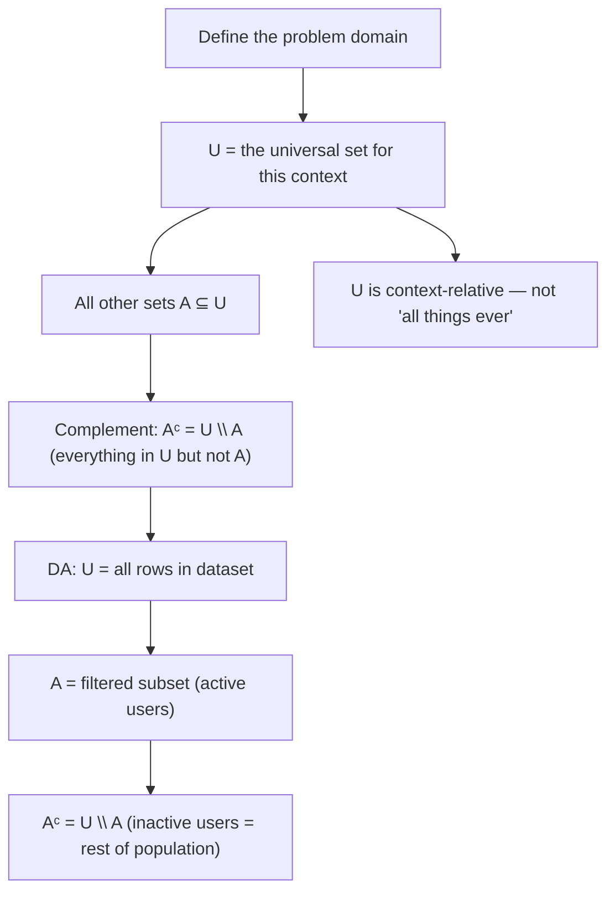

# Universal set

$$
U
$$

## Deep Breakdown

What it tells me *(Situation Awareness)*:
The **universal set** $U$ is the "everything" set — the complete collection of all objects under consideration in a given context. It is not an absolute "all things in existence"; it is context-relative: $U$ is whatever you define as the full domain for a specific problem. All other sets in the discussion are subsets of $U$. The complement of a set $A$ is defined relative to $U$: $A^c = U \setminus A$ — everything in $U$ that is not in $A$. In DA/DS, the universal set is the full dataset, the full user population, all possible dates in a time range, all possible categories — whatever forms the "complete picture" against which subsets are measured.

## Flowchart



## Real-world use

### Where it is used

Defining the full population before segmentation: "all users who visited in Q4" is $U$; "users who purchased" is $A$; "users who did not purchase" is $A^c = U \setminus A$. SQL `CROSS JOIN` between a date spine and all products creates $U$ (all date-product combinations). Population vs. sample reasoning: $U$ is the full population; your dataset is a sample $S \subseteq U$.

### Problem it solves

Without defining $U$, you cannot properly compute complements, coverage, or completeness. "What percentage of users did NOT convert?" requires knowing the total user count ($|U|$) to compute $|A^c| / |U|$. Without $U$, you only know who converted — not the denominator.

### How it solves the problem

Explicitly defining $U$ as your complete domain lets you: compute complements ($A^c$), measure coverage ($|A| / |U|$), build complete time-series spines (missing dates = $U \setminus \text{dates present in data}$), and reason about what is absent rather than only what is present.

### Example in a business

Churn rate: $U$ = all active customers at start of quarter ($|U| = 10{,}000$). $A$ = customers retained at end of quarter. $A^c = U \setminus A$ = churned customers. Churn rate = $|A^c| / |U| = (10000 - 8500) / 10000 = 15\%$. Without defining $U$ explicitly, the denominator is unclear.

## The formula, piece by piece

Breaking the notation:

- $U$: the uppercase letter U, used as the standard symbol for the universal set. Sometimes also written $\Omega$ (especially in probability theory, where it is the "sample space").
- $A \subseteq U$: every set in the discussion is a subset of $U$ — no element can be outside $U$ in a well-defined context.
- $A^c = U \setminus A$: the complement — all elements of $U$ not in $A$.
- $|A^c| = |U| - |A|$: the size of the complement.

Key identities involving $U$:
- $A \cup A^c = U$ (a set and its complement cover all of $U$)
- $A \cap A^c = \emptyset$ (a set and its complement are disjoint)
- $U^c = \emptyset$ (the complement of the universal set is empty)
- $\emptyset^c = U$ (the complement of the empty set is the whole universe)

## The formula in words

"$U$ is the complete context — every possible element you are considering. It is not infinite or metaphysical; it is whatever scope you defined for your analysis. 'All rows in this table,' 'all products in this catalog,' 'all dates in this fiscal year' — those are all valid universal sets for their respective analyses."

## Critical Concepts

1. **Context-dependence**: $U$ changes with the problem. For a sales analysis, $U$ might be "all transactions in 2024." For a user analysis, $U$ might be "all registered users." Always state your $U$ explicitly when computing metrics.
2. **Complement in pandas**: `df_complement = df[~mask]` where `mask` selects subset $A$ from the full DataFrame $U = df$. The complement is every row NOT in $A$.
3. **SQL CROSS JOIN as universal set builder**: to create a complete date-product grid (avoiding missing-date gaps), cross-join a date spine with a product list: `SELECT d.date, p.product_id FROM date_spine d CROSS JOIN products p`. This generates $U = \text{dates} \times \text{products}$ as the baseline.
4. **Probability sample space**: in probability, $U$ is the sample space $\Omega$ — all possible outcomes of an experiment.

Events are subsets of $\Omega$. $P(\Omega) = 1$: the probability of the universal set is 1.

## Step-by-step calculation (tiny example)

Task: compute churn rate using the universal set concept.

*Step 1: Define U*
$U = \text{all customers at start of month} = \{C_1, C_2, \ldots, C_{100}\}$, $|U| = 100$.

*Step 2: Define A (retained)*
$A = \text{customers still active at end of month}$. Say $|A| = 82$.

*Step 3: Compute complement (churned)*
$A^c = U \setminus A$ — customers in $U$ but not in $A$. $|A^c| = 100 - 82 = 18$.

*Step 4: Compute churn rate*
$\text{Churn rate} = \frac{|A^c|}{|U|} = \frac{18}{100} = 18\%$. Without defining $U$ explicitly, the "18" churned customers has no denominator — the rate is undefined.

## Code examples

### Beginner example (Python)

```python
# U — the universal set (full domain/population)
# Define U and work with subsets
U = set(range(1, 101))   # all user IDs 1-100 retained = {1, 2, 5, 7, 8, 10, 12, 14, 15, 17, 20, 22, 23, 25, 30, 35, 40, 45, 50, 55, 60, 65, 70, 75, 80, 85, 90, 95} churned = U - retained # complement: A^c = U \ A
print(f"|U| = {len(U)}")
print(f"|A| (retained) = {len(retained)}")
print(f"|Aᶜ| (churned) = {len(churned)}")
print(f"Churn rate = {len(churned)/len(U):.1%}")   # Verify: A ∪ Aᶜ = U and A ∩ Aᶜ = ∅
print(f"\nA ∪ Aᶜ = U: {retained | churned == U}")
print(f"A ∩ Aᶜ = ∅: {retained & churned == set()}")   # Pandas: universal set = full DataFrame
import pandas as pd
import numpy as np
np.random.seed(42)
df_all_users = pd.DataFrame({   # U = all users
    "user_id": range(1, 101), "segment": np.random.choice(["premium", "standard", "trial"], 100),
})
premium_mask = df_all_users["segment"] == "premium"
df_premium = df_all_users[premium_mask]   # subset A
df_non_premium = df_all_users[~premium_mask]   # complement Aᶜ
print(f"\n|U|: {len(df_all_users)}")
print(f"|A| (premium): {len(df_premium)}")
print(f"|Aᶜ| (non-premium): {len(df_non_premium)}")
print(f"Coverage: {len(df_premium)/len(df_all_users):.1%}")
```

### Beginner example (R)

```r
# Universal set in R #
U = all user IDs
U <- 1:100
retained <- c(1, 5, 10, 15, 20, 25, 30, 35, 40, 45, 50, 55, 60, 65, 70, 75, 80, 85, 90)
churned <- setdiff(U, retained)  # complement
Aᶜ = U \ A
cat(sprintf("|U|: %d\n", length(U)))
cat(sprintf("|A| retained: %d\n", length(retained)))
cat(sprintf("|Aᶜ| churned: %d\n", length(churned)))
cat(sprintf("Churn rate: %.1f%%\n", 100 * length(churned) / length(U)))
cat(sprintf("\nA ∪ Aᶜ = U: %s\n", setequal(union(retained, churned), U)))
cat(sprintf("A ∩ Aᶜ = ∅: %s\n", length(intersect(retained, churned)) == 0))  # Complete date-product grid (U = all date × product combinations)
dates <- seq.Date(as.Date("2024-01-01"), by = "day", length.out = 5)
products <- c("A", "B", "C")
U_grid <- expand.grid(date = dates, product = products)
cat(sprintf("\n|U| (date×product grid): %d rows\n", nrow(U_grid)))
cat("(This is the 'universal set' for a complete sales report)\n")
```

### Professional example (Python)

```python
import pandas as pd
import numpy as np
from itertools import product as cartesian_product   # Scenario: build a complete reporting grid using the universal set concept
# U = all (date × product × channel) combinations for a full month
np.random.seed(42)
dates = pd.date_range("2024-01-01", "2024-01-31", freq="D")
products = ["Widget_A", "Widget_B", "Widget_C", "Widget_D"]
channels = ["organic", "paid", "email"]   # Define U: the complete universal set of combinations
U_combinations = list(cartesian_product(dates, products, channels))
U_df = pd.DataFrame(U_combinations, columns=["date", "product", "channel"])
print(f"Universal set |U| = {len(dates)} dates × {len(products)} products × {len(channels)} channels")
print(f" |U| = {len(U_df)} rows\n")   # Simulate sparse actual data (subset A ⊂ U)
n_actual = 200
actual_df = pd.DataFrame({ "date": np.random.choice(dates, n_actual), "product": np.random.choice(products, n_actual), "channel": np.random.choice(channels, n_actual), "revenue": np.random.uniform(10, 500, n_actual).round(2),
}).drop_duplicates(subset=["date", "product", "channel"])   # Merge: complete grid with zeros for missing combinations (Aᶜ = U \ A)
complete_df = ( U_df .merge(actual_df, on=["date", "product", "channel"], how="left") .fillna({"revenue": 0.0}) )
actual_rows = (complete_df["revenue"] > 0).sum()
missing_rows = (complete_df["revenue"] == 0).sum()
print("Coverage Report (U = full grid, A = rows with actual data)")
print("=" * 52)
print(f" |U|: {len(complete_df):>6} (universal set)")
print(f" |A| (actual data): {actual_rows:>6} ({actual_rows/len(complete_df):.1%} of U)")
print(f" |Aᶜ| (zero-fill gaps): {missing_rows:>6} ({missing_rows/len(complete_df):.1%} of U)")
print(f"\n A ∪ Aᶜ = U: {actual_rows + missing_rows == len(U_df)}")
print(f" Without U (zero-fill), {missing_rows} combinations would be missing from the report.")
```

### Professional example (R)

```r
# Universal set
U = full grid; merge with actuals and zero-fill (A complement)
dates <- seq(as.Date("2024-01-01"), as.Date("2024-01-07"), by = "day")
products <- c("P1", "P2")
channels <- c("email", "display")
U_df <- expand.grid(date = dates, product = products, channel = channels, stringsAsFactors = FALSE)
actual_df <- U_df[sample(nrow(U_df), 8), ]
actual_df$revenue <- runif(8, 10, 100)
complete_df <- merge(U_df, actual_df, by = c("date", "product", "channel"), all.x = TRUE)
complete_df$revenue[is.na(complete_df$revenue)] <- 0
actual_rows <- sum(complete_df$revenue > 0)
missing_rows <- sum(complete_df$revenue == 0)
cat("Coverage Report (U = full grid)\n")
cat(" |U|: ", nrow(complete_df), "\n")
cat(" |A| (actual data): ", actual_rows, "\n")
cat(" |A^c| (zero-fill): ", missing_rows, "\n")
cat(" A ∪ A^c = U:", actual_rows + missing_rows == nrow(U_df), "\n")
```

---

*Source: 1300 p. 13*
