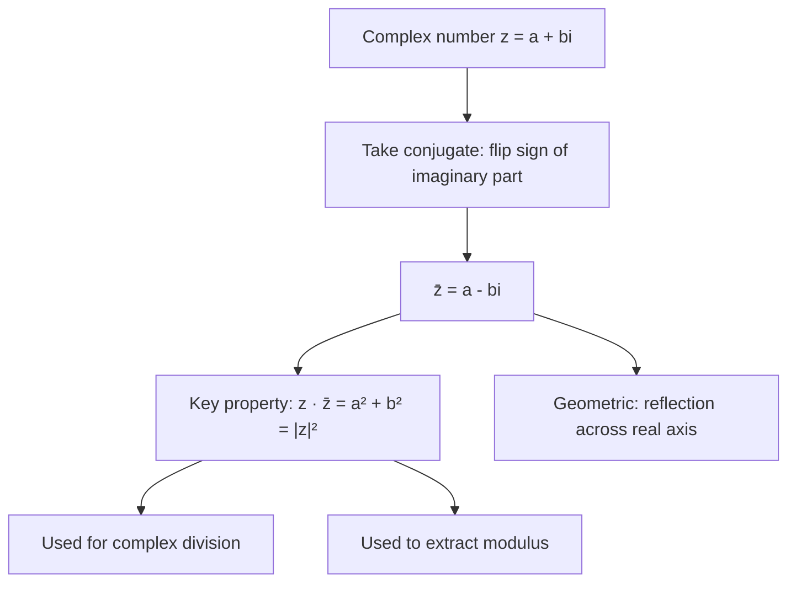

# Conjugate

$$
\overline{a + bi} = a - bi
$$

## Deep Breakdown

What it tells me *(Situation Awareness)*:
The **complex conjugate** of $z = a + bi$ is $\bar{z} = a - bi$: flip the sign of the imaginary part and leave the real part unchanged. Geometrically, $\bar{z}$ is the reflection of $z$ across the real axis in the complex plane. In DA/DS, conjugates appear in: complex division (multiply numerator and denominator by the conjugate to remove $i$ from the denominator), the relationship $z \bar{z} = |z|^2$ (squaring the modulus), FFT symmetry (for real input signals, $X[N-k] = \overline{X[k]}$), and Hermitian matrices ($A = A^H$ where $A^H = \bar{A}^T$).

## Flowchart



## Real-world use

### Where it is used

Complex division: to compute $\frac{z_1}{z_2}$, multiply numerator and denominator by $\bar{z_2}$, producing a real denominator. FFT of real signals: `np.fft.rfft` exploits the conjugate symmetry $X[N-k] = \overline{X[k]}$ to return only half the spectrum. Hermitian matrix operations: the conjugate transpose $A^H = \bar{A}^T$ is used in quantum computing, complex linear systems, and the generalized inner product.

### Problem it solves

Division of complex numbers: $\frac{3 + 2i}{1 + i}$ looks complicated because of the $i$ in the denominator. Multiplying numerator and denominator by the conjugate $\overline{1 + i} = 1 - i$ clears the imaginary part from the denominator: $(1 + i)(1 - i) = 1 - i^2 = 1 + 1 = 2$ (a real number). The conjugate is the tool for rationalizing complex denominators.

### How it solves the problem

$z \cdot \bar{z} = (a + bi)(a - bi) = a^2 - (bi)^2 = a^2 - b^2 i^2 = a^2 + b^2 = |z|^2$.
The product of a complex number and its conjugate is always a real non-negative number. This is the key: multiplying by the conjugate eliminates all imaginary parts from a product, giving a real result.

### Example in a business

Normalizing a complex filter in signal processing: to apply a frequency filter $H(f) = \frac{1}{1 + if}$ and compute its gain at a given frequency, you evaluate $|H(f)|^2 = H(f) \cdot \overline{H(f)}$. This converts the complex filter response into a real gain value (the power at that frequency), which is directly interpretable as the signal attenuation/amplification.

## The formula, piece by piece

Breaking the notation:

- $\overline{\phantom{x}}$: the overline (bar) denotes complex conjugation.
- $a + bi$: the original complex number ($a$ real part, $b$ imaginary part).
- $a - bi$: the conjugate — same real part, negated imaginary part.

Key properties:
- $\overline{z_1 + z_2} = \bar{z_1} + \bar{z_2}$ (conjugate distributes over addition).
- $\overline{z_1 z_2} = \bar{z_1} \bar{z_2}$ (conjugate distributes over multiplication).
- $\overline{\bar{z}} = z$ (conjugate is its own inverse).
- $z + \bar{z} = 2\text{Re}(z) = 2a$ (sum gives twice the real part).
- $z - \bar{z} = 2i\,\text{Im}(z) = 2bi$ (difference gives twice the imaginary part times $i$).
- $z \cdot \bar{z} = |z|^2 = a^2 + b^2$ (product gives squared modulus, always real).

## The formula in words

"The conjugate of a complex number is its mirror image flipped across the real axis: keep the real part, negate the imaginary part. When you multiply a complex number by its conjugate, the imaginary parts cancel and you get the squared distance from the origin — a real number. This is how you do complex division: multiply top and bottom by the conjugate of the denominator."

## Critical Concepts

1. **Complex division via conjugate**: $\frac{a + bi}{c + di} = \frac{(a + bi)(c - di)}{(c + di)(c - di)} = \frac{(ac + bd) + (bc - ad)i}{c^2 + d^2}$. The denominator becomes real.
2. **Hermitian matrices**: $A^H = (\bar{A})^T$ (conjugate transpose). Symmetric matrices $A^T = A$ are the real-number analog. Hermitian matrices have real eigenvalues — which is why covariance matrices (real and symmetric) have real eigenvalues.
3. **FFT conjugate symmetry**: for a real-valued time series, `fft[k] = conj(fft[N-k])`. This means only the first half of the FFT output is unique. `np.fft.rfft` exploits this and returns only the first $N/2 + 1$ elements.
4. **`np.conj()` and `.conjugate()`**: both work in NumPy.

For a complex array: `z_conj = np.conj(z)` or `z_conj = z.conj()`.

## Step-by-step calculation (tiny example)

Task: compute $\frac{3 + 2i}{1 + i}$ using the conjugate method.

*Step 1: Identify the conjugate of the denominator*
Denominator: $1 + i$. Conjugate: $1 - i$.

*Step 2: Multiply numerator and denominator by the conjugate*
$\frac{(3 + 2i)(1 - i)}{(1 + i)(1 - i)}$.

*Step 3: Expand denominator*
$(1 + i)(1 - i) = 1 - i + i - i^2 = 1 + 1 = 2$.

*Step 4: Expand numerator*
$(3 + 2i)(1 - i) = 3 - 3i + 2i - 2i^2 = 3 - i + 2 = 5 - i$.

*Step 5: Divide*
$\frac{5 - i}{2} = 2.5 - 0.5i$.

## Code examples

### Beginner example (Python)

```python
# Complex conjugate: conj(a + bi) = a - bi
import numpy as np
z_values = [3 + 2j, -1 + 4j, 5 + 0j, 0 + 3j]
print("Complex conjugates:")
for z in z_values:
    conj_z = z.conjugate()
    product = z * conj_z
    print(f" z={z:>7} conj={conj_z:>7} z×conj={product} |z|²={abs(z)**2:.1f}")

# Complex division using conjugate
z1 = 3 + 2j
z2 = 1 + 1j
print(f"\nDivision: ({z1}) / ({z2})")
# Manual: multiply by conjugate of denominator
conj_z2 = z2.conjugate()
numerator = z1 * conj_z2
denominator = z2 * conj_z2   # should be real
result_manual = numerator / denominator.real
result_direct = z1 / z2
print(f" Via conjugate: {result_manual}")
print(f" Direct: {result_direct}")
print(f" Equal: {abs(result_manual - result_direct) < 1e-10}")

# FFT conjugate symmetry for real input
signal = np.array([1.0, 2.0, 3.0, 2.0, 1.0, 0.0, -1.0, 0.0])
fft = np.fft.fft(signal)
n = len(signal)
print(f"\nFFT conjugate symmetry (X[k] = conj(X[N-k])):")
for k in range(1, 4):
    print(f" X[{k}]={fft[k]:.4f} conj(X[{n-k}])={np.conj(fft[n-k]):.4f} " f"equal: {abs(fft[k] - np.conj(fft[n-k])) < 1e-10}")
```

### Beginner example (R)

```r
# Complex conjugate in R: Conj()
z_values <- c(3+2i, -1+4i, 5+0i, 0+3i)
cat("Complex conjugates:\n")
for (z in z_values) {
  conj_z <- Conj(z)
  product <- z * conj_z
  cat(sprintf(" z=%s conj=%s z×conj=%s |z|²=%.1f\n", z, conj_z, product, Mod(z)^2))
}

# Complex division
z1 <- 3 + 2i
z2 <- 1 + 1i
result <- z1 / z2
cat(sprintf("\n(%s) / (%s) = %s\n", z1, z2, result))
```

### Professional example (Python)

```python
import numpy as np
import pandas as pd

# Scenario: FFT-based frequency analysis exploiting conjugate symmetry
# and computing a power spectral density
np.random.seed(42)
n = 128  # power of 2 for efficient FFT

# Simulate ECG-like signal: 1 Hz + 2 Hz + noise
t = np.linspace(0, 1, n, endpoint=False)  # 1 second
signal = (
    np.sin(2 * np.pi * 1 * t)            # 1 Hz component
    + 0.5 * np.sin(2 * np.pi * 2 * t)    # 2 Hz
    + 0.2 * np.random.randn(n)           # noise
)

# Full FFT and rfft (exploits conjugate symmetry)
fft_full = np.fft.fft(signal)   # n complex values
fft_real = np.fft.rfft(signal)  # only n/2 + 1 values (conjugate symmetry)

# Verify symmetry: X[k] = conj(X[N-k])
print("FFT Conjugate Symmetry Verification")
print("=" * 42)
symmetry_check = [abs(fft_full[k] - np.conj(fft_full[n - k])) < 1e-10 for k in range(1, n // 2)]
print(f" X[k] = conj(X[N-k]) for all k=1..{n // 2 - 1}: {all(symmetry_check)}")
print(f" Full FFT length: {len(fft_full)}")
print(f" rfft length: {len(fft_real)} (= n/2 + 1 = {n // 2 + 1})")
print()

# Power spectral density via conjugate: PSD[k] = X[k] × conj(X[k]) = |X[k]|²
freqs = np.fft.rfftfreq(n, d=1 / n)             # Hz
psd = (fft_real * np.conj(fft_real)).real / n   # PSD using conjugate product
psd_check = np.abs(fft_real) ** 2 / n           # via modulus
print("PSD: X[k]×conj(X[k]) == |X[k]|²")
print(f" Methods agree: {np.allclose(psd, psd_check)}")
print()

# Top frequency components
df_psd = pd.DataFrame({"freq_hz": freqs, "power": psd})
top5 = df_psd.sort_values("power", ascending=False).head(6)
print("Top frequency components by power:")
print(top5.to_string(index=False))
print("\n → Strong peaks at 1 Hz and 2 Hz (as designed)")
```

### Professional example (R)

```r
# PSD = X[k] × Conj(X[k]) = |X[k]|²
set.seed(42)
t <- seq(0, 2, by = 0.01)
x <- sin(2 * pi * 1 * t) + 0.5 * sin(2 * pi * 2 * t)
fft_x <- fft(x)
psd <- Re(fft_x * Conj(fft_x))
freqs <- (0:(length(t) - 1)) / length(t)
df_psd <- data.frame(freq_hz = freqs, power = psd)
top5 <- head(df_psd[order(-df_psd$power), ], 6)
cat("Top frequency components by power:\n")
print(top5)
cat(" → Strong peaks at 1 Hz and 2 Hz (as designed)\n")
```

---

*Source: 1300 p. 17*
