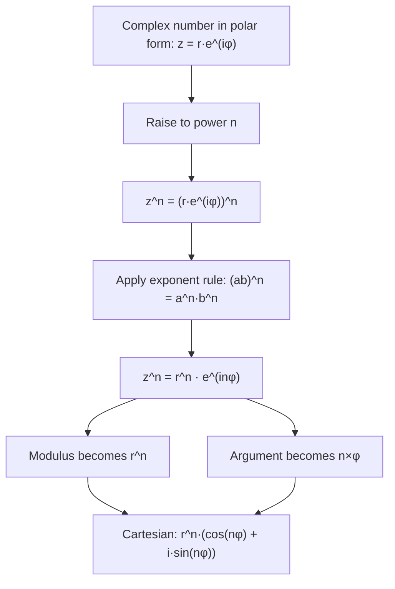

# De Moivre's Formula

$$
(r(\cos \phi + i\sin \phi))^n = r^n(\cos(n\phi) + i\sin(n\phi))
$$

## Deep Breakdown

What it tells me *(Situation Awareness)*:
**De Moivre's Formula** gives a clean way to compute the $n$-th power of a complex number in polar form: raise the modulus to the $n$-th power and multiply the argument by $n$. In polar notation: $(r e^{i\phi})^n = r^n e^{in\phi}$. In DA/DS, De Moivre underlies: computing powers of rotation matrices, deriving multi-step forecasting equations in complex-eigenvalue linear systems, computing roots of complex numbers, and understanding why Fourier basis functions $e^{i2\pi kn/N}$ behave as they do.

## Flowchart



## Real-world use

### Where it is used

Computing $n$-step forecasts in ARMA models with complex roots, finding all $n$-th roots of unity ($z^n = 1 \Rightarrow z = e^{i2\pi k/n}$, $k = 0, \ldots, n-1$), understanding FFT butterfly operations (powers of $e^{i2\pi/N}$), and proving trigonometric identities like $\cos(n\phi) + i\sin(n\phi) = (\cos\phi + i\sin\phi)^n$.

### Problem it solves

Without De Moivre, computing $(1 + i)^{10}$ requires 9 complex multiplications. With De Moivre: $1 + i = \sqrt{2}\, e^{i\pi/4}$, so $(1+i)^{10} = (\sqrt{2})^{10} e^{i \cdot 10\pi/4} = 32\, e^{i5\pi/2} = 32(\cos(5\pi/2) + i\sin(5\pi/2)) = 32(0 + i) = 32i$. One clean calculation.

### How it solves the problem

$(r e^{i\phi})^n = r^n e^{in\phi}$ is just the exponent rule applied to the polar form. It works because $e^{i\phi}$ is an exponential and exponent rules apply: $(e^{i\phi})^n = e^{in\phi}$. This is computationally efficient and reveals the geometric meaning: taking the $n$-th power $n$-times the angle and stretches by $r^n$.

### Example in a business

ARMA time series with complex eigenvalues: if the companion matrix has eigenvalue $\lambda = r e^{i\phi}$, then the $n$-step-ahead contribution from this eigenvalue is $\lambda^n = r^n e^{in\phi}$. If $r < 1$, the contribution decays to zero over time (stationary process). If $r = 1$, it oscillates persistently (unit root, non-stationary). De Moivre gives the exact $n$-step value.

## The formula, piece by piece

Breaking the notation:

- $r$: modulus of the complex number ($r \geq 0$).
- $\cos\phi + i\sin\phi$: unit complex number at angle $\phi$ (polar form with $r=1$).
- $n$: the exponent (can be any integer; also extends to rationals for root-finding).
- $r^n$: modulus raised to power $n$.
- $\cos(n\phi) + i\sin(n\phi)$: the unit complex number at angle $n\phi$. Compact form: $(re^{i\phi})^n = r^n e^{in\phi}$.

Special cases:
- $r = 1$: $(\cos\phi + i\sin\phi)^n = \cos(n\phi) + i\sin(n\phi)$ (unit circle rotations).
- $n = -1$: $(re^{i\phi})^{-1} = r^{-1} e^{-i\phi} = \frac{1}{r} e^{-i\phi}$ (inverse = conjugate/divide modulus).
- Roots: the $n$ distinct $n$-th roots of $Re^{i\Phi}$ are $R^{1/n} e^{i(\Phi + 2\pi k)/n}$, $k = 0, 1, \ldots, n-1$.

## The formula in words

"Raising a complex number to the $n$-th power just raises its distance from zero to the $n$-th power and multiplies its angle by $n$. It's like spinning a point on the complex plane: each power rotates it further by the same angle and stretches/shrinks its distance by $r$ each time."

## Critical Concepts

1. **Roots of unity**: the $n$-th roots of unity are $e^{i2\pi k/n}$ for $k = 0, \ldots, n-1$. These are equally spaced points on the unit circle. The DFT twiddle factors $W_N^k = e^{-i2\pi k/N}$ are roots of unity.
2. **Stability via modulus**: in a linear recurrence $x_t = \lambda x_{t-1}$, $x_n = \lambda^n x_0 = r^n e^{in\phi} x_0$. If $r < 1$: decaying oscillation (stable). If $r = 1$: persistent oscillation (unit root). If $r > 1$: explosive growth (unstable).
3. **Trigonometric identities**: De Moivre is the standard derivation of double/triple angle formulas. E.g., $(\cos\phi + i\sin\phi)^2 = \cos^2\phi - \sin^2\phi + 2i\cos\phi\sin\phi = \cos(2\phi) + i\sin(2\phi)$.
4. **Python: `z**n` works for complex numbers**: `(1 + 1j)**10` returns the correct complex result.

## Step-by-step calculation (tiny example)

Task: compute $(1 + i)^8$ using De Moivre.

*Step 1: Convert to polar form*
$|1 + i| = \sqrt{2}$, $\phi = \pi/4$ (45°).
So $1 + i = \sqrt{2}\, e^{i\pi/4}$.

*Step 2: Apply De Moivre: $(re^{i\phi})^n = r^n e^{in\phi}$*
$({\sqrt{2}}\, e^{i\pi/4})^8 = (\sqrt{2})^8 \cdot e^{i \cdot 8 \cdot \pi/4} = 16 \cdot e^{i2\pi}$.

*Step 3: Simplify $e^{i2\pi}$*
$e^{i2\pi} = \cos(2\pi) + i\sin(2\pi) = 1 + 0i = 1$.
So $(1+i)^8 = 16 \cdot 1 = 16$.

*Step 4: Verify by Cartesian multiplication*
$(1+i)^2 = 2i$, $(2i)^2 = -4$, $(-4)^2 = 16$. Confirmed.

## Code examples

### Beginner example (Python)

```python
# De Moivre's Formula: (r·e^(iφ))^n = r^n · e^(i·n·φ)
import numpy as np
import cmath   # Compute (1+i)^8 using De Moivre
z = 1 + 1j
n = 8   # Method 1: De Moivre (polar)
r, phi = cmath.polar(z)
r_n = r**n
phi_n = n * phi
z_n_moivre = cmath.rect(r_n, phi_n)   # Method 2: Direct Python power
z_n_direct = z**n
print(f"z = {z}")
print(f"r = {r:.4f}, φ = {phi:.4f} rad ({np.degrees(phi):.1f}°)")
print(f"r^{n} = {r_n:.4f}, {n}φ = {phi_n:.4f} rad ({np.degrees(phi_n):.1f}°)")
print(f"z^{n} via De Moivre: {z_n_moivre:.4f}")
print(f"z^{n} direct: {z_n_direct:.4f}")
print(f"Equal: {abs(z_n_moivre - z_n_direct) < 1e-10}")   # Roots of unity: n-th roots of 1 = e^(i·2π·k/n)
n_roots = 6
print(f"\n6th Roots of Unity (z^6 = 1):")
for k in range(n_roots):
    root = np.exp(1j * 2 * np.pi * k / n_roots)
check = root**n_roots
print(f" k={k}: e^(i·{k}·60°) = {root:.4f} | raised to 6 = {check:.4f}")
```

### Beginner example (R)

```r
# De Moivre's Formula in R
z <- 1 + 1i
n <- 8L  # Polar form
r <- Mod(z)
phi <- Arg(z)
r_n <- r^n
phi_n <- n * phi
z_moivre <- complex(modulus=r_n, argument=phi_n)
z_direct <- z^n
cat(sprintf("z = %s\n", z))
cat(sprintf("r = %.4f, φ = %.4f rad\n", r, phi))
cat(sprintf("z^%d via De Moivre: %.4f+%.4fi\n", n, Re(z_moivre), Im(z_moivre)))
cat(sprintf("z^%d direct: %.4f+%.4fi\n", n, Re(z_direct), Im(z_direct)))  # Roots of unity
cat("\n6th Roots of Unity:\n")
for (k in 0:5) { root <- exp(1i * 2 * pi * k / 6)
  cat(sprintf(" k=%d: %.4f+%.4fi | |z^6-1| = %.2e\n", k, Re(root), Im(root), Mod(root^6 - 1)))
}
```

### Professional example (Python)

```python
import numpy as np
import pandas as pd   # Scenario: De Moivre in time-series — n-step forecast decay for complex eigenvalue # AR(2) process: x_t = phi1*x_{t-1} + phi2*x_{t-2}
# Companion matrix eigenvalues determine dynamics
phi1 = 1.0   # AR coefficient 1
phi2 = -0.7   # AR coefficient 2 # Companion matrix
companion = np.array([[phi1, phi2], [1.0, 0.0]])
eigenvalues = np.linalg.eigvals(companion)
print("AR(2) Complex Eigenvalue Analysis via De Moivre")
print("=" * 50)
for i, lam in enumerate(eigenvalues):
    r, phi = abs(lam), np.angle(lam)
period = 2 * np.pi / abs(phi)
stable = r < 1
print(f" λ{i+1} = {lam:.4f} |λ|={r:.4f} φ={np.degrees(phi):.1f}° period={period:.1f} steps stable: {stable}")
print()
print("n-step multiplier via De Moivre (λ^n = r^n · e^(i·n·φ)):")
print(f"{'n':>4} {'|λ|^n':>10} {'cos(nφ)':>10} {'sin(nφ)':>10} {'Re(λ^n)':>10}")
lam = eigenvalues[0]   # use first eigenvalue
r, phi = abs(lam), np.angle(lam)
rows = []
for n in [1, 2, 5, 10, 20, 50]:
    r_n = r**n
phi_n = n * phi
lam_n_moivre = r_n * np.exp(1j * phi_n)
lam_n_direct = lam**n
rows.append({ "n": n, "|λ|^n": round(r_n, 6), "cos(nφ)": round(np.cos(phi_n), 4), "sin(nφ)": round(np.sin(phi_n), 4), "Re(λ^n)": round(lam_n_moivre.real, 6), "match": abs(lam_n_moivre - lam_n_direct) < 1e-10 })
df = pd.DataFrame(rows)
print(df.to_string(index=False))
print()
print(f" |λ| = {r:.4f} < 1 → decaying oscillations → stationary AR(2)")
print(f" Cycle length ≈ {2*np.pi/abs(phi):.1f} steps (periodicity from Im eigenvalue)")
```

### Professional example (R)

```r
# De Moivre: λ^n for complex eigenvalue; |λ| < 1 => stationary AR(2)
lambda <- 0.7 + 0.3i
r <- Mod(lambda)
phi <- Arg(lambda)
n_vals <- c(1, 5, 10)
for (n in n_vals) { lam_n_direct <- lambda^n
  lam_n_moivre <- r^n * (cos(n * phi) + 1i * sin(n * phi))
  cat(sprintf("n=%d: De Moivre match: %s\n", n, isTRUE(all.equal(lam_n_direct, lam_n_moivre))))
}
cat(sprintf(" |λ| = %.4f < 1 → decaying oscillations\n", r))
cat(sprintf(" Cycle length ≈ %.1f steps\n", 2*pi / abs(phi)))
```

---

*Source: 1300 p. 17*
