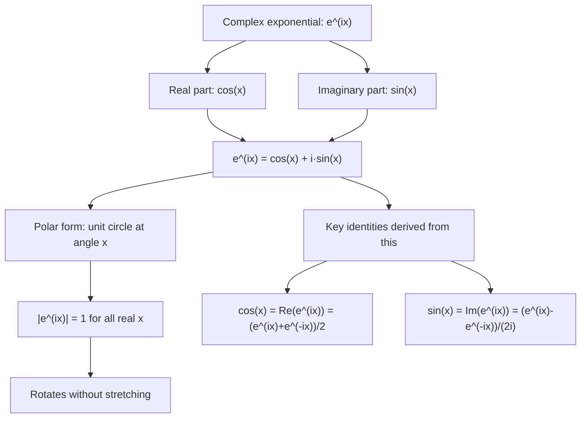

# Euler's Formula

$$
e^{ix} = \cos x + i\sin x
$$

## Deep Breakdown

What it tells me *(Situation Awareness)*:
**Euler's formula** establishes the deep connection between the complex exponential and trigonometric functions. It says that raising $e$ to a purely imaginary exponent $ix$ produces a unit complex number whose real part is $\cos x$ and imaginary part is $\sin x$. This is arguably the most important formula connecting analysis, trigonometry, and complex numbers. In DA/DS and ML: Euler's formula is the basis of all Fourier analysis (FFT), signal processing, and any system where exponential growth and oscillation interact.

## Flowchart



## Real-world use

### Where it is used

Fourier series and DFT: basis functions are $e^{i2\pi kn/N} = \cos(2\pi kn/N) + i\sin(2\pi kn/N)$. These are exactly Euler's formula evaluated at $x = 2\pi kn/N$. Signal modulation: multiplying a signal by $e^{i2\pi f_0 t}$ shifts its frequency by $f_0$. Solving ODEs with oscillatory solutions: solutions of the form $e^{(\alpha + i\omega)t} = e^{\alpha t}(\cos\omega t + i\sin\omega t)$.

### Problem it solves

The DFT of a signal decomposes it into $e^{i2\pi kn/N}$ basis functions. Without Euler's formula, these complex exponentials would be mysterious. With it: they are just sine and cosine waves combined into one compact notation. Every FFT coefficient $X[k]$ measures how much of the frequency $k$ basis wave $(\cos + i\sin)$ is present in the signal.

### How it solves the problem

$e^{ix} = \cos x + i\sin x$ means every point on the unit circle (modulus 1, angle $x$) can be written as $e^{ix}$. The exponential function unifies linear growth (real exponent) with oscillation (imaginary exponent). Complex exponentials $e^{(a+bi)t} = e^{at}(\cos bt + i\sin bt)$ model systems with simultaneous growth/decay and oscillation.

### Example in a business

Time series Fourier decomposition: the DFT coefficient $X[k] = \sum_{n=0}^{N-1} x[n] e^{-i2\pi kn/N}$. By Euler: $e^{-i2\pi kn/N} = \cos(2\pi kn/N) - i\sin(2\pi kn/N)$. The real and imaginary parts of $X[k]$ measure the cosine and sine components at frequency $k/N$ cycles per sample. This is how seasonality is detected: monthly, quarterly, annual cycles each correspond to a specific $k$.

## The formula, piece by piece

Breaking the notation:

- $e$: Euler's number ($\approx 2.71828$), the base of the natural exponential.
- $i$: the imaginary unit ($i^2 = -1$).
- $x$: a real number (the angle in radians).
- $e^{ix}$: the complex exponential — Euler's formula is its definition via Taylor series.
- $\cos x$: real part of $e^{ix}$.
- $i\sin x$: imaginary part of $e^{ix}$.

Derivation via Taylor series (motivational):
$e^{ix} = \sum_{n=0}^{\infty} \frac{(ix)^n}{n!} = 1 + ix + \frac{(ix)^2}{2!} + \frac{(ix)^3}{3!} + \cdots$
$= \left(1 - \frac{x^2}{2!} + \frac{x^4}{4!} - \cdots\right) + i\left(x - \frac{x^3}{3!} + \frac{x^5}{5!} - \cdots\right)$
$= \cos x + i\sin x$.

Key consequences:
- $e^{-ix} = \cos x - i\sin x$ (conjugate).
- $\cos x = \frac{e^{ix} + e^{-ix}}{2}$.
- $\sin x = \frac{e^{ix} - e^{-ix}}{2i}$.
- $|e^{ix}| = 1$ for all real $x$ (unit circle).
- DFT: $X[k] = \sum_n x[n] e^{-i2\pi kn/N}$.

## The formula in words

"The complex exponential $e^{ix}$ is a unit-length 'arrow' in the complex plane pointing at angle $x$ radians. Its horizontal shadow is $\cos x$ and its vertical shadow is $\sin x$. As $x$ increases from 0 to $2\pi$, the arrow sweeps a complete circle. This is why frequencies are represented as complex exponentials: they describe circular motion, which produces sinusoidal oscillations."

## Critical Concepts

1. **DFT basis**: every DFT is a dot product of the signal with $e^{-i2\pi kn/N}$ (a complex exponential via Euler). `np.fft.fft` internally uses these basis functions.
2. **Frequency shift theorem**: multiplying a signal by $e^{i2\pi f_0 t}$ shifts its frequency spectrum by $f_0$. This is the basis of modulation (AM/FM radio, OFDM in 5G).
3. **$e^{ix}$ is periodic**: $e^{i(x + 2\pi)} = e^{ix}$. This periodicity is why the DFT is periodic with period $N$.
4. **Complex exponential vs. real exponential**: $e^{ax}$ for real $a > 0$ grows without bound; $e^{ix}$ for real $x$ stays on the unit circle.

They combine in $e^{(a+ix)} = e^a \cdot e^{ix}$: growth rate $e^a$ and oscillation $e^{ix}$ simultaneously.

## Step-by-step calculation (tiny example)

Task: verify Euler's formula at $x = \pi/2$ and $x = \pi$.

*Step 1: $x = \pi/2$*
$e^{i\pi/2} = \cos(\pi/2) + i\sin(\pi/2) = 0 + i \cdot 1 = i$.
So $e^{i\pi/2} = i$: a quarter turn counter-clockwise gives the imaginary unit.

*Step 2: $x = \pi$*
$e^{i\pi} = \cos(\pi) + i\sin(\pi) = -1 + i \cdot 0 = -1$.
This gives Euler's identity: $e^{i\pi} + 1 = 0$.

*Step 3: $x = 2\pi$*
$e^{i2\pi} = \cos(2\pi) + i\sin(2\pi) = 1 + 0i = 1$.
A full rotation returns to the starting point.

## Code examples

### Beginner example (Python)

```python
# Euler's Formula: e^(ix) =
cos(x) + i*sin(x)
import numpy as np
angles = [0, np.pi/6, np.pi/4, np.pi/2, np.pi, 3*np.pi/2, 2*np.pi]
labels = ["0", "π/6", "π/4", "π/2", "π", "3π/2", "2π"]
print("Euler's Formula: e^(ix) = cos(x) + i·sin(x)")
print(f"{'x':>6} {'e^(ix)':>18} {'cos+i·sin':>18} {'|e^(ix)|':>10}")
for x, label in zip(angles, labels):
    euler = np.exp(1j * x)   # e^(ix) via NumPy
trig = np.cos(x) + 1j * np.sin(x)   #
cos(x) + i*sin(x)
modulus = abs(euler)
equal = abs(euler - trig) < 1e-10
print(f" {label:>4} {str(euler.round(4)):>18} {str(trig.round(4)):>18} {modulus:.4f} ✓" if equal else "MISMATCH")   # DFT basis functions via Euler's formula
N = 8
print(f"\nDFT basis functions e^(-i·2π·k·n/N) for N={N}, n=0..7 and k=0,1,2:")
for k in range(3):
    basis = np.array([np.exp(-1j * 2 * np.pi * k * n / N) for n in range(N)])
print(f" k={k}: {np.round(basis, 3)}")
```

### Beginner example (R)

```r
# Euler's Formula in R: exp(1i * x)
angles <- c(0, pi/6, pi/4, pi/2, pi, 3*pi/2, 2*pi)
labels <- c("0", "π/6", "π/4", "π/2", "π", "3π/2", "2π")
cat("Euler's Formula: e^(ix) = cos(x) + i·sin(x):\n")
for (idx in seq_along(angles)) { x <- angles[idx]
  euln <- exp(1i * x)
  trig <- cos(x) + 1i * sin(x)
  cat(sprintf(" x=%-5s e^(ix)=%.4f+%.4fi |e^(ix)|=%.4f\n", labels[idx], Re(euln), Im(euln), Mod(euln)))
}
```

### Professional example (Python)

```python
import numpy as np
import pandas as pd   # Scenario: Fourier decomposition of a sales time series
# FFT coefficients ARE Euler's formula applied at discrete frequencies
np.random.seed(42)
N = 120   # 10 years monthly
t_months = np.arange(N)
sales = (50_000 + 500 * t_months   # linear trend + 10_000 * np.cos(2*np.pi * t_months/12) # annual cycle + 3_000 * np.cos(2*np.pi * t_months/3) # quarterly cycle + np.random.normal(0, 1_500, N)) # noise # DFT via FFT: X[k] = sum_n x[n] * e^(-i*2π*kn/N)
 fft_raw = np.fft.rfft(sales) freqs = np.fft.rfftfreq(N, d=1)   # cycles per month # Each coefficient is: Re[X[k]] = cos component, Im[X[k]] = sin component
 amplitudes = np.abs(fft_raw) phases = np.angle(fft_raw) print("Fourier Decomposition via Euler's Formula (e^(ix) = cos(x) + i·sin(x))") print("=" * 70) print(f" {'k':>3} {'freq (cpm)':>12} {'period (mo)':>12} {'amplitude':>12} {'phase (deg)':>12}")   # Show components for meaningful frequencies
 for k in range(1, len(fft_raw)): f = freqs[k] if f == 0: continue period = 1 / f amp = amplitudes[k] phase = np.degrees(phases[k]) if amp > 2000:   # only significant components print(f"
{k:>3} {f:>12.4f} {period:>12.1f} {amp:>12.1f} {phase:>12.1f}") print() print(" Euler's formula makes this explicit:") print(" X[k] = Σ x[n]·(cos(2πkn/N) - i·sin(2πkn/N))") print(" = Σ x[n]·cos(...) - i·Σ x[n]·sin(...)") print(" Re[X[k]] = cosine projection = how much 'cosine at freq k' is in signal") print(" Im[X[k]] = sine projection = how much 'sine at freq k' is in signal") print()   # Demonstrate: manual DFT for k=10
(1/12 months = annual cycle) k_annual = round(N / 12) basis_cos = np.cos(2 * np.pi * k_annual * t_months / N) basis_sin = np.sin(2 * np.pi * k_annual * t_months / N) X_re_manual = np.sum(sales * basis_cos) X_im_manual = np.sum(sales * (-basis_sin)) X_fft = fft_raw[k_annual] print(f"Manual DFT at annual frequency (k={k_annual}):") print(f" Re[X[{k_annual}]] manual = {X_re_manual:.1f} | fft = {X_fft.real:.1f}") print(f" Im[X[{k_annual}]] manual = {X_im_manual:.1f} | fft = {X_fft.imag:.1f}") print(f" Amplitude = |X[{k_annual}]| = {abs(X_fft):.1f}")
```

### Professional example (R)

```r
# Manual DFT via Euler's formula:
Re = sum(x*cos), Im = -sum(x*sin)
set.seed(42)
N <- 60
t_months <- 0:(N - 1)
sales <- 10000 + 500 * t_months + 2000 * sin(2 * pi * t_months / 12) + rnorm(N, 0, 200)
fft_raw <- fft(sales)
k_annual <- 5
basis_cos <- cos(2 * pi * k_annual * t_months / N)
basis_sin <- sin(2 * pi * k_annual * t_months / N)
X_re_manual <- sum(sales * basis_cos)
X_im_manual <- -sum(sales * basis_sin)
X_fft <- fft_raw[k_annual + 1]
cat(sprintf("Manual DFT at k=%d: Re = %.1f (fft %.1f), Im = %.1f (fft %.1f)\n", k_annual, X_re_manual, Re(X_fft), X_im_manual, Im(X_fft)))
cat(" Amplitude = |X| =", round(Mod(X_fft), 1), "\n")
```

---

*Source: domain knowledge*
