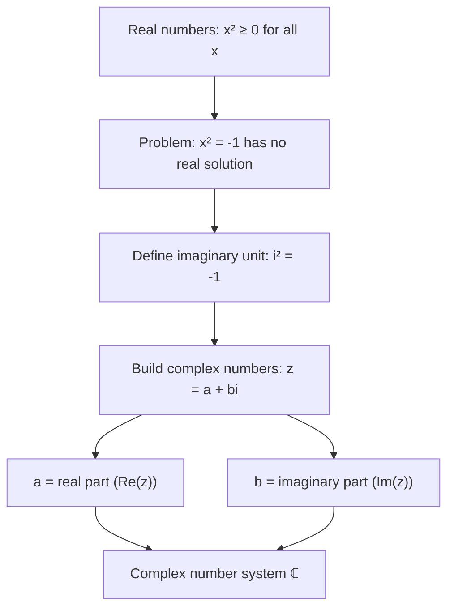

# Imaginary unit

$$
i^2 = -1
$$

## Deep Breakdown

What it tells me *(Situation Awareness)*:
The **imaginary unit** $i$ is defined as the number whose square equals $-1$: $i^2 = -1$. No real number satisfies $x^2 = -1$ (squaring any real number gives a non-negative result), so $i$ extends the real number system to the complex numbers $\mathbb{C} = \{a + bi : a, b \in \mathbb{R}\}$. In DS/ML, complex numbers appear in: Fourier transforms (signal decomposition, time-series analysis), eigenvalues of non-symmetric matrices (can be complex), rotational transformations, and the mathematical foundations of certain neural network architectures.

## Flowchart



## Real-world use

### Where it is used

Discrete Fourier Transform (DFT): converts a time-domain signal $x[n]$ into frequency components $X[k] = \sum_{n=0}^{N-1} x[n] e^{-i 2\pi kn/N}$. The $e^{-i\theta}$ terms involve $i$. Fast Fourier Transform (FFT) libraries (NumPy `np.fft.fft`) operate on complex arrays where $i$ is represented as the imaginary component `j` in Python.

### Problem it solves

Quadratic equations of the form $x^2 + 1 = 0$ have no real solutions. By defining $i$ such that $i^2 = -1$, the solutions become $x = \pm i$. This closes the real number system under root-taking and enables the Fundamental Theorem of Algebra: every polynomial of degree $n$ has exactly $n$ complex roots (counting multiplicity).

### How it solves the problem

$i^2 = -1$ provides a consistent algebraic rule for manipulating $i$: whenever you encounter $i^2$ in a calculation, replace it with $-1$. For example: $(3 + 2i)(1 - i) = 3 - 3i + 2i - 2i^2 = 3 - i - 2(-1) = 3 - i + 2 = 5 - i$. Arithmetic on complex numbers reduces to ordinary real arithmetic plus the substitution $i^2 = -1$.

### Example in a business

Time-series frequency analysis: sales data is transformed via FFT to identify seasonal cycles. The FFT output is a complex array; each complex value $X[k] = \text{Re}(X[k]) + i \cdot \text{Im}(X[k])$. The magnitude $|X[k]|$ gives the amplitude of the frequency component, and the angle $\angle X[k] = \arctan(\text{Im}/\text{Re})$ gives the phase. Neither magnitude nor phase is computable without $i$.

## The formula, piece by piece

Breaking the notation:

- $i$: the imaginary unit. In engineering and Python, written as $j$ (`1j` in Python).
- $i^2$: $i$ multiplied by itself.
- $= -1$: the defining property. Not a derived result — it is the definition of $i$.

Complex number vocabulary:
- $z = a + bi$: a complex number.
- $a = \text{Re}(z)$: the real part.
- $b = \text{Im}(z)$: the imaginary part.
- $|z| = \sqrt{a^2 + b^2}$: the modulus (magnitude).
- $\bar{z} = a - bi$: the complex conjugate.

Arithmetic rules (follow from $i^2 = -1$):
- Addition: $(a + bi) + (c + di) = (a+c) + (b+d)i$.
- Multiplication: $(a + bi)(c + di) = (ac - bd) + (ad + bc)i$.
- Division: $\frac{a + bi}{c + di} = \frac{(a+bi)(c-di)}{c^2 + d^2}$.

## The formula in words

"$i$ is the number that, when multiplied by itself, gives negative one. This breaks the rule that squares are always non-negative, but only by inventing a new type of number. Once you accept $i^2 = -1$ as the definition, all complex number arithmetic follows by applying this rule whenever $i^2$ appears."

## Critical Concepts

1. **Python notation**: Python uses `j` not `i` for the imaginary unit (`1j`, `2.5j`, `complex(3, 4)`). In NumPy, complex arrays use `dtype=complex128` (or `complex64`).
2. **Eigenvalues of real matrices**: the eigenvalues of a real non-symmetric matrix can be complex. For example, rotation matrices have eigenvalues $e^{\pm i\theta}$. When you see complex eigenvalues from `np.linalg.eig`, this is expected — not an error.
3. **FFT output is always complex**: `np.fft.fft(real_array)` returns a complex array even if the input is purely real. You usually take `np.abs(fft_output)` (the amplitude spectrum) for interpretation.
4. **Algebraic closure**: $\mathbb{R}$ is not algebraically closed ($x^2 + 1 = 0$ has no solution in $\mathbb{R}$), but $\mathbb{C}$ is (every polynomial has a root in $\mathbb{C}$).

This is the Fundamental Theorem of Algebra.

## Step-by-step calculation (tiny example)

Task: multiply $(3 + 2i)(1 - i)$ using $i^2 = -1$.

*Step 1: Expand using FOIL*
$(3)(1) + (3)(-i) + (2i)(1) + (2i)(-i) = 3 - 3i + 2i - 2i^2$.

*Step 2: Substitute $i^2 = -1$*
$= 3 - 3i + 2i - 2(-1) = 3 - i + 2$.

*Step 3: Combine real and imaginary parts*
$= (3 + 2) + (-1)i = 5 - i$.

## Code examples

### Beginner example (Python)

```python
# Imaginary unit: i² = -1
# Python uses 'j' for imaginary unit
# Basic complex number arithmetic
z1 = 3 + 2j
z2 = 1 - 1j
print(f"z1 = {z1}")
print(f"z2 = {z2}")
print(f"z1 + z2 = {z1 + z2}")
print(f"z1 * z2 = {z1 * z2} (expect 5-1j: real=3-(-2)=5, imag=-3+2=-1)")
print(f"i² = {1j * 1j} (expect -1+0j)")   # Components
z = 3 + 4j
print(f"\nz = {z}")
print(f" Real part: {z.real}")
print(f" Imaginary part: {z.imag}")
print(f" Modulus |z|: {abs(z):.4f} (= sqrt(3²+4²) = 5)")
print(f" Conjugate: {z.conjugate()}")
```

### Beginner example (R)

```r
# Imaginary unit in R: use complex() or as.complex()
z1 <- 3 + 2i
z2 <- 1 - 1i
cat(sprintf("z1 = %s\n", z1))
cat(sprintf("z2 = %s\n", z2))
cat(sprintf("z1 + z2 = %s\n", z1 + z2))
cat(sprintf("z1 * z2 = %s (expect 5-1i)\n", z1 * z2))
cat(sprintf("i² = %s (expect -1+0i)\n", 1i * 1i))
z <- 3 + 4i
cat(sprintf("\nRe(z) = %.1f\n", Re(z)))
cat(sprintf("Im(z) = %.1f\n", Im(z)))
cat(sprintf("|z| = %.4f\n", Mod(z)))
cat(sprintf("Conj = %s\n", Conj(z)))
```

### Professional example (Python)

```python
import numpy as np
import pandas as pd
import matplotlib
matplotlib.use('Agg')
import matplotlib.pyplot as plt   # Scenario: FFT on monthly sales to detect seasonality
# Complex numbers (imaginary unit) are fundamental to FFT
np.random.seed(42)
n_months = 60   # 5 years of monthly data
t = np.arange(n_months)
# Simulate: trend + 12-month seasonality + noise
seasonal = 2_000 * np.sin(2 * np.pi * t / 12)
trend = 500 * t
noise = np.random.normal(0, 300, n_months)
sales = 10_000 + trend + seasonal + noise   # FFT: returns complex array using i (j in Python)
fft_output = np.fft.fft(sales)   # complex array
frequencies = np.fft.fftfreq(n_months)   # in cycles per month
amplitudes = np.abs(fft_output)   # |X[k]| = sqrt(Re² + Im²)
phases = np.angle(fft_output)   # arctan(Im/Re) # Find dominant frequency (excluding DC component at k=0)
pos_mask = frequencies > 0
dominant_idx = np.argmax(amplitudes[pos_mask])
dominant_freq = frequencies[pos_mask][dominant_idx]
dominant_period = 1 / dominant_freq
print("FFT Seasonality Detection (imaginary unit i in action)")
print("=" * 54)
print(f" Input: {n_months} months of simulated sales")
print(f" FFT output dtype: {fft_output.dtype} ← complex array")
print(f" Sample FFT value: {fft_output[5]:.1f}")
print(f" Real part: {fft_output[5].real:.1f}")
print(f" Imag part: {fft_output[5].imag:.1f} ← imaginary unit component")
print()
print(f" Dominant frequency: {dominant_freq:.4f} cycles/month")
print(f" Dominant period: {dominant_period:.1f} months (expect ≈ 12)")
print(f" Amplitude at peak: {amplitudes[pos_mask][dominant_idx]:,.1f}")
print()
print(" Top 5 amplitudes (positive frequencies):")
top5_idx = np.argsort(amplitudes[pos_mask])[-5:][::-1]
for idx in top5_idx:
    f = frequencies[pos_mask][idx]
a = amplitudes[pos_mask][idx]
period = 1/f if f != 0 else float('inf')
print(f" freq={f:.4f}, period={period:.1f} months, amplitude={a:,.1f}")
```

### Professional example (R)

```r
# FFT (complex) -> modulus gives amplitude; dominant period from peak
set.seed(42)
n <- 60
t <- 0:(n - 1)
sales <- 10000 + 2000 * sin(2 * pi * t / 12) + rnorm(n, 0, 200)
fft_raw <- fft(sales)
amplitudes <- Mod(fft_raw)
frequencies <- (0:(n - 1)) / n
pos <- frequencies > 0 & frequencies <= 0.5
dominant_idx <- which.max(amplitudes[pos])
dominant_period <- 1 / frequencies[pos][dominant_idx]
cat(" Dominant period: ", round(dominant_period, 1), "months (expect ≈ 12)\n")
cat(" Top amplitudes (positive freqs):\n")
ord <- order(amplitudes[pos], decreasing = TRUE)[1:5]
for (i in ord) { f <- frequencies[pos][i]
  a <- amplitudes[pos][i]
  cat(sprintf(" freq=%.4f, period=%.1f months, amplitude=%.1f\n", f, 1/f, a))
}
```

---

*Source: 1300 p. 17*
