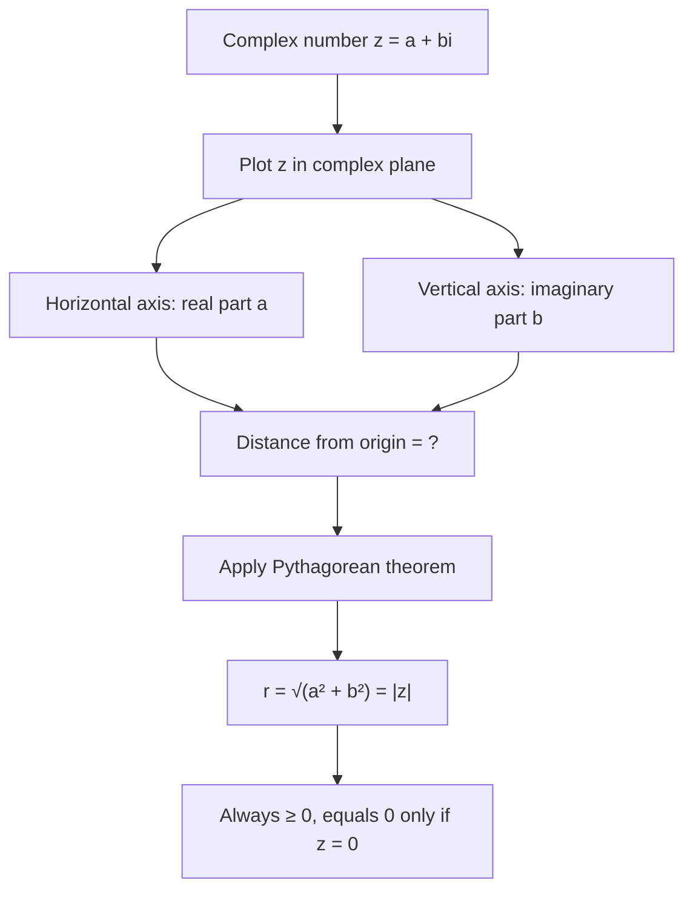

# Modulus

$$
r = |a + bi| = \sqrt{a^2 + b^2}
$$

## Deep Breakdown

What it tells me *(Situation Awareness)*:
The **modulus** (or absolute value) of a complex number $z = a + bi$ is its distance from the origin in the complex plane: $|z| = \sqrt{a^2 + b^2}$. It is always a non-negative real number. In DA/DS, the modulus is the magnitude of a complex quantity: the amplitude of a frequency component in an FFT, the magnitude of a complex eigenvalue, the strength of a complex signal, and the Euclidean distance of a 2D point $(a, b)$ from the origin.

## Flowchart



## Real-world use

### Where it is used

FFT amplitude spectrum: `np.abs(fft_output)` gives the magnitude of each complex frequency component. Complex eigenvalue magnitude: `np.abs(eigenvalue)` gives the growth/decay rate in a dynamical system. Signal strength: the power of a complex signal is $|z|^2 = a^2 + b^2$. Euclidean distance in 2D can be viewed as the modulus of the complex number $x + yi$.

### Problem it solves

After computing an FFT, the output is an array of complex numbers. You cannot directly plot or compare complex values, but you can compute their moduli (magnitudes) to get the amplitude spectrum — how "strong" each frequency is. The modulus converts a complex number into a single non-negative real number that measures its size.

### How it solves the problem

$|a + bi| = \sqrt{a^2 + b^2}$ uses the Pythagorean theorem: the complex number $a + bi$ is a point at coordinates $(a, b)$ in the plane, and its distance from the origin is $\sqrt{a^2 + b^2}$. This is the same as the L2 norm of the vector $(a, b)$.

### Example in a business

Seasonality strength in time series: after applying FFT to monthly sales, the amplitude of the 12-month frequency component is `np.abs(fft[5])` (for a 60-month series). A large modulus means strong seasonality; a small modulus means weak seasonality. The modulus converts the complex FFT coefficient into an interpretable amplitude.

## The formula, piece by piece

Breaking the notation:

- $r$: the modulus (also called magnitude, absolute value, or norm).
- $|a + bi|$: the modulus notation — vertical bars, just like absolute value for reals.
- $a$: real part of the complex number.
- $b$: imaginary part.
- $\sqrt{a^2 + b^2}$: Pythagorean distance formula.

Key properties:
- $|z| \geq 0$ for all $z$, with $|z| = 0 \Leftrightarrow z = 0$.
- $|z| = |\bar{z}|$ (conjugate has the same modulus).
- $|z_1 z_2| = |z_1||z_2|$ (modulus of product = product of moduli).
- $|z_1 + z_2| \leq |z_1| + |z_2|$ (triangle inequality).
- $z \cdot \bar{z} = a^2 + b^2 = |z|^2$ (product with conjugate gives squared modulus).
- For real $a$: $|a + 0i| = |a|$ (consistent with real absolute value).

## The formula in words

"The modulus is the distance of a complex number from zero in the complex plane. It's calculated using the Pythagorean theorem on the real and imaginary parts. It's always a non-negative real number. Think of a complex number as a 2D point: the modulus is how far that point is from the origin."

## Critical Concepts

1. **Power spectral density**: power is $|z|^2 = a^2 + b^2$. In signal processing, PSD gives the power at each frequency. `np.abs(fft)**2` computes this.
2. **Convergence of complex series**: a geometric series $\sum r^n z^n$ converges if $|rz| < 1$. The convergence condition is stated in terms of the modulus.
3. **Eigenvalue stability**: in discrete dynamical systems ($x_{t+1} = Ax_t$), the system is stable if all eigenvalues of $A$ have modulus $< 1$ (i.e., $|\lambda_i| < 1$ for all $i$). Instability occurs when some $|\lambda_i| > 1$.
4. **Python `abs()` on complex numbers**: `abs(3 + 4j)` returns `5.0` (the modulus, not an error). `np.abs()` works element-wise on complex arrays.

## Step-by-step calculation (tiny example)

Task: find the modulus of $z = 3 + 4i$, then verify $z \cdot \bar{z} = |z|^2$.

*Step 1: Apply the formula*
$|3 + 4i| = \sqrt{3^2 + 4^2} = \sqrt{9 + 16} = \sqrt{25} = 5$.

*Step 2: Compute conjugate product*
$\bar{z} = 3 - 4i$. $z \cdot \bar{z} = (3 + 4i)(3 - 4i) = 9 - 12i + 12i - 16i^2 = 9 + 16 = 25$.

*Step 3: Verify*
$|z|^2 = 5^2 = 25 = z \cdot \bar{z}$. Confirmed.

## Code examples

### Beginner example (Python)

```python
# Modulus of a complex number: |a + bi| = sqrt(a² + b²)
import numpy as np
z_values = [3 + 4j, -5 + 12j, 1 + 1j, 0 + 2j, 6 + 0j]
print("Modulus |a + bi| = sqrt(a² + b²):")
for z in z_values:
    a, b = z.real, z.imag
manual = np.sqrt(a**2 + b**2)
builtin = abs(z)
print(f" |{a}+{b}j| = sqrt({a}²+{b}²) = sqrt({a**2+b**2:.1f}) = {manual:.4f} | abs() = {builtin:.4f}")   # Verify z * conj(z) = |z|²
z = 3 + 4j
conj_z = z.conjugate()
product = z * conj_z
print(f"\nz = {z}")
print(f"conj(z) = {conj_z}")
print(f"z × conj(z) = {product} (expect {abs(z)**2:.0f}+0j)")
print(f"|z|² = {abs(z)**2:.1f}")
print(f"Equal: {abs(product.real - abs(z)**2) < 1e-10}")
```

### Beginner example (R)

```r
# Modulus of complex numbers in R: Mod()
z_values <- c(3+4i, -5+12i, 1+1i, 0+2i, 6+0i)
cat("Modulus |a + bi| = sqrt(a² + b²):\n")
for (z in z_values) { a <- Re(z); b <- Im(z)
  manual <- sqrt(a^2 + b^2)
  builtin <- Mod(z)
  cat(sprintf(" |%.0f+%.0fi| = %.4f | Mod() = %.4f\n", a, b, manual, builtin))
}  # z * Conj(z) = |z|^2
z <- 3 + 4i
cat(sprintf("\nz × Conj(z) = %s (expect %d+0i)\n", z * Conj(z), as.integer(Mod(z)^2)))
```

### Professional example (Python)

```python
import numpy as np
import pandas as pd   # Scenario: FFT amplitude spectrum on sales data
# Modulus converts complex FFT output to interpretable amplitudes
np.random.seed(42)
n = 60   # 5 years monthly
t = np.arange(n)
sales = (10_000 + 500 * t + 2_000 * np.sin(2 * np.pi * t / 12)   # annual cycle + 500 * np.sin(2 * np.pi * t /
    3)   # quarterly cycle + np.random.normal(0, 300, n)) # FFT
fft_raw = np.fft.fft(sales)   # complex array
frequencies = np.fft.fftfreq(n, d=1)   # cycles per month # Modulus = amplitude at each frequency
amplitudes = np.abs(fft_raw)   # |X[k]| = sqrt(Re²+Im²)
power = amplitudes**2   # PSD = |X[k]|²
phases_deg = np.degrees(np.angle(fft_raw))   # angle in degrees # Focus on positive frequencies (symmetric for real input)
pos = frequencies > 0
freq_df = pd.DataFrame({ "frequency_cpm": frequencies[pos], "period_months": np.where(frequencies[pos] > 0, 1 / frequencies[pos], np.inf), "amplitude": amplitudes[pos], "power": power[pos], "phase_deg": phases_deg[pos],
}).sort_values("amplitude", ascending=False).head(8).reset_index(drop=True)
freq_df["period_months"] = freq_df["period_months"].round(1)
freq_df["amplitude"] = freq_df["amplitude"].round(1)
freq_df["power"] = freq_df["power"].round(0)
freq_df["phase_deg"] = freq_df["phase_deg"].round(1)
print("FFT Amplitude Spectrum (Modulus of Complex FFT Coefficients)")
print("=" * 62)
print(freq_df.to_string(index=False))
print()
print(" → Period ≈ 12.0 months: annual seasonality (amplitude ~2000)")
print(" → Period ≈ 3.0 months: quarterly seasonality (amplitude ~500)")
print(" → Modulus converts complex FFT values to real amplitudes")   # Eigenvalue stability check (modulus < 1 → stable)
print("\nEigenvalue Stability Check (|λ| < 1 → stable):")
A = np.array([[0.8, -0.3], [0.2, 0.7]])   # stable system
eigenvalues = np.linalg.eigvals(A)
for i, lam in enumerate(eigenvalues):
    stable = np.abs(lam) < 1
print(f" λ{i+1} = {lam:.4f}, |λ{i+1}| = {np.abs(lam):.4f}, stable: {stable}")
```

### Professional example (R)

```r
# FFT amplitude spectrum (modulus of complex FFT) and eigenvalue stability
set.seed(42)
n <- 60
t <- 0:(n - 1)
sales <- 10000 + 500 * t + 2000 * sin(2 * pi * t / 12) + 500 * sin(2 * pi * t / 3) + rnorm(n, 0, 300)
fft_raw <- fft(sales)
amplitudes <- Mod(fft_raw)
frequencies <- (0:(n - 1)) / n
pos <- frequencies > 0 & frequencies <= 0.5
df <- data.frame( frequency_cpm = frequencies[pos], period_months = 1 / frequencies[pos], amplitude = amplitudes[pos]
)
df <- df[order(-df$amplitude), ]
cat("FFT Amplitude Spectrum (Modulus of Complex FFT)\n")
print(head(df, 8))
cat(" → Modulus converts complex FFT values to real amplitudes\n")
A <- matrix(c(0.8, -0.3, 0.2, 0.7), 2, 2)
eigenvals <- eigen(A)$values
cat("\nEigenvalue stability (|λ| < 1 → stable):\n")
for (i in seq_along(eigenvals)) { lam <- eigenvals[i]
  cat(sprintf(" λ%d = %.4f, |λ%d| = %.4f, stable: %s\n", i, lam, i, Mod(lam), Mod(lam) < 1))
}
```

---

*Source: 1300 p. 17*
