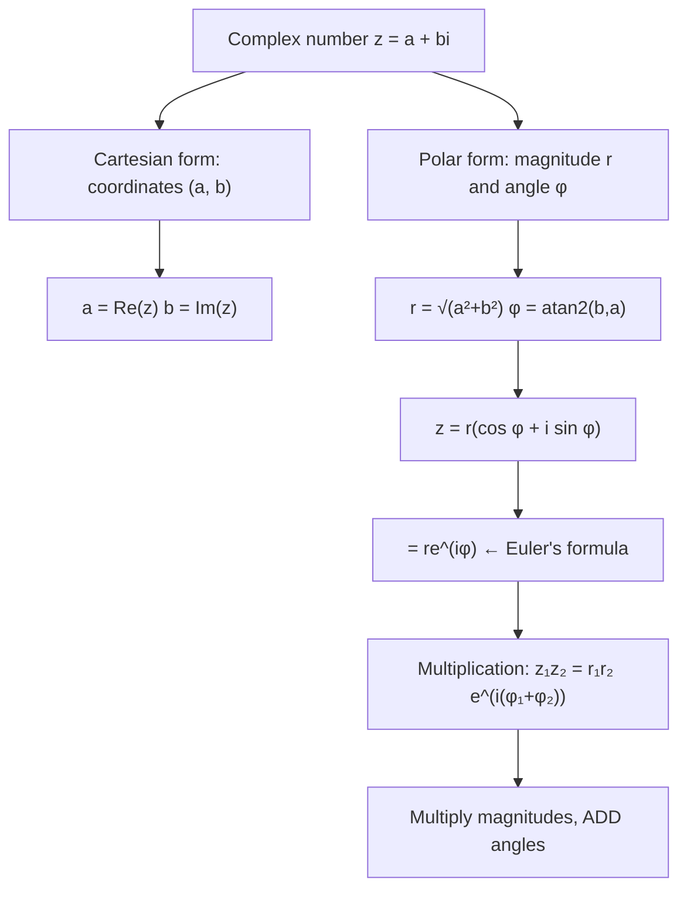

# Polar Presentation

$$
z = r(\cos \phi + i \sin \phi) = re^{i\phi}
$$

## Deep Breakdown

What it tells me *(Situation Awareness)*:
The **polar form** of a complex number expresses $z$ using its modulus $r = |z|$ and argument $\phi = \text{arg}(z)$ instead of Cartesian coordinates $(a, b)$. The equivalence $r(\cos\phi + i\sin\phi) = re^{i\phi}$ follows from Euler's formula. In DA/DS: FFT coefficients are naturally in polar form (amplitude $r$ and phase $\phi$); complex exponentials $e^{i\phi}$ are the basis functions of Fourier analysis; rotation in 2D is multiplication by $e^{i\phi}$; and polar form makes complex multiplication elegant: multiply moduli, add arguments.

## Flowchart



## Real-world use

### Where it is used

Polar form is natural for: FFT output (every coefficient is $r \cdot e^{i\phi}$ where $r$ = amplitude and $\phi$ = phase), rotation matrices (rotation by $\theta$ = multiplication by $e^{i\theta}$), complex exponential Fourier basis functions $e^{i2\pi kn/N}$, and De Moivre's theorem for computing powers of complex numbers.

### Problem it solves

Multiplying two complex numbers in Cartesian form requires 4 multiplications and 2 additions: $(a+bi)(c+di) = (ac-bd) + (ad+bc)i$. In polar form, it reduces to: $r_1 e^{i\phi_1} \cdot r_2 e^{i\phi_2} = r_1 r_2 \cdot e^{i(\phi_1 + \phi_2)}$. Multiply the magnitudes, add the angles. This is conceptually simpler and reveals the geometric meaning of complex multiplication: stretching and rotating.

### How it solves the problem

$z = r e^{i\phi}$ means: $z$ lies at distance $r$ from the origin, at angle $\phi$ from the positive real axis. Multiplying two complex numbers: the result lies at distance $r_1 r_2$ (magnitudes multiply) at angle $\phi_1 + \phi_2$ (angles add). This is why multiplying by $e^{i\theta}$ (unit modulus) is a pure rotation.

### Example in a business

The DFT basis functions $e^{-i2\pi kn/N}$ are unit-modulus complex exponentials. Each frequency bin $k$ in the FFT represents a sinusoidal component at that frequency. The amplitude $|X[k]|$ and phase $\angle X[k]$ are the polar form of the complex coefficient. The signal can be reconstructed as a sum of $|X[k]| \cos(2\pi kn/N + \angle X[k])$ terms.

## The formula, piece by piece

Breaking the notation:

- $z$: the complex number.
- $r$: modulus ($r = |z| = \sqrt{a^2 + b^2}$), always $r \geq 0$.
- $\phi$: argument/phase ($\phi = \text{atan2}(b, a)$), in radians.
- $\cos\phi + i\sin\phi$: the unit complex number at angle $\phi$ (modulus 1).
- $e^{i\phi}$: Euler's formula shorthand for $\cos\phi + i\sin\phi$.
- Full: $z = r e^{i\phi}$.

Converting between forms:
- Cartesian → Polar: $r = \sqrt{a^2 + b^2}$, $\phi = \text{atan2}(b, a)$.
- Polar → Cartesian: $a = r\cos\phi$, $b = r\sin\phi$.

Polar multiplication: $r_1 e^{i\phi_1} \cdot r_2 e^{i\phi_2} = (r_1 r_2) e^{i(\phi_1 + \phi_2)}$.
Polar division: $\frac{r_1 e^{i\phi_1}}{r_2 e^{i\phi_2}} = \frac{r_1}{r_2} e^{i(\phi_1 - \phi_2)}$.
Polar power: $(re^{i\phi})^n = r^n e^{in\phi}$ (De Moivre).

## The formula in words

"Any complex number can be described by two numbers: how far it is from zero (the modulus $r$) and which direction it points (the angle $\phi$). That's the polar form. The compact notation $re^{i\phi}$ means 'a point at distance $r$ in the direction $\phi$.' Multiplying two complex numbers = multiply their distances and add their angles."

## Critical Concepts

1. **Rotation as multiplication**: multiplying any complex number by $e^{i\theta}$ rotates it by $\theta$ radians around the origin (modulus unchanged). A 90° counter-clockwise rotation is multiplication by $e^{i\pi/2} = i$.
2. **numpy.polar and cmath.polar**: `cmath.polar(z)` returns `(r, phi)`. `cmath.rect(r, phi)` converts back to Cartesian. For arrays: `np.abs(z)` and `np.angle(z)`.
3. **Signal reconstruction**: given FFT coefficients in polar form $(r_k, \phi_k)$, the time-domain signal is $x[n] = \frac{1}{N}\sum_k r_k e^{i(2\pi kn/N + \phi_k)}$. Taking the real part gives the actual signal.
4. **Unit circle**: when $r = 1$, $z = e^{i\phi} = \cos\phi + i\sin\phi$ lies on the unit circle.

Eigenvalues of rotation matrices live on the unit circle.

## Step-by-step calculation (tiny example)

Task: convert $z = 1 + i$ to polar form, then multiply by $w = \sqrt{2} e^{i\pi/4}$.

*Step 1: Find $r$ and $\phi$ for $z = 1 + i$*
$r = \sqrt{1^2 + 1^2} = \sqrt{2}$.
$\phi = \text{atan2}(1, 1) = \pi/4$ (45°).
So $z = \sqrt{2}\, e^{i\pi/4}$.

*Step 2: Polar multiplication $z \cdot w$*
$z = \sqrt{2}\, e^{i\pi/4}$, $w = \sqrt{2}\, e^{i\pi/4}$.
$z \cdot w = (\sqrt{2} \cdot \sqrt{2})\, e^{i(\pi/4 + \pi/4)} = 2\, e^{i\pi/2}$.

*Step 3: Convert back to Cartesian*
$2\, e^{i\pi/2} = 2(\cos(\pi/2) + i\sin(\pi/2)) = 2(0 + i) = 2i$.
Check: $(1+i)(1+i) = 1 + 2i + i^2 = 1 + 2i - 1 = 2i$. Confirmed.

## Code examples

### Beginner example (Python)

```python
# Polar form: z = r*exp(i*phi) = r*(cos(phi) + i*sin(phi))
import numpy as np
import cmath
z_values = [1 + 1j, 3 + 4j, -1 + 0j, 0 + 2j]
print("Cartesian → Polar → Cartesian round-trip:")
for z in z_values:
    r, phi = cmath.polar(z)   # Cartesian to polar z_back = cmath.rect(r, phi) # Polar to Cartesian print(f" z={z:>7} → r={r:.4f}, φ={phi:.4f} rad ({np.degrees(phi):.1f}°)[[" f"]] → {z_back:.4f}") # Polar multiplication: multiply moduli, add angles
z1 = 2 * np.exp(1j * np.pi / 6)   # r=2, phi=30°
z2 = 3 * np.exp(1j * np.pi / 3)   # r=3, phi=60°
product = z1 * z2
print(f"\nPolar multiplication:")
print(f" z1: r={abs(z1):.1f}, φ={np.degrees(np.angle(z1)):.0f}°")
print(f" z2: r={abs(z2):.1f}, φ={np.degrees(np.angle(z2)):.0f}°")
print(f" z1×z2: r={abs(product):.1f}, φ={np.degrees(np.angle(product)):.0f}° (multiply r, add φ)")   # Rotation: multiply by e^(i*theta)
z = 3 + 0j   # point on real axis
angle = np.pi / 2
rotated = z * np.exp(1j * angle)
print(f"\nRotation by 90°: {z} → {rotated}")
```

### Beginner example (R)

```r
# Polar form in R
to_polar <- function(z) list(r = Mod(z), phi = Arg(z))
from_polar <- function(r, phi) complex(modulus=r, argument=phi)
z_values <- c(1+1i, 3+4i, -1+0i, 0+2i)
cat("Cartesian → Polar → Cartesian:\n")
for (z in z_values) { pol <- to_polar(z)
  back <- from_polar(pol$r, pol$phi)
  cat(sprintf(" z=%s r=%.4f phi=%.4f rad (%.1f°) back=%s\n", z, pol$r, pol$phi, pol$phi*180/pi, round(back, 6)))
}  # Rotation
z <- 3 + 0i
theta <- pi / 2
rotated <- z * exp(1i * theta)
cat(sprintf("\nRotation 90°: %s → %.4f+%.4fi\n", z, Re(rotated), Im(rotated)))
```

### Professional example (Python)

```python
import numpy as np
import pandas as pd   # Scenario: FFT polar decomposition and signal reconstruction
# Polar form is how FFT coefficients are interpreted
np.random.seed(42)
n = 64   # Synthetic signal: 2 Hz + 5 Hz
t = np.linspace(0, 1, n, endpoint=False)
signal = 3 * np.cos(2 * np.pi * 2 * t) + 1.5 * np.sin(2 * np.pi * 5 * t)   # FFT: complex coefficients in Cartesian form
fft_coeffs = np.fft.rfft(signal)
freqs = np.fft.rfftfreq(n, d=1/n)   # Convert to polar: r and phi
r_values = np.abs(fft_coeffs)   # amplitude spectrum
phi_values = np.angle(fft_coeffs)   # phase spectrum # Polar representation table for top frequencies
df = pd.DataFrame({ "freq_hz": freqs, "r_amp": r_values.round(3), "phi_rad": phi_values.round(4), "phi_deg": np.degrees(phi_values).round(1), "Re_coeff": fft_coeffs.real.round(3), "Im_coeff": fft_coeffs.imag.round(3),
}).query("r_amp > 10").sort_values("r_amp", ascending=False)
print("FFT Polar Decomposition (r·e^(iφ) form)")
print("=" * 56)
print(df.to_string(index=False))
print()
print(" 2 Hz component → r ≈ n/2 × amplitude = 32×3 = 96")
print(" 5 Hz component → r ≈ n/2 × amplitude = 32×1.5 = 48")
print()   # Reconstruct signal from polar coefficients
fft_from_polar = r_values * np.exp(1j * phi_values)
signal_reconstructed = np.fft.irfft(fft_from_polar, n=n)
max_error = np.max(np.abs(signal - signal_reconstructed))
print(f"Signal reconstruction via polar coefficients:")
print(f" Max reconstruction error: {max_error:.2e} ← should be ≈ 0")
print(f" Perfect reconstruction: {max_error < 1e-10}")
```

### Professional example (R)

```r
# Polar form: r*exp(i*phi); reconstruct signal from polar FFT coefficients
set.seed(42)
n <- 32
signal <- rnorm(n)
fft_signal <- fft(signal)
r_values <- Mod(fft_signal)
phi_values <- Arg(fft_signal)
fft_from_polar <- r_values * exp(1i * phi_values)
signal_reconstructed <- Re(fft(fft_from_polar, inverse = TRUE) / n)
max_error <- max(abs(signal - signal_reconstructed))
cat("Signal reconstruction via polar coefficients:\n")
cat(" Max reconstruction error:", format(max_error, scientific = TRUE), "\n")
cat(" Perfect reconstruction:", max_error < 1e-10, "\n")
```

---

*Source: MFB p. 142*
