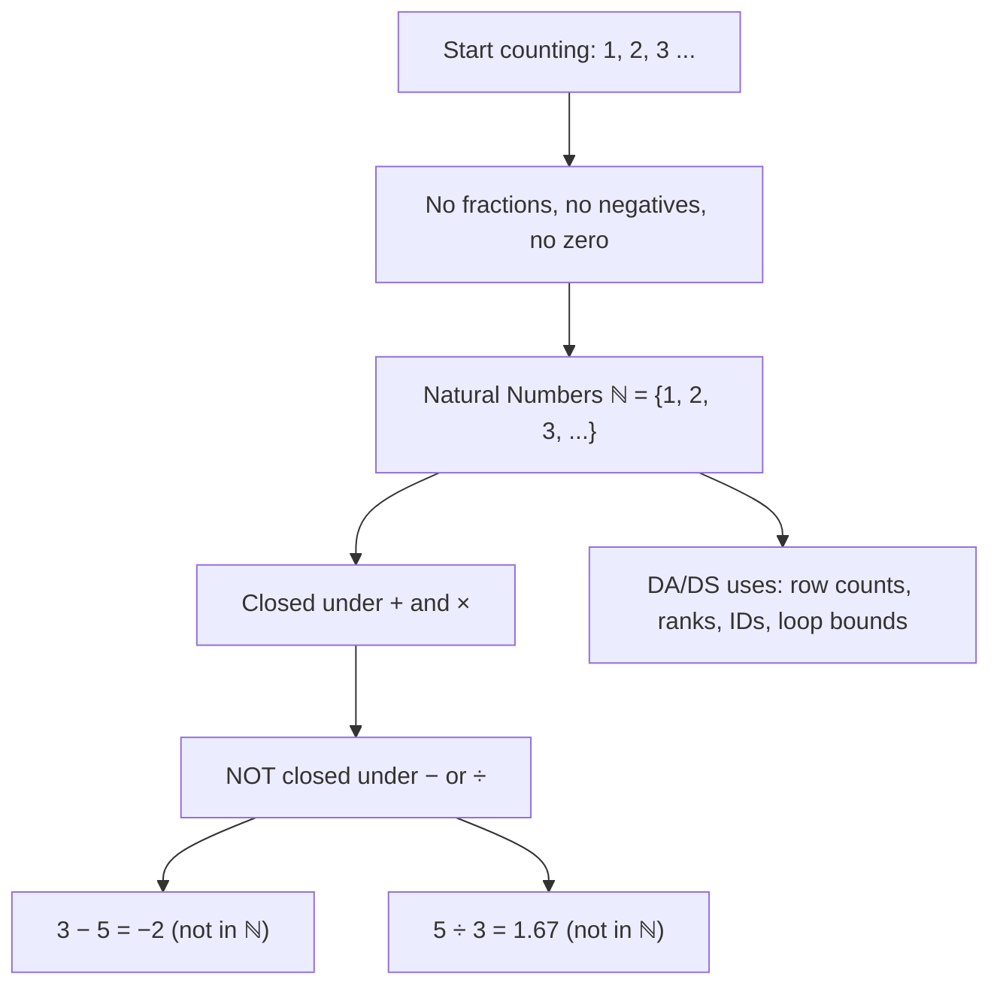

# Natural numbers

$$
\mathbb{N} = \{1, 2, 3, \dots\}
$$

## Deep Breakdown

What it tells me *(Situation Awareness)*:
The **natural numbers** $\mathbb{N}$ are the positive counting integers: $\{1, 2, 3, 4, \ldots\}$. They are the first and most intuitive number set — the numbers used for counting discrete objects. Note: some conventions include 0 in $\mathbb{N}$, but the standard mathematical convention (used here) excludes 0; when 0 is included, the set is denoted $\mathbb{N}_0$ or $\mathbb{W}$ (whole numbers). In DA/DS, natural numbers appear as: row counts, index positions, iteration counts, category labels, ordinal rankings, and wherever you need to count discrete items with no zero or negative values.

## Flowchart



## Real-world use

### Where it is used

Counting records, defining loop ranges (`range(1, n+1)`), ordinal rankings (rank 1st, 2nd, 3rd), category IDs (product SKU codes, user IDs that start at 1), iteration counts in algorithms, array sizes, and anywhere a non-negative non-zero whole number is required.

### Problem it solves

When you need to represent discrete countable quantities — "how many customers?", "what rank is this?", "which iteration?" — natural numbers are the right type. Using float or signed int when natural numbers suffice wastes memory and allows negative values where they are meaningless (negative customer count makes no sense).

### How it solves the problem

Natural numbers are always positive and always whole. In Python, `int` covers $\mathbb{N}$ and more; in pandas, `uint32` or `uint64` dtypes enforce the non-negative constraint efficiently. In SQL, `UNSIGNED INT` or `SERIAL` (PostgreSQL auto-increment) types encode natural-number semantics.

### Example in a business

Row count validation: `assert len(df) >= 1` — count is a natural number, at least 1. Product rank: "Top 10 products by revenue" — ranks 1 through 10 are natural numbers. User ID auto-increment: primary key `user_id SERIAL` in PostgreSQL generates $1, 2, 3, \ldots$ — natural numbers by design.

## The formula, piece by piece

Breaking the notation:

- $\mathbb{N}$: the blackboard-bold capital N, the standard symbol for natural numbers. From the German *natürliche Zahlen* (natural numbers).
- $\{1, 2, 3, \ldots\}$: set-builder notation listing the first few elements, with the ellipsis indicating the pattern continues infinitely.
- The set is **countably infinite** — you can list every element in order, but the list never ends.

Key properties of $\mathbb{N}$:
- **Closed under addition**: $a, b \in \mathbb{N} \implies a + b \in \mathbb{N}$
- **Closed under multiplication**: $a, b \in \mathbb{N} \implies a \cdot b \in \mathbb{N}$
- **NOT closed under subtraction**: $3 - 5 = -2 \notin \mathbb{N}$ (need $\mathbb{Z}$)
- **NOT closed under division**: $5 \div 3 = 1.\overline{6} \notin \mathbb{N}$ (need $\mathbb{Q}$)
- **Well-ordering**: every non-empty subset of $\mathbb{N}$ has a smallest element (foundation of mathematical induction)

## The formula in words

"$\mathbb{N}$ is the set of all positive whole numbers starting from 1, continuing upward forever. No zero, no negatives, no fractions. These are the numbers you use when counting physical objects: 1 customer, 2 transactions, 3 failed rows."

## Critical Concepts

1. **Convention on zero**: some authors (especially in logic and set theory) define $\mathbb{N} = \{0, 1, 2, \ldots\}$. Python's `range(n)` starts at 0 — it uses the $\mathbb{N}_0$ convention. Always be explicit about whether your indexing is 0-based or 1-based.
2. **Closed vs. not closed**: $\mathbb{N}$ is closed under $+$ and $\times$ but not $-$ or $\div$. This is why we need $\mathbb{Z}$ (closes subtraction) and $\mathbb{Q}$ (closes division) as extensions.
3. **Mathematical induction**: the well-ordering property is the foundation of proof by induction — if a statement holds for $n=1$ and its truth for $n=k$ implies its truth for $n=k+1$, it holds for all $n \in \mathbb{N}$.
4. **Python int vs. natural number**: Python `int` can be negative.

Enforce natural-number semantics with assertions (`assert n >= 1`) or pandas `uint` dtypes.

## Step-by-step calculation (tiny example)

Task: verify closure and non-closure for $\mathbb{N}$ with concrete values.

*Step 1: Test closure under addition*
$3 + 5 = 8$. Is $8 \in \mathbb{N}$? Yes, $8 \geq 1$ and whole. Closed.

*Step 2: Test closure under multiplication*
$4 \times 6 = 24$. Is $24 \in \mathbb{N}$? Yes. Closed.

*Step 3: Test non-closure under subtraction*
$3 - 5 = -2$. Is $-2 \in \mathbb{N}$? No — negative. Not closed. Extension needed: $\mathbb{Z}$.

*Step 4: Test non-closure under division*
$7 \div 2 = 3.5$. Is $3.5 \in \mathbb{N}$? No — not a whole number. Not closed. Extension needed: $\mathbb{Q}$.

## Code examples

### Beginner example (Python)

```python
# Natural numbers ℕ = {1, 2, 3, ...}
# Generate natural numbers
natural_numbers = list(range(1, 11))
print("First 10 natural numbers:", natural_numbers)

# Closure demonstration
a, b = 7, 3
print(f"\nClosure under addition: {a} + {b} = {a + b} (in ℕ: {a + b >= 1})")
print(f"Closure under multiplication: {a} × {b} = {a * b} (in ℕ: {a * b >= 1})")
print(f"NOT closed - subtraction: {b} - {a} = {b - a} (in ℕ: {(b - a) >= 1})")
print(f"NOT closed - division: {a} ÷ {b} = {a / b:.4f} (whole: {a % b == 0})")

import pandas as pd
import numpy as np

np.random.seed(42)
df = pd.DataFrame({
    "product_id": range(1, 11),                   # natural number IDs
    "units_sold": np.random.randint(1, 500, 10),  # counts: ℕ (no zeros)
    "rank": range(1, 11),                         # ordinal ranks: ℕ
})

# Validate no zeros or negatives crept in
assert (df["units_sold"] >= 1).all(), "units_sold must be >= 1 (natural number)"
assert (df["rank"] >= 1).all(), "rank must be >= 1 (natural number)"

# Enforce with efficient uint32 dtype
df["product_id"] = df["product_id"].astype("uint32")
df["units_sold"] = df["units_sold"].astype("uint32")
df["rank"] = df["rank"].astype("uint32")
print("\nProduct table (uint32 enforces ℕ semantics):")
print(df.to_string(index=False))
print(f"\nDtypes: {df.dtypes.to_dict()}")
```

### Beginner example (R)

```r
# Natural numbers in R
natural_numbers <- 1:10
cat("First 10 natural numbers:", natural_numbers, "\n")

# Closure checks
a <- 7L
b <- 3L
cat(sprintf("\nClosure under +: %d + %d = %d (in ℕ: %s)\n", a, b, a + b, a + b >= 1L))
cat(sprintf("NOT closed under -: %d - %d = %d (in ℕ: %s)\n", b, a, b - a, (b - a) >= 1L))
cat(sprintf("NOT closed under /: %d / %d = %.4f (whole: %s)\n", a, b, a / b, a %% b == 0L))

# Practical: product rankings (natural numbers)
set.seed(42)
df <- data.frame(
  product_id = 1L:10L,
  units_sold = sample(1L:500L, 10L, replace = TRUE),
  rank = 1L:10L
)

# Validate natural number constraints
stopifnot(all(df$units_sold >= 1L))
stopifnot(all(df$rank >= 1L))
stopifnot(all(df$product_id >= 1L))
cat("\nProduct table (all ℕ columns):\n")
print(df)
cat("\nAll columns satisfy ℕ: no zeros, no negatives, no fractions.\n")
```

### Professional example (Python)

```python
import pandas as pd
import numpy as np

# Scenario: enforce natural-number semantics across a sales pipeline
# Natural numbers appear as IDs, counts, ranks, iteration bounds
np.random.seed(42)
N_PRODUCTS = 50
raw_df = pd.DataFrame({
    "product_id": np.arange(1, N_PRODUCTS + 1, dtype="uint32"),
    "units_sold": np.random.randint(0, 1000, N_PRODUCTS),   # may contain zeros
    "returns": np.random.randint(0, 50, N_PRODUCTS),
    "price_usd": np.random.uniform(5.0, 500.0, N_PRODUCTS).round(2),
})


def validate_natural_columns(
    df: pd.DataFrame,
    columns: list[str],
    strict: bool = True,
) -> dict[str, int]:
    """Validate that specified columns contain only natural-number values.

    Args:
        df: Input DataFrame.
        columns: Column names to validate.
        strict: If True, require >= 1 (ℕ). If False, allow >= 0 (ℕ₀).

    Returns:
        Dict mapping column name to count of violations.
    """
    threshold = 1 if strict else 0
    return {col: int((df[col] < threshold).sum()) for col in columns if col in df.columns}


# Validate ID and count columns
violations = validate_natural_columns(
    df=raw_df,
    columns=["product_id", "units_sold", "returns"],
    strict=True,
)
print("Natural Number (ℕ) Validation Report")
print("=" * 42)
for col, count in violations.items():
    status = "PASS" if count == 0 else f"FAIL — {count} violation(s)"
    print(f"  {col:<20} {status}")

# Rank products by net sales (rank is always ℕ: starts at 1)
raw_df["net_units"] = (raw_df["units_sold"] - raw_df["returns"]).clip(lower=1)
raw_df["rank"] = (
    raw_df["net_units"]
    .rank(ascending=False, method="min")
    .astype("uint32")
)
top_10 = raw_df.nsmallest(10, "rank")[["product_id", "net_units", "rank"]]
print("\nTop 10 Products by Net Units Sold:")
print(top_10.to_string(index=False))
print(f"\nRank dtype: {raw_df['rank'].dtype} ← uint32 enforces ℕ (no negatives possible)")
print(f"Min rank: {raw_df['rank'].min()} ← starts at 1, not 0")
```

### Professional example (R)

```r
# Enforce natural-number semantics: validate ℕ columns, rank by net units
set.seed(42)
N_PRODUCTS <- 50
raw_df <- data.frame(
  product_id = seq_len(N_PRODUCTS),
  units_sold = sample(0:1000, N_PRODUCTS, replace = TRUE),
  returns = sample(0:50, N_PRODUCTS, replace = TRUE),
  price_usd = round(runif(N_PRODUCTS, 5, 500), 2)
)

validate_natural_columns <- function(df, columns, strict = TRUE) {
  threshold <- if (strict) 1 else 0
  sapply(columns[columns %in% names(df)], function(col) sum(df[[col]] < threshold))
}

violations <- validate_natural_columns(raw_df, c("product_id", "units_sold", "returns"), strict = TRUE)
cat("Natural Number (ℕ) Validation Report\n")
for (col in names(violations)) {
  status <- if (violations[col] == 0) "PASS" else paste("FAIL —", violations[col], "violation(s)")
  cat(" ", col, " ", status, "\n", sep = "")
}
raw_df$net_units <- pmax(raw_df$units_sold - raw_df$returns, 1)
raw_df$rank <- rank(-raw_df$net_units, ties.method = "min")
top_10 <- head(raw_df[order(raw_df$rank), c("product_id", "net_units", "rank")], 10)
cat("\nTop 10 Products by Net Units Sold:\n")
print(top_10)
cat("Min rank:", min(raw_df$rank), "← starts at 1\n")
```

---

*Source: 1300 p. 15*
