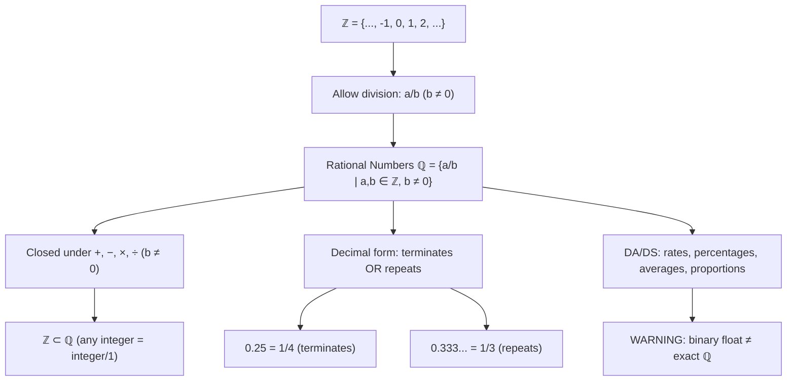

# Rational numbers

$$
\mathbb{Q} = \{ \frac{a}{b} \mid a \in \mathbb{Z}, b \in \mathbb{Z}, b \neq 0 \}
$$

## Deep Breakdown

What it tells me *(Situation Awareness)*:
The **rational numbers** $\mathbb{Q}$ are all numbers expressible as a ratio of two integers, with a non-zero denominator. The symbol $\mathbb{Q}$ comes from the Italian *quoziente* (quotient). This set includes all integers (set $b = 1$), all proper fractions ($\frac{1}{3}$, $\frac{7}{4}$), all repeating decimals ($0.\overline{3} = \frac{1}{3}$), and all terminating decimals ($0.25 = \frac{1}{4}$). In DA/DS, rational numbers appear everywhere there is division: ratios, percentages, rates, averages, and proportions. The critical engineering issue is that most rationals cannot be represented exactly in binary floating-point — leading to the infamous `0.1 + 0.2 != 0.3` problem in Python.

## Flowchart



## Real-world use

### Where it is used

Conversion rates (conversions / visits = rational number), click-through rates, average order value (total revenue / order count), weighted averages, proportions in group-by aggregations, price-to-earnings ratios, any metric computed via division.

### Problem it solves

$\mathbb{Z}$ is not closed under division: $7 \div 2 = 3.5 \notin \mathbb{Z}$. Rational numbers close $\mathbb{Z}$ under division (except division by zero). This lets you compute averages, rates, and proportions and still be in a well-defined number system.

### How it solves the problem

Any division of two integers (denominator non-zero) produces a rational number. In Python, this is a `float` or `fractions.Fraction`. In SQL, `CAST(numerator AS FLOAT) / denominator` produces a rational approximation. The `fractions.Fraction` type in Python's standard library gives exact rational arithmetic.

### Example in a business

Conversion rate: `SELECT conversions / NULLIF(visits, 0) AS conversion_rate FROM campaign_stats`. Result is a rational number in $[0, 1]$ (or slightly above 1 if deduplication is off). Stored as `FLOAT` or `DECIMAL(10,4)` in the database.

## The formula, piece by piece

Breaking the notation:

- $\mathbb{Q}$: from Italian *quoziente* (quotient). All numbers formed by dividing one integer by another.
- $a \in \mathbb{Z}$: the numerator is an integer (can be negative, zero, or positive).
- $b \in \mathbb{Z}$: the denominator is an integer.
- $b \neq 0$: division by zero is undefined — excluded explicitly.
- $\frac{a}{b}$: the ratio, which may be simplified: $\frac{6}{4} = \frac{3}{2}$.

Key properties of $\mathbb{Q}$:
- **Closed under all four operations** (except $\div 0$): $\mathbb{Q}$ is a **field**.
- **Dense**: between any two rationals, there is another rational. No "next" rational number after $\frac{1}{3}$.
- **Countably infinite**: despite density, you can put rationals in a one-to-one correspondence with $\mathbb{N}$ (Cantor's diagonal argument).
- **Decimal forms**: terminating ($\frac{1}{4} = 0.25$) or repeating ($\frac{1}{3} = 0.\overline{3}$).

Never non-repeating non-terminating (that would be irrational).

## The formula in words

"$\mathbb{Q}$ is every number you can write as a fraction — one integer on top, a non-zero integer on bottom. Every percentage, every average, every rate is a rational number. Division is finally fully defined (except by zero). The catch: computers cannot store most rationals exactly in binary."

## Critical Concepts

1. **Floating-point is not $\mathbb{Q}$**: Python `float` (IEEE 754 double) stores a rational approximation with ~15-17 significant decimal digits. `0.1 + 0.2 = 0.30000000000000004`. Use `decimal.Decimal` or `fractions.Fraction` for exact rational arithmetic in financial calculations.
2. **`DECIMAL` vs `FLOAT` in SQL**: `FLOAT` is an approximate type (binary floating-point). `DECIMAL(p, s)` or `NUMERIC(p, s)` stores exact decimal fractions — use for currency and rates where exactness matters.
3. **Division by zero guard**: always protect division operations: `NULLIF(denominator, 0)` in SQL, `np.where(denom != 0, num / denom, np.nan)` in Python. Unguarded division by zero raises `ZeroDivisionError` in Python or returns `NULL`/`Infinity` in SQL depending on dialect.
4. **Reduced form**: $\frac{6}{4}$ and $\frac{3}{2}$ are the same rational number.

In `fractions.Fraction`, Python automatically reduces to lowest terms.

## Step-by-step calculation (tiny example)

Task: compute the average order value for a campaign.

*Step 1: Raw data*
Orders: $\$120, \$80, \$200, \$150, \$90$. Total: $\$640$. Count: $5$.

*Step 2: Compute rational*
$\text{AOV} = \frac{640}{5} = 128 \in \mathbb{Q}$ (happens to be an integer here).

*Step 3: Non-integer case*
If total is $\$641$: $\text{AOV} = \frac{641}{5} = 128.2 \in \mathbb{Q}$ (terminates in decimal).

*Step 4: Repeating decimal case*
If total is $\$1$, count is $3$: $\frac{1}{3} = 0.\overline{3} \in \mathbb{Q}$ (repeating). The float `0.3333333333333333` is an approximation.

## Code examples

### Beginner example (Python)

```python
# Rational numbers ℚ = {a/b | a ∈ ℤ, b ∈ ℤ, b ≠ 0}
from fractions import Fraction
import pandas as pd
import numpy as np

# Exact rational arithmetic with Fraction
f1 = Fraction(1, 3)
f2 = Fraction(1, 6)
print(f"1/3 + 1/6 = {f1 + f2} (exact: {float(f1 + f2)})")
print(f"1/3 × 6/1 = {f1 * Fraction(6, 1)} (exact)")

# Floating-point approximation (NOT exact ℚ)
print(f"\nFloat trap: 0.1 + 0.2 = {0.1 + 0.2} (expected 0.3)")
print(f"Exact via Fraction: {Fraction('0.1') + Fraction('0.2')}")

# DA use: conversion rates and averages (rational results)
np.random.seed(42)
df = pd.DataFrame({
    "campaign": ["A", "B", "C", "D"],
    "visits": np.random.randint(100, 5000, 4),
    "conversions": np.random.randint(5, 200, 4),
    "revenue": np.random.randint(500, 20_000, 4),
})

# Guard division: NULLIF equivalent in pandas
df["conversion_rate"] = np.where(
    df["visits"] > 0,
    df["conversions"] / df["visits"],  # rational number
    np.nan,
)
df["avg_order_value"] = np.where(
    df["conversions"] > 0,
    df["revenue"] / df["conversions"],  # rational number
    np.nan,
)
print("\nCampaign Metrics (rational numbers):")
print(df.to_string(index=False))
print(f"\nconversion_rate dtype: {df['conversion_rate'].dtype} ← float64 (approx ℚ)")
```

### Beginner example (R)

```r
# Rational numbers in R
# R stores rationals as double-precision float by default
cat("1/3 =", 1/3, "\n")
cat("1/4 =", 1/4, "\n")
cat("Float trap: 0.1 + 0.2 =", 0.1 + 0.2, "\n")
cat("Exact check: 0.1 + 0.2 == 0.3:", 0.1 + 0.2 == 0.3, "\n")
cat("Safe check (all.equal):", isTRUE(all.equal(0.1 + 0.2, 0.3)), "\n")

# Conversion rates: guarded division (avoid /0)
set.seed(42)
df <- data.frame(
  campaign = c("A", "B", "C", "D"),
  visits = sample(100:5000, 4),
  conversions = sample(5:200, 4),
  revenue = sample(500:20000, 4)
)
df$conversion_rate <- ifelse(
  df$visits > 0,
  df$conversions / df$visits,  # ℚ result
  NA_real_
)
df$avg_order_value <- ifelse(
  df$conversions > 0,
  df$revenue / df$conversions,  # ℚ result
  NA_real_
)
cat("\nCampaign metrics (rational numbers):\n")
print(df)
```

### Professional example (Python)

```python
from decimal import Decimal, ROUND_HALF_UP
import pandas as pd
import numpy as np   # Scenario: financial reporting with exact rational arithmetic
# Currency calculations require DECIMAL precision, not float
np.random.seed(42)
N = 200
transactions = pd.DataFrame({ "transaction_id": range(1, N + 1), "amount_cents": np.random.randint(100, 50_000, N),   # store as integer cents
    "category": np.random.choice(["product", "service", "subscription"], N),
})   # Integer cents avoid float errors: $12.50 = 1250 cents (integer, ℤ)
# Convert to decimal dollars only for display
transactions["amount_dollars"] = transactions["amount_cents"] / 100   # rational ℚ

def safe_ratio(numerator: pd.Series, denominator: pd.Series) -> pd.Series:
    """ Compute element-wise ratio, returning NaN where denominator is zero. Args: numerator: Numeric series. denominator: Numeric series. Returns: Float series (rational approximation), NaN where undefined. """
    return np.where(denominator != 0, numerator / denominator, np.nan)   # Aggregate metrics: all rational results
agg = transactions.groupby("category").agg( total_cents=("amount_cents", "sum"), count=("amount_cents", "count"),
).reset_index()
agg["avg_cents"] = agg["total_cents"] / agg["count"]   # rational
agg["avg_dollars"] = agg["avg_cents"] / 100   # rational # Show exact representation using Python Decimal for display
agg["avg_dollars_exact"] = agg["avg_cents"].apply( lambda c: str(Decimal(str(c / 100)).quantize(Decimal("0.01"), rounding=ROUND_HALF_UP)) )
print("Financial Aggregation — Rational Number Metrics")
print("=" * 52)
print(agg[["category", "count", "total_cents", "avg_dollars", "avg_dollars_exact"]] .to_string(index=False))
print("\nKey principle:")
print(" Store money as INTEGER cents (ℤ) to avoid float drift.")
print(" Compute averages/rates in ℚ (float64 approx or Decimal for display).")
print(" Final display: round to 2 decimal places with explicit rounding mode.")
```

### Professional example (R)

```r
# Store money as integer cents (ℤ); averages in ℚ (float), display rounded
set.seed(42)
agg <- data.frame( category = c("A", "B", "C"), count = c(10L, 20L, 15L), total_cents = c(10000L, 25000L, 15000L)
)
agg$avg_dollars <- round(agg$total_cents / 100 / agg$count, 2)
agg$avg_dollars_exact <- agg$total_cents / 100 / agg$count
cat("Financial Aggregation — Rational Number Metrics\n")
print(agg[, c("category", "count", "total_cents", "avg_dollars", "avg_dollars_exact")])
cat(" Store as integer cents; compute averages in ℚ; display rounded to 2 decimals.\n")
```

---

*Source: 1300 p. 15*
