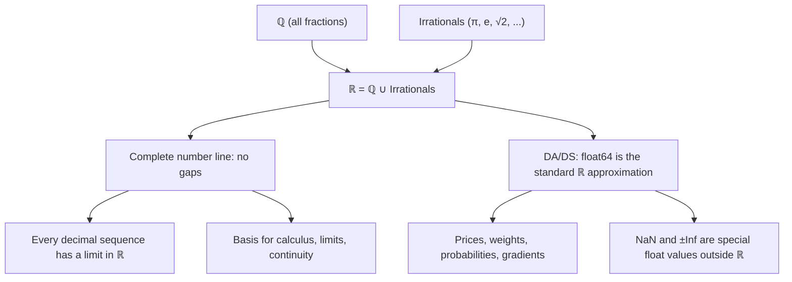

# Real numbers

$$
\mathbb{R} = \mathbb{Q} \cup \text{Irrationals}
$$

## Deep Breakdown

What it tells me *(Situation Awareness)*:
The **real numbers** $\mathbb{R}$ are the complete number line — every rational and every irrational number. $\mathbb{R} = \mathbb{Q} \cup \{\text{irrational numbers}\}$. The key property that defines $\mathbb{R}$ (and distinguishes it from $\mathbb{Q}$ alone) is **completeness**: every Cauchy sequence of real numbers converges to a real number, and there are no "gaps" in the real line. This completeness is what makes calculus work. In DA/DS, virtually every continuous quantity lives in $\mathbb{R}$: prices, weights, probabilities, model predictions, feature values, losses, gradients. Python's `float64` and numpy's `np.float64` are the standard computational representation of $\mathbb{R}$.

## Flowchart



## Real-world use

### Where it is used

Every continuous variable in a dataset: height, weight, temperature, price, probability score, model output, gradient magnitude, loss value, correlation coefficient, feature importance score. The `float64` dtype in pandas/numpy is the standard real-number type. SQL `FLOAT`, `DOUBLE PRECISION`, `REAL` types all represent subsets of $\mathbb{R}$.

### Problem it solves

The rational numbers $\mathbb{Q}$ are dense but incomplete — there are limits of sequences of rationals that are not themselves rational (e.g., $\lim_{n\to\infty}(1 + \frac{1}{n})^n = e \notin \mathbb{Q}$). Calculus, optimization (gradient descent), and probability theory all require completeness. $\mathbb{R}$ provides it.

### How it solves the problem

$\mathbb{R}$ fills in all the gaps. Every convergent sequence has a limit in $\mathbb{R}$. This means you can take derivatives (needed for gradient descent), define integrals (needed for probability densities), and compute limits (needed for activation functions and loss functions). In code, `float64` gives you 64-bit floating-point: ~15 significant decimal digits, range $\approx \pm 10^{308}$.

### Example in a business

Model training: gradient descent updates weights by $w \leftarrow w - \alpha \cdot \nabla L$ where $w$, $\alpha$, and $\nabla L$ are all real numbers (stored as `float32` or `float64`). The loss $L$ and all activations are real numbers. Without $\mathbb{R}$ (and its float approximation), neural networks cannot be trained.

## The formula, piece by piece

Breaking the notation:

- $\mathbb{R}$: blackboard-bold R, for "real numbers."
- $\mathbb{Q}$: the rational numbers (all fractions).
- $\cup$: union — the combined set of everything in $\mathbb{Q}$ or in the irrationals.
- "Irrationals": the set $\mathbb{R} \setminus \mathbb{Q}$ — real numbers that are not rational.
- Together: $\mathbb{R}$ contains all rationals and all irrationals, with no gaps.

Key properties of $\mathbb{R}$:
- **Ordered field**: you can add, subtract, multiply, divide (by non-zero), and compare any two reals.
- **Complete (Cauchy completeness)**: every Cauchy sequence converges within $\mathbb{R}$ — no gaps.
- **Uncountably infinite**: $|\mathbb{R}| > |\mathbb{Q}|$ (Cantor's theorem). There are "more" reals than rationals.
- **Dense**: between any two real numbers, there are infinitely many more. Special float values (outside mathematical $\mathbb{R}$, but in IEEE 754):
- `np.nan` (Not a Number): result of undefined operations ($0/0$, $\sqrt{-1}$ in real arithmetic).
- `np.inf`, `-np.inf`: overflow or $1/0$.

Not in $\mathbb{R}$ mathematically, but present in float arithmetic.

## The formula in words

"$\mathbb{R}$ is the full number line — every point you can place on it, rational or irrational. It is complete: there are no missing points, no gaps. It is the mathematical home of all continuous quantities in data science. Your computer approximates it with 64-bit floats."

## Critical Concepts

1. **float64 is not $\mathbb{R}$**: IEEE 754 `double` has finite precision (~15-17 significant digits) and finite range ($\pm 10^{308}$). It is a dense but finite sample of the rationals, approximating $\mathbb{R}$. Never assume float arithmetic is exact.
2. **NaN propagation**: `np.nan` is not a real number. Any arithmetic with NaN produces NaN. This is how missing or undefined values spread silently through pipelines. Always check `df.isna().sum()` before modeling.
3. **Overflow and underflow**: values outside float range become `±inf` (overflow) or `0.0` (underflow). Common in log-probabilities and neural network activations. Use log-space arithmetic (`np.log1p`, `scipy.special.logsumexp`) to avoid underflow.
4. **Numerical stability**: the order of floating-point operations affects the result due to non-associativity of float arithmetic.

Use `np.sum` (with pairwise summation) over manual loops, and `scipy.linalg.solve` over explicit matrix inversion for numerical stability.

## Step-by-step calculation (tiny example)

Task: show that $\mathbb{R}$ is necessary for a simple convergent sequence.

*Step 1: Define the sequence*
$a_n = \left(1 + \frac{1}{n}\right)^n$ for $n = 1, 2, 3, \ldots$

*Step 2: Compute a few values*
- $n=1$: $(1 + 1)^1 = 2.0$
- $n=2$: $(1 + 0.5)^2 = 2.25$
- $n=10$: $(1.1)^{10} \approx 2.5937$
- $n=100$: $\approx 2.7048$
- $n=1000$: $\approx 2.7169$

*Step 3: Identify the limit*
$\lim_{n \to \infty} a_n = e \approx 2.71828\ldots \in \mathbb{R} \setminus \mathbb{Q}$ (irrational).

*Step 4: Conclusion*
The sequence lives entirely in $\mathbb{Q}$ (each $a_n$ is rational), but the limit is irrational. If you only had $\mathbb{Q}$, this sequence would "converge to nothing" — no rational limit exists. $\mathbb{R}$'s completeness provides the limit $e$.

## Code examples

### Beginner example (Python)

```python
# Real numbers ℝ = ℚ ∪ Irrationals
import numpy as np
import pandas as pd

# float64 is Python's approximation of ℝ
print("Real number (float64) properties:")
print(f" Max float64: {np.finfo(np.float64).max:.3e}")
print(f" Min positive: {np.finfo(np.float64).tiny:.3e}")
print(f" Machine eps: {np.finfo(np.float64).eps:.3e}")
print(f" Precision: ~{np.finfo(np.float64).precision} significant decimal digits")

# Special float values (outside ℝ mathematically)
print("\nSpecial float values:")
print(f" np.inf: {np.inf} (overflow — not in ℝ)")
print(f" -np.inf: {-np.inf} (overflow — not in ℝ)")
print(f" np.nan: {np.nan} (undefined — not in ℝ)")

# Convergence to e: sequence (1 + 1/n)^n
print("\nSequence (1 + 1/n)^n converging to e (irrational):")
for n in [1, 10, 100, 1_000, 10_000, 100_000]:
    val = (1 + 1/n) ** n
    print(f" n={n:>8}: {val:.8f} (e = {np.e:.8f})")

# Typical DA use: continuous features in a real dataset
np.random.seed(42)
df = pd.DataFrame({
    "price": np.random.uniform(10.0, 1000.0, 100).round(2),
    "probability": np.random.beta(2, 5, 100),                # (0,1) ⊂ ℝ
    "log_value": np.log(np.random.uniform(1, 100, 100)),     # ℝ, can be negative
})
print("\nReal-valued columns (float64):")
print(df.dtypes)
print(df.describe().round(4))
```

### Beginner example (R)

```r
# Real numbers ℝ in R — R uses double by default
cat("R numeric type is double (float64, approximation of ℝ):\n")
cat(sprintf(" Max: %.3e\n", .Machine$double.xmax))
cat(sprintf(" Smallest pos:%.3e\n", .Machine$double.xmin))
cat(sprintf(" Machine eps: %.3e\n", .Machine$double.eps))

# Special values
cat("\nSpecial float values (outside ℝ):\n")
cat(sprintf(" Inf: %s\n", Inf))
cat(sprintf(" -Inf: %s\n", -Inf))
cat(sprintf(" NaN: %s\n", NaN))

# Convergence to e
cat("\nSequence (1 + 1/n)^n → e:\n")
for (n in c(1, 10, 100, 1000, 10000)) {
  val <- (1 + 1/n)^n
  cat(sprintf(" n=%6d: %.8f (e = %.8f)\n", n, val, exp(1)))
}

# Real-valued columns in a dataframe
set.seed(42)
df <- data.frame(
  price = round(runif(100, 10, 1000), 2),
  probability = rbeta(100, 2, 5),
  log_value = log(runif(100, 1, 100))
)
cat("\nColumn types (all numeric = double = ℝ approx):\n")
print(sapply(df, class))
print(summary(df))
```

### Professional example (Python)

```python
import numpy as np
import pandas as pd

# Scenario: audit a real-valued feature matrix for data quality issues
# Common ℝ-related problems: NaN, ±Inf, extreme values, precision loss
np.random.seed(42)
N, D = 500, 8

# Simulate a feature matrix with intentional issues
features = np.random.randn(N, D).astype(np.float64)
col_names = [f"feature_{i}" for i in range(D)]

# Inject issues
features[0, 0] = np.nan       # NaN (undefined)
features[1, 1] = np.inf       # +Inf (overflow)
features[2, 2] = -np.inf      # -Inf (underflow/overflow)
features[3, 3] = 1e308 * 10   # Overflow → Inf
features[4, 4] = 1e-320       # Denormalized (underflow region)
df = pd.DataFrame(features, columns=col_names)


def audit_real_columns(df: pd.DataFrame) -> pd.DataFrame:
    """Audit a DataFrame of real-valued (ℝ) columns for numerical issues.

    Args:
        df: DataFrame with float64 columns.

    Returns:
        Summary DataFrame with counts of NaN, Inf, -Inf, and extreme values.
    """
    report_rows = []
    for col in df.columns:
        col_data = df[col]
        finite = col_data[np.isfinite(col_data)]
        report_rows.append({
            "column": col,
            "dtype": str(col_data.dtype),
            "nan_count": int(col_data.isna().sum()),
            "inf_count": int(np.isinf(col_data).sum()),
            "finite_count": int(np.isfinite(col_data).sum()),
            "mean": round(float(finite.mean()), 4),
            "std": round(float(finite.std()), 4),
        })
    return pd.DataFrame(report_rows)


report = audit_real_columns(df)
print("Real-Valued Feature Matrix Audit (ℝ → float64)")
print("=" * 58)
print(report.to_string(index=False))

# Fix: replace non-finite values before modeling
df_clean = df.replace([np.inf, -np.inf], np.nan)
nan_before = df.isna().sum().sum()
nan_after = df_clean.isna().sum().sum()
print(f"\nNaN count before fix: {nan_before}")
print(f"NaN count after ±Inf→NaN: {nan_after}")
print(f"These non-finite values are outside mathematical ℝ — impute or drop before modeling.")
```

### Professional example (R)

```r
# Non-finite values (Inf, -Inf, NaN) are outside ℝ; replace before modeling
df <- data.frame(x = c(1, 2, Inf, -Inf, NaN, 3))
df_clean <- replace(df, sapply(df, function(col) col == Inf | col == -Inf), NA)
nan_after <- sum(is.na(df_clean))
cat("NaN count after ±Inf→NaN:", nan_after, "\n")
cat("Non-finite values are outside mathematical ℝ — impute or drop before modeling.\n")
```

---

*Source: 1300 p. 15*
