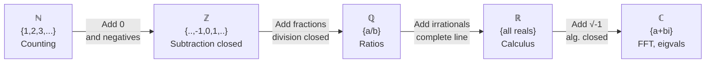

# Set progression

$$
\mathbb{N} \subset \mathbb{Z} \subset \mathbb{Q} \subset \mathbb{R} \subset \mathbb{C}
$$

## Deep Breakdown

What it tells me *(Situation Awareness)*:
The **number set hierarchy** $\mathbb{N} \subset \mathbb{Z} \subset \mathbb{Q} \subset \mathbb{R} \subset \mathbb{C}$ is the foundational map of how number systems nest inside each other, each one extending the previous by closing a gap. Each extension is motivated by a specific arithmetic problem that the smaller set cannot solve. In DA/DS, this hierarchy tells you which numeric type to use for each quantity, why certain operations produce "unexpected" results (integer overflow, float imprecision, complex outputs), and how to reason about data types across Python, R, SQL, and numpy.

## Flowchart



## Real-world use

### Where it is used

Choosing the correct numeric dtype for a column or computation. Debugging type errors and overflow issues. Understanding why `5 - 7` requires $\mathbb{Z}$, why `1 / 3` requires $\mathbb{Q}$, why `np.log(2)` gives an irrational in $\mathbb{R}$, and why `np.fft.fft()` returns $\mathbb{C}$. Communicating data contracts in pipelines ("this column is always a natural number — use uint32").

### Problem it solves

Developers and analysts who do not know this hierarchy make systematic errors: storing signed quantities as unsigned integers (overflow), expecting exact decimal arithmetic from floats (precision loss), being surprised by complex FFT output, or wondering why a model produces NaN (irrational arithmetic overflow or division by zero escaped $\mathbb{R}$).

### How it solves the problem

Each step in the hierarchy solves a closure problem:
- $\mathbb{N} \to \mathbb{Z}$: closes subtraction ($3 - 5 = -2 \in \mathbb{Z}$)
- $\mathbb{Z} \to \mathbb{Q}$: closes division ($5 \div 3 = \frac{5}{3} \in \mathbb{Q}$)
- $\mathbb{Q} \to \mathbb{R}$: closes limits/convergence ($\lim_{n\to\infty}(1 + \frac{1}{n})^n = e \in \mathbb{R}$)
- $\mathbb{R} \to \mathbb{C}$: closes polynomial roots ($\sqrt{-1} \in \mathbb{C}$)

### Example in a business

Pipeline dtype audit: "Units sold is $\mathbb{N}$ — use `uint32`. Revenue delta is $\mathbb{Z}$ — use `int64`. Conversion rate is $\mathbb{Q}$ — use `float64`. Model prediction is $\mathbb{R}$ — use `float64`. FFT output is $\mathbb{C}$ — use `complex128`." This mental map prevents silent type errors.

## The formula, piece by piece

Breaking the notation:

- $\subset$: "is a proper subset of" — every element of the left set is in the right set, but the right set has more.
- $\mathbb{N} \subset \mathbb{Z}$: every natural number is an integer, but $-1 \in \mathbb{Z}$ and $-1 \notin \mathbb{N}$.
- $\mathbb{Z} \subset \mathbb{Q}$: every integer is rational ($n = \frac{n}{1}$), but $\frac{1}{2} \in \mathbb{Q}$ and $\frac{1}{2} \notin \mathbb{Z}$.
- $\mathbb{Q} \subset \mathbb{R}$: every rational is real, but $\pi \in \mathbb{R}$ and $\pi \notin \mathbb{Q}$.
- $\mathbb{R} \subset \mathbb{C}$: every real is complex ($a + 0i$), but $i \in \mathbb{C}$ and $i \notin \mathbb{R}$.

Why each extension is necessary:
| Transition | Closure problem | Example that fails |
|------------|-----------------|-------------------|
| $\mathbb{N} \to \mathbb{Z}$ | Subtraction | $3 - 5 = -2 \notin \mathbb{N}$ |
| $\mathbb{Z} \to \mathbb{Q}$ | Division | $5 \div 2 = 2.5 \notin \mathbb{Z}$ |
| $\mathbb{Q} \to \mathbb{R}$ | Limit/completeness | $\sqrt{2} \notin \mathbb{Q}$ |
| $\mathbb{R} \to \mathbb{C}$ | Polynomial roots | $x^2 + 1 = 0$ has no real root |

## The formula in words

"Natural numbers sit inside integers, which sit inside rationals, which sit inside reals, which sit inside complex numbers. Each bigger set fills in gaps left by the smaller one. You always use the smallest set that handles your problem — but know when your problem demands a bigger one."

## Critical Concepts

1. **Use the smallest sufficient set**: `uint32` for counts (not `float64`), `int64` for signed integers (not `float64`), `float64` for reals. Using float for everything wastes memory and introduces unnecessary precision issues.
2. **Python's implicit promotion**: `5 / 2 = 2.5` (Python 3 auto-promotes to float/rational). `5 // 2 = 2` (stays in integer). `np.fft.fft([1,2,3,4])` auto-promotes to complex. Know which operations promote to a larger set.
3. **SQL type hierarchy**: `INTEGER → BIGINT → DECIMAL → FLOAT → DOUBLE`. Arithmetic between an INTEGER and a DECIMAL returns DECIMAL. Between DECIMAL and FLOAT returns FLOAT (potentially losing precision).
4. **NaN and Inf are not in $\mathbb{R}$**: IEEE 754 float adds `NaN` and `±Inf` as special values outside the real line.

These are engineering conveniences, not mathematical real numbers. Always handle them before modeling.

## Step-by-step calculation (tiny example)

Task: trace which number set each operation in a typical DA pipeline uses.

*Step 1: Count rows*
`row_count = len(df)` → $5 \in \mathbb{N}$ (positive integer count)

*Step 2: Revenue delta*
`delta = revenue_this_week - revenue_last_week = 1200 - 1500 = -300` → $-300 \in \mathbb{Z}$ (negative — left $\mathbb{N}$)

*Step 3: Conversion rate*
`rate = 15 / 200 = 0.075` → $\frac{15}{200} = \frac{3}{40} \in \mathbb{Q}$ (fraction — left $\mathbb{Z}$)

*Step 4: Log-transform*
`log_revenue = log(1200) ≈ 7.0901` → $\ln(1200) \in \mathbb{R} \setminus \mathbb{Q}$ (irrational — left $\mathbb{Q}$)

*Step 5: FFT*
`fft_output = fft(time_series)` → elements in $\mathbb{C}$ (complex — left $\mathbb{R}$) Each step moved up the hierarchy, and each step had a reason.

## Code examples

### Beginner example (Python)

```python
# Number set hierarchy: ℕ ⊂ ℤ ⊂ ℚ ⊂ ℝ ⊂ ℂ
import numpy as np   # Demonstrate which set each value belongs to

def classify_number(value) -> str:
    """Classify a scalar value by the smallest number set it belongs to."""
    if isinstance(value, complex) and value.imag != 0:
        return "ℂ (complex)"
    val = float(value.real) if isinstance(value, complex) else float(value)
    if not np.isfinite(val):
        return "outside ℝ (NaN or ±Inf)"
    if val == int(val):
        n = int(val)
        if n >= 1:
            return f"ℕ (natural): {n}"
        elif n >= 0:
            return f"ℕ₀ (whole): {n}"
        else:
            return f"ℤ (integer): {n}"
        from fractions import Fraction
    frac = Fraction(val).limit_denominator(10**9)
    if abs(float(frac) - val) < 1e-10:
        return f"ℚ (rational): {frac}"
    return f"ℝ (real, likely irrational): {val:.6f}"
examples = [ 5,   # ℕ
    -3,   # ℤ
    0.75,   # ℚ
    (= 3/4) np.sqrt(2),   # ℝ
    (irrational) np.pi,   # ℝ
    (irrational) 2 + 3j,   # ℂ np.nan, # outside ℝ np.inf, # outside ℝ
]
print("Number Set Classification:")
for v in examples:
    print(f" {str(v):>15} → {classify_number(v)}")   # Python dtype hierarchy (practical mapping)
print("\nPractical dtype mapping:")
dtype_map = { "row count, rank": "uint32 (ℕ)", "revenue delta, lag": "int64 (ℤ)", "conversion rate, %": "float64 (ℚ approx)", "log value, gradient": "float64 (ℝ approx)", "FFT output, eigval": "complex128 (ℂ)",
}
for use_case, dtype in dtype_map.items():
    print(f" {use_case:<30} → {dtype}")
```

### Beginner example (R)

```r
# Number set hierarchy in R # R uses double for ℝ, complex for ℂ, integer for ℤ and ℕ
values <- list( natural = 5L, integer = -3L, rational = 3/4, irrational = sqrt(2), complex = 2 + 3i, nan_val = NaN, inf_val = Inf
) cat("R numeric types vs. mathematical sets:\n")
cat(sprintf(" %-15s class=%-10s is.integer=%-5s is.complex=%-5s is.finite=%-5s\n", "value", "class", "int?", "complex?", "finite?"))
for (name in names(values)) { v <- valuesname
  cat(sprintf(" %-15s class=%-10s is.integer=%-5s is.complex=%-5s is.finite=%-5s\n", name, class(v), is.integer(v), is.complex(v), if (is.complex(v)) "N/A" else is.finite(v)))
}  # FFT in R returns complex vector
signal <- c(1, 2, 3, 4, 3, 2, 1, 0)
fft_out <- fft(signal)
cat(sprintf("\nFFT output class: %s (ℂ)\n", class(fft_out)))
cat(sprintf("First element: %.2f + %.2fi\n", Re(fft_out[1]), Im(fft_out[1])))
```

### Professional example (Python)

```python
import numpy as np
import pandas as pd   # Scenario: audit a pipeline's column types against the number-set hierarchy
# Goal: assign the smallest sufficient numeric type to each column
np.random.seed(42)
N = 300
raw = pd.DataFrame({ "user_id": np.arange(1, N + 1),   # ℕ
    "session_count": np.random.randint(0, 50, N),   # ℕ₀
    (can be 0) "revenue_delta": np.random.randint(-1000, 5000, N),   # ℤ
    "conversion_rate": np.random.uniform(0, 0.5, N),   # ℚ/ℝ
    "log_spend": np.log(np.random.uniform(1, 1000, N)),   # ℝ
})   # Optimal dtypes aligned with number-set hierarchy
dtype_plan = { "user_id": ("uint32", "ℕ — positive IDs, no zero needed"), "session_count": ("uint16", "ℕ₀ — non-negative counts, max 50"), "revenue_delta": ("int32", "ℤ — can be negative, fits in 32 bits"), "conversion_rate": ("float32", "ℝ — continuous [0,1], 32-bit sufficient"), "log_spend": ("float64", "ℝ — irrational values, 64-bit needed"),
}
print("Number-Set Hierarchy: Dtype Audit")
print("=" * 58)
print(f" {'Column':<20} {'Before':>12} {'After':>12} {'Set'} {'Reason'}")
print(" " + "-" * 80)
optimized = raw.copy()
for col, (target_dtype, reason) in dtype_plan.items():
    before = str(raw[col].dtype)
optimized[col] = raw[col].astype(target_dtype)
after = str(optimized[col].dtype)
print(f" {col:<20} {before:>12} {after:>12} {reason}")   # Memory savings
mem_before = raw.memory_usage(deep=True).sum()
mem_after = optimized.memory_usage(deep=True).sum()
print(f"\n Memory before: {mem_before:,} bytes")
print(f" Memory after: {mem_after:,} bytes")
print(f" Reduction: {(1 - mem_after/mem_before)*100:.1f}%")   # FFT demo: automatically promotes to ℂ
signal = np.sin(2 * np.pi * np.linspace(0, 1, 128))
fft_output = np.fft.fft(signal)
print(f"\n FFT input dtype: {signal.dtype} ← ℝ (float64)")
print(f" FFT output dtype: {fft_output.dtype} ← ℂ (complex128)")
print(f" Promotion: ℝ → ℂ happens automatically inside np.fft.fft()")
```

### Professional example (R)

```r
# FFT promotes real input to complex output (ℝ → ℂ)
signal <- sin(2 * pi * seq(0, 1, length.out = 128))
fft_output <- fft(signal)
cat(" FFT input: real (numeric)\n")
cat(" FFT output: complex", class(fft_output), "\n")
cat(" Promotion: ℝ → ℂ happens automatically inside fft()\n")
```

---

*Source: 1300 p. 15*
