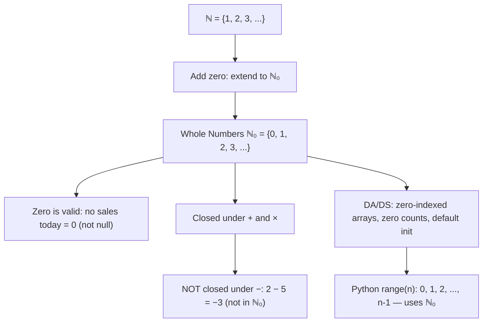

# Whole numbers

$$
\mathbb{N}_0 = \{0, 1, 2, 3, \dots\}
$$

## Deep Breakdown

What it tells me *(Situation Awareness)*:
The **whole numbers** $\mathbb{N}_0$ (also written $\mathbb{W}$) are the natural numbers extended to include zero: $\{0, 1, 2, 3, \ldots\}$. Zero is the additive identity — the value that changes nothing when added. Adding zero to $\mathbb{N}$ closes the set under subtraction for the special case $a - a = 0$, but does not make it fully closed under subtraction (you can still get negatives). In DA/DS, whole numbers appear everywhere: zero counts (zero-sale days, zero-return customers), zero-indexed arrays, default initializations, and any scenario where zero is a valid count but negatives are not.

## Flowchart



## Real-world use

### Where it is used

Zero counts in data (a product with zero sales is not null — it sold nothing), Python 0-based indexing (`df.iloc[0]`), SQL `COUNT(*)` returning 0 for empty groups (not NULL), default metric values before any events, batch sizes starting at 0, and cumulative sums that start at 0.

### Problem it solves

A null value and a zero count mean different things: NULL often means "unknown" or "not applicable", while 0 means "we know the value, and it is zero." Whole numbers formalize this distinction. In a sales report, a product that was available but sold nothing should show 0, not NULL — otherwise aggregations silently drop it.

### How it solves the problem

$\mathbb{N}_0$ includes zero explicitly, so zero is a valid, meaningful count. In SQL: `COALESCE(SUM(sales), 0)` converts NULL (no rows) to 0 (zero sales), returning a whole-number result. In pandas: `.fillna(0)` on count columns converts missing counts to whole numbers.

### Example in a business

Daily sales dashboard: a product available for 30 days should have 30 rows in the report — days with zero sales show 0, not gaps. Using `CROSS JOIN` between a date spine and product list, then `COALESCE(SUM(revenue), 0)` ensures every day appears with a whole-number (possibly zero) revenue count.

## The formula, piece by piece

Breaking the notation:

- $\mathbb{N}_0$: the subscript 0 indicates that zero is included. From German *natürliche Zahlen mit Null*.
- $\{0, 1, 2, 3, \ldots\}$: zero followed by all natural numbers, continuing infinitely.
- Relationship: $\mathbb{N} \subset \mathbb{N}_0 \subset \mathbb{Z}$ — whole numbers sit between natural numbers and integers.

Key properties:
- **Closed under addition**: $a + b \in \mathbb{N}_0$ for all $a, b \in \mathbb{N}_0$
- **Closed under multiplication**: $a \cdot b \in \mathbb{N}_0$
- **NOT closed under subtraction**: $2 - 5 = -3 \notin \mathbb{N}_0$
- **Zero as additive identity**: $a + 0 = a$ for all $a \in \mathbb{N}_0$

## The formula in words

"$\mathbb{N}_0$ is the natural numbers plus zero — all non-negative whole numbers. Zero is not 'nothing missing'; it is a valid, known, meaningful value. A day with zero sales is as real as a day with 100 sales."

## Critical Concepts

1. **Zero vs. NULL in databases**: zero is a value; NULL is the absence of a value. In SQL aggregations, NULL propagates (any arithmetic with NULL returns NULL), while 0 does not. Always decide whether missing data means zero or unknown.
2. **Python indexing is ℕ₀-based**: `list[0]` accesses the first element. Off-by-one errors are often caused by confusing $\mathbb{N}$ (1-indexed, as in R and mathematics) with $\mathbb{N}_0$ (0-indexed, as in Python and C).
3. **Closed-form gap filling**: when generating a complete time series in pandas (`pd.date_range`), you create a "spine" of dates. Merging with sales data and filling with 0 converts NULL to $\mathbb{N}_0$ values.
4. **uint vs. int dtype**: whole numbers fit in `uint8`, `uint16`, `uint32` — unsigned integer types.

No sign bit wasted. Use these for non-negative count columns to save memory and signal intent.

## Step-by-step calculation (tiny example)

Task: show that $\mathbb{N}_0$ is closed under addition but not subtraction.

*Step 1: Closure under addition*
$0 + 3 = 3 \in \mathbb{N}_0$. $5 + 7 = 12 \in \mathbb{N}_0$. Closed.

*Step 2: Additive identity*
$0 + a = a$ for any $a \in \mathbb{N}_0$. Zero is the identity element.

*Step 3: Non-closure under subtraction*
$2 - 5 = -3 \notin \mathbb{N}_0$ (negative). Not closed. Need $\mathbb{Z}$ to fix this.

*Step 4: Daily sales example*
Products: A, B, C. Days: Mon, Tue, Wed. Raw data has no row for Product B on Monday. Correct whole-number fill: Product B, Monday = 0 (not NULL, not missing).

## Code examples

### Beginner example (Python)

```python
# Whole numbers ℕ₀ = {0, 1, 2, 3, ...}
whole_numbers = list(range(0, 11))
print("First 11 whole numbers (0 to 10):", whole_numbers)   # Zero is valid, not missing
print(f"\nClosure under addition: 0 + 5 = {0 + 5} (in ℕ₀: {0 + 5 >= 0})")
print(f"Additive identity: 7 + 0 = {7 + 0} (unchanged)")
print(f"NOT closed under -: 2 - 5 = {2 - 5} (in ℕ₀: {(2 - 5) >= 0})")
import pandas as pd
import numpy as np   # Zero-count gap filling: every product appears on every day
dates = pd.date_range("2024-01-01", periods=5, freq="D")
products = ["A", "B", "C"]   # Spine: every date × every product
spine = pd.MultiIndex.from_product([dates, products], names=["date", "product"])
spine_df = pd.DataFrame(index=spine).reset_index()   # Simulated raw sales (some days missing for some products)
np.random.seed(42)
raw_sales = pd.DataFrame({ "date": np.random.choice(dates, 8), "product": np.random.choice(products, 8), "units": np.random.randint(1, 50, 8),
})   # Merge and fill zeros (ℕ₀ semantics: absent = 0, not null)
full_df = spine_df.merge(raw_sales, on=["date", "product"], how="left")
full_df["units"] = full_df["units"].fillna(0).astype("uint32")
print("\nFull sales grid (zeros = whole-number absence, not null):")
print(full_df.pivot(index="date", columns="product", values="units").to_string())
print(f"\nDtype: {full_df['units'].dtype} ← uint32 enforces ℕ₀ semantics")
```

### Beginner example (R)

```r
# Whole numbers ℕ₀ = {0, 1, 2, 3, ...}
whole_numbers <- 0:10
cat("First 11 whole numbers:", whole_numbers, "\n")
cat(sprintf("Additive identity: 7 + 0 = %d\n", 7L + 0L))
cat(sprintf("NOT closed under subtraction: 2 - 5 = %d (negative)\n", 2L - 5L))  # Gap filling: complete date × product grid with zero counts
library(dplyr)
library(tidyr)
dates <- seq.Date(as.Date("2024-01-01"), by = "day", length.out = 5)
products <- c("A", "B", "C")
spine <- expand.grid(date = dates, product = products, stringsAsFactors = FALSE)
set.seed(42)
raw_sales <- data.frame( date = sample(dates, 8, replace = TRUE), product = sample(products, 8, replace = TRUE), units = sample(1:50, 8, replace = TRUE)
) full_df <- spine |> left_join(raw_sales, by = c("date", "product")) |> mutate(units = if_else(is.na(units), 0L, as.integer(units))) cat("\nFull sales grid (ℕ₀ — zeros not nulls):\n")
print(full_df |> pivot_wider(names_from = product, values_from = units))
```

### Professional example (Python)

```python
import pandas as pd
import numpy as np   # Scenario: build a complete daily KPI report with zero-fill
# Zero counts are whole numbers; missing = 0 (known absence), not NULL (unknown)
np.random.seed(42)
date_range = pd.date_range("2024-01-01", "2024-01-31", freq="D")
channels = ["organic", "paid", "email", "referral"]   # Spine: complete cross product of dates × channels
spine = pd.DataFrame( [(d, c) for d in date_range for c in channels], columns=["date", "channel"],
)   # Raw events (sparse — not all channels active every day)
n_events = 60
raw_events = pd.DataFrame({ "date": np.random.choice(date_range, n_events), "channel": np.random.choice(channels, n_events), "sessions": np.random.randint(1, 500, n_events), "conversions": np.random.randint(0, 20, n_events),
})   # Aggregate and merge — zero-fill for ℕ₀ semantics
agg = raw_events.groupby(["date", "channel"], as_index=False).agg( total_sessions=("sessions", "sum"), total_conversions=("conversions", "sum"),
)
report = ( spine .merge(agg, on=["date", "channel"], how="left") .fillna({"total_sessions": 0, "total_conversions": 0}) .astype({"total_sessions": "uint32", "total_conversions": "uint32"}) .sort_values(["channel", "date"]) .reset_index(drop=True) )   # Verify: no NULLs, no negatives — all values in ℕ₀
assert report["total_sessions"].isna().sum() == 0, "NULLs in sessions"
assert report["total_conversions"].isna().sum() == 0, "NULLs in conversions"
assert (report["total_sessions"] >= 0).all(), "Negative sessions"
assert (report["total_conversions"] >= 0).all(), "Negative conversions"
print("Daily Channel KPI Report — ℕ₀ values (no NULLs, no negatives)")
print(f" Shape: {report.shape} ← {len(date_range)} days × {len(channels)} channels = complete grid")
print(f" Dtypes: sessions={report['total_sessions'].dtype}, " f"conversions={report['total_conversions'].dtype}")
print(f"\n Days with zero sessions (valid ℕ₀ = 0): " f"{(report['total_sessions'] == 0).sum()}")
print(f" Days with NULL sessions (should be 0): " f"{report['total_sessions'].isna().sum()}")
print("\nSample (first 8 rows):")
print(report.head(8).to_string(index=False))
```

### Professional example (R)

```r
# Daily aggregates: total_sessions, total_conversions in ℕ₀ (whole numbers, 0 allowed)
set.seed(42)
daily <- data.frame( date = rep(seq(as.Date("2024-01-01"), by = "day", length.out = 7), each = 3), sessions = sample(0:100, 21, replace = TRUE), conversions = sample(0:10, 21, replace = TRUE)
)
report <- aggregate(cbind(sessions = sessions, conversions = conversions) ~ date, data = daily, sum)
cat(" Days with zero sessions (valid ℕ₀):", sum(report$sessions == 0), "\n")
cat("Sample (first 8 rows):\n")
print(head(report, 8))
```

---

*Source: 1300 p. 15*
