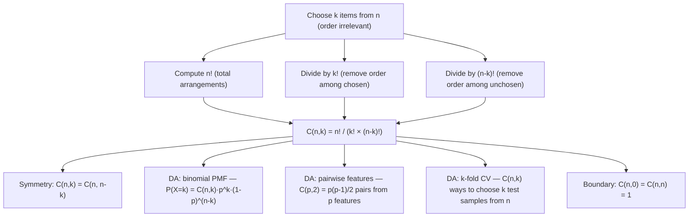

# Combinations

$$
\binom{n}{k} = \frac{n!}{k!(n-k)!}
$$

## Deep Breakdown

What it tells me *(Situation Awareness)*:
The binomial coefficient $\binom{n}{k}$ (read "n choose k") counts the number of ways to select $k$ items from a set of $n$ distinct items, where the order of selection does not matter. Also written $C(n, k)$ or $C_k^n$. In DA/DS, this is foundational to: the binomial probability distribution ($P(X = k) = \binom{n}{k} p^k (1-p)^{n-k}$), the hypergeometric distribution, combinatorial feature generation (how many pairs of features can be formed from $p$ features: $\binom{p}{2}$), cross-validation fold selection, bootstrap confidence intervals, and counting outcomes in probability spaces. In machine learning, $\binom{p}{2}$ gives the number of pairwise interaction terms in a polynomial feature expansion — a key figure when assessing the dimensionality explosion of degree-2 features. The formula requires computing three factorials, but for large $n$ it is computed via logarithms or scipy functions to avoid integer overflow.

## Flowchart



## Real-world use

### Where it is used

Binomial probability: probability that exactly $k$ out of $n$ users convert, given conversion rate $p$. Hypergeometric sampling: probability of drawing exactly $k$ defective items from a batch without replacement. Feature engineering: number of all pairwise interaction features from $p$ original features = $\binom{p}{2} = p(p-1)/2$ — grows quadratically. Test size planning: how many possible train/test splits exist for a dataset of $n$ samples when choosing $k$ for the test set. Bootstrap: number of distinct bootstrap samples of size $k$ from $n$ (with replacement, more complex, but combinations underlie the theory).

### Problem it solves

When selecting $k$ items from $n$, the raw number of ordered sequences is $\frac{n!}{(n-k)!}$ (permutations). But if the order of the selected items doesn't matter (e.g., selecting a group of 3 analysts from a team of 10 — the group is the same regardless of the order they were chosen), you overcount each selection by $k!$ (the number of orderings of the $k$ chosen items). Dividing by $k!$ gives the combinations count.

### How it solves the problem

$\binom{n}{k} = \frac{n!}{k!(n-k)!}$: $n!$ = total arrangements of all $n$ items. $k!$ = overcounting due to ordering the selected $k$ items (irrelevant). $(n-k)!$ = overcounting due to ordering the remaining $n-k$ items (irrelevant). Dividing by both removes all irrelevant orderings, leaving only the distinct selections. Alternatively: $\binom{n}{k} = \frac{n(n-1)(n-2)\cdots(n-k+1)}{k!}$ — multiply $k$ descending integers from $n$, then divide by $k!$. This form avoids computing $(n-k)!$ and is numerically better for large $n$.

### Example in a business

A product team has $p = 20$ features and wants to compute all pairwise interaction terms for a polynomial regression. The number of pairs is $\binom{20}{2} = \frac{20 \times 19}{2} = 190$. Adding these to the original 20 features gives 210 total features — already a significant expansion. For degree-3 interactions: $\binom{20}{3} = 1{,}140$ additional terms. This combinatorial explosion is why regularization (L1/L2) and feature selection are essential when using polynomial features.

## The formula, piece by piece

Breaking the notation:

- $\binom{n}{k}$: "n choose k" — the number of ways to select $k$ items from $n$ without order.
- $n$: the total number of items to choose from (population size). Must be a non-negative integer.
- $k$: the number of items to select (sample size). Must satisfy $0 \le k \le n$.
- $n!$: $n$ factorial — $n \times (n-1) \times \cdots \times 2 \times 1$. By convention, $0! = 1$.
- $k!$: factorial of the number chosen — removes ordering among selected items.
- $(n-k)!$: factorial of the remainder — removes ordering among unselected items. **Key values**:
- $\binom{n}{0} = 1$: there is exactly one way to select zero items (select nothing).
- $\binom{n}{n} = 1$: there is exactly one way to select all items.
- $\binom{n}{1} = n$: selecting one item from $n$ gives $n$ choices.
- $\binom{n}{2} = \frac{n(n-1)}{2}$: number of pairs — grows as $O(n^2)$. **Symmetry**: $\binom{n}{k} = \binom{n}{n-k}$ — choosing $k$ to include is equivalent to choosing $n-k$ to exclude. **Pascal's rule**: $\binom{n}{k} = \binom{n-1}{k-1} + \binom{n-1}{k}$ — the recursive identity that generates Pascal's triangle.

## The formula in words

"$\binom{n}{k}$ counts the number of distinct groups of size $k$ you can form from $n$ items, when you don't care about the order within the group. Compute it as: $n!$ divided by $k!$ divided by $(n-k)!$. In Python: `math.comb(n, k)` or `scipy.special.comb(n, k)`. In R: `choose(n, k)`. The result is always a positive integer for $0 \le k \le n$."

## Critical Concepts

1. **Combinations vs. permutations**: permutations $P(n,k) = n!/(n-k)!$ count ordered selections. Combinations $C(n,k) = P(n,k)/k!$ count unordered selections. When choosing a committee (order doesn't matter): use combinations. When assigning ranked positions (order matters): use permutations.
2. **Symmetry $\binom{n}{k} = \binom{n}{n-k}$**: choosing 3 from 10 gives the same count as choosing 7 from 10. In code: `comb(n, k) == comb(n, n-k)`. Use this to compute the smaller argument for efficiency.
3. **Feature explosion**: $\binom{p}{2}$ pairwise features grows as $O(p^2)$. For $p = 100$ features, degree-2 expansion generates $\binom{100}{2} = 4{,}950$ pairwise terms plus 100 squared terms = 5{,}050 features. This is why `PolynomialFeatures(degree=2)` in scikit-learn can dramatically increase dimensionality.
4. **Numerical overflow for large $n$**: computing $n!$ directly overflows 64-bit integers for $n \ge 21$ (in exact integer arithmetic). Use `scipy.special.comb(n, k, exact=False)` for float approximation or `scipy.special.gammaln` for log-scale computation. In Python: `math.comb(n, k)` uses arbitrary-precision integers and never overflows, but is slow for very large $n$.
5. **Sum identity**: $\sum_{k=0}^{n} \binom{n}{k} = 2^n$ — the total number of subsets of an $n$-element set.

Setting $p = 0.5$ in the binomial theorem: $(0.5 + 0.5)^n = 1$ = sum of all equal-weight binomial probabilities.

## Step-by-step calculation (tiny example)

Task: compute $\binom{5}{2}$ — the number of ways to choose 2 features from 5 for a pairwise interaction.

*Step 1: Write the formula*
$\binom{5}{2} = \frac{5!}{2!(5-2)!} = \frac{5!}{2! \cdot 3!}$.

*Step 2: Compute the factorials*
$5! = 5 \times 4 \times 3 \times 2 \times 1 = 120$.
$2! = 2 \times 1 = 2$.
$3! = 3 \times 2 \times 1 = 6$.

*Step 3: Divide*
$\binom{5}{2} = \frac{120}{2 \times 6} = \frac{120}{12} = 10$.

*Step 4: Verify with the shortcut formula*
$\binom{5}{2} = \frac{5 \times 4}{2!} = \frac{20}{2} = 10$.

*Step 5: Enumerate to confirm*
Features: $\{A, B, C, D, E\}$. Pairs: $\{AB, AC, AD, AE, BC, BD, BE, CD, CE, DE\}$ = 10 pairs.

## Code examples

### Beginner example (Python)

```python
# Combinations: C(n, k) = n! / (k! * (n-k)!)
from math import comb, factorial   # Manual computation

def combinations_manual(n: int, k: int) -> int:
    """Compute C(n,k) using the factorial formula."""
    if k < 0 or k > n:
        return 0
    return factorial(n) // (factorial(k) * factorial(n - k))   # Verify against math.comb
n, k = 5, 2
manual = combinations_manual(n, k)
builtin = comb(n, k)
print(f"C({n},{k}) = {n}! / ({k}! * {n-k}!) = {factorial(n)} / ({factorial(k)} * {factorial(n-k)}) = {manual}")
print(f"math.comb({n},{k}) = {builtin}")   # Key properties
print(f"\nKey values:")
for n_val in [10, 20, 50]:
    print(f" C({n_val},0)={comb(n_val,0)} C({n_val},1)={comb(n_val,1)} C({n_val},2)={comb(n_val,2)} sum=2^{n_val}={2**n_val}")   # Symmetry: C(n,k) = C(n,n-k)
n_val = 10
for k_val in range(n_val + 1):
    assert comb(n_val, k_val) == comb(n_val, n_val - k_val), f"Symmetry failed at k={k_val}"
print(f"\nSymmetry C({n_val},k) == C({n_val},{n_val}-k): verified for all k")   # Feature engineering: pairwise interaction count
for p in [5, 10, 20, 50, 100]:
    n_pairs = comb(p, 2)
print(f" p={p:>3} features → C({p},2)={n_pairs:>5} pairwise interactions")
```

### Beginner example (R)

```r
# Combinations in R: choose(n, k) # Manual and built-in comparison
n <- 5; k <- 2
manual <- factorial(n) / (factorial(k) * factorial(n - k))
builtin <- choose(n, k)
cat(sprintf("C(%d,%d) = %d! / (%d! * %d!) = %d\n", n, k, n, k, n - k, manual))
cat(sprintf("choose(%d,%d) = %d\n", n, k, builtin))  # Symmetry
cat("\nSymmetry check: C(10,k) == C(10,10-k)\n")
for (k_val in 0:10) { cat(sprintf(" C(10,%d) = %d C(10,%d) = %d equal: %s\n", k_val, choose(10, k_val), 10 - k_val, choose(10, 10 - k_val), choose(10, k_val) == choose(10, 10 - k_val)))
}  # Feature explosion
cat("\nPairwise feature count C(p, 2):\n")
for (p in c(5, 10, 20, 50, 100)) { cat(sprintf(" p=%3d features → C(%d,2) = %d pairwise interactions\n", p, p, choose(p, 2)))
}
```

### Professional example (Python)

```python
import pandas as pd
import numpy as np
from math import comb
from itertools import combinations
from scipy.special import gammaln   # Scenario: polynomial feature expansion audit
# For a given feature set, compute the number of features at each polynomial degree
# Use C(p, k) to forecast the dimensionality before calling PolynomialFeatures
# Use log-scale for large n to avoid overflow
np.random.seed(42)

def polynomial_feature_counts( n_original: int, max_degree: int ) -> pd.DataFrame:
    """ Compute the number of new terms added at each polynomial degree. For degree d, the number of degree-d interaction terms from p features is C(p + d - 1, d). For exact (no repetition) interactions only: C(p, d). Args: n_original: Number of original features. max_degree: Maximum polynomial degree. Returns: DataFrame with degree, C(p,d) exact terms, cumulative features, and log10 of cumulative. """
    rows = []
    cumulative = n_original   # start with original features
    for degree in range(2, max_degree + 1):
        if degree > n_original:
            break
        new_terms = comb(n_original, degree)
    cumulative += new_terms
    rows.append({ "degree": degree, "C(p, degree)": new_terms, "cumulative_feats": cumulative, "log10_cumulative": np.log10(cumulative), })
    return pd.DataFrame(rows)

def log_comb(n: int, k: int) -> float:
    """Compute log(C(n,k)) using log-gamma for large n."""
    return gammaln(n + 1) - gammaln(k + 1) - gammaln(n - k + 1)
feature_counts = [10, 50, 100, 500]
max_degree = 5
print("Polynomial Feature Explosion: C(p, degree) new terms per degree")
print("=" * 72)
for p in feature_counts:
    report = polynomial_feature_counts(p, max_degree)
print(f"\np = {p} original features:")
print(report.to_string(index=False))   # Log-scale for astronomically large combinations
print("\n--- Log10 of C(n, k) for large values ---")
large_cases = [(1000, 10), (10000, 5), (500, 50), (100, 50)]
for n_val, k_val in large_cases:
    log_val = log_comb(n_val, k_val)
print(f" log10(C({n_val:>5},{k_val:>3})) = {log_val / np.log(10):>10.2f} (exact value has ~{int(log_val / np.log(10))+1} digits)")
```

### Professional example (R)

```r
# C(n,k) and log10(C(n,k)) for large n
log_comb <- function(n, k) lgamma(n + 1) - lgamma(k + 1) - lgamma(n - k + 1)
for (p in c(2, 3, 5)) { n <- 10; k <- 1:p
  vals <- choose(n, k)
  cat(sprintf("C(%d, 1..%d): %s\n", n, p, paste(round(vals, 0), collapse = ", ")))
}
large_cases <- list(c(1000, 10), c(10000, 5), c(500, 50))
for (x in large_cases) { log_val <- log_comb(x[1], x[2])
  cat(sprintf(" log10(C(%d, %d)) = %.2f\n", x[1], x[2], log_val / log(10)))
}
```

---

*Source: 1300 p. 19*
