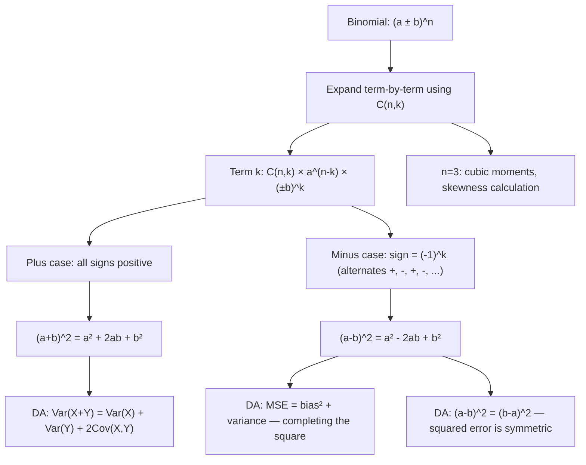

# Expanded Binomial Formula

$$
(a \pm b)^n = \binom{n}{0}a^n \pm \binom{n}{1}a^{n-1}b + \binom{n}{2}a^{n-2}b^2 \pm \dots \pm \binom{n}{n}b^n
$$

## Deep Breakdown

What it tells me *(Situation Awareness)*:
The expanded binomial formula writes out all $n+1$ terms of $(a \pm b)^n$ explicitly, making the sign alternation pattern for the subtraction case visible. For the plus version $(a + b)^n$, all terms are positive. For the minus version $(a - b)^n$, the signs alternate: $+$ for even powers of $b$, $-$ for odd powers. This is because $(-b)^k = (-1)^k b^k$: even $k$ gives $+$, odd $k$ gives $-$. In DA/DS, the key practical forms are the low-degree cases: $(a + b)^2 = a^2 + 2ab + b^2$ and $(a - b)^2 = a^2 - 2ab + b^2$ appear constantly in variance algebra ($\text{Var}(X \pm Y) = \text{Var}(X) + \text{Var}(Y) \pm 2\text{Cov}(X,Y)$), MSE decomposition (MSE = bias$^2$ + variance), polynomial regression, and completing the square for optimization. The cubic case $(a \pm b)^3$ appears in third-moment (skewness) calculations.

## Flowchart



## Real-world use

### Where it is used

Variance of a sum: $\text{Var}(X + Y) = \text{Var}(X) + \text{Var}(Y) + 2\text{Cov}(X,Y)$ — derived from $(a+b)^2 = a^2 + 2ab + b^2$ applied to deviations. MSE decomposition: $\text{MSE} = \mathbb{E}[(\hat{\theta} - \theta)^2] = \text{Bias}^2 + \text{Variance}$ — a completing-the-square derivation. The "bias-variance tradeoff" is literally the $a^2 + b^2$ structure of the expanded square. Polynomial regression features: $(x_1 + x_2)^2$ generates $x_1^2, 2x_1 x_2, x_2^2$ — the three degree-2 terms. Third moments (skewness): $(x - \mu)^3$ expanded gives terms involving $x^3, x^2\mu, x\mu^2, \mu^3$.

### Problem it solves

The compact notation $(a \pm b)^n$ hides the term structure. Writing it out makes the signs explicit and allows you to identify and extract specific terms — for example, the $a^{n-1}b$ term (coefficient $n$) for a linear approximation, or the middle term $2ab$ in $(a+b)^2$ that represents covariance-like cross-products. The expanded form is also the starting point for completing the square, finding roots, and simplifying algebraic expressions.

### How it solves the problem

For $(a - b)^n$: treat it as $(a + (-b))^n$ and apply the binomial theorem: $\sum_{k=0}^n \binom{n}{k} a^{n-k} (-b)^k = \sum_{k=0}^n (-1)^k \binom{n}{k} a^{n-k} b^k$. The $(-1)^k$ factor alternates the sign of each term.

For the most common cases:

$$
(a+b)^2 = a^2 + 2ab + b^2, \quad (a-b)^2 = a^2 - 2ab + b^2
$$

$$
(a+b)^3 = a^3 + 3a^2 b + 3ab^2 + b^3, \quad (a-b)^3 = a^3 - 3a^2 b + 3ab^2 - b^3
$$

### Example in a business

A data scientist decomposes MSE into bias and variance. Let $\hat{\theta}$ be the model's prediction and $\theta$ the true value. Define $b = \mathbb{E}[\hat{\theta}] - \theta$ (bias) and $v = \hat{\theta} - \mathbb{E}[\hat{\theta}]$ (zero-mean noise).

Then $\hat{\theta} - \theta = b + v$ and:

$$
\text{MSE} = \mathbb{E}[(b+v)^2] = b^2 + 2b\,\mathbb{E}[v] + \mathbb{E}[v^2] = b^2 + 0 + \text{Var}(\hat{\theta}) = \text{Bias}^2 + \text{Variance}
$$

The middle term $2b\,\mathbb{E}[v] = 0$ because $v$ is zero-mean by definition. The entire MSE decomposition is the expanded form of $(b + v)^2$.

## The formula, piece by piece

Breaking the notation:

- $(a \pm b)^n$: binomial raised to integer power $n$.
- $\pm$: the sign choice — $+$ gives all positive terms; $-$ gives alternating signs.
- $\binom{n}{k}$: binomial coefficient — coefficient of the $k$-th term.
- $a^{n-k}$: decreasing power of $a$ (from $a^n$ down to $a^0$).
- $b^k$: increasing power of $b$ (from $b^0$ up to $b^n$).
- $\pm \binom{n}{k} a^{n-k} b^k$: the $k$-th term, sign $= (-1)^k$ for the minus case. **Degree-2 expansion** (memorize these — used daily):

$$
(a+b)^2 = a^2 + 2ab + b^2
$$

$$
(a-b)^2 = a^2 - 2ab + b^2
$$

**Key identity**: $(a-b)^2 = (b-a)^2$ — squared difference is symmetric. Squared error $(\hat{y} - y)^2 = (y - \hat{y})^2$. **Degree-3 expansion**:

$$
(a \pm b)^3 = a^3 \pm 3a^2 b + 3ab^2 \pm b^3
$$

## The formula in words

"To expand $(a \pm b)^n$: write out $n+1$ terms, each with coefficient $\binom{n}{k}$, with $a$'s power decreasing from $n$ to 0 and $b$'s power increasing from 0 to $n$. For the minus case, flip the sign of every term where the power of $b$ is odd. The degree-2 case is the most important: $(a+b)^2 = a^2 + 2ab + b^2$ — the middle term $2ab$ is the cross-product. In Python: `expand((a+b)**n)` via sympy, or just memorize the degree-2 and degree-3 cases."

## Critical Concepts

1. **$(a-b)^2 = a^2 - 2ab + b^2$, not $a^2 - b^2$**: a very common error is forgetting the middle term. $(a-b)^2 \ne a^2 - b^2$. The identity $a^2 - b^2 = (a-b)(a+b)$ is the difference of squares — a completely different identity.
2. **The middle term = covariance proxy**: in $(a+b)^2 = a^2 + 2ab + b^2$, the $2ab$ term is the cross-product. In the variance formula $\text{Var}(X+Y) = \text{Var}(X) + \text{Var}(Y) + 2\text{Cov}(X,Y)$, the $2\text{Cov}(X,Y)$ term is exactly this cross-product applied to random variables.
3. **Bias-variance tradeoff via $(b+v)^2$**: MSE $= \text{Bias}^2 + \text{Var}$ is the degree-2 binomial expansion $(b+v)^2$, simplified by $\mathbb{E}[v] = 0$. The full expansion has three terms; the cross-term drops out because the noise is unbiased.
4. **Sign alternation for the minus case**: in $(a-b)^n$, term $k$ has sign $(-1)^k$. Even $k$: positive. Odd $k$: negative. This is why $(a-b)^2 = a^2 - 2ab + b^2$ has a negative middle term ($k=1$) and why $(a-b)^3 = a^3 - 3a^2b + 3ab^2 - b^3$ has alternating signs.
5. **Taylor series first-order form**: for $|b/a| \ll 1$: $(a + b)^n \approx a^n + n a^{n-1} b$ — only the first two terms of the expansion, used as a linear approximation.

## Step-by-step calculation (tiny example)

Task: expand $(3 - x)^3$ to compute a polynomial and verify at $x = 1$.

*Step 1: Identify the form*
$(a - b)^3$ with $a = 3, b = x, n = 3$. Signs alternate: $+, -, +, -$.

*Step 2: Write the 4 terms ($k = 0, 1, 2, 3$)*
$k=0$: $+\binom{3}{0} 3^3 x^0 = +1 \cdot 27 = +27$.
$k=1$: $-\binom{3}{1} 3^2 x^1 = -3 \cdot 9 \cdot x = -27x$.
$k=2$: $+\binom{3}{2} 3^1 x^2 = +3 \cdot 3 \cdot x^2 = +9x^2$.
$k=3$: $-\binom{3}{3} 3^0 x^3 = -1 \cdot x^3 = -x^3$.

*Step 3: Assemble*
$(3 - x)^3 = 27 - 27x + 9x^2 - x^3$.

*Step 4: Verify at $x = 1$*
$(3-1)^3 = 2^3 = 8$. Formula: $27 - 27 + 9 - 1 = 8$. ✓

## Code examples

### Beginner example (Python)

```python
# Expanded binomial formula: (a ± b)^n
from math import comb

def expand_binomial(n: int, a: float, b: float, sign: int = 1) -> list[tuple[float, int, int]]:
    """Compute all n+1 terms of (a + sign*b)^n.

    Args:
        n: Power.
        a: First base.
        b: Second base (positive value).
        sign: +1 for (a+b)^n, -1 for (a-b)^n.

    Returns:
        List of (coefficient, a_power, b_power) tuples.
    """
    terms = []
    for k in range(n + 1):
        coeff = comb(n, k) * (a ** (n - k)) * (b ** k) * (sign ** k)
        terms.append((coeff, n - k, k))
    return terms


# (3 ± x)^3 at x = 1
n_val = 3; a_val = 3.0; b_val = 1.0
plus_terms = expand_binomial(n_val, a_val, b_val, sign=+1)
minus_terms = expand_binomial(n_val, a_val, b_val, sign=-1)
print(f"(3 + x)^3 at x={b_val}: {[round(t[0], 2) for t in plus_terms]} sum={sum(t[0] for t in plus_terms):.1f} direct={(a_val+b_val)**n_val:.1f}")
print(f"(3 - x)^3 at x={b_val}: {[round(t[0], 2) for t in minus_terms]} sum={sum(t[0] for t in minus_terms):.1f} direct={(a_val-b_val)**n_val:.1f}")

# Key degree-2 case: variance composition
print("\nDegree-2 expansions:")
for sign_val, label in [(+1, "(a+b)²"), (-1, "(a-b)²")]:
    a2, b2 = 5.0, 3.0
    terms2 = expand_binomial(2, a2, b2, sign=sign_val)
    print(f" {label}: a²={terms2[0][0]:.1f} ±2ab={terms2[1][0]:.1f} b²={terms2[2][0]:.1f} sum={sum(t[0] for t in terms2):.1f} direct={(a2 + sign_val*b2)**2:.1f}")

# MSE = Bias² + Variance via (bias + noise)^2
bias = 2.5
noise_samples = [1.0, -0.5, 2.0, -1.5, 0.5]   # zero-mean noise
squared_errors = [(bias + v)**2 for v in noise_samples]
bias_sq = bias**2
var_term = sum(v**2 for v in noise_samples) / len(noise_samples)
mse = sum(squared_errors) / len(squared_errors)
decomposed = bias_sq + var_term
print(f"\nMSE decomposition: (bias + noise)² = bias² + variance (cross-term ≈ 0)")
print(f" MSE = {mse:.4f} | bias² + variance ≈ {decomposed:.4f}")
```

### Beginner example (R)

```r
# Expanded binomial formula in R
expand_binomial <- function(n, a, b, sign = 1) {
  sapply(0:n, function(k) choose(n, k) * a^(n - k) * b^k * sign^k)
}

# (3 ± x)^3 at x = 1
n_val <- 3; a_val <- 3.0; b_val <- 1.0
plus_terms <- expand_binomial(n_val, a_val, b_val, sign = 1)
minus_terms <- expand_binomial(n_val, a_val, b_val, sign = -1)
cat(sprintf("(3+x)^3 terms: %s sum=%.1f direct=%.1f\n", paste(round(plus_terms, 2), collapse=", "), sum(plus_terms), (a_val + b_val)^n_val))
cat(sprintf("(3-x)^3 terms: %s sum=%.1f direct=%.1f\n", paste(round(minus_terms, 2), collapse=", "), sum(minus_terms), (a_val - b_val)^n_val))

# Degree-2: MSE decomposition
bias <- 2.5
noise <- c(1.0, -0.5, 2.0, -1.5, 0.5)
squared_errors <- (bias + noise)^2
mse <- mean(squared_errors)
var_term <- mean(noise^2)
cat(sprintf("\nMSE = %.4f | bias^2 + variance = %.4f\n", mse, bias^2 + var_term))
```

### Professional example (Python)

```python
import numpy as np
import pandas as pd
from math import comb

# Scenario: Bias-Variance tradeoff — empirical MSE decomposition
# Demonstrates that MSE = Bias² + Variance via the degree-2 binomial expansion
# Simulates multiple model complexities with different bias-variance trade-offs
np.random.seed(42)
N_BOOTSTRAP = 1_000
N_SAMPLES = 100
TRUE_THETA = 5.0

def simulate_estimator(n: int, true_value: float, bias: float, noise_std: float, n_boot: int) -> dict:
    """Simulate an estimator with known bias and variance, and compute MSE decomposition.

    Args:
        n: Sample size per bootstrap run.
        true_value: True parameter value.
        bias: Systematic bias of the estimator.
        noise_std: Standard deviation of the estimator's sampling noise.
        n_boot: Number of bootstrap replications.

    Returns:
        Dictionary with empirical MSE, bias², variance, decomposed MSE, and match flag.
    """
    estimates = true_value + bias + np.random.normal(0, noise_std, n_boot)
    errors = estimates - true_value   # e_i = bias + noise_i
    squared_errors = errors ** 2   # (bias + noise)^2
    empirical_mse = squared_errors.mean()
    empirical_bias = errors.mean()   # E[e] ≈ bias
    empirical_var = estimates.var(ddof=0)   # Var(estimator)

    # Binomial expansion: E[(bias+noise)^2] = bias^2 + 2*bias*E[noise] + E[noise^2]
    # Since E[noise] = 0: MSE = bias^2 + Var
    decomposed_mse = empirical_bias**2 + empirical_var
    match = abs(empirical_mse - decomposed_mse) < 0.01
    return {
        "bias": bias,
        "noise_std": noise_std,
        "empirical_mse": round(empirical_mse, 4),
        "bias_sq": round(empirical_bias**2, 4),
        "variance": round(empirical_var, 4),
        "decomposed_mse": round(decomposed_mse, 4),
        "match": match,
    }


# Simulate across bias-variance trade-off spectrum
scenarios = [
    {"bias": 3.0, "noise_std": 0.5},   # high bias, low variance
    {"bias": 1.5, "noise_std": 1.5},   # balanced
    {"bias": 0.5, "noise_std": 3.0},   # low bias, high variance
    {"bias": 0.1, "noise_std": 4.5},   # very low bias, very high variance
]
rows = [
    simulate_estimator(N_SAMPLES, TRUE_THETA, s["bias"], s["noise_std"], N_BOOTSTRAP)
    for s in scenarios
]
report = pd.DataFrame(rows)
print("Bias-Variance Decomposition: MSE = Bias² + Variance (from (b+v)^2 expansion)")
print("=" * 72)
print(report.to_string(index=False))
print("\nAll match (MSE ≈ Bias² + Variance):", report["match"].all())
```

### Professional example (R)

```r
# MSE = Bias² + Variance (from (b+v)^2 expansion)
set.seed(42)
N_SAMPLES <- 500
TRUE_THETA <- 10
simulate <- function(bias, noise_std) {
  est <- TRUE_THETA + bias + rnorm(N_SAMPLES, 0, noise_std)
  empirical_bias <- mean(est) - TRUE_THETA
  empirical_var <- mean((est - mean(est))^2)
  empirical_mse <- mean((est - TRUE_THETA)^2)
  decomposed_mse <- empirical_bias^2 + empirical_var
  data.frame(bias = bias, noise_std = noise_std,
             empirical_mse = round(empirical_mse, 4),
             bias_sq = round(empirical_bias^2, 4),
             variance = round(empirical_var, 4),
             decomposed_mse = round(decomposed_mse, 4),
             match = abs(empirical_mse - decomposed_mse) < 0.01)
}
report <- do.call(rbind, lapply(list(c(3, 0.5), c(1.5, 1.5), c(0.5, 3), c(0.1, 4.5)), function(x) simulate(x[1], x[2])))
cat("MSE = Bias² + Variance\n")
print(report)
```

---

*Source: domain knowledge*
