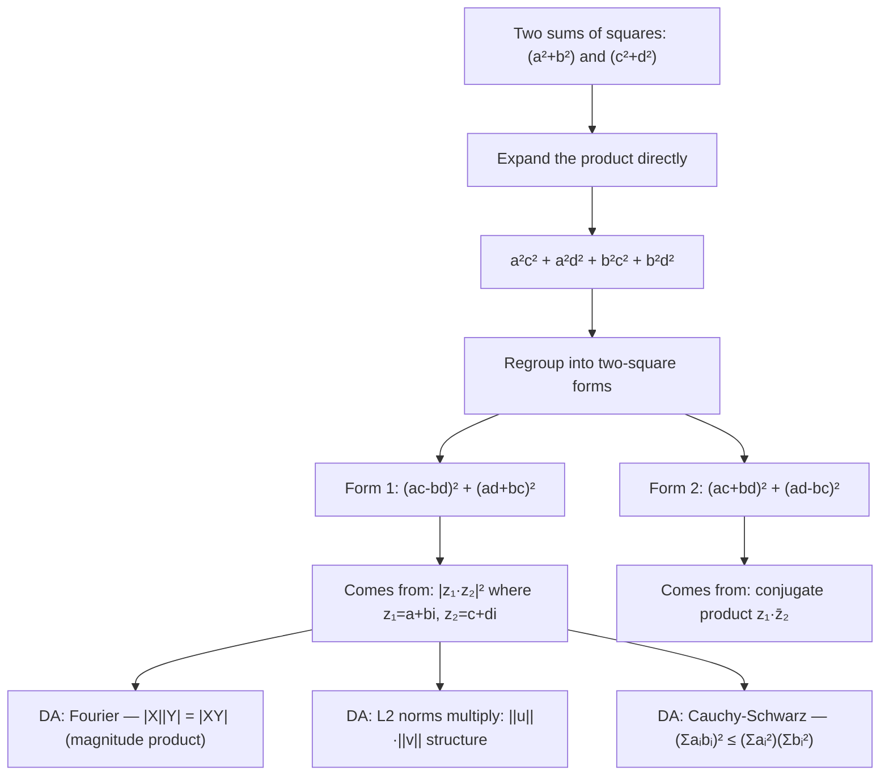

# Brahmagupta–Fibonacci Identity

$$
(a^2+b^2)(c^2+d^2) = (ac-bd)^2 + (ad+bc)^2 = (ac+bd)^2 + (ad-bc)^2
$$

## Deep Breakdown

What it tells me *(Situation Awareness)*:
The Brahmagupta-Fibonacci identity states that the product of two sums of squares is itself expressible as a sum of two squares in two distinct ways. The formula arises naturally from complex number multiplication:
$(a + bi)(c + di) = (ac - bd) + (ad + bc)i$
and since
$|z_1|^2 |z_2|^2 = |z_1 z_2|^2$
we get
$(a^2+b^2)(c^2+d^2) = (ac-bd)^2 + (ad+bc)^2$ The second form with
$(ac+bd)$
and
$(ad-bc)$
comes from the conjugate product. In DA/DS, this identity appears in: understanding why the L2 norm of the product of two complex-valued signals equals the product of their individual L2 norms, Fourier transform magnitude properties
($|X \cdot Y|^2 = |X|^2 |Y|^2$),
pairwise distance computations, the structure of correlation coefficients, and the Cauchy-Schwarz inequality derivation. It also explains why multiplying two "sum of squares" quantities (like the total sum of squares in ANOVA, or norms in vector spaces) stays as a sum of squares.

## Flowchart



## Real-world use

### Where it is used

Fourier/signal processing: if signal $X$ has L2 norm
$\|X\|_2^2 = a^2 + b^2$
(sum of squared real and imaginary parts), the product of two spectra satisfies the identity.

Cauchy-Schwarz inequality:
$(a_1 b_1 + a_2 b_2)^2 \le (a_1^2 + a_2^2)(b_1^2 + b_2^2)$
— the right-hand side is
$(a^2+b^2)(c^2+d^2)$
and the left is
$(ac+bd)^2$
(one of the terms).
Correlation coefficient derivation: Pearson's
$r^2 \le 1$
is a consequence.

Complex modulus:
$|z_1 \cdot z_2| = |z_1| \cdot |z_2|$.

### Problem it solves

Given two quantities that are each expressed as sums of squares (norms, energies, variances), their product can be decomposed into a sum of squares as well — the "sum of squares" structure is closed under multiplication. This is non-obvious and has practical implications: you can compute pairwise products of norms and represent the result without leaving the squared-magnitude domain.

### How it solves the problem

Direct proof by expansion:
$(ac-bd)^2 + (ad+bc)^2 = a^2c^2 - 2abcd + b^2d^2 + a^2d^2 + 2abcd + b^2c^2 = a^2c^2 + a^2d^2 + b^2c^2 + b^2d^2 = a^2(c^2+d^2) + b^2(c^2+d^2) = (a^2+b^2)(c^2+d^2)$
The cross terms $\pm 2abcd$ cancel. The elegant motivation: complex multiplication
$(a+bi)(c+di) = (ac-bd) + (ad+bc)i$,
and
$|z|^2 = \text{Re}(z)^2 + \text{Im}(z)^2$, so $|z_1|^2 |z_2|^2 = |z_1 z_2|^2$

### Example in a business

A DA validates the Cauchy-Schwarz inequality for two feature vectors. Vectors $\mathbf{u} = (3, 4)$ and $\mathbf{v} = (1, 2)$: $\|\mathbf{u}\|^2 = 9 + 16 = 25$, $\|\mathbf{v}\|^2 = 1 + 4 = 5$. Product: $25 \times 5 = 125$. Dot product squared: $(3 \cdot 1 + 4 \cdot 2)^2 = 11^2 = 121$. Cauchy-Schwarz: $121 \le 125$. ✓ The Brahmagupta-Fibonacci identity says $125 = (3 \cdot 1 - 4 \cdot 2)^2 + (3 \cdot 2 + 4 \cdot 1)^2 = (-5)^2 + 10^2 = 25 + 100 = 125$. ✓ This confirms the identity and provides the geometric structure behind Cauchy-Schwarz.

## The formula, piece by piece

Breaking the notation:

- $a^2 + b^2$: sum of squares of the first pair — the squared L2 norm of vector $(a, b)$.
- $c^2 + d^2$: sum of squares of the second pair — the squared L2 norm of vector $(c, d)$.
- $(ac - bd)$: the real part of the complex product $(a+bi)(c+di)$.
- $(ad + bc)$: the imaginary part of the complex product $(a+bi)(c+di)$.
- $(ac + bd)$: the dot product of vectors $(a,b)$ and $(c,d)$ — used in Cauchy-Schwarz.
- $(ad - bc)$: the cross product (2D determinant) of vectors $(a,b)$ and $(c,d)$. **Cauchy-Schwarz connection**:

$$
(a^2+b^2)(c^2+d^2) = (ac+bd)^2 + (ad-bc)^2 \ge (ac+bd)^2
$$

This is exactly $\|\mathbf{u}\|^2 \|\mathbf{v}\|^2 \ge (\mathbf{u} \cdot \mathbf{v})^2$, i.e., Cauchy-Schwarz. **Complex number form**: $(a^2+b^2)(c^2+d^2) = |a+bi|^2 \cdot |c+di|^2 = |(a+bi)(c+di)|^2 = (ac-bd)^2 + (ad+bc)^2$.

## The formula in words

"The product of two 'squared lengths' $(a^2+b^2)$ and $(c^2+d^2)$ can itself be written as a squared length in two ways. This comes directly from how complex numbers multiply: the magnitude of a product equals the product of the magnitudes. In Python: `(a**2 + b**2) * (c**2 + d**2) == (a*c - b*d)**2 + (a*d + b*c)**2` is always `True` (up to float rounding). The second form gives Cauchy-Schwarz as a bonus: the product of norms is always $\ge$ the squared dot product."

## Critical Concepts

1. **Complex number interpretation**: $(a^2+b^2)(c^2+d^2) = |a+bi|^2 |c+di|^2 = |(a+bi)(c+di)|^2$. This is the single most illuminating way to understand the identity. If you know that $|z_1 z_2| = |z_1||z_2|$, the identity follows immediately.
2. **Cauchy-Schwarz is a corollary**: from form 2: $(a^2+b^2)(c^2+d^2) = (ac+bd)^2 + (ad-bc)^2 \ge (ac+bd)^2$. This is the 2D Cauchy-Schwarz inequality. For vectors $\mathbf{u}, \mathbf{v}$: $\|\mathbf{u}\|^2\|\mathbf{v}\|^2 \ge (\mathbf{u} \cdot \mathbf{v})^2$, i.e., $|\cos\theta| \le 1$.
3. **Two distinct factorizations**: the product has two representations as a sum of squares, corresponding to the two choices of sign in the complex conjugate pairing. This non-uniqueness is a feature of the identity — it shows that the same number can be a sum of squares in multiple ways.
4. **Generalization to Gaussian integers**: the identity underlies the ring of Gaussian integers $\mathbb{Z}[i]$ — the "sums of squares" form a multiplicatively closed set.
5. **Correlation coefficient bound**:
Pearson's
$r = \frac{\sum (x_i - \bar{x})(y_i - \bar{y})}{\sqrt{\sum(x_i-\bar{x})^2 \cdot \sum(y_i-\bar{y})^2}}$
The denominator is a product of L2 norms; $r^2 \le 1$ follows from Cauchy-Schwarz, which is a consequence of this identity.

## Step-by-step calculation (tiny example)

Task: verify the Brahmagupta-Fibonacci identity for $a=3, b=4, c=1, d=2$.

*Step 1: Compute the left side*
$(a^2+b^2)(c^2+d^2) = (9+16)(1+4) = 25 \times 5 = 125$.

*Step 2: Compute Form 1 — $(ac-bd)^2 + (ad+bc)^2$*
$ac - bd = 3 \cdot 1 - 4 \cdot 2 = 3 - 8 = -5$.
$ad + bc = 3 \cdot 2 + 4 \cdot 1 = 6 + 4 = 10$.
$(−5)^2 + 10^2 = 25 + 100 = 125$. ✓

*Step 3: Compute Form 2 — $(ac+bd)^2 + (ad-bc)^2$*
$ac + bd = 3 + 8 = 11$.
$ad - bc = 6 - 4 = 2$.
$11^2 + 2^2 = 121 + 4 = 125$. ✓

*Step 4: Verify Cauchy-Schwarz*
Dot product squared: $(ac+bd)^2 = 121 \le 125$. ✓ $\Rightarrow$ Pearson $r^2 = 121/125 < 1$.

## Code examples

### Beginner example (Python)

```python
# Brahmagupta–Fibonacci Identity: (a²+b²)(c²+d²) = (ac-bd)² + (ad+bc)² = (ac+bd)² + (ad-bc)²
# Basic verification
cases = [(3, 4, 1, 2), (5, 12, 3, 4), (1, 0, 0, 1), (-2, 3, 4, -1)]
print(f"{'a':>4}{'b':>4}{'c':>4}{'d':>4} {'LHS':>6} {'Form1':>6} {'Form2':>6} {'eq':>6}")
for a, b, c, d in cases:
    lhs = (a**2 + b**2) * (c**2 + d**2)
form1 = (a*c - b*d)**2 + (a*d + b*c)**2
form2 = (a*c + b*d)**2 + (a*d - b*c)**2
print(f"{a:>4}{b:>4}{c:>4}{d:>4} {lhs:>6} {form1:>6} {form2:>6} {str(lhs == form1 == form2):>6}")   # Complex number interpretation
import cmath
print("\nComplex number interpretation: |z1|² × |z2|² = |z1 × z2|²")
pairs = [(3+4j, 1+2j), (5+12j, 3+4j)]
for z1, z2 in pairs:
    lhs = abs(z1)**2 * abs(z2)**2
rhs = abs(z1 * z2)**2
print(f" z1={z1} z2={z2} |z1|²|z2|²={lhs:.1f} |z1·z2|²={rhs:.1f} equal={abs(lhs-rhs)<1e-10}")   # Cauchy-Schwarz consequence
import numpy as np
print("\nCauchy-Schwarz from Form 2: (a²+b²)(c²+d²) ≥ (ac+bd)²")
a, b, c, d = 3, 4, 1, 2
norm_prod = (a**2 + b**2) * (c**2 + d**2)
dot_sq = (a*c + b*d)**2
print(f" ||u||²||v||² = {norm_prod} (dot product)² = {dot_sq} CS holds: {norm_prod >= dot_sq}")
print(f" |cosine|² = {dot_sq}/{norm_prod} = {dot_sq/norm_prod:.4f} ≤ 1: {dot_sq <= norm_prod}")
```

### Beginner example (R)

```r
# Brahmagupta–Fibonacci Identity in R # Verification
cases <- list(c(3,4,1,2), c(5,12,3,4), c(1,0,0,1), c(-2,3,4,-1))
cat(sprintf("%-16s %-6s %-6s %-6s %s\n", "a,b,c,d", "LHS", "Form1", "Form2", "equal"))
for (p in cases) { a <- p[1]; b <- p[2]; c <- p[3]; d <- p[4]
  lhs <- (a^2 + b^2) * (c^2 + d^2)
  form1 <- (a*c - b*d)^2 + (a*d + b*c)^2
  form2 <- (a*c + b*d)^2 + (a*d - b*c)^2
  cat(sprintf("(%2d,%2d,%2d,%2d) %6d %6d %6d %s\n", a, b, c, d, lhs, form1, form2, lhs == form1 && lhs == form2))
}  # Cauchy-Schwarz
a <- 3; b <- 4; c <- 1; d <- 2
norm_prod <- (a^2 + b^2) * (c^2 + d^2)
dot_sq <- (a*c + b*d)^2
cat(sprintf("\nCauchy-Schwarz: %d ≥ %d holds: %s r² = %.4f\n", norm_prod, dot_sq, norm_prod >= dot_sq, dot_sq / norm_prod))
```

### Professional example (Python)

```python
import numpy as np
import pandas as pd   # Scenario: validate Cauchy-Schwarz via Brahmagupta-Fibonacci for random 2D vectors
# Demonstrates that (a²+b²)(c²+d²) >= (ac+bd)² always holds (=> |r| <= 1)
# Also shows: |r| = 1 iff (ad - bc)² = 0, i.e., vectors are collinear
np.random.seed(42)
N_PAIRS = 5_000
FLOAT_TOL = 1e-9

def brahmagupta_check(vectors_1: np.ndarray, vectors_2: np.ndarray) -> pd.DataFrame:
    """ Verify the Brahmagupta-Fibonacci identity and Cauchy-Schwarz for pairs of 2D vectors. Args: vectors_1: Array of shape (n, 2) — first set of vectors. vectors_2: Array of shape (n, 2) — second set of vectors. Returns: DataFrame with LHS, form1, form2, dot-product squared, Cauchy-Schwarz flag. """
    a, b = vectors_1[:, 0], vectors_1[:, 1]
    c, d = vectors_2[:, 0], vectors_2[:, 1]
    lhs = (a**2 + b**2) * (c**2 + d**2)
    form1 = (a*c - b*d)**2 + (a*d + b*c)**2
    form2 = (a*c + b*d)**2 + (a*d - b*c)**2
    dot_sq = (a*c + b*d)**2
    return pd.DataFrame({ "lhs": lhs, "form1": form1, "form2": form2, "dot_sq": dot_sq, "form1_match": np.abs(lhs - form1) < FLOAT_TOL, "form2_match": np.abs(lhs - form2) < FLOAT_TOL, "cs_holds": lhs >= dot_sq - FLOAT_TOL, })
vectors_1 = np.random.randn(N_PAIRS, 2)
vectors_2 = np.random.randn(N_PAIRS, 2)
report = brahmagupta_check(vectors_1, vectors_2)
print("Brahmagupta–Fibonacci Identity Validation")
print("=" * 72)
print(f" N pairs tested: {N_PAIRS}")
print(f" Form 1 matches: {report['form1_match'].sum()} / {N_PAIRS}")
print(f" Form 2 matches: {report['form2_match'].sum()} / {N_PAIRS}")
print(f" Cauchy-Schwarz holds: {report['cs_holds'].sum()} / {N_PAIRS}")
print(f"\n Max |LHS - Form1|: {(report['lhs'] - report['form1']).abs().max():.2e}")
print(f" Max |LHS - Form2|: {(report['lhs'] - report['form2']).abs().max():.2e}")
print(f"\nConclusion: identity holds to float64 precision; CS is a corollary (never violated).")
```

### Professional example (R)

```r
# Brahmagupta-Fibonacci and Cauchy-Schwarz for random 2D vector pairs
set.seed(42)
N_PAIRS <- 5000
FLOAT_TOL <- 1e-9
v1 <- matrix(rnorm(N_PAIRS * 2), ncol = 2)
v2 <- matrix(rnorm(N_PAIRS * 2), ncol = 2)
a <- v1[, 1]; b <- v1[, 2]; c <- v2[, 1]; d <- v2[, 2]
lhs <- (a^2 + b^2) * (c^2 + d^2)
form1 <- (a*c - b*d)^2 + (a*d + b*c)^2
form2 <- (a*c + b*d)^2 + (a*d - b*c)^2
dot_sq <- (a*c + b*d)^2
form1_match <- abs(lhs - form1) < FLOAT_TOL
form2_match <- abs(lhs - form2) < FLOAT_TOL
cs_holds <- lhs >= dot_sq - FLOAT_TOL
cat("Brahmagupta–Fibonacci Identity Validation\n")
cat(sprintf(" N pairs: %d Form1 match: %d Form2 match: %d CS holds: %d\n", N_PAIRS, sum(form1_match), sum(form2_match), sum(cs_holds)))
cat(sprintf(" Max |LHS - Form1|: %.2e Max |LHS - Form2|: %.2e\n", max(abs(lhs - form1)), max(abs(lhs - form2))))
```

---

*Source: AIO p. 43*
