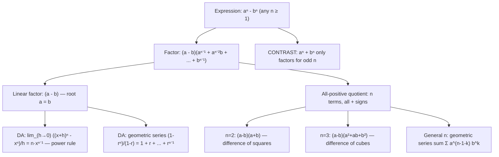

# General xⁿ − yⁿ (any n)

$$
a^n - b^n = (a - b)(a^{n-1} + a^{n-2}b + \dots + b^{n-1})
$$

## Deep Breakdown

What it tells me *(Situation Awareness)*:
The difference of like powers $a^n - b^n$ factors for any positive integer $n \ge 1$. The linear factor $(a - b)$ gives the only real root: $a = b$. The quotient polynomial $a^{n-1} + a^{n-2}b + \cdots + b^{n-1}$ has all positive terms and exactly $n$ terms. This is the general form that unifies several special cases: $n = 2$ gives the difference of squares $a^2 - b^2 = (a-b)(a+b)$; $n = 3$ gives the difference of cubes $a^3 - b^3 = (a-b)(a^2 + ab + b^2)$; general $n$ gives the finite geometric series formula $\frac{a^n - b^n}{a - b} = \sum_{k=0}^{n-1} a^{n-1-k} b^k$. In DA/DS, this identity appears in: deriving the derivative of $x^n$ from first principles ($\lim_{h \to 0} \frac{(x+h)^n - x^n}{h}$), simplifying polynomial loss function ratios, understanding the geometric series sum formula ($\sum_{k=0}^{n-1} r^k = \frac{1 - r^n}{1 - r}$ for $r \ne 1$), computing discounted cash flows, and analyzing polynomial regression residuals. This is arguably the single most important polynomial factoring identity, because it works for any $n$ and because its quotient is the finite geometric series.

## Flowchart



## Real-world use

### Where it is used

Geometric series sum: $1 + r + r^2 + \cdots + r^{n-1} = \frac{1 - r^n}{1 - r}$ is the $a=1, b=r$ case. Present value of annuity: $\sum_{t=1}^{n} \frac{1}{(1+i)^t} = \frac{1 - (1+i)^{-n}}{i}$ uses this formula. Power rule derivation: $\frac{(x+h)^n - x^n}{h} = \sum_{k=0}^{n-1} (x+h)^k x^{n-1-k} \to n x^{n-1}$. Polynomial simplification: $\frac{x^n - a^n}{x - a} = x^{n-1} + ax^{n-2} + \cdots + a^{n-1}$.

### Problem it solves

Expressions of the form $\frac{x^n - c^n}{x - c}$ appear in limits (derivatives from first principles) and rational simplification. Without the factoring identity, evaluating these requires polynomial long division of a degree-$n$ polynomial, which is mechanical and slow for large $n$. The identity provides the quotient instantly: $x^{n-1} + cx^{n-2} + \cdots + c^{n-1}$.

### How it solves the problem

Verification by expansion: $(a-b)(a^{n-1} + a^{n-2}b + \cdots + b^{n-1})$. Distributing $a$: $a^n + a^{n-1}b + \cdots + ab^{n-1}$. Distributing $-b$: $-a^{n-1}b - a^{n-2}b^2 - \cdots - b^n$. Every middle term cancels (telescoping), leaving $a^n - b^n$. The quotient is a finite geometric series with first term $a^{n-1}$, ratio $b/a$, and $n$ terms.

### Example in a business

A data analyst computes the present value of $n$ equal annual cash flows of $C$ discounted at rate $i$: $PV = C \cdot \frac{1 - (1+i)^{-n}}{i}$. The factor $\frac{1 - r^n}{1-r}$ is exactly $a^n - b^n$ divided by $(a - b)$ with $a = 1$, $b = r = (1+i)^{-1}$, giving $1 + r + r^2 + \cdots + r^{n-1}$. This identity underlies all discounted-cash-flow models in finance.

## The formula, piece by piece

Breaking the notation:

- $a^n - b^n$: the difference of $n$th powers — works for any positive integer $n$.
- $(a - b)$: the linear factor — always present. Zero when $a = b$.
- $a^{n-1} + a^{n-2}b + \cdots + b^{n-1}$: the quotient polynomial — all positive terms, $n$ terms total. The $k$th term (0-indexed) is $a^{n-1-k} b^k$.
- The quotient is a geometric series: if $a = 1$, the quotient is $1 + b + b^2 + \cdots + b^{n-1} = \frac{1 - b^n}{1 - b}$ (for $b \ne 1$). **Special cases**:
- $n = 1$: $a - b = (a - b) \cdot 1$ (trivial).
- $n = 2$: $a^2 - b^2 = (a-b)(a+b)$.
- $n = 3$: $a^3 - b^3 = (a-b)(a^2 + ab + b^2)$.
- $n = 4$: $a^4 - b^4 = (a-b)(a^3 + a^2b + ab^2 + b^3) = (a^2-b^2)(a^2+b^2)$ (can also factor further). **Limit application**: $\lim_{a \to b} \frac{a^n - b^n}{a - b} = n b^{n-1}$ — this is the derivative of $x^n$ at $x = b$. **Geometric series connection**: $\frac{1 - r^n}{1 - r} = 1 + r + r^2 + \cdots + r^{n-1}$ is the $a = 1$, $b = r$ case.

## The formula in words

"$a^n - b^n$ always factors as $(a-b)$ times a sum of $n$ terms, each of the form $a^{n-1-k} b^k$, with all positive signs. It is a telescoping product: multiply and watch middle terms cancel in pairs. The quotient is the finite geometric series in $(b/a)$. Use this identity to simplify rational expressions, evaluate limits (power rule), and sum geometric progressions. Works for every positive integer $n$; contrast with $a^n + b^n$ which only factors for odd $n$."

## Critical Concepts

1. **Works for all $n \ge 1$**: unlike the sum $a^n + b^n$, the difference $a^n - b^n$ always factors. The quotient always has all positive terms.
2. **Finite geometric series**: the quotient $a^{n-1} + a^{n-2}b + \cdots + b^{n-1}$ is a geometric series with first term $a^{n-1}$, common ratio $b/a$, and $n$ terms. Setting $a=1$ gives $\sum_{k=0}^{n-1} b^k = \frac{1-b^n}{1-b}$.
3. **Power rule from first principles**: $\frac{d}{dx}x^n = \lim_{h \to 0} \frac{(x+h)^n - x^n}{h}$. Setting $a = x+h$, $b = x$: numerator $= (a-b)(a^{n-1} + \cdots + b^{n-1}) = h \cdot \sum_{k} (x+h)^k x^{n-1-k} \to h \cdot n x^{n-1}$. Dividing by $h$ gives $n x^{n-1}$.
4. **Further factoring for even $n$**: $a^4 - b^4 = (a^2 - b^2)(a^2 + b^2) = (a-b)(a+b)(a^2+b^2)$. The identity factors out $(a-b)$ first, but more complete factoring may be possible for composite $n$.
5. **Discounted cash flows / geometric sums**: $\sum_{t=0}^{n-1} r^t = \frac{1 - r^n}{1 - r}$ is the single-step formula for annuities, NPV calculations, and compound growth models.

## Step-by-step calculation (tiny example)

Task: compute the sum $1 + 2 + 4 + 8 + 16$ using the geometric series formula, and verify using the difference-of-powers identity.

*Step 1: Recognize the structure*
This is $\sum_{k=0}^{4} 2^k = 1 + 2 + 4 + 8 + 16$. Using the formula: $\frac{2^5 - 1}{2 - 1} = \frac{32 - 1}{1} = 31$.

*Step 2: Verify by direct addition*
$1 + 2 + 4 + 8 + 16 = 31$.

*Step 3: Connect to the identity*
$2^5 - 1^5 = (2 - 1)(2^4 + 2^3 \cdot 1 + 2^2 \cdot 1^2 + 2 \cdot 1^3 + 1^4) = 1 \cdot (16 + 8 + 4 + 2 + 1) = 31$.

*Step 4: Limit application*
$\lim_{a \to 2} \frac{a^5 - 2^5}{a - 2} = 5 \cdot 2^4 = 80$. Check at $a = 2.0001$: $(2.0001^5 - 32) / 0.0001 \approx 80$.

## Code examples

### Beginner example (Python)

```python
# General difference of powers: aⁿ - bⁿ = (a-b)(aⁿ⁻¹ + aⁿ⁻²b + ... + bⁿ⁻¹)

def difference_quotient(a: float, b: float, n: int) -> float:
    """ Evaluate the all-positive quotient polynomial (aⁿ - bⁿ) / (a - b). Args: a: First value. b: Second value. n: Positive integer degree. Returns: Quotient polynomial value: sum_{k=0}^{n-1} a^(n-1-k) * b^k. """
    return sum(a ** (n - 1 - k) * b ** k for k in range(n))   # Verify identity for multiple n and (a,b) pairs
print("Difference of powers: aⁿ - bⁿ = (a-b) × quotient (any n)")
print(f"{'n':>4} {'a':>5} {'b':>5} {'aⁿ-bⁿ':>12} {'(a-b)×Q':>12} {'match':>6}")
for n_val in [1, 2, 3, 4, 5, 6]:
    for a, b in [(3.0, 2.0), (5.0, 1.5)]:
        lhs = a ** n_val - b ** n_val
    rhs = (a - b) * difference_quotient(a, b, n_val)
print(f"{n_val:>4} {a:>5.1f} {b:>5.1f} {lhs:>12.4f} {rhs:>12.4f} {str(abs(lhs - rhs) < 1e-8):>6}")   # Geometric series: (1 - rⁿ) / (1 - r) = 1 + r + ... + rⁿ⁻¹
print("\nGeometric series: (1 - rⁿ)/(1-r) = sum of r^k for k=0 to n-1")
for r, n_val in [(0.5, 5), (2.0, 6), (0.9, 10)]:
    formula_sum = (1 - r ** n_val) / (1 - r) if abs(1 - r) > 1e-12 else n_val
direct_sum = sum(r ** k for k in range(n_val))
print(f" r={r}, n={n_val}: formula={formula_sum:.6f} direct={direct_sum:.6f} match={abs(formula_sum - direct_sum) < 1e-8}")   # Limit → power rule
import math
print("\nDerivative limit: lim_(a→b) (aⁿ-bⁿ)/(a-b) → n·bⁿ⁻¹")
b_val, n_limit = 3.0, 4
exact = n_limit * b_val ** (n_limit - 1)
for delta in [0.1, 0.01, 0.001, 1e-5]:
    approx = ((b_val + delta) ** n_limit - b_val ** n_limit) / delta
print(f" delta={delta:.0e} approx={approx:.6f} exact={exact:.6f}")
```

### Beginner example (R)

```r
# Difference of powers in R: aⁿ -
bⁿ = (a-b) × quotient
difference_quotient <- function(a, b, n) {  # Quotient polynomial: sum_{k=0}^{n-1} a^(n-1-k) * b^k sum(sapply(0:(n - 1),
  function(k) a^(n - 1 - k) * b^k))
}  # Verification table
cat(sprintf("%-4s %-5s %-5s %-12s %-12s %s\n", "n", "a", "b", "aⁿ-bⁿ", "(a-b)×Q", "match"))
for (n_val in c(1, 2, 3, 4, 5)) { for (pair in list(c(3, 2), c(5, 1.5))) { a <- pair[1]; b <- pair[2]
    lhs <- a^n_val - b^n_val
    rhs <- (a - b) * difference_quotient(a, b, n_val)
    cat(sprintf("%4d %5.1f %5.1f %12.4f %12.4f %s\n", n_val, a, b, lhs, rhs, abs(lhs - rhs) < 1e-8))
  }
}  # Geometric series
cat("\nGeometric series: (1 - r^n)/(1 - r)\n")
for (r in c(0.5, 2.0, 0.9)) { n_val <- 6
  formula_sum <- (1 - r^n_val) / (1 - r)
  direct_sum <- sum(r^(0:(n_val - 1)))
  cat(sprintf(" r=%.1f n=%d: formula=%.6f direct=%.6f match=%s\n", r, n_val, formula_sum, direct_sum, abs(formula_sum - direct_sum) < 1e-8))
}
```

### Professional example (Python)

```python
import numpy as np
import pandas as pd   # Scenario: NPV (net present value) computation using the geometric series formula
# NPV = C × (1 - r^n) / (1 - r) where r = 1/(1+i), C = periodic cash flow
# This is the difference-of-powers identity applied to financial modeling

def npv_annuity( cash_flow: float, discount_rate: float, n_periods: int,
) -> float:
    """ Compute the present value of a uniform annuity using the geometric series formula. Formula: PV = C × (1 - r^n) / (1 - r) where r = 1/(1+i) This equals C × sum_{t=1}^{n} 1/(1+i)^t. Args: cash_flow: Equal periodic cash flow C. discount_rate: Periodic discount rate i (e.g., 0.05 for 5%). n_periods: Number of periods n. Returns: Present value of the annuity. """
    r = 1.0 / (1.0 + discount_rate)
    return cash_flow * r * (1 - r ** n_periods) / (1 - r)

def npv_direct( cash_flow: float, discount_rate: float, n_periods: int,
) -> float:
    """ Compute NPV by direct discounting for verification. Args: cash_flow: Equal periodic cash flow C. discount_rate: Periodic discount rate i. n_periods: Number of periods n. Returns: Present value computed term-by-term. """
    return sum(cash_flow / (1 + discount_rate) ** t for t in range(1, n_periods + 1))   # Compare the geometric series formula against direct computation
CASH_FLOW = 1_000.0
scenarios = [ {"label": "5-yr @5%", "rate": 0.05, "n": 5}, {"label": "10-yr @8%", "rate": 0.08, "n": 10}, {"label": "20-yr @3%", "rate": 0.03, "n": 20}, {"label": "30-yr @6%", "rate": 0.06, "n": 30},
]
rows = []
for sc in scenarios:
    pv_formula = npv_annuity(CASH_FLOW, sc["rate"], sc["n"])
pv_direct = npv_direct(CASH_FLOW, sc["rate"], sc["n"])
rows.append({ "scenario": sc["label"], "cash_flow": CASH_FLOW, "rate": sc["rate"], "n_periods": sc["n"], "pv_formula": round(pv_formula, 4), "pv_direct": round(pv_direct, 4), "error": abs(pv_formula - pv_direct), })
report = pd.DataFrame(rows)
print("NPV via Geometric Series (aⁿ - bⁿ identity): PV = C·r·(1-rⁿ)/(1-r)")
print("=" * 72)
print(report[["scenario", "pv_formula", "pv_direct", "error"]].to_string(index=False))
print(f"\nAll errors < 1e-9: {(report['error'] < 1e-9).all()}")
```

### Professional example (R)

```r
# NPV:
PV = C*r*(1-r^n)/(1-r) (geometric series, a^n - b^n identity)
scenarios <- data.frame(scenario = c("Short", "Medium", "Long"), r = c(0.9, 0.95, 0.98), n = c(5, 10, 20), C = 100)
pv_direct <- function(C, r, n) C * r * (1 - r^n) / (1 - r)
scenarios$pv_formula <- with(scenarios, pv_direct(C, r, n))
scenarios$pv_direct <- with(scenarios, sapply(1:nrow(scenarios), function(i) sum(C[i] * r[i]^(1:n[i]))))
scenarios$error <- abs(scenarios$pv_formula - scenarios$pv_direct)
cat("NPV via geometric series\n")
print(scenarios)
cat(sprintf("\nAll errors < 1e-9: %s\n", all(scenarios$error < 1e-9)))
```

---

*Source: 1300 p. 20*
