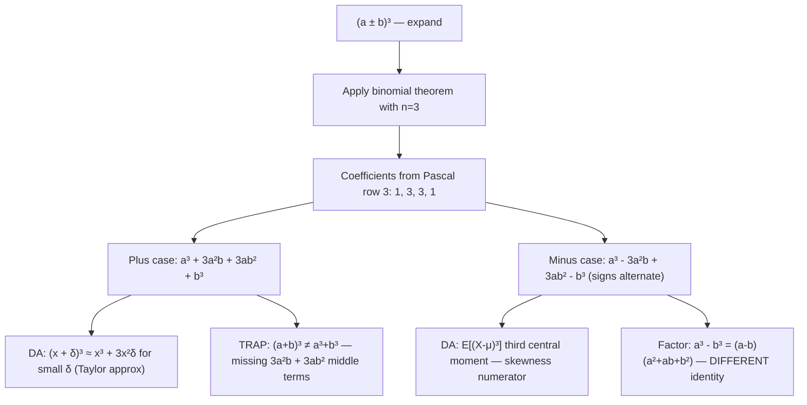

# Perfect cube polynomials

$$
(a \pm b)^3 = a^3 \pm 3a^2b + 3ab^2 \pm b^3
$$

## Deep Breakdown

What it tells me *(Situation Awareness)*:
The perfect cube expansion $(a \pm b)^3$ gives the full expansion of a cubed binomial. For addition: $(a+b)^3 = a^3 + 3a^2b + 3ab^2 + b^3$. For subtraction: $(a-b)^3 = a^3 - 3a^2b + 3ab^2 - b^3$ (signs alternate: $+, -, +, -$). The coefficients $1, 3, 3, 1$ are row 3 of Pascal's triangle, and correspond to $\binom{3}{0}, \binom{3}{1}, \binom{3}{2}, \binom{3}{3}$. This is the $n = 3$ special case of the binomial theorem $(a+b)^n = \sum_{k=0}^{n} \binom{n}{k} a^{n-k} b^k$. In DA/DS, this identity arises in: expanding polynomial features of degree 3 in feature engineering, deriving third-order Taylor approximations ($(x_0 + \delta)^3 = x_0^3 + 3x_0^2\delta + 3x_0\delta^2 + \delta^3$), understanding the skewness of a distribution ($E[(X - \mu)^3]$ expansion), and simplifying cost function algebra that involves cubed differences. Note: this is the expansion identity; the factoring identity for $a^3 \pm b^3$ is the separate sum/difference of cubes.

## Flowchart



## Real-world use

### Where it is used

Third-order Taylor expansion: $f(x + h) \approx f(x) + f'(x)h + \frac{f''(x)}{2}h^2 + \frac{f'''(x)}{6}h^3$ — when $f(x) = x^3$, the cubic expansion is exact. Skewness calculation: the third central moment $E[(X - \mu)^3] = E[X^3] - 3E[X^2]\mu + 3E[X]\mu^2 - \mu^3$, which is exactly $(X - \mu)^3$ expanded. Polynomial feature engineering: degree-3 feature $(x_1 + x_2)^3$ expands into $x_1^3 + 3x_1^2 x_2 + 3x_1 x_2^2 + x_2^3$.

### Problem it solves

Expanding $(a \pm b)^3$ by repeated FOIL is mechanical: first $(a \pm b)^2 = a^2 \pm 2ab + b^2$, then multiplying by $(a \pm b)$ again. The identity skips those steps and gives the result directly: $a^3 \pm 3a^2b + 3ab^2 \pm b^3$. This is essential when deriving formulas that involve cubed differences, such as the third central moment of a distribution.

### How it solves the problem

The coefficients $1, 3, 3, 1$ come from $\binom{3}{k}$ for $k = 0, 1, 2, 3$. The sign for the minus case follows the pattern $(-1)^k$: $+, -, +, -$. Verified by multiplying: $(a+b)^2 = a^2 + 2ab + b^2$, then $(a^2 + 2ab + b^2)(a + b) = a^3 + 2a^2b + ab^2 + a^2b + 2ab^2 + b^3 = a^3 + 3a^2b + 3ab^2 + b^3$. ✓

### Example in a business

A data analyst computes the skewness of a revenue distribution. The third central moment requires $E[(R - \bar{R})^3]$. Expanding $(R - \mu)^3 = R^3 - 3R^2\mu + 3R\mu^2 - \mu^3$, taking expectations: $E[(R-\mu)^3] = E[R^3] - 3E[R^2]\mu + 3E[R]\mu^2 - \mu^3 = E[R^3] - 3E[R^2]\mu + 3\mu^3 - \mu^3 = E[R^3] - 3E[R^2]\mu + 2\mu^3$. This allows computing skewness in a single pass over the data by accumulating $\sum r_i$, $\sum r_i^2$, and $\sum r_i^3$.

## The formula, piece by piece

Breaking the notation:

- $(a + b)^3$: a binomial raised to the third power.
- $a^3$: first term — $a$ cubed, coefficient 1.
- $3a^2b$: second term — coefficient $\binom{3}{1} = 3$, power of $a$ decreases by 1, power of $b$ increases by 1.
- $3ab^2$: third term — coefficient $\binom{3}{2} = 3$.
- $b^3$: last term — $b$ cubed, coefficient 1.
- For $(a - b)^3$: substitute $b \to -b$: signs alternate $+, -, +, -$. **Full expansions**:
- $(a+b)^3 = a^3 + 3a^2b + 3ab^2 + b^3$
- $(a-b)^3 = a^3 - 3a^2b + 3ab^2 - b^3$ **Pascal's triangle row 3**: $1 \quad 3 \quad 3 \quad 1$ — these are the coefficients for any $n=3$ binomial expansion. **Skewness expansion**: $E[(X-\mu)^3] = E[X^3] - 3\mu E[X^2] + 3\mu^2 E[X] - \mu^3 = E[X^3] - 3\mu E[X^2] + 2\mu^3$. **TRAP**: $(a+b)^3 \ne a^3 + b^3$.

The two missing middle terms $3a^2b + 3ab^2$ are substantial. The "sum of cubes" factoring identity $a^3 + b^3 = (a+b)(a^2-ab+b^2)$ is a completely different identity from the "cube of a sum" expansion $(a+b)^3$.

## The formula in words

"$(a+b)^3$ expands to $a^3 + 3a^2b + 3ab^2 + b^3$. Coefficients: $1, 3, 3, 1$ from Pascal's triangle row 3. Powers of $a$ decrease from 3 to 0; powers of $b$ increase from 0 to 3. For the minus case $(a-b)^3$: replace $b$ with $-b$ — signs alternate: $+, -, +, -$. Never forget the middle terms: $(a+b)^3$ is NOT $a^3 + b^3$. In Python: `(a + b)**3 == a**3 + 3*a**2*b + 3*a*b**2 + b**3` is always `True`."

## Critical Concepts

1. **Coefficients $1,3,3,1$**: from Pascal's triangle row 3 (or $\binom{3}{k}$ for $k = 0, 1, 2, 3$). Memorize the pattern: the inner terms both have coefficient 3.
2. **TRAP: $(a+b)^3 \ne a^3 + b^3$**: the middle terms $3a^2b + 3ab^2$ are often forgotten. This error appears frequently when computing cubed differences in statistical moments.
3. **Skewness formula**: the third central moment $E[(X-\mu)^3]$ expands via $(x-\mu)^3 = x^3 - 3x^2\mu + 3x\mu^2 - \mu^3$. Taking expectations gives the computational formula for skewness without needing to subtract the mean first.
4. **Minus case sign pattern**: $(a-b)^3 = a^3 - 3a^2b + 3ab^2 - b^3$. Signs: $+, -, +, -$. The odd-power terms ($a^3$, $b^3$ and $3a^2b$ coefficient for $b^1$) flip; $3ab^2$ stays positive because $(-b)^2 = b^2$.
5. **Distinguish from sum/difference of cubes**: $(a+b)^3$ is an expansion of a cube. $a^3 + b^3$ is a factoring target.

They are related: $a^3 + b^3 = (a+b)^3 - 3ab(a+b) = (a+b)[(a+b)^2 - 3ab]$, but they are not the same thing.

## Step-by-step calculation (tiny example)

Task: expand $(x + 2)^3$ and evaluate at $x = 3$.

*Step 1: Identify $a$ and $b$*
$a = x$, $b = 2$.

*Step 2: Apply the expansion*
$(x + 2)^3 = x^3 + 3x^2(2) + 3x(2)^2 + 2^3 = x^3 + 6x^2 + 12x + 8$.

*Step 3: Evaluate at $x = 3$*
$3^3 + 6(9) + 12(3) + 8 = 27 + 54 + 36 + 8 = 125$.

*Step 4: Verify directly*
$(3 + 2)^3 = 5^3 = 125$. ✓

*Step 5: Verify the minus case — expand $(x - 1)^3$*
$x^3 - 3x^2 + 3x - 1$. At $x = 2$: $8 - 12 + 6 - 1 = 1 = (2-1)^3 = 1$. ✓

## Code examples

### Beginner example (Python)

```python
# Perfect cube expansion: (a ± b)³ = a³ ± 3a²b + 3ab² ± b³

def expand_cube_plus(a: float, b: float) -> float:
    """Return (a + b)³ using the explicit expansion."""
    return a**3 + 3 * a**2 * b + 3 * a * b**2 + b**3

def expand_cube_minus(a: float, b: float) -> float:
    """Return (a - b)³ using the explicit expansion."""
    return a**3 - 3 * a**2 * b + 3 * a * b**2 - b**3


# Verify against direct computation
pairs = [(2.0, 3.0), (5.0, 1.0), (-1.0, 4.0), (0.5, 0.25)]
print("Perfect cube expansion verification")
print(f"{'a':>6} {'b':>6} {'(a+b)³ direct':>14} {'expanded':>10} {'match':>6}")
for a, b in pairs:
    direct = (a + b) ** 3
    expanded = expand_cube_plus(a, b)
    print(f"{a:>6.2f} {b:>6.2f} {direct:>14.4f} {expanded:>10.4f} {str(abs(direct - expanded) < 1e-10):>6}")

print(f"\n{'a':>6} {'b':>6} {'(a-b)³ direct':>14} {'expanded':>10} {'match':>6}")
for a, b in pairs:
    direct = (a - b) ** 3
    expanded = expand_cube_minus(a, b)
    print(f"{a:>6.2f} {b:>6.2f} {direct:>14.4f} {expanded:>10.4f} {str(abs(direct - expanded) < 1e-10):>6}")

# TRAP: (a+b)³ ≠ a³ + b³
a, b = 2.0, 3.0
print(f"\nTRAP: (a+b)³ vs a³+b³ for a={a}, b={b}")
print(f" (a+b)³ = {(a+b)**3:.0f}")
print(f" a³ + b³ = {a**3 + b**3:.0f} (NOT the same!)")
print(f" Middle terms 3a²b + 3ab² = {3*a**2*b + 3*a*b**2:.0f}")

# Skewness: E[(X-μ)³] computational formula
import numpy as np

np.random.seed(42)
data = np.random.exponential(scale=2.0, size=1000)   # right-skewed
mu = data.mean()

# Two methods
skew_direct = np.mean((data - mu) ** 3)
skew_expand = np.mean(data**3) - 3 * mu * np.mean(data**2) + 2 * mu**3
print(f"\nThird central moment (skewness numerator):")
print(f" E[(X-μ)³] direct: {skew_direct:.6f}")
print(f" E[(X-μ)³] formula: {skew_expand:.6f}")
print(f" Match: {abs(skew_direct - skew_expand) < 1e-8}")
```

### Beginner example (R)

```r
# Perfect cube expansion in R
expand_cube_plus <- function(a, b) a^3 + 3*a^2*b + 3*a*b^2 + b^3
expand_cube_minus <- function(a, b) a^3 - 3*a^2*b + 3*a*b^2 - b^3
pairs <- list(c(2,3), c(5,1), c(-1,4), c(0.5,0.25))
cat("Plus case: (a+b)³\n")
cat(sprintf("%-6s %-6s %-14s %-10s %s\n", "a", "b", "(a+b)³ direct", "expanded", "match"))
for (p in pairs) {
  a <- p[1]; b <- p[2]
  direct <- (a + b)^3
  expanded <- expand_cube_plus(a, b)
  cat(sprintf("%-6.2f %-6.2f %-14.4f %-10.4f %s\n", a, b, direct, expanded, abs(direct - expanded) < 1e-10))
}

# Skewness via expansion
set.seed(42)
data <- rexp(1000, rate = 0.5)  # right-skewed
mu <- mean(data)
skew_direct <- mean((data - mu)^3)
skew_expand <- mean(data^3) - 3 * mu * mean(data^2) + 2 * mu^3
cat(sprintf("\nThird central moment:\n"))
cat(sprintf(" Direct: %.6f\n", skew_direct))
cat(sprintf(" Formula: %.6f\n", skew_expand))
cat(sprintf(" Match: %s\n", abs(skew_direct - skew_expand) < 1e-8))
```

### Professional example (Python)

```python
import numpy as np
import pandas as pd

# Scenario: single-pass skewness computation using (x - μ)³ expansion
# Accumulate sum_x, sum_x2, sum_x3 in one pass; compute 3rd central moment
# using the identity: E[(X-μ)³] = E[X³] - 3μE[X²] + 2μ³


class OnlineMomentsTracker:
    """
    Single-pass tracker for the first three raw moments (E[X], E[X²], E[X³]).
    Uses the cubic expansion to compute the third central moment
    (skewness numerator) without a second pass over the data.
    """

    def __init__(self) -> None:
        self._n: int = 0
        self._sum1: float = 0.0   # sum of x
        self._sum2: float = 0.0   # sum of x²
        self._sum3: float = 0.0   # sum of x³

    def update(self, x: float) -> None:
        """Add one observation."""
        self._n += 1
        self._sum1 += x
        self._sum2 += x * x
        self._sum3 += x * x * x

    @property
    def mean(self) -> float:
        """E[X]."""
        return self._sum1 / self._n if self._n > 0 else 0.0

    @property
    def variance(self) -> float:
        """E[X²] - (E[X])²."""
        mu = self.mean
        return self._sum2 / self._n - mu ** 2

    @property
    def third_central_moment(self) -> float:
        """
        E[(X-μ)³] = E[X³] - 3μE[X²] + 2μ³.
        Uses (a-b)³ expansion with a=X, b=μ, applied to expectations.
        """
        mu = self.mean
        ex2 = self._sum2 / self._n
        ex3 = self._sum3 / self._n
        return ex3 - 3 * mu * ex2 + 2 * mu ** 3

    @property
    def skewness(self) -> float:
        """Standardized skewness: third central moment / std³."""
        std = self.variance ** 0.5
        if std < 1e-12:
            return 0.0
        return self.third_central_moment / std ** 3


# Compare single-pass vs two-pass for multiple distributions
np.random.seed(42)
N = 10_000
distributions = {
    "normal (0,1)": np.random.normal(0, 1, N),
    "exponential (λ=1)": np.random.exponential(1, N),
    "chi-squared (df=3)": np.random.chisquare(3, N),
}
rows = []
for dist_name, samples in distributions.items():
    # Single-pass
    tracker = OnlineMomentsTracker()
    for x in samples:
        tracker.update(float(x))
    skew_single_pass = tracker.skewness

    # Two-pass reference (numpy)
    mu_ref = samples.mean()
    std_ref = samples.std()
    skew_ref = np.mean((samples - mu_ref) ** 3) / std_ref ** 3
    rows.append({
        "distribution": dist_name,
        "skew_single": round(skew_single_pass, 6),
        "skew_two_pass": round(skew_ref, 6),
        "error": abs(skew_single_pass - skew_ref),
    })

report = pd.DataFrame(rows)
print("Single-Pass Skewness via (x-μ)³ Expansion: E[(X-μ)³] = E[X³] - 3μE[X²] + 2μ³")
print("=" * 72)
print(report.to_string(index=False))
print(f"\nAll errors < 1e-6: {(report['error'] < 1e-6).all()}")
```

### Professional example (R)

```r
# Single-pass skewness: E[(X-μ)³] = E[X³] - 3μE[X²] + 2μ³
set.seed(42)
N <- 10000
samples <- list(
  "normal" = rnorm(N),
  "exponential" = rexp(N),
  "chisq" = rchisq(N, 3)
)
single_pass_skew <- function(x) {
  n <- length(x)
  sum_x <- sum(x); sum_x2 <- sum(x^2); sum_x3 <- sum(x^3)
  mu <- sum_x / n
  ex2 <- sum_x2 / n; ex3 <- sum_x3 / n
  third_central <- ex3 - 3*mu*ex2 + 2*mu^3
  std <- sqrt(ex2 - mu^2)
  third_central / (std^3 + 1e-12)
}
report <- do.call(rbind, lapply(names(samples), function(nm) {
  x <- samples[[nm]]
  skew_s <- single_pass_skew(x)
  skew_ref <- mean((x - mean(x))^3) / (sd(x)^3 + 1e-12)
  data.frame(distribution = nm, skew_single = round(skew_s, 6),
             skew_two_pass = round(skew_ref, 6), error = abs(skew_s - skew_ref))
}))
cat("Single-Pass Skewness via (x-μ)³ expansion\n")
print(report)
```

---

*Source: domain knowledge*
