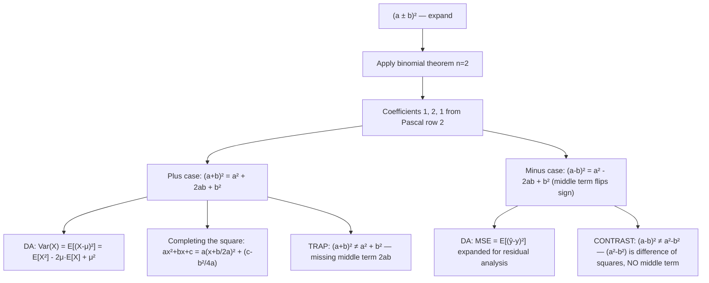

# Perfect square trinomials

$$
(a \pm b)^2 = a^2 \pm 2ab + b^2
$$

## Deep Breakdown

What it tells me *(Situation Awareness)*:
The perfect square trinomial $(a \pm b)^2$ is the expansion of a squared binomial. Addition: $(a+b)^2 = a^2 + 2ab + b^2$. Subtraction: $(a-b)^2 = a^2 - 2ab + b^2$. Both expansions have three terms (hence "trinomial") and the coefficients $1, 2, 1$ from row 2 of Pascal's triangle. This is the $n = 2$ case of the binomial theorem. The middle term $\pm 2ab$ is the term most frequently forgotten or confused with the difference of squares identity $a^2 - b^2 = (a-b)(a+b)$, which has no middle term. In DA/DS, this identity is one of the most used: the variance formula $\text{Var}(X) = E[(X-\mu)^2] = E[X^2] - 2\mu E[X] + \mu^2 = E[X^2] - \mu^2$ (expanding and using $E[X] = \mu$), completing the square in quadratic expressions (ridge regression penalty), MSE decomposition into bias and variance ($(\hat{\theta} - \theta)^2 = \hat{\theta}^2 - 2\hat{\theta}\theta + \theta^2$), and deriving the computational formula for variance from the definition.

## Flowchart



## Real-world use

### Where it is used

Variance derivation: $\text{Var}(X) = E[(X - \mu)^2] = E[X^2 - 2\mu X + \mu^2] = E[X^2] - 2\mu \cdot \mu + \mu^2 = E[X^2] - \mu^2$. Completing the square for ridge regression: minimizing $\|y - Xw\|^2 + \lambda\|w\|^2$ involves completing the square in $w$. Euclidean distance: $\|a - b\|^2 = a^T a - 2a^T b + b^T b$ is the vector form of $(a-b)^2$. MSE as (bias)² + variance: $E[(\hat{\theta} - \theta)^2] = \text{bias}^2 + \text{Var}(\hat{\theta})$ uses the expansion.

### Problem it solves

Without the expansion, simplifying expressions like $E[(X - \mu)^2]$ requires working term by term inside the expectation. The identity immediately gives $E[X^2 - 2\mu X + \mu^2]$, which then distributes to $E[X^2] - 2\mu E[X] + \mu^2 = E[X^2] - \mu^2$. This is the computational variance formula — derived entirely from the perfect square expansion.

### How it solves the problem

Verified by FOIL: $(a+b)^2 = (a+b)(a+b) = a^2 + ab + ba + b^2 = a^2 + 2ab + b^2$. The middle terms $ab$ and $ba$ are equal and combine to $2ab$. For the minus case: $(a-b)(a-b) = a^2 - ab - ba + b^2 = a^2 - 2ab + b^2$.

### Example in a business

A data scientist evaluates model quality. The MSE is $E[(\hat{y} - y)^2]$. Expanding: $(\hat{y} - y)^2 = \hat{y}^2 - 2\hat{y}y + y^2$. Across predictions: $\text{MSE} = \frac{1}{n}\sum(\hat{y}_i^2 - 2\hat{y}_i y_i + y_i^2)$. This allows computing MSE in one pass by accumulating $\sum \hat{y}_i^2$, $\sum \hat{y}_i y_i$, and $\sum y_i^2$ simultaneously, avoiding storing the full residual array.

## The formula, piece by piece

Breaking the notation:

- $(a + b)^2$: a binomial raised to the second power.
- $a^2$: the first term — coefficient 1, power of $b$ is 0.
- $2ab$: the middle term — coefficient 2 (from $\binom{2}{1} = 2$). This is the crucial term that is often forgotten.
- $b^2$: the last term — coefficient 1, power of $a$ is 0.
- $(a - b)^2$: same expansion with $b \to -b$, giving $a^2 - 2ab + b^2$. The last term $+b^2$ stays positive because $(-b)^2 = b^2$. **Full expansions**:
- $(a + b)^2 = a^2 + 2ab + b^2$
- $(a - b)^2 = a^2 - 2ab + b^2$ **Completing the square**: $x^2 + bx = (x + b/2)^2 - b^2/4$.

The extra term $b^2/4$ is what you "add and subtract" to complete the square. **Variance computational formula**: $E[(X-\mu)^2] = E[X^2] - 2\mu E[X] + \mu^2 = E[X^2] - \mu^2$ (since $E[X] = \mu$). **Vector form**: $\|a - b\|^2 = \|a\|^2 - 2\langle a, b\rangle + \|b\|^2$ — exact analogue with dot products. **TRAP: $(a+b)^2 \ne a^2 + b^2$**: the middle term $2ab$ is always present. This is the single most common algebra error in statistics and ML derivations. **CONTRAST with difference of squares**: $(a-b)^2 = a^2 - 2ab + b^2$ (has middle term); $a^2 - b^2 = (a-b)(a+b)$ (no middle term). These are different identities.

## The formula in words

"$(a+b)^2$ expands to $a^2 + 2ab + b^2$ — three terms with coefficients $1, 2, 1$. The middle term $2ab$ is the product of both terms times 2; never forget it. For the minus case $(a-b)^2$: the last term stays positive ($+b^2$) and only the middle term changes sign. In Python: `(a + b)**2 == a**2 + 2*a*b + b**2` is always `True`. The variance formula $E[X^2] - \mu^2$ is this identity applied to expectations."

## Critical Concepts

1. **Middle term $2ab$**: never zero unless $a = 0$ or $b = 0$. The most common mistake in DA/DS is writing $E[(X-\mu)^2] = E[X^2] - \mu^2$ without the derivation step, confusing it with difference of squares. The result is correct but only after using $E[X] = \mu$; the expansion is the key step.
2. **Computational variance formula**: $\text{Var}(X) = E[X^2] - (E[X])^2$. Derived by expanding $(X-\mu)^2$ via the perfect square identity and taking expectations. Enables one-pass variance computation.
3. **Completing the square**: the reverse operation. Given $x^2 + px$, rewrite as $(x + p/2)^2 - p^2/4$. Used in: quadratic optimization (closed-form minimizer), normal distribution exponent manipulation, Bayesian posterior derivation.
4. **$(a-b)^2 \ne a^2 - b^2$**: these are completely different. $(a-b)^2 = a^2 - 2ab + b^2$ has a middle term; $a^2 - b^2 = (a-b)(a+b)$ does not. Confusing them is a very common error.
5. **Vector analogue**: the cosine similarity formula $\cos\theta = \frac{\langle a, b\rangle}{\|a\|\|b\|}$ comes from $\|a - b\|^2 = \|a\|^2 - 2\langle a, b\rangle + \|b\|^2$.

Expanding squared distances in embedding space uses this identity.

## Step-by-step calculation (tiny example)

Task: compute the variance of $X \in \{2, 4, 6\}$ using the computational formula derived from the perfect square expansion.

*Step 1: Compute the mean*
$\mu = (2 + 4 + 6)/3 = 12/3 = 4$.

*Step 2: Apply the expansion to $(X - \mu)^2$*
$(X - 4)^2 = X^2 - 2 \cdot 4 \cdot X + 4^2 = X^2 - 8X + 16$.

*Step 3: Take expectations*
$E[(X-4)^2] = E[X^2] - 8E[X] + 16$.

*Step 4: Compute $E[X^2]$*
$E[X^2] = (4 + 16 + 36)/3 = 56/3 \approx 18.67$.

*Step 5: Apply formula*
$\text{Var}(X) = 56/3 - 8(4) + 16 = 56/3 - 32 + 16 = 56/3 - 16 = (56 - 48)/3 = 8/3 \approx 2.67$.

*Step 6: Verify directly*
$(2-4)^2 + (4-4)^2 + (6-4)^2 = 4 + 0 + 4 = 8$. Mean: $8/3 \approx 2.67$.

## Code examples

### Beginner example (Python)

```python
# Perfect square trinomial: (a ± b)² = a² ± 2ab + b²

def square_plus(a: float, b: float) -> float:
    """Return (a + b)² using the expansion."""
    return a**2 + 2 * a * b + b**2

def square_minus(a: float, b: float) -> float:
    """Return (a - b)² using the expansion."""
    return a**2 - 2 * a * b + b**2

# Verification
pairs = [(3.0, 2.0), (5.0, 4.0), (-1.0, 3.0), (0.5, 0.25)]
print("Perfect square trinomial verification")
print(f"{'a':>6} {'b':>6} {'(a+b)² direct':>14} {'expanded':>10} {'match':>6}")
for a, b in pairs:
    direct = (a + b) ** 2
    expanded = square_plus(a, b)
    print(f"{a:>6.2f} {b:>6.2f} {direct:>14.4f} {expanded:>10.4f} {str(abs(direct - expanded) < 1e-10):>6}")

# TRAP: (a+b)² ≠ a² + b²
a, b = 3.0, 4.0
print(f"\nTRAP: (a+b)² vs a²+b² for a={a}, b={b}")
print(f" (a+b)² = {(a+b)**2:.0f}")
print(f" a² + b² = {a**2 + b**2:.0f} (NOT the same!)")
print(f" Middle term 2ab = {2*a*b:.0f}")

# Variance: E[(X-μ)²] = E[X²] - μ² via perfect square expansion
import numpy as np

np.random.seed(42)
data = np.array([2.0, 4.0, 6.0, 8.0, 10.0, 3.0, 7.0])
mu = data.mean()
var_definition = np.mean((data - mu) ** 2)
var_expansion = np.mean(data**2) - 2 * mu * mu + mu**2   # full expansion
var_formula = np.mean(data**2) - mu**2                   # simplified (since E[X]=μ)
print(f"\nVariance computation (n={len(data)}, μ={mu:.4f}):")
print(f" E[(X-μ)²] definition: {var_definition:.6f}")
print(f" Via full expansion: {var_expansion:.6f}")
print(f" Simplified formula: {var_formula:.6f}")
print(f" All match: {abs(var_definition - var_formula) < 1e-10 and abs(var_expansion - var_formula) < 1e-10}")

# Completing the square: x² + px
p = 6.0
print(f"\nCompleting the square: x²+{p:.0f}x = (x+{p/2:.0f})² - {(p/2)**2:.0f}")
for x in [1.0, 2.0, -3.0]:
    lhs = x**2 + p * x
    rhs = (x + p / 2) ** 2 - (p / 2) ** 2
    print(f" x={x:5.1f} lhs={lhs:8.2f} rhs={rhs:8.2f} match={abs(lhs-rhs)<1e-10}")
```

### Beginner example (R)

```r
# Perfect square trinomial in R
square_plus <- function(a, b) a^2 + 2*a*b + b^2
square_minus <- function(a, b) a^2 - 2*a*b + b^2
pairs <- list(c(3,2), c(5,4), c(-1,3), c(0.5,0.25))
cat("Plus case: (a+b)²\n")
for (p in pairs) {
  a <- p[1]; b <- p[2]
  direct <- (a + b)^2
  expanded <- square_plus(a, b)
  cat(sprintf(" a=%.2f b=%.2f direct=%.4f expanded=%.4f match=%s\n", a, b, direct, expanded, abs(direct - expanded) < 1e-10))
}

# Variance
data <- c(2, 4, 6, 8, 10, 3, 7)
mu_val <- mean(data)
var_def <- mean((data - mu_val)^2)
var_formula <- mean(data^2) - mu_val^2
cat(sprintf("\nVariance: E[(X-μ)²] definition=%.6f formula=%.6f match=%s\n", var_def, var_formula, abs(var_def - var_formula) < 1e-10))

# Completing the square
x_vals <- c(-3, 0, 1, 2, 5)
p_val <- 6
cat(sprintf("\nCompleting the square: x² + %.0fx = (x+%.0f)² - %.0f\n", p_val, p_val/2, (p_val/2)^2))
for (x in x_vals) {
  lhs <- x^2 + p_val * x
  rhs <- (x + p_val/2)^2 - (p_val/2)^2
  cat(sprintf(" x=%3.0f lhs=%6.2f rhs=%6.2f match=%s\n", x, lhs, rhs, abs(lhs - rhs) < 1e-10))
}
```

### Professional example (Python)

```python
import numpy as np
import pandas as pd

# Scenario: single-pass variance and MSE computation using (a-b)² expansion
# Accumulate sum(y), sum(y²), sum(ŷ), sum(ŷ²), sum(ŷy) in one pass
# Then use: MSE = E[ŷ²] - 2E[ŷy] + E[y²] via (ŷ-y)² expansion


class OnlineRegressionMetrics:
    """Single-pass accumulator for regression metrics using the (a-b)² identity.

    Tracks:
        MSE = E[(ŷ - y)²] = E[ŷ²] - 2E[ŷy] + E[y²]
        Var(residual) = E[(ŷ-y - mean(ŷ-y))²]

    Args:
        None
    """

    def __init__(self) -> None:
        self._n: int = 0
        self._sum_y: float = 0.0
        self._sum_y2: float = 0.0
        self._sum_yhat: float = 0.0
        self._sum_yhat2: float = 0.0
        self._sum_yyhat: float = 0.0

    def update(self, y_true: float, y_pred: float) -> None:
        """Add one (true, predicted) pair."""
        self._n += 1
        self._sum_y += y_true
        self._sum_y2 += y_true * y_true
        self._sum_yhat += y_pred
        self._sum_yhat2 += y_pred * y_pred
        self._sum_yyhat += y_true * y_pred

    @property
    def mse(self) -> float:
        """MSE = E[(ŷ-y)²] = E[ŷ²] - 2E[ŷy] + E[y²] via perfect square expansion."""
        if self._n == 0:
            return 0.0
        e_yhat2 = self._sum_yhat2 / self._n
        e_yyhat = self._sum_yyhat / self._n
        e_y2 = self._sum_y2 / self._n
        return e_yhat2 - 2 * e_yyhat + e_y2

    @property
    def mean_error(self) -> float:
        """Mean signed error E[ŷ - y] = E[ŷ] - E[y]."""
        if self._n == 0:
            return 0.0
        return (self._sum_yhat - self._sum_y) / self._n

    @property
    def bias_squared(self) -> float:
        """bias² = (E[ŷ] - E[y])² = (mean_error)²."""
        return self.mean_error ** 2

    @property
    def variance_of_predictions(self) -> float:
        """Var(ŷ) = E[ŷ²] - (E[ŷ])²."""
        if self._n == 0:
            return 0.0
        e_yhat2 = self._sum_yhat2 / self._n
        e_yhat = self._sum_yhat / self._n
        return e_yhat2 - e_yhat ** 2


# Simulate predictions from three hypothetical models
np.random.seed(42)
N = 5_000
y_true = np.random.normal(50, 10, N)
models = {
    "unbiased_low_var": y_true + np.random.normal(0, 2, N),
    "biased_low_var": y_true + 5 + np.random.normal(0, 2, N),
    "unbiased_high_var": y_true + np.random.normal(0, 8, N),
}
rows = []
for model_name, y_pred in models.items():
    tracker = OnlineRegressionMetrics()
    for y_t, y_p in zip(y_true, y_pred):
        tracker.update(float(y_t), float(y_p))
    mse_direct = np.mean((y_pred - y_true) ** 2)   # reference
    rows.append({
        "model": model_name,
        "mse_formula": round(tracker.mse, 4),
        "mse_direct": round(mse_direct, 4),
        "bias²": round(tracker.bias_squared, 4),
        "var_pred": round(tracker.variance_of_predictions, 4),
        "error": abs(tracker.mse - mse_direct),
    })
report = pd.DataFrame(rows)
print("Single-Pass MSE via (ŷ-y)² Expansion: MSE = E[ŷ²] - 2E[ŷy] + E[y²]")
print("=" * 72)
print(report[["model", "mse_formula", "mse_direct", "bias²", "var_pred", "error"]].to_string(index=False))
print(f"\nAll errors < 1e-8: {(report['error'] < 1e-8).all()}")
```

### Professional example (R)

```r
# Single-pass MSE via (ŷ-y)² expansion: MSE = E[ŷ²] - 2E[ŷy] + E[y²]
set.seed(42)
N <- 200
y_true <- 2 + 0.5 * (1:N) + rnorm(N, 0, 2)
y_pred_bias <- y_true + 5 + rnorm(N, 0, 2)
y_pred_unbias <- y_true + rnorm(N, 0, 8)
mse_direct <- mean((y_pred_bias - y_true)^2)
mse_formula <- mean(y_pred_bias^2) - 2*mean(y_pred_bias*y_true) + mean(y_true^2)
cat(sprintf("MSE (direct): %.4f MSE (formula): %.4f Match: %s\n", mse_direct, mse_formula, abs(mse_direct - mse_formula) < 1e-8))
```

---

*Source: 1300 p. 20*
