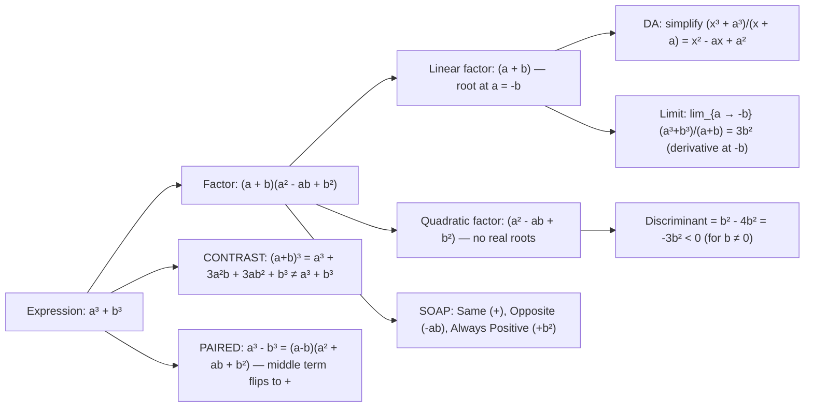

# Sum of cubes

$$
a^3 + b^3 = (a + b)(a^2 - ab + b^2)
$$

```latex
$a^3 + b^3 = (a + b)(a^2 - ab + b^2)$
```

## Deep Breakdown

What it tells me *(Situation Awareness)*:
The sum of cubes $a^3 + b^3$ factors into the product of a linear factor
$(a+b)$
and a quadratic factor
$(a^2 - ab + b^2)$.
The quadratic factor has a negative middle term
$-ab$
and no real roots (its discriminant is $(-b)^2 - 4(1)(b^2) = b^2 - 4b^2 = -3b^2 < 0$ for $b \ne 0$). The only real root of $a^3 + b^3 = 0$ is $a = -b$. This is the paired identity of the difference of cubes $a^3 - b^3 = (a-b)(a^2 + ab + b^2)$. The two are related by the SOAP mnemonic: Same sign as the original, Opposite middle term sign, Always Positive last term. In DA/DS, this identity appears in: simplifying rational expressions involving sums of cubes, computing limits of the form $\lim_{x \to -a} \frac{x^3 + a^3}{x + a} = 3a^2$ (derivative of $x^3$ at $x = -a$ from first principles), recognizing third-degree polynomial structure in gradient computations, and understanding why $a^3 + b^3 \ne (a+b)^3$ (the cube of a sum expands to four terms; the sum of cubes is only two of them).

## Flowchart



## Real-world use

### Where it is used

Simplifying rational expressions:
$\frac{x^3 + 27}{x + 3} = \frac{(x+3)(x^2-3x+9)}{x+3} = x^2 - 3x + 9$ (for $x \ne -3$).
Limit computations:
$\lim_{x \to -a} \frac{x^3 + a^3}{x + a} = 3a^2$
— derivative of
$f(x) = x^3$
at
$x = -a$.
Polynomial simplification in gradient derivations: ratios involving third-degree differences with sign changes.

### Problem it solves

Without the identity, canceling $(x + a)$ from $\frac{x^3 + a^3}{x + a}$ requires polynomial long division. The identity skips that and gives the quotient $x^2 - ax + a^2$ directly. This is particularly important for evaluating limits or simplifying expressions in gradient computations.

### How it solves the problem

Verification by expansion: # $(a+b)(a^2 - ab + b^2) = a(a^2 - ab + b^2) + b(a^2 - ab + b^2)$
$$
= a^3 - a^2b + ab^2 + a^2b - ab^2 + b^3 = a^3 + b^3
$$

. All middle terms cancel. The key is the alternating signs in the quadratic factor: $-ab$ ensures the $a^2b$ and $ab^2$ cross terms cancel.

### Example in a business

A data scientist is computing a finite-difference gradient approximation:
$\frac{f(w) - f(-1)}{w - (-1)} = \frac{w^3 + 1}{w + 1}$ for $f(w) = w^3$.
Using sum of cubes:
$w^3 + 1^3 = (w+1)(w^2 - w + 1)$
, so
#$\frac{w^3 + 1}{w+1} = w^2 - w + 1$.
At
$w = -1$
the quotient
$= 1 + 1 + 1 = 3 = 3(-1)^2 = f'(-1)$.
The identity avoids an undefined $0/0$ form.

## The formula, piece by piece

Breaking the notation:

- $a^3 + b^3$: sum of two cubes — requires recognizing both terms as perfect cubes (or expressible as cubes).
- $(a + b)$: the linear factor — the same sign as the sum, zero when $a = -b$. Only real root.
- $(a^2 - ab + b^2)$: the irreducible quadratic factor — middle term is negative (Opposite from SOAP). Discriminant $= -3b^2 < 0$ for $b \ne 0$, so no real roots. **SOAP mnemonic** (for both sum and difference of cubes):
- **S**ame: linear factor sign matches the original. $a^3 + b^3 \Rightarrow (a + b)$; $a^3 - b^3 \Rightarrow (a - b)$.
- **O**pposite: middle term of quadratic has the opposite sign. Sum: $-ab$; Difference: $+ab$.
- **A**lways **P**ositive: last term of quadratic is always $+b^2$. **Paired identity comparison**:
- Sum: $a^3 + b^3 = (a+b)(a^2 - ab + b^2)$ — middle term $-ab$.
- Difference: $a^3 - b^3 = (a-b)(a^2 + ab + b^2)$ — middle term $+ab$. **Limit application**: $\lim_{a \to -b} \frac{a^3 + b^3}{a + b} = \lim_{a \to -b}(a^2 - ab + b^2) = b^2 + b^2 + b^2 = 3b^2$.

## The formula in words

"To factor $a^3 + b^3$: write $(a+b)$ times $(a^2 - ab + b^2)$. Remember SOAP: the linear factor keeps the same sign; the middle term of the quadratic flips (here it's $-ab$); the last term is always $+b^2$. Verify by expanding — all middle terms cancel. The quadratic has no real roots. Compare with the difference of cubes, which has $+ab$ in the quadratic. In Python: `sympy.factor(a**3 + b**3)` returns this factoring."

## Critical Concepts

1. **SOAP mnemonic**: the single most reliable way to write both sum and difference of cubes correctly without confusion. Same sign for linear factor, Opposite sign for the middle term of the quadratic, Always Positive for the last term.
2. **Quadratic factor is irreducible**: $(a^2 - ab + b^2)$ has discriminant $-3b^2 < 0$ for $b \ne 0$. No real roots. The sum of cubes has only one real root over the reals: $a = -b$.
3. **Not the same as $(a+b)^3$**: $(a+b)^3 = a^3 + 3a^2b + 3ab^2 + b^3$. The sum of cubes $a^3 + b^3$ is missing $3a^2b + 3ab^2$. This is the most common sign confusion: students try to "simplify" $a^3 + b^3$ to $(a+b)^3$, which is wrong.
4. **Limit / derivative**: $\frac{a^3 + b^3}{a + b} = a^2 - ab + b^2 \to 3b^2$ as $a \to -b$. This gives the derivative of $x^3$ at $x = -b$: $3(-b)^2 = 3b^2$.
5. **Paired with difference of cubes**: the two identities together cover all factoring of $a^3 \pm b^3$.

The only structural difference is the sign of the middle term in the quadratic: sum of cubes has $-ab$; difference of cubes has $+ab$.

## Step-by-step calculation (tiny example)

Task: simplify $\frac{x^3 + 64}{x + 4}$.

*Step 1: Recognize the form*
$x^3 + 64 = x^3 + 4^3$. Sum of cubes: $a = x$, $b = 4$.

*Step 2: Apply SOAP*
Linear factor: $(a + b) = (x + 4)$. Quadratic: $a^2 - ab + b^2 = x^2 - 4x + 16$.

*Step 3: Factor*
$x^3 + 64 = (x + 4)(x^2 - 4x + 16)$.

*Step 4: Cancel the common factor*
$\frac{(x+4)(x^2 - 4x + 16)}{x + 4} = x^2 - 4x + 16$ (for $x \ne -4$).

*Step 5: Verify at $x = 2$*
$(8 + 64) / (2 + 4) = 72/6 = 12$. Formula: $4 - 8 + 16 = 12$.

## Code examples

### Beginner example (Python)

```python
# Sum of cubes: a³ + b³ = (a + b)(a² - ab + b²)
# Basic verification
pairs = [(2, 1), (3, 2), (5, 3), (10, 7), (0.5, 0.25)]
print(f"{'a':>6} {'b':>6} {'a³+b³':>10} {'(a+b)(a²-ab+b²)':>18} {'match':>6}")
for a, b in pairs:
    lhs = a**3 + b**3
    rhs = (a + b) * (a**2 - a * b + b**2)
    print(f"{a:>6.2f} {b:>6.2f} {lhs:>10.4f} {rhs:>18.4f} {str(abs(lhs - rhs) < 1e-10):>6}")

# Simplify rational expression: (x³ + a³) / (x + a)
print("\nSimplification: (x³ + a³) / (x + a) = x² - ax + a²")
a_val = 4.0
for x in [1.0, 2.0, 5.0, 6.0]:
    if abs(x + a_val) > 1e-10:
        direct = (x**3 + a_val**3) / (x + a_val)
        factored = x**2 - a_val * x + a_val**2
        print(f" x={x:.1f}: direct={direct:.4f} factored={factored:.4f} match={abs(direct - factored) < 1e-10}")

# Derivative from first principles: d/dx(x³) at x = -2 = 3(-2)² = 12
a_limit = -2.0
print(f"\nDerivative of x³ at x={a_limit} via (x³+a³)/(x+a) → 3a² = {3*a_limit**2}")
for h in [0.1, 0.01, 0.001, 0.0001]:
    x_near = a_limit - h  # approaching -a from below
    if abs(x_near + a_limit) > 1e-12:
        diff_quot = (x_near**3 + a_limit**3) / (x_near + a_limit)
    else:
        diff_quot = float("nan")
    print(f" h={h:.4f} x+a={x_near + a_limit:.6f} quotient={diff_quot:.6f}")

# TRAP: a³ + b³ ≠ (a+b)³
a, b = 2.0, 3.0
print(f"\nTRAP: a³+b³ = {a**3 + b**3:.0f} vs (a+b)³ = {(a+b)**3:.0f}")
```

### Beginner example (R)

```r
# Sum of cubes in R: a³ + b³ = (a+b)(a² - ab + b²)
pairs <- list(c(2,1), c(3,2), c(5,3), c(10,7))
cat(sprintf("%-6s %-6s %-10s %-18s %s\n", "a", "b", "a³+b³", "(a+b)(a²-ab+b²)", "match"))
for (p in pairs) {
  a <- p[1]; b <- p[2]
  lhs <- a^3 + b^3
  rhs <- (a + b) * (a^2 - a*b + b^2)
  cat(sprintf("%-6.2f %-6.2f %-10.4f %-18.4f %s\n", a, b, lhs, rhs, abs(lhs - rhs) < 1e-10))
}

# Simplify (x³ + 64) / (x + 4)
a_val <- 4.0
cat(sprintf("\nSimplification: (x³ + %.0f³) / (x + %.0f) = x² - %.0fx + %.0f\n", a_val, a_val, a_val, a_val^2))
for (x in c(1, 2, 5, 6)) {
  direct <- (x^3 + a_val^3) / (x + a_val)
  factored <- x^2 - a_val * x + a_val^2
  cat(sprintf(" x=%d: direct=%.4f factored=%.4f match=%s\n", x, direct, factored, abs(direct - factored) < 1e-10))
}
```

### Professional example (Python)

```python
import numpy as np
import sympy as sp
import pandas as pd

# Scenario: symbolic and numeric verification of sum-of-cubes factoring
# Demonstrate SOAP mnemonic, limit at a = -b, and quadratic factor irreducibility

# Symbolic check
a, b, x = sp.symbols("a b x", real=True)
sum_cubes = a**3 + b**3
factored_sym = sp.factor(sum_cubes)
simplified_rat = sp.simplify(sum_cubes / (a + b))
limit_val = sp.limit((x**3 + b**3) / (x + b), x, -b)
print("Symbolic: sum of cubes")
print(f" Original: {sum_cubes}")
print(f" Factored: {factored_sym}")
print(f" (a³+b³)/(a+b) = {simplified_rat}")
print(f" Limit as a → -b: {limit_val} (= 3b²)")

# Numeric validation: (a³ + b³) / (a + b) ≈ 3b² near a = -b
b_vals = np.array([1.0, 2.0, 3.0, 5.0, 10.0])
delta = 1e-5
print("\nNumerical limit check: (a³+b³)/(a+b) → 3b² as a → -b")
print(f"{'b':>6} {'3b²':>8} {'ratio at a≈-b':>14} {'error':>10}")
for b_val in b_vals:
    a_near = -b_val + delta
    ratio = (a_near**3 + b_val**3) / (a_near + b_val)
    exact = 3 * b_val**2
    print(f"{b_val:>6.1f} {exact:>8.4f} {ratio:>14.6f} {abs(ratio - exact):>10.2e}")

# Discriminant of quadratic factor: -3b² < 0 for b ≠ 0
print("\nQuadratic factor a²-ab+b²: discriminant = -3b² < 0 (no real roots)")
for b_val in [1.0, 2.0, 5.0]:
    disc = b_val**2 - 4 * b_val**2  # coefficient of a: 1, constant: b²
    print(f" b={b_val}: discriminant = {disc:.2f} < 0: {disc < 0}")
```

### Professional example (R)

```r
# Numeric verification of sum-of-cubes: (a³+b³)/(a+b) and limit 3b² as a → -b
b_vals <- c(1, 2, 3, 5, 10)
delta <- 1e-5
cat("Numerical limit: (a³+b³)/(a+b) → 3b² as a → -b\n")
cat(sprintf("%6s %8s %14s %10s\n", "b", "3b²", "ratio at a≈-b", "error"))
for (b_val in b_vals) {
  a_near <- -b_val + delta
  ratio <- (a_near^3 + b_val^3) / (a_near + b_val)
  exact <- 3 * b_val^2
  cat(sprintf("%6.1f %8.4f %14.6f %10.2e\n", b_val, exact, ratio, abs(ratio - exact)))
}
cat("\nQuadratic factor a²-ab+b²: discriminant = -3b² < 0\n")
for (b_val in c(1, 2, 5)) {
  disc <- b_val^2 - 4 * b_val^2
  cat(sprintf(" b=%.1f: discriminant = %.2f < 0: %s\n", b_val, disc, disc < 0))
}
```

---

*Source: 1300 p. 20*
