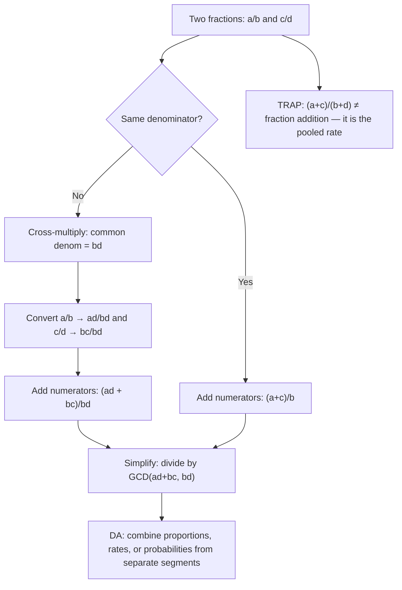

# Adding fractions

$$
\frac{a}{b} + \frac{c}{d} = \frac{ad + bc}{bd}
$$

## Deep Breakdown

What it tells me *(Situation Awareness)*:
Adding fractions requires a common denominator — two fractions cannot be summed directly unless they share the same denominator, because fractions with different denominators are measuring parts of different-sized wholes. The formula $\frac{a}{b} + \frac{c}{d} = \frac{ad + bc}{bd}$ uses the cross-multiplication method: scale both fractions to the common denominator $bd$, then add the numerators $ad + bc$. In DA/DS this appears any time you combine proportions, rates, or probabilities from separate sources: blending conversion rates from two traffic segments, adding class-conditional fractions, computing cumulative proportions, or mixing two sampling fractions. The critical trap: $\frac{a+c}{b+d}$ is NOT fraction addition — it is the pooled rate (weighted average with equal weights), a completely different quantity. Confusing them is a common data error that leads to Simpson's paradox-style miscalculations.

## Flowchart



## Real-world use

### Where it is used

Any time you compute with proportions or fractions of different denominators: adding two class fractions when merging data batches, computing the total fraction of a dataset matching one of two non-overlapping filters, checking that sub-sample fractions sum to 1, or combining probability terms in exact Bayesian calculations. Python's `fractions.Fraction` module handles this automatically; in SQL and pandas you typically work with floats but the same arithmetic applies.

### Problem it solves

You cannot add fractions with different denominators by simply adding numerators and denominators. Without a common denominator, the result is meaningless. Example: campaign A converts 3 out of 20 visitors (CTR = 3/20); campaign B converts 1 out of 8 visitors (CTR = 1/8). The arithmetic sum of these two rates as fractions is $\frac{3}{20} + \frac{1}{8} = \frac{11}{40}$ — not $\frac{4}{28}$, which would be a pooled rate calculation.

### How it solves the problem

$\frac{a}{b} + \frac{c}{d} = \frac{ad + bc}{bd}$: multiply the numerator of each fraction by the other's denominator to convert both to the common denominator $bd$, then add. Afterward, simplify by dividing numerator and denominator by $\gcd(ad+bc, bd)$. If you know the least common denominator (LCD $= bd / \gcd(b,d)$) upfront, use it to keep numbers smaller; but the cross-multiply formula always works.

### Example in a business

A marketing analyst has two email campaigns. Campaign A sent to a list of 500 contacts with 120 opens: open rate = $\frac{120}{500} = \frac{6}{25}$. Campaign B sent to 300 contacts with 75 opens: open rate = $\frac{75}{300} = \frac{1}{4}$. To find the arithmetic sum of the two rates (as a starting point for a combined metric): $\frac{6}{25} + \frac{1}{4} = \frac{6 \cdot 4 + 1 \cdot 25}{25 \cdot 4} = \frac{24 + 25}{100} = \frac{49}{100} = 49\%$. Note: this is the arithmetic sum of the rates, not the pooled open rate (which would be $\frac{120 + 75}{500 + 300} = \frac{195}{800} = 24.375\%$). Both computations are valid for different purposes; which one you need depends on the question.

## The formula, piece by piece

Breaking the notation:

- $a$: numerator of the first fraction — the "part" being measured.
- $b$: denominator of the first fraction — the "whole" unit.
- $\frac{a}{b}$: the first fraction.
- $c$: numerator of the second fraction.
- $d$: denominator of the second fraction.
- $\frac{c}{d}$: the second fraction.
- $+$: addition — combining two quantities of the same unit.
- $bd$: the common denominator — the product of both denominators. Always a valid common denominator; may not be the LCD.
- $ad$: the first fraction's numerator scaled up to denominator $bd$ — equivalent to $\frac{a}{b} = \frac{ad}{bd}$.
- $bc$: the second fraction's numerator scaled up to denominator $bd$ — equivalent to $\frac{c}{d} = \frac{bc}{bd}$.
- $ad + bc$: the combined numerator.
- $\frac{ad + bc}{bd}$: the result before simplification.

Simplification: divide $\gcd(ad+bc, \, bd)$ from both numerator and denominator to get the reduced form. LCD optimization: if $\gcd(b, d) = g > 1$, use LCD $= bd/g$ instead of $bd$ to avoid large numbers:

$$
\frac{a}{b} + \frac{c}{d} = \frac{a \cdot (d/g) + c \cdot (b/g)}{bd/g}
$$

## The formula in words

"To add $\frac{a}{b}$ and $\frac{c}{d}$: make both fractions use the same denominator by multiplying $a$ by $d$ and $c$ by $b$, giving you $\frac{ad}{bd}$ and $\frac{bc}{bd}$. Now the units match and you can add the tops: $\frac{ad + bc}{bd}$. Finally, simplify by canceling any common factors. In Python: just use `fractions.Fraction(a, b) + fractions.Fraction(c, d)` and it handles everything automatically."

## Critical Concepts

1. **Never add numerators and denominators separately**: $\frac{a}{b} + \frac{c}{d} \neq \frac{a+c}{b+d}$. This is the most common fraction mistake and it appears in DA when analysts "pool" rates incorrectly. $\frac{3}{20} + \frac{1}{8} = \frac{11}{40} = 0.275$, not $\frac{4}{28} \approx 0.143$.
2. **Pooled rate vs. arithmetic sum**: $\frac{a+c}{b+d}$ is the pooled (weighted) rate — the ratio of combined counts. This is a valid statistic but a completely different quantity from the arithmetic sum of the rates. Choose deliberately: arithmetic sum of rates vs. weighted average rate.
3. **LCD vs. cross-multiply**: both give the same answer. Cross-multiply ($bd$) always works; LCD gives smaller intermediate numbers and is less likely to overflow in integer arithmetic. In Python: `fractions.Fraction` always uses GCD internally, so you get the reduced form automatically.
4. **Float imprecision for exact fractions**: `0.1 + 0.2 != 0.3` in float64 arithmetic. For exact fraction sums (e.g., dataset split ratios), use `fractions.Fraction`. For reporting purposes, float is usually fine.
5. **Fraction addition and probability**: $P(A \cup B) = P(A) + P(B)$ only when $A$ and $B$ are mutually exclusive.

Otherwise: $P(A \cup B) = P(A) + P(B) - P(A \cap B)$. The fraction addition formula applies to each individual $P$ term; whether you can simply add them depends on the probability rule you are applying.

## Step-by-step calculation (tiny example)

Task: add $\frac{2}{5} + \frac{3}{4}$.

*Step 1: Identify a, b, c, d*
$a = 2,\; b = 5,\; c = 3,\; d = 4$.

*Step 2: Compute the common denominator*
$bd = 5 \times 4 = 20$.

*Step 3: Scale each numerator*
$ad = 2 \times 4 = 8$. Fraction 1 becomes $\frac{8}{20}$.
$bc = 3 \times 5 = 15$. Fraction 2 becomes $\frac{15}{20}$.

*Step 4: Add numerators*
$ad + bc = 8 + 15 = 23$.
Result: $\frac{23}{20}$.

*Step 5: Simplify*
$\gcd(23, 20) = 1$ — already fully reduced.
Final answer: $\frac{23}{20} = 1.15$.
Verify with decimals: $\frac{2}{5} + \frac{3}{4} = 0.4 + 0.75 = 1.15$.

## Code examples

### Beginner example (Python)

```python
# Fraction addition in Python
from fractions import Fraction   # Basic fraction addition using the cross-multiply formula manually
a, b = 2, 5   # first fraction: 2/5
c, d = 3, 4   # second fraction: 3/4
numerator = a * d + c * b   # ad + bc
denominator = b * d   # bd print(f"Cross-multiply method: ({a}×{d} + {c}×{b}) / ({b}×{d}) = {numerator}/{denominator}") # Python's Fraction class handles simplification automatically
frac_1 = Fraction(a, b)
frac_2 = Fraction(c, d)
result = frac_1 + frac_2
print(f"\nUsing Fraction class:")
print(f" {frac_1} + {frac_2} = {result} ({float(result):.4f})")   # TRAP: fraction addition vs. pooled rate
print("\n--- TRAP: a/b + c/d vs. (a+c)/(b+d) ---")
a2, b2 = 3, 20   # CTR campaign A
c2, d2 = 1, 8   # CTR campaign B
frac_sum = Fraction(a2, b2) + Fraction(c2, d2)
pooled = Fraction(a2 + c2, b2 + d2)
print(f" Fraction sum: {Fraction(a2,b2)} + {Fraction(c2,d2)} = {frac_sum} = {float(frac_sum):.4f}")
print(f" Pooled rate: ({a2}+{c2}) / ({b2}+{d2}) = {pooled} = {float(pooled):.4f}")
print(f" They are different: {frac_sum != pooled}")   # Proportions summing to 1 (sanity check for dataset splits)
train = Fraction(3, 5)   # 60%
val = Fraction(1, 5)   # 20%
test = Fraction(1, 5)   # 20%
total = train + val + test
print(f"\nDataset splits: {train} + {val} + {test} = {total} (sums to 1: {total == 1})")
```

### Beginner example (R)

```r
# Fraction addition in R
library(MASS)  # for fractions (Mod.Fraction) # Manual cross-multiply
a <- 2; b <- 5
c <- 3; d <- 4
numerator <- a * d + c * b  # ad + bc
denominator <- b * d  # bd
cat(sprintf("Cross-multiply: (%d×%d + %d×%d) / (%d×%d) = %d/%d = %.4f\n", a, d, c, b, b, d, numerator, denominator, numerator / denominator))  # Simplify manually with GCD
gcd <- function(x, y)
if (y == 0) x
else gcd(y, x %% y)
g <- gcd(numerator, denominator)
cat(sprintf("Simplified: %d/%d\n", numerator / g, denominator / g))  # TRAP: fraction sum vs. pooled rate
a2 <- 3; b2 <- 20  # CTR campaign A
c2 <- 1; d2 <- 8  # CTR campaign B
frac_sum <- a2 / b2 + c2 / d2  # arithmetic sum of rates
pooled <- (a2 + c2) / (b2 + d2)  # pooled (weighted) rate
cat(sprintf("\nFraction sum: %.4f\n", frac_sum))
cat(sprintf("Pooled rate: %.4f\n", pooled))
cat(sprintf("They are equal: %s\n", frac_sum == pooled))  # Dataset splits must sum to 1
train <- 3/5
val <- 1/5
test <- 1/5
cat(sprintf("\nSplit total: %.1f (should be 1.0)\n", train + val + test))
```

### Professional example (Python)

```python
import pandas as pd
import numpy as np
from fractions import Fraction   # Scenario: exact proportion tracking for a stratified sample
# Compute fraction of dataset covered by each segment,
# verify splits sum to 1, and catch the pooled-rate trap in reporting
np.random.seed(42)
N = 10_000
df = pd.DataFrame({ "segment": np.random.choice(["premium", "standard", "trial"], N, p=[0.20, 0.50, 0.30]), "converted": np.random.binomial(1, 0.15, N),
})

def fraction_of_total(series: pd.Series, total: int) -> Fraction:
    """ Return the fraction of rows in `series` that satisfy a condition, expressed as an exact Fraction. Args: series: Boolean Series (condition applied externally or passed as mask). total: Total row count to use as denominator. Returns: Exact Fraction representing the proportion. """
    return Fraction(int(series.sum()), total)   # Compute exact fractions per segment
segment_fractions = { seg: fraction_of_total(df["segment"] == seg, N) for seg in df["segment"].unique() }
print("Segment proportions (exact fractions):")
for seg, frac in segment_fractions.items():
    print(f" {seg:<12}: {frac} = {float(frac):.4f}")   # Verify: all fractions must sum to exactly 1
total_fraction = sum(segment_fractions.values())
print(f"\nSum of all segment fractions: {total_fraction} (valid: {total_fraction == 1})")   # Conversion rates per segment (exact fractions)
conv_fractions = { seg: Fraction( int(df[df["segment"] == seg]["converted"].sum()), int((df["segment"] == seg).sum()), ) for seg in df["segment"].unique() }
print("\nConversion rates per segment (exact fractions):")
for seg, frac in conv_fractions.items():
    print(f" {seg:<12}: {frac} ≈ {float(frac):.4f}")   # TRAP DEMO: arithmetic sum of two rates vs. pooled rate
seg_a, seg_b = "premium", "standard"
rate_a = conv_fractions[seg_a]
rate_b = conv_fractions[seg_b]
arith_sum = rate_a + rate_b   # fraction addition: ad+bc / bd
pooled = Fraction( int(df[df["segment"].isin([seg_a, seg_b])]["converted"].sum()), int(df["segment"].isin([seg_a, seg_b]).sum()),
)
print(f"\nArithmetic sum of {seg_a} + {seg_b} rates: {arith_sum} = {float(arith_sum):.4f}")
print(f"Pooled (weighted) rate for both: {pooled} = {float(pooled):.4f}")
print(f"Different values: {arith_sum != pooled} — use pooled rate for combined segment reporting")
```

### Professional example (R)

```r
# Exact proportion tracking for stratified sample; verify splits sum to 1; pooled-rate trap
set.seed(42)
N <- 10000
df <- data.frame( segment = sample(c("premium", "standard", "trial"), N, replace = TRUE, prob = c(0.20, 0.50, 0.30)), converted = rbinom(N, 1, 0.15)
) segment_counts <- table(df$segment)
segment_fractions <- segment_counts / N
cat("Segment proportions (exact fractions):\n")
for (seg in names(segment_fractions)) { cat(sprintf(" %-12s: %d/%d = %.4f\n", seg, segment_counts[seg], N, segment_fractions[seg]))
}
cat(sprintf("\nSum of segment fractions: %.4f (valid: %s)\n", sum(segment_fractions), abs(sum(segment_fractions) - 1) < 1e-9))
conv_rates <- aggregate(converted ~ segment, data = df, function(z) sum(z) / length(z))
cat("\nConversion rates per segment:\n")
print(conv_rates)
seg_a <- "premium"
seg_b <- "standard"
sub <- df[df$segment %in% c(seg_a, seg_b), ]
rate_a <- mean(df$converted[df$segment == seg_a])
rate_b <- mean(df$converted[df$segment == seg_b])
arith_sum <- rate_a + rate_b
pooled <- sum(sub$converted) / nrow(sub)
cat(sprintf("\nArithmetic sum %s + %s: %.4f\n", seg_a, seg_b, arith_sum))
cat(sprintf("Pooled rate: %.4f — use pooled for combined segment reporting.\n", pooled))
```

---

*Source: MRAF*
