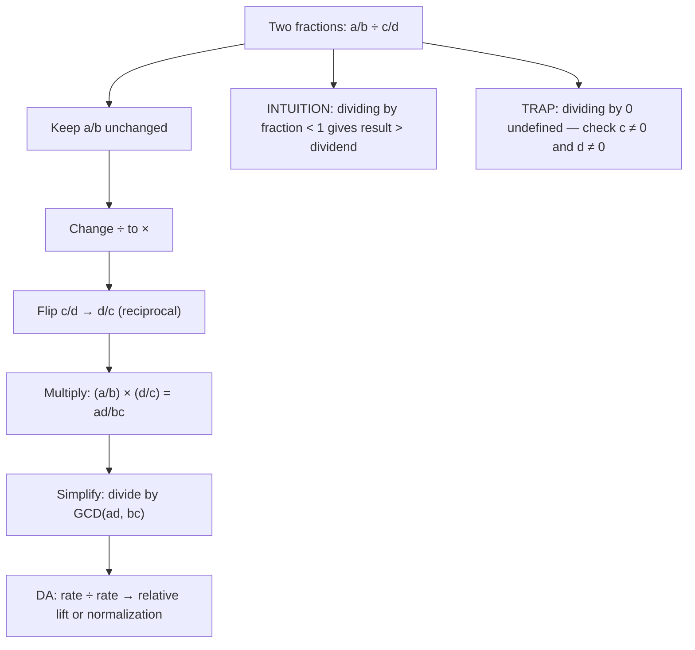

# Dividing fractions

$$
\frac{a/b}{c/d} = \frac{ad}{bc}
$$

## Deep Breakdown

What it tells me *(Situation Awareness)*:
Dividing one fraction by another is equivalent to multiplying the first fraction by the reciprocal of the second: $\frac{a/b}{c/d} = \frac{a}{b} \cdot \frac{d}{c} = \frac{ad}{bc}$. The mnemonic is KCF: **K**eep the first fraction, **C**hange division to multiplication, **F**lip the second fraction. In DA/DS, fraction division appears whenever you compute a rate relative to another rate: revenue per converted user when you have total revenue as a fraction of budget and conversion rate as a fraction of visitors; normalizing a metric proportion by a benchmark proportion; computing how many times larger one rate is relative to another (lift, relative risk); and scaling a probability by a base-rate denominator. A critical intuition: dividing by a proper fraction ($0 < c/d < 1$) always gives a result *larger* than the dividend — if only 1 in 5 users converts and you ask "how many visitors do you need per conversion?", you are dividing by $\frac{1}{5}$ and the answer is 5. Division by a fraction greater than 1 shrinks the result.

## Flowchart



## Real-world use

### Where it is used

Any time you normalize one proportion by another: computing lift (observed rate ÷ baseline rate), relative risk (event rate in group A ÷ event rate in group B), revenue per converted user (fraction of revenue ÷ fraction of conversions), or inverting a rate (impressions per click = $1 \div \frac{3}{20} = \frac{20}{3} \approx 6.7$). Also used for unit conversion: converting a rate in events-per-minute to events-per-hour involves multiplying by 60 (equivalently, dividing by $\frac{1}{60}$).

### Problem it solves

You need to compare two rates or express one quantity relative to another. Dividing raw counts works for whole numbers; when both quantities are expressed as fractions of different totals, fraction division gives the correct relative measure. Example: campaign A has a 15% conversion rate and the baseline is 6%. Lift = $\frac{15/100}{6/100} = \frac{15 \cdot 100}{100 \cdot 6} = \frac{15}{6} = 2.5\times$ — campaign A converts at 2.5 times the baseline rate.

### How it solves the problem

$\frac{a/b}{c/d} = \frac{a}{b} \cdot \frac{d}{c} = \frac{ad}{bc}$. Flip the divisor fraction to its reciprocal, then multiply. Simplify with $\gcd(ad, bc)$. The result is a fraction with denominator $bc$, representing the ratio of the two original rates. When both fractions share the same denominator ($b = d$), it cancels and the result simplifies to $\frac{a}{c}$ — just the ratio of the numerators.

### Example in a business

A/B test lift: variant B has a conversion rate of $\frac{180}{1200} = \frac{3}{20}$. The control has $\frac{60}{1000} = \frac{3}{50}$. Lift = $\frac{3/20}{3/50} = \frac{3}{20} \cdot \frac{50}{3} = \frac{150}{60} = \frac{5}{2} = 2.5$. Variant B converts at 2.5 times the control rate. The 3 in both numerators cross-cancels before multiplying, making the arithmetic straightforward.

## The formula, piece by piece

Breaking the notation:

- $a$: numerator of the dividend fraction.
- $b$: denominator of the dividend fraction.
- $\frac{a}{b}$: the fraction being divided (the dividend).
- $\div$ (or the fraction bar): division — "how many times does the divisor fit into the dividend?"
- $c$: numerator of the divisor fraction.
- $d$: denominator of the divisor fraction.
- $\frac{c}{d}$: the fraction doing the dividing (the divisor).
- $\frac{d}{c}$: the reciprocal of the divisor — obtained by flipping numerator and denominator.
- $ad$: product of the dividend numerator and divisor denominator (the new numerator).
- $bc$: product of the dividend denominator and divisor numerator (the new denominator).
- $\frac{ad}{bc}$: the result — the dividend scaled by the reciprocal of the divisor. **Interpretation**: $\frac{a/b}{c/d}$ asks "how many times does $\frac{c}{d}$ fit into $\frac{a}{b}$?" If $\frac{c}{d} < 1$, it fits more than once and the result exceeds $\frac{a}{b}$.

If $\frac{c}{d} > 1$, it fits less than once and the result is smaller than $\frac{a}{b}$. **Special case — same denominator**: $\frac{a/b}{c/b} = \frac{ab}{bc} = \frac{a}{c}$. Common denominator cancels; only the numerator ratio matters. **Reciprocal of a fraction**: $\frac{1}{c/d} = \frac{d}{c}$. The reciprocal of a fraction less than 1 is always greater than 1. `Fraction(c, d)**-1 == Fraction(d, c)` in Python.

## The formula in words

"To divide $\frac{a}{b}$ by $\frac{c}{d}$: Keep the first fraction unchanged, Change division to multiplication, Flip the second fraction to its reciprocal $\frac{d}{c}$, then multiply normally — top times top over bottom times bottom = $\frac{ad}{bc}$. Simplify the result. In Python it is just `Fraction(a, b) / Fraction(c, d)`. The result tells you how many times the divisor fraction fits into the dividend fraction. Dividing by a fraction smaller than 1 always gives a larger result."

## Critical Concepts

1. **KCF — Keep, Change, Flip**: Keep the dividend, change $\div$ to $\times$, flip the divisor. This is the only procedure needed and it works for all nonzero fractions. Never attempt to find a common denominator for division — that is the addition/subtraction approach and it is wrong here.
2. **Division by a proper fraction amplifies**: $\frac{a}{b} \div \frac{c}{d} > \frac{a}{b}$ whenever $0 < \frac{c}{d} < 1$. This is the mathematical basis for: "a 5% CTR means 1 impression per 0.05 clicks, or 20 impressions per click." Inverting a small rate produces a large number.
3. **Lift and relative risk**: lift = observed rate ÷ baseline rate. Relative risk = event rate (treated) ÷ event rate (control). Both are fraction division. When both fractions share the same denominator, it cancels and the result is just the ratio of numerators.
4. **Division by zero is undefined**: if $c = 0$ (the divisor numerator) or $d = 0$ (the divisor denominator), the divisor fraction is either zero or undefined. In DA, a zero conversion rate as a denominator means you have no data for the baseline — guard against this before computing lift or relative risk.
5. **Python `Fraction` for exact division**: `Fraction(a, b) / Fraction(c, d)` returns the exact reduced fraction.

For float division, the same arithmetic applies but floating-point rounding accumulates. Use `Fraction` when comparing ratios exactly or verifying that a lift equals a specific value.

## Step-by-step calculation (tiny example)

Task: compute lift for a campaign with 18% conversion rate vs. a 6% baseline.

*Step 1: Express both rates as fractions*
Campaign rate = $\frac{18}{100} = \frac{9}{50}$. Baseline = $\frac{6}{100} = \frac{3}{50}$.

*Step 2: Set up the division*
Lift = $\frac{9/50}{3/50}$.

*Step 3: Apply KCF*
Keep $\frac{9}{50}$, change $\div$ to $\times$, flip $\frac{3}{50}$ to $\frac{50}{3}$:

$$
\frac{9}{50} \times \frac{50}{3} = \frac{9 \cdot 50}{50 \cdot 3} = \frac{450}{150}
$$

*Step 4: Simplify*
$\gcd(450, 150) = 150$. $\frac{450}{150} = \frac{3}{1} = 3$.

*Step 5: Interpret*
Lift = 3. The campaign converts at 3 times the baseline rate. *Shortcut — same denominator cancels*:
Since both had denominator 50: $\frac{9/50}{3/50} = \frac{9}{3} = 3$.

## Code examples

### Beginner example (Python)

```python
# Fraction division in Python
from fractions import Fraction

# Basic: a/b ÷ c/d
a, b = 9, 50   # 18% campaign conversion rate
c, d = 3, 50   # 6% baseline rate

# Manual KCF: keep a/b, change to multiply, flip c/d → d/c
numerator = a * d   # ad
denominator = b * c   # bc
print(f"KCF manual: ({a}×{d}) / ({b}×{c}) = {numerator}/{denominator} = {numerator/denominator:.4f}")

# Python Fraction (auto-simplifies)
dividend = Fraction(a, b)
divisor = Fraction(c, d)
lift = dividend / divisor
print(f"Fraction class: {dividend} ÷ {divisor} = {lift} ({float(lift):.2f}×)")

# Reciprocal demonstration
print(f"\nReciprocal of {divisor} = {Fraction(d, c)} (flip numerator and denominator)")
print(f"Fraction reciprocal: {divisor**-1}")

# Dividing by a fraction < 1 amplifies the result
ctr = Fraction(3, 20)   # 15% CTR
impressions_per_click = Fraction(1) / ctr
print(f"\nCTR = {ctr} ({float(ctr):.1%})")
print(f"Impressions per click = 1 ÷ {ctr} = {impressions_per_click} ({float(impressions_per_click):.1f})")

# Relative risk: A/B test
rate_treatment = Fraction(180, 1200)   # variant B
rate_control = Fraction(60, 1000)   # control
relative_risk = rate_treatment / rate_control
print(f"\nA/B relative risk:")
print(f" treatment: {rate_treatment} = {float(rate_treatment):.4f}")
print(f" control: {rate_control} = {float(rate_control):.4f}")
print(f" lift: {relative_risk} = {float(relative_risk):.2f}×")
```

### Beginner example (R)

```r
# Fraction division in R
# Manual KCF
a <- 9; b <- 50  # 18%
c <- 3; d <- 50  # 6%
numerator <- a * d  # ad
denominator <- b * c  # bc
cat(sprintf("KCF manual: (%d×%d) / (%d×%d) = %d/%d = %.4f\n", a, d, b, c, numerator, denominator, numerator / denominator))

# Simplify with GCD
gcd <- function(x, y) if (y == 0) x else gcd(y, x %% y)
g <- gcd(numerator, denominator)
cat(sprintf("Simplified: %d/%d = %.4f\n", numerator / g, denominator / g, numerator / denominator))

# Reciprocal: 1 / (c/d) = d/c
ctr <- 3 / 20  # 15% CTR
impressions_per_click <- 1 / ctr
cat(sprintf("\nCTR = %.4f | Impressions per click = 1 / %.4f = %.2f\n", ctr, ctr, impressions_per_click))

# A/B relative risk
rate_treatment <- 180 / 1200
rate_control <- 60 / 1000
relative_risk <- rate_treatment / rate_control
cat(sprintf("\nRelative risk: %.4f / %.4f = %.2f×\n", rate_treatment, rate_control, relative_risk))
```

### Professional example (Python)

```python
import pandas as pd
import numpy as np
from fractions import Fraction
from typing import NamedTuple

# Scenario: multi-variant lift report
# Compute exact lift (fraction division) for each variant vs. control
# Flag variants below lift threshold (underperforming vs. control)
# Guard against zero-denominator (undefined lift when control has 0 conversions)
np.random.seed(42)
LIFT_THRESHOLD = Fraction(1)   # lift < 1.0 flags underperformance


class VariantResult(NamedTuple):
    """Conversion counts for one variant or control group."""
    name: str
    visitors: int
    conversions: int


def compute_lift(variant: VariantResult, control: VariantResult) -> dict:
    """
    Compute exact lift for one variant relative to control using fraction division.

    Args:
        variant: The variant being evaluated.
        control: The control group result.

    Returns:
        Dictionary with variant name, rates, exact lift fraction, and underperformance flag.

    Raises:
        ZeroDivisionError: If the control conversion rate is zero (lift is undefined).
    """
    if control.conversions == 0:
        raise ZeroDivisionError(
            f"Control '{control.name}' has zero conversions: lift is undefined."
        )
    variant_rate = Fraction(variant.conversions, variant.visitors)
    control_rate = Fraction(control.conversions, control.visitors)
    lift = variant_rate / control_rate   # fraction division: KCF applied
    return {
        "variant": variant.name,
        "variant_rate": float(variant_rate),
        "control_rate": float(control_rate),
        "lift_exact": str(lift),
        "lift_float": float(lift),
        "underperforms": lift < LIFT_THRESHOLD,
    }


# Simulated experiment counts
control_group = VariantResult("control", visitors=10_000, conversions=600)
variants = [
    VariantResult("variant_A", visitors=5_000, conversions=375),
    VariantResult("variant_B", visitors=4_800, conversions=240),
    VariantResult("variant_C", visitors=5_200, conversions=702),
]
rows = [compute_lift(v, control_group) for v in variants]
report = pd.DataFrame(rows)
print("Lift Report: Fraction Division (variant rate ÷ control rate)")
print("=" * 72)
print(report.to_string(index=False))
base_rate = Fraction(control_group.conversions, control_group.visitors)
print(f"\nControl base rate: {base_rate} = {float(base_rate):.4f}")
```

### Professional example (R)

```r
# Lift report: variant rate ÷ control rate (fraction division)
control_visitors <- 10000
control_conversions <- 600
variants <- data.frame( variant = c("variant_A", "variant_B", "variant_C"), visitors = c(5000, 4800, 5200), conversions = c(375, 240, 702)
)
control_rate <- control_conversions / control_visitors
variants$variant_rate <- variants$conversions / variants$visitors
variants$lift_float <- variants$variant_rate / control_rate
variants$underperforms <- variants$lift_float < 1.0
cat("Lift Report: Fraction Division (variant rate ÷ control rate)\n")
print(variants)
cat(sprintf("\nControl base rate: %.4f\n", control_rate))
```

---

*Source: MRAF*
