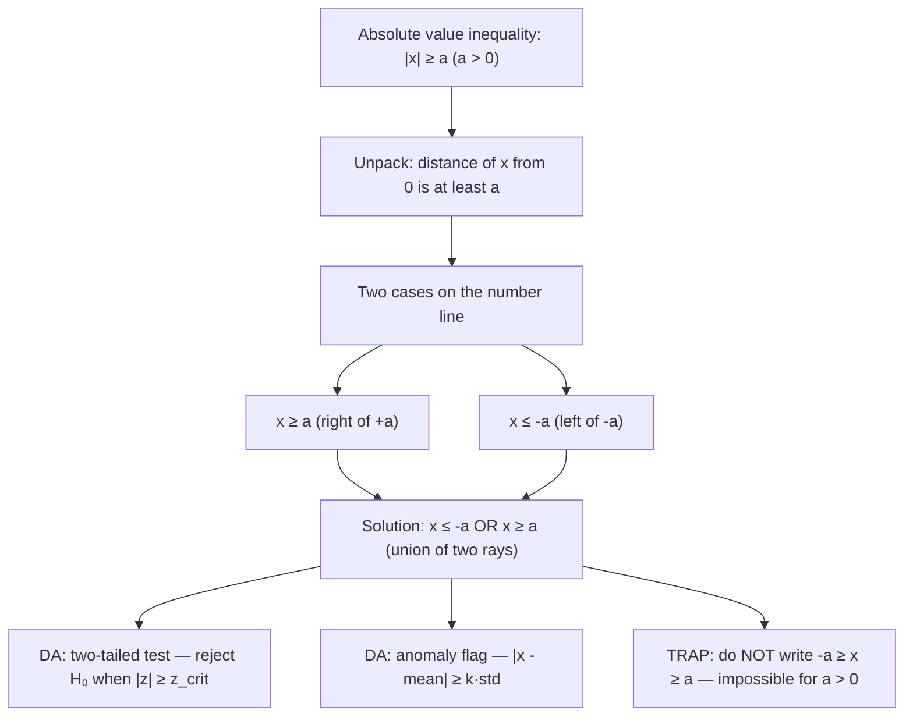

# Boundary condition (lower bound)

$$
|x| \ge a \iff x \le -a \text{ or } x \ge a
$$

(for $a > 0$)

## Deep Breakdown

What it tells me *(Situation Awareness)*:
The lower-bound absolute value inequality $|x| \ge a$ (for $a > 0$) means: the distance of $x$ from zero is at least $a$. Equivalently, $x$ lies outside the interval $(-a, a)$ — either far left ($x \le -a$) or far right ($x \ge a$). The solution is a union of two rays, not a connected interval. In DA/DS, this appears whenever you want to flag or select values that deviate significantly from a reference point: anomaly detection (flag observations more than $k$ standard deviations from the mean), two-tailed hypothesis testing (reject $H_0$ when $|z| \ge z_{\alpha/2}$), outlier filtering (keep rows where $|x - \mu| \ge$ threshold), and residual analysis (identify predictions whose absolute error exceeds an acceptable tolerance). The "or" in the solution is critical — a common mistake is to write $-a \ge x \ge a$, which is impossible for $a > 0$.

## Flowchart



## Real-world use

### Where it is used

Two-tailed statistical tests: reject the null hypothesis when the test statistic $|z| \ge z_{\alpha/2}$ or $|t| \ge t_{\alpha/2,\nu}$. Anomaly detection pipelines: flag a metric value as anomalous when $|x - \mu| \ge k \cdot \sigma$ (e.g., $k = 3$ for 3-sigma rule). Outlier removal: drop rows where $|x_i - \bar{x}| \ge c$ for some threshold $c$. Quality control: trigger an alert when a sensor reading deviates from the expected value by more than a set tolerance. All of these reduce to $|x| \ge a$ after centering and scaling.

### Problem it solves

When you need values that are far from a reference point, you cannot express the condition as a single connected range. The deviation can be in either direction. Writing $x \ge a$ alone misses large negative values; writing $x \le -a$ alone misses large positive ones. The $|x| \ge a$ form captures both cases simultaneously and translates cleanly to code (`abs(x) >= a` or equivalently `x <= -a or x >= a`).

### How it solves the problem

$|x| \ge a$ is geometrically: the points on the real line at distance at least $a$ from the origin. These are exactly the two rays $(-\infty, -a]$ and $[a, +\infty)$, united as $x \le -a$ OR $x \ge a$. Algebraically: since $|x| \ge a > 0$, either $x \ge 0$ and $x \ge a$ (so $x \ge a$), or $x < 0$ and $-x \ge a$ (so $x \le -a$). The split is exhaustive and the union of the two cases is the complete solution.

### Example in a business

A data analyst applies z-score anomaly detection to daily revenue data. After computing $z_i = (x_i - \mu) / \sigma$, they flag any day as anomalous when $|z_i| \ge 3$, i.e., when $z_i \le -3$ or $z_i \ge 3$. This catches both abnormally high revenue days (potential data entry errors or system-generated transactions) and abnormally low revenue days (outages or missing data). A single-sided threshold ($z_i \ge 3$ only) would miss the negative anomalies entirely.

## The formula, piece by piece

Breaking the notation:

- $|x|$: the absolute value of $x$ — the distance of $x$ from zero, always $\ge 0$.
- $\ge$: greater than or equal to — the value is at least $a$.
- $a$: the threshold — a positive real number specifying the minimum distance.
- $\iff$: "if and only if" — the condition on the left is exactly equivalent to the condition on the right; neither implies the other alone.
- $x \le -a$: $x$ is at or to the left of $-a$ — far negative deviation.
- $\text{or}$: logical OR — the solution is the union of two disjoint regions.
- $x \ge a$: $x$ is at or to the right of $+a$ — far positive deviation. **Boundary cases**: at exactly $x = a$ or $x = -a$, $|x| = a$, so the boundary points are included (non-strict inequality $\ge$).

For strict inequality $|x| > a$, the boundary points are excluded. **Scaling**: in practice, $x$ is often a centered and normalized quantity: $|z_i| \ge k$ where $z_i = (x_i - \mu)/\sigma$ and $k$ is the number of standard deviations. Substituting back: $|(x_i - \mu)/\sigma| \ge k \iff x_i \le \mu - k\sigma$ or $x_i \ge \mu + k\sigma$.

## The formula in words

"$|x| \ge a$ means: $x$ is at least $a$ units away from zero, in either direction. The solution is not a single interval but two separate regions on the number line: everything to the left of (and including) $-a$, and everything to the right of (and including) $+a$. In Python: `abs(x) >= a` or equivalently `x <= -a or x >= a`. Think of it as a two-tailed filter — you are selecting the tails of the distribution, not the center."

## Critical Concepts

1. **Union of two rays, not an interval**: the solution to $|x| \ge a$ is $x \le -a$ OR $x \ge a$ — two separate half-lines. It is never written as a single compound inequality like $-a \ge x \ge a$ (that condition is impossible for $a > 0$). In Python, this is `x <= -a or x >= a`, not `x <= -a and x >= a`.
2. **Direction reversal from $|x| \le a$**: the upper-bound case $|x| \le a$ gives a connected interval $[-a, a]$ (AND condition). The lower-bound case $|x| \ge a$ gives an "outside" condition (OR condition). These are complementary: $|x| \ge a$ is the complement of $|x| < a$.
3. **Two-tailed tests**: in hypothesis testing, the rejection region for a two-tailed test is exactly $|T| \ge c_{\alpha}$ — both extreme negative and extreme positive values of the test statistic lead to rejection.
4. **Threshold selection**: the value of $a$ determines how extreme a deviation must be. In z-score anomaly detection: $a = 2$ flags ~5% of data (roughly), $a = 3$ flags ~0.3%. Choosing $a$ is a business decision, not a mathematical one.
5. **Centering matters**: the raw form $|x| \ge a$ measures distance from zero.

When flagging deviations from a mean, center first: $|x - \mu| \ge a$, which is equivalent to $x \le \mu - a$ or $x \ge \mu + a$.

## Step-by-step calculation (tiny example)

Task: flag daily revenue values (in thousands) that deviate more than 20 from a mean of 100. That is, identify all values where $|x - 100| \ge 20$.

*Step 1: Rewrite in standard form*
Let $u = x - 100$. The condition becomes $|u| \ge 20$.

*Step 2: Split into two cases*
Case 1: $u \ge 20 \implies x - 100 \ge 20 \implies x \ge 120$.
Case 2: $u \le -20 \implies x - 100 \le -20 \implies x \le 80$.

*Step 3: Interpret the solution*
Flag any day where revenue $\le 80$ or revenue $\ge 120$.

*Step 4: Check boundary values*
$x = 120$: $|120 - 100| = 20 \ge 20$. Flagged (boundary included).
$x = 100$: $|100 - 100| = 0 \ge 20$? No. Not flagged.
$x = 75$: $|75 - 100| = 25 \ge 20$. Flagged.

## Code examples

### Beginner example (Python)

```python
# Lower-bound absolute value inequality: |x| >= a
# Basic: solve |x| >= a
a = 3.0
test_values = [-5.0, -3.0, -2.0, 0.0, 2.0, 3.0, 5.0]
print(f"Condition: |x| >= {a} → x <= {-a} OR x >= {a}")
print(f"{'x':>6} {'|x|':>6} {'|x|>=a':>8} {'x<=-a or x>=a':>16}")
for x in test_values:
    abs_check = abs(x) >= a
split_check = x <= -a or x >= a
print(f"{x:>6.1f} {abs(x):>6.1f} {str(abs_check):>8} {str(split_check):>16}")   # DA: z-score anomaly flagging
import numpy as np
np.random.seed(42)
N_DAYS = 30
MEAN_REV = 100.0
STD_REV = 15.0
Z_THRESH = 2.0   # flag if |z| >= 2
daily_revenue = np.random.normal(MEAN_REV, STD_REV, N_DAYS)
z_scores = (daily_revenue - MEAN_REV) / STD_REV
anomalous = np.abs(z_scores) >= Z_THRESH   # |z| >= 2.0
print(f"\nAnomaly detection: |z| >= {Z_THRESH}")
print(f" Total days: {N_DAYS}")
print(f" Anomalous days: {anomalous.sum()}")
print(f" Values flagged: {daily_revenue[anomalous].round(1)}")
print(f" Thresholds: x <= {MEAN_REV - Z_THRESH * STD_REV:.1f} or x >= {MEAN_REV + Z_THRESH * STD_REV:.1f}")
```

### Beginner example (R)

```r
# Lower-bound absolute value inequality: |x| >= a # Basic solve
a <- 3.0
test_values <- c(-5, -3, -2, 0, 2, 3, 5)
cat(sprintf("Condition: |x| >= %.1f -> x <= %.1f OR x >= %.1f\n", a, -a, a))
cat(sprintf("%-6s %-6s %-8s\n", "x", "|x|", "|x|>=a"))
for (x in test_values) { cat(sprintf("%-6.1f %-6.1f %-8s\n", x, abs(x), abs(x) >= a))
}  # Z-score anomaly detection
set.seed(42)
N_DAYS <- 30
mean_rev <- 100.0
std_rev <- 15.0
z_thresh <- 2.0
daily_revenue <- rnorm(N_DAYS, mean_rev, std_rev)
z_scores <- (daily_revenue - mean_rev) / std_rev
anomalous <- abs(z_scores) >= z_thresh
cat(sprintf("\nAnomaly detection: |z| >= %.1f\n", z_thresh))
cat(sprintf(" Anomalous days: %d\n", sum(anomalous)))
cat(sprintf(" Thresholds: x <= %.1f or x >= %.1f\n", mean_rev - z_thresh * std_rev, mean_rev + z_thresh * std_rev))
cat(" Flagged values:", round(daily_revenue[anomalous], 1), "\n")
```

### Professional example (Python)

```python
import pandas as pd
import numpy as np   # Scenario: two-tailed anomaly detection pipeline for daily KPI monitoring
# Flag metrics that deviate more than k standard deviations from a rolling baseline
# Use |z| >= k_sigma (lower-bound absolute value inequality) for each metric
np.random.seed(42)
N_DAYS = 90
K_SIGMA = 2.5   # flag threshold: |z| >= 2.5
ROLLING_WINDOW = 14   # rolling window for mean and std estimation # Simulate daily KPI data: revenue, sessions, conversion rate
kpi_data = pd.DataFrame({ "date": pd.date_range("2025-01-01", periods=N_DAYS, freq="D"), "revenue": np.random.normal(50_000, 5_000, N_DAYS), "sessions": np.random.normal(10_000, 800, N_DAYS), "conversion_rate": np.random.normal(0.035, 0.004, N_DAYS),
})   # Inject artificial anomalies
kpi_data.loc[30, "revenue"] = 30_000   # revenue crash
kpi_data.loc[60, "sessions"] = 18_000   # traffic spike
kpi_data.loc[75, "conversion_rate"] = 0.012   # conversion collapse
kpi_metrics = ["revenue", "sessions", "conversion_rate"]

def flag_anomalies( series: pd.Series, k_sigma: float, window: int ) -> pd.Series:
    """ Flag values where |z-score| >= k_sigma using a rolling baseline. Args: series: Numeric time series to evaluate. k_sigma: Threshold; flag when |z| >= k_sigma. window: Rolling window size for mean and std estimation. Returns: Boolean Series — True where the condition |z| >= k_sigma holds. """
    rolling_mean = series.rolling(window, min_periods=1).mean()
    rolling_std = series.rolling(window, min_periods=1).std().fillna(1.0)
    z_scores = (series - rolling_mean) / rolling_std
    return z_scores.abs() >= k_sigma
anomaly_flags = pd.DataFrame({"date": kpi_data["date"]})
for metric in kpi_metrics:
    anomaly_flags[metric] = flag_anomalies(kpi_data[metric], K_SIGMA, ROLLING_WINDOW)
anomaly_flags["any_anomaly"] = anomaly_flags[kpi_metrics].any(axis=1)
summary = anomaly_flags[anomaly_flags["any_anomaly"]][["date"] + kpi_metrics]
print(f"Two-Tailed Anomaly Report: |z| >= {K_SIGMA} (rolling {ROLLING_WINDOW}-day window)")
print("=" * 72)
print(summary.to_string(index=False))
print(f"\nTotal anomalous days: {anomaly_flags['any_anomaly'].sum()} of {N_DAYS}")
```

### Professional example (R)

```r
# Two-tailed anomaly: |z| >= k_sigma (rolling window)
set.seed(42)
N_DAYS <- 90
K_SIGMA <- 2.5
ROLLING_WINDOW <- 14
kpi_data <- data.frame( date = seq(as.Date("2025-01-01"), by = "day", length.out = N_DAYS), revenue = rnorm(N_DAYS, 50000, 5000), sessions = rnorm(N_DAYS, 10000, 800), conversion_rate = rnorm(N_DAYS, 0.035, 0.004)
)
kpi_data$revenue[31] <- 30000
kpi_data$sessions[61] <- 18000
kpi_data$conversion_rate[76] <- 0.012
roll_mean <- function(x, w) { n <- length(x) sapply(seq_along(x), function(i) mean(x[max(1, i-w+1):i], na.rm = TRUE))
}
roll_sd <- function(x, w) { n <- length(x)
  s <- sapply(seq_along(x), function(i) { r <- x[max(1, i-w+1):i]; if (length(r) < 2) 1 else sd(r) }) replace(s, is.na(s), 1)
}
flag_anomalies <- function(series, k, w) { z <- (series - roll_mean(series, w)) / roll_sd(series, w) abs(z) >= k
}
anomaly_flags <- data.frame(date = kpi_data$date)
for (col in c("revenue", "sessions", "conversion_rate"))
anomaly_flagscol <- flag_anomalies(kpi_datacol, K_SIGMA, ROLLING_WINDOW)
anomaly_flags$any_anomaly <- anomaly_flags$revenue | anomaly_flags$sessions | anomaly_flags$conversion_rate
cat(sprintf("Anomaly Report: |z| >= %.1f\n", K_SIGMA))
print(anomaly_flags[anomaly_flags$any_anomaly, ])
cat(sprintf("\nTotal anomalous days: %d of %d\n", sum(anomaly_flags$any_anomaly), N_DAYS))
```

---

*Source: MRAF*
