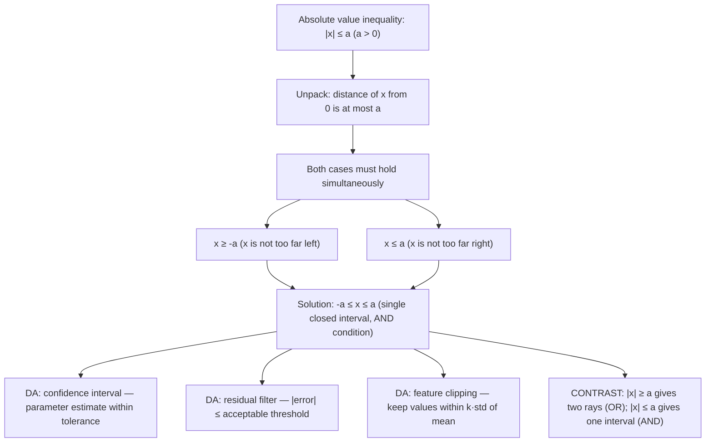

# Boundary condition (upper bound)

$$
|x| \le a \iff -a \le x \le a
$$

(for $a > 0$)

## Deep Breakdown

What it tells me *(Situation Awareness)*:
The upper-bound absolute value inequality $|x| \le a$ (for $a > 0$) means: the distance of $x$ from zero is at most $a$. Equivalently, $x$ lies within the closed interval $[-a, a]$. This is a single connected range, expressed as a compound AND condition: $x \ge -a$ AND $x \le a$. In DA/DS, this appears whenever you want to filter or select values that are close enough to a reference point: confidence intervals ($|\hat{\theta} - \theta| \le \varepsilon$), tolerance bands (accepted residual range), feature clipping (clip values that are within $a$ standard deviations), checking that a metric stays within a service-level threshold, and validating that proportions sum to approximately 1 within floating-point tolerance. The contrast with the lower-bound case $|x| \ge a$ is important: $|x| \le a$ selects the center (within bounds), while $|x| \ge a$ selects the tails (outside bounds).

## Flowchart



## Real-world use

### Where it is used

Confidence interval construction: a 95% CI for a proportion is defined such that $|\hat{p} - p_0| \le z_{\alpha/2} \cdot \text{SE}$, i.e., the estimate falls within $a = z_{\alpha/2} \cdot \text{SE}$ of the null value. Residual acceptance: in forecasting, flag predictions where $|y_i - \hat{y}_i| \le \varepsilon$ for a defined tolerance $\varepsilon$ as "within acceptable error." Feature clipping: clip outliers by replacing values outside $[\mu - k\sigma, \mu + k\sigma]$ — which is $|\frac{x - \mu}{\sigma}| \le k$ — with the boundary values. Floating-point equality checks: `abs(a - b) <= tol` instead of `a == b` is the standard Python pattern for comparing floats.

### Problem it solves

Raw numeric comparisons like `x >= -a and x <= a` work but require two separate conditions. The absolute value form $|x| \le a$ expresses both bounds in one compact expression, making it easier to read, reason about, and translate directly to the mathematical definition of a tolerance or interval. It also makes the connection to distance explicit: the condition is a distance constraint, not an arbitrary double inequality.

### How it solves the problem

$|x| \le a$ means $-a \le x \le a$, derived as follows: since $|x| \ge 0$ and $a > 0$, if $x \ge 0$ then $x \le a$, and if $x < 0$ then $-x \le a$ so $x \ge -a$. Combining: $x \in [-a, a]$. In code: `abs(x) <= a` is exactly `x >= -a and x <= a`. For centering around a mean $\mu$: $|x - \mu| \le a \iff \mu - a \le x \le \mu + a$ — the interval is now centered at $\mu$.

### Example in a business

A data scientist validates that a classifier's predicted probability for each class stays within a plausible range. They require $|p_i - 0.5| \le 0.5$, i.e., $0 \le p_i \le 1$. More practically: after a feature normalization step, they verify that all z-scored features satisfy $|z_i| \le 4$ (values beyond 4 standard deviations are likely data errors). This is $-4 \le z_i \le 4$, a direct application of the upper-bound inequality.

## The formula, piece by piece

Breaking the notation:

- $|x|$: the absolute value of $x$ — the distance of $x$ from zero.
- $\le$: less than or equal to — the distance is within (at most) $a$.
- $a$: the bound — a positive real number defining the maximum allowed distance from zero.
- $\iff$: "if and only if" — both directions hold.
- $-a \le x \le a$: compact notation for the compound condition $x \ge -a$ AND $x \le a$.
- The interval $[-a, a]$: closed interval — endpoints $-a$ and $a$ are included because the inequality is non-strict ($\le$). **Strict version**: $|x| < a \iff -a < x < a$ — open interval, endpoints excluded. **Centering**: for a threshold centered at $\mu$: $|x - \mu| \le a \iff \mu - a \le x \le \mu + a$. **Complementary pair**: $|x| \le a$ and $|x| \ge a$ are complementary on the boundary.

Their strict-inequality interiors are mutually exclusive and exhaustive: $|x| < a$ (inside) and $|x| > a$ (outside) partition the real line (excluding the two boundary points).

## The formula in words

"$|x| \le a$ means: $x$ is within $a$ units of zero in both directions — it sits inside the interval from $-a$ to $a$. In Python: `abs(x) <= a` or equivalently `x >= -a and x <= a`. Think of it as a window or tolerance band: any $x$ inside the band passes, anything outside fails. This is the mathematical definition of a confidence interval, a residual tolerance, or a feature clip bound."

## Critical Concepts

1. **AND condition — single interval**: the solution to $|x| \le a$ is a single closed interval $[-a, a]$. Both conditions must hold simultaneously: $x \ge -a$ AND $x \le a$. Compare with the lower-bound case $|x| \ge a$, which is an OR condition giving two disjoint rays.
2. **Floating-point equality via tolerance**: never use `a == b` for floats; use `abs(a - b) <= tol` with a small tolerance like `1e-9`. This is a direct application of $|a - b| \le \varepsilon$.
3. **Confidence intervals**: a $100(1-\alpha)\%$ confidence interval is centered at the point estimate $\hat{\theta}$ with half-width $w$: $|\hat{\theta} - \theta_0| \le w$. The interval is $[\hat{\theta} - w, \hat{\theta} + w]$.
4. **Feature clipping (winsorization)**: clipping features to $[\mu - k\sigma, \mu + k\sigma]$ is equivalent to enforcing $|z_i| \le k$ for all z-scored values $z_i = (x_i - \mu)/\sigma$.
5. **Non-strict vs. strict**: $|x| \le a$ includes the endpoints (closed interval); $|x| < a$ excludes them (open interval).

In code: `<=` vs. `<`. Choose based on whether boundary values are acceptable.

## Step-by-step calculation (tiny example)

Task: find all values of $x$ satisfying $|2x - 6| \le 4$.

*Step 1: Identify the form*
This is $|u| \le a$ with $u = 2x - 6$ and $a = 4$.

*Step 2: Apply the rule*
$-4 \le 2x - 6 \le 4$.

*Step 3: Solve for x*
Add 6 to all parts: $2 \le 2x \le 10$.
Divide by 2: $1 \le x \le 5$.

*Step 4: Verify the endpoints*
$x = 1$: $|2(1) - 6| = |-4| = 4 \le 4$.
$x = 5$: $|2(5) - 6| = |4| = 4 \le 4$.
$x = 3$ (midpoint): $|2(3) - 6| = |0| = 0 \le 4$.

## Code examples

### Beginner example (Python)

```python
# Upper-bound absolute value inequality: |x| <= a
# Basic: solve |x| <= a
a = 3.0
test_values = [-5.0, -3.0, -2.0, 0.0, 2.0, 3.0, 5.0]
print(f"Condition: |x| <= {a} → {-a} <= x <= {a}")
print(f"{'x':>6} {'|x|':>6} {'|x|<=a':>8}")
for x in test_values:
    print(f"{x:>6.1f} {abs(x):>6.1f} {str(abs(x) <= a):>8}")   # Floating-point equality using tolerance (instead of x == y)
a_float = 0.1 + 0.2
b_float = 0.3
tol = 1e-9
print(f"\nFloat equality: 0.1 + 0.2 == 0.3 → {a_float == b_float}")
print(f"Tolerance check: |{a_float:.17f} - {b_float:.1f}| <= {tol} → {abs(a_float - b_float) <= tol}")   # Feature clipping: enforce |z| <= k_sigma
import numpy as np
np.random.seed(42)
K_SIGMA = 3.0
data = np.array([1.0, 2.5, -1.0, 8.5, 0.3, -7.2, 4.1])
mean = data.mean()
std = data.std(ddof=1)
z_scores = (data - mean) / std
within = np.abs(z_scores) <= K_SIGMA
print(f"\nFeature clipping: |z| <= {K_SIGMA}")
print(f" Mean={mean:.2f}, Std={std:.2f}")
print(f" Bounds: [{mean - K_SIGMA * std:.2f}, {mean + K_SIGMA * std:.2f}]")
for val, z, flag in zip(data, z_scores, within):
    print(f" x={val:5.1f} z={z:+6.2f} within={flag}")
```

### Beginner example (R)

```r
# Upper-bound absolute value inequality: |x| <= a # Basic check
a <- 3.0
test_values <- c(-5, -3, -2, 0, 2, 3, 5)
cat(sprintf("Condition: |x| <= %.1f -> %.1f <= x <= %.1f\n", a, -a, a))
for (x in test_values) { cat(sprintf(" x = %5.1f |x| = %.1f within: %s\n", x, abs(x), abs(x) <= a))
}  # Float tolerance check
a_float <- 0.1 + 0.2
b_float <- 0.3
tol <- 1e-9
cat(sprintf("\n0.1 + 0.2 == 0.3: %s\n", isTRUE(a_float == b_float)))
cat(sprintf("Tolerance check: %s\n", abs(a_float - b_float) <= tol))  # Feature clipping
set.seed(42)
k_sigma <- 3.0
data <- c(1.0, 2.5, -1.0, 8.5, 0.3, -7.2, 4.1)
mu <- mean(data)
sigma <- sd(data)
z_scores <- (data - mu) / sigma
within <- abs(z_scores) <= k_sigma
cat(sprintf("\nFeature clipping: |z| <= %.1f\n", k_sigma))
cat(sprintf(" Bounds: [%.2f, %.2f]\n", mu - k_sigma * sigma, mu + k_sigma * sigma))
for (i in seq_along(data)) { cat(sprintf(" x=%5.1f z=%+6.2f within=%s\n", data[i], z_scores[i], within[i]))
}
```

### Professional example (Python)

```python
import pandas as pd
import numpy as np   # Scenario: feature validation and clipping pipeline
# After normalization, enforce |z| <= K_SIGMA for all numeric features
# Report per-feature violation counts and clip out-of-bound values
np.random.seed(42)
N_ROWS = 500
K_SIGMA = 3.0   # upper bound for z-scores; enforce |z| <= K_SIGMA # Simulate a feature matrix with intentional outliers
feature_data = pd.DataFrame({ "revenue": np.random.normal(50_000, 8_000, N_ROWS), "session_length": np.random.normal(180, 40, N_ROWS), "page_views": np.random.normal(6, 2, N_ROWS),
})   # Inject outliers
feature_data.loc[10, "revenue"] = 200_000
feature_data.loc[42, "session_length"] = -500
feature_data.loc[99, "page_views"] = 80

def clip_to_z_bound( series: pd.Series, k_sigma: float ) -> tuple[pd.Series, dict]:
    """ Clip a numeric series to enforce |z-score| <= k_sigma. Args: series: Input numeric Series. k_sigma: Maximum allowed z-score magnitude. Returns: Tuple of (clipped Series, stats dict with mean, std, bounds, n_clipped). """
    mu = series.mean()
    sigma = series.std(ddof=1)
    lower = mu - k_sigma * sigma
    upper = mu + k_sigma * sigma
    within = series.between(lower, upper)   # equivalent to |z| <= k_sigma
    n_clipped = (~within).sum()
    clipped = series.clip(lower=lower, upper=upper)
    stats = { "mean": mu, "std": sigma, "lower": lower, "upper": upper, "n_clipped": int(n_clipped), }
    return clipped, stats
rows = []
clipped_data = feature_data.copy()
for col in feature_data.columns:
    clipped_series, stats = clip_to_z_bound(feature_data[col], K_SIGMA)
clipped_data[col] = clipped_series
stats["feature"] = col
rows.append(stats)
report = pd.DataFrame(rows)[["feature", "mean", "std", "lower", "upper", "n_clipped"]]
print(f"Feature Clipping Report: |z| <= {K_SIGMA}")
print("=" * 72)
print(report.round(2).to_string(index=False))
print(f"\nTotal values clipped: {report['n_clipped'].sum()}")
```

### Professional example (R)

```r
# Clip features to |z| <= k_sigma
set.seed(42)
K_SIGMA <- 2.5
feature_data <- data.frame( page_views = rnorm(100, 50, 15), session_dur = rnorm(100, 180, 40)
)
feature_data$page_views[100] <- 80
clip_to_z <- function(x, k) { mu <- mean(x); sigma <- sd(x)
  lower <- mu - k * sigma; upper <- mu + k * sigma list(clipped = pmax(pmin(x, upper), lower), n_clipped = sum(x < lower | x > upper), mean = mu, std = sigma, lower = lower, upper = upper)
}
report <- do.call(rbind, lapply(names(feature_data), function(col) { r <- clip_to_z(feature_datacol, K_SIGMA) data.frame(feature = col, mean = r$mean, std = r$std, lower = r$lower, upper = r$upper, n_clipped = r$n_clipped)
}))
cat(sprintf("Feature Clipping: |z| <= %.1f\n", K_SIGMA))
print(report)
cat(sprintf("\nTotal clipped: %d\n", sum(report$n_clipped)))
```

---

*Source: MRAF*
