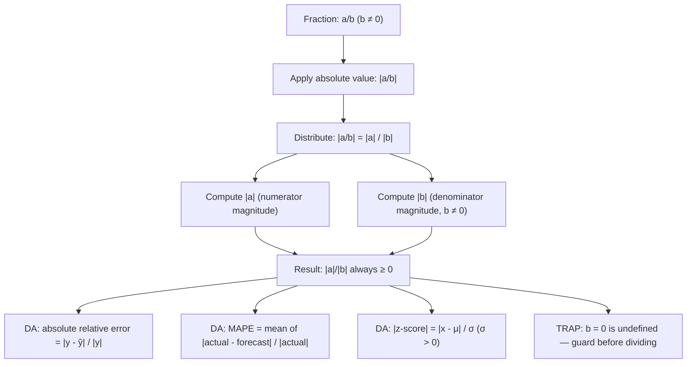

# Division

$$
\left| \frac{a}{b} \right| = \frac{|a|}{|b|}
$$

## Deep Breakdown

What it tells me *(Situation Awareness)*:
The absolute value distributes over division: the absolute value of a quotient equals the quotient of the absolute values. This holds for any $b \ne 0$. In DA/DS, this property is used every time you compute a relative or normalized error metric: absolute relative error is $\left|\frac{y - \hat{y}}{y}\right| = \frac{|y - \hat{y}|}{|y|}$ — absolute numerator divided by absolute denominator. MAPE (Mean Absolute Percentage Error) is built on exactly this. It also appears in z-score interpretation ($|z| = |x - \mu| / \sigma = |(x - \mu)| / \sigma$ when $\sigma > 0$), in computing absolute log-returns, and in any situation where you need the magnitude of a ratio regardless of the signs of the numerator and denominator. The property eliminates case-by-case sign analysis: instead of checking whether $a/b$ is positive or negative, you can just take absolute values of numerator and denominator independently.

## Flowchart



## Real-world use

### Where it is used

Absolute relative error: $\left|\frac{y_i - \hat{y}_i}{y_i}\right| = \frac{|y_i - \hat{y}_i|}{|y_i|}$ — used when you need the error as a fraction of the true value, regardless of whether the prediction over- or under-shoots. MAPE = $\frac{1}{n}\sum_i \frac{|y_i - \hat{y}_i|}{|y_i|}$. Absolute z-score: $|z_i| = \frac{|x_i - \mu|}{\sigma}$ — the number of standard deviations a value lies from the mean, always non-negative. Signal-to-noise ratio magnitude: $|SNR| = \frac{|\mu|}{|\sigma|}$. Absolute log-returns: $\left|\ln\frac{P_t}{P_{t-1}}\right|$.

### Problem it solves

When computing a ratio $a/b$, the sign of the result depends on the signs of both $a$ and $b$. If you only care about the magnitude (how large is the relative deviation, regardless of direction?), you need to apply absolute value to the quotient. Without this property, you would have to enumerate four sign cases: $(+/+)$, $(+/-)$, $(-/+)$, $(-/-)$. The distributive property reduces this to: just take $|a|/|b|$.

### How it solves the problem

$\left|\frac{a}{b}\right| = \frac{|a|}{|b|}$ because the absolute value of a product (or quotient) equals the product (or quotient) of the absolute values: $|a \cdot c| = |a| \cdot |c|$. Applying this to $\frac{a}{b} = a \cdot \frac{1}{b}$: $\left|\frac{a}{b}\right| = |a| \cdot \left|\frac{1}{b}\right| = |a| \cdot \frac{1}{|b|} = \frac{|a|}{|b|}$. The sign of the quotient is discarded; only the magnitudes remain.

### Example in a business

A forecasting analyst computes MAPE for a revenue model. For one period, actual revenue is $-\$2{,}000$ (a loss) and the model predicts $-\$1{,}500$. The signed error is $-2000 - (-1500) = -500$. The relative error is $\frac{-500}{-2000} = 0.25$ — the sign happens to be positive here, but in general the sign could be misleading. Using the absolute relative error: $\frac{|-500|}{|-2000|} = \frac{500}{2000} = 0.25 = 25\%$. The property $\left|\frac{a}{b}\right| = \frac{|a|}{|b|}$ makes the sign handling transparent and automatic.

## The formula, piece by piece

Breaking the notation:

- $\left|\frac{a}{b}\right|$: the absolute value of the quotient $a/b$ — the magnitude of the ratio.
- $a$: the numerator — may be positive, negative, or zero.
- $b$: the denominator — must be nonzero ($b \ne 0$); may be positive or negative.
- $|a|$: the magnitude of the numerator, always $\ge 0$.
- $|b|$: the magnitude of the denominator, always $> 0$ (since $b \ne 0$).
- $\frac{|a|}{|b|}$: the result — always $\ge 0$, equal to the magnitude of the quotient. **When $a = 0$**: $\left|\frac{0}{b}\right| = \frac{0}{|b|} = 0$.

The ratio is zero with zero magnitude. **Connection to absolute value multiplication**: $|a \cdot b| = |a| \cdot |b|$. Division is multiplication by the reciprocal: $\frac{a}{b} = a \cdot b^{-1}$, so $\left|\frac{a}{b}\right| = |a| \cdot |b^{-1}| = |a| \cdot \frac{1}{|b|} = \frac{|a|}{|b|}$. **Absolute relative error formula**: $\text{ARE}_i = \left|\frac{y_i - \hat{y}_i}{y_i}\right| = \frac{|y_i - \hat{y}_i|}{|y_i|}$ — valid when $y_i \ne 0$.

## The formula in words

"The absolute value of a fraction equals the fraction of the absolute values: numerator's magnitude over denominator's magnitude. The sign of neither numerator nor denominator matters — you just strip both signs. In Python: `abs(a / b)` gives the same result as `abs(a) / abs(b)`. This is how MAPE is computed: take the absolute value of (actual minus forecast), then divide by the absolute value of actual, giving the unsigned relative deviation."

## Critical Concepts

1. **Distributes over division (and multiplication)**: $|a/b| = |a|/|b|$ and $|a \cdot b| = |a| \cdot |b|$. Absolute value is multiplicative — it distributes over both multiplication and division, but NOT over addition or subtraction (that's what the triangle inequality is about).
2. **MAPE undefined when actuals are zero**: $\text{ARE}_i = |y_i - \hat{y}_i|/|y_i|$ is undefined when $y_i = 0$. Always check for zero actuals before computing MAPE. Use SMAPE (Symmetric MAPE) or MASE as alternatives when actuals can be zero.
3. **Sign of denominator does not affect magnitude**: $|a / (-b)| = |a| / |-b| = |a| / |b|$. Whether the denominator is positive or negative, the absolute ratio is the same. This eliminates the need for conditional sign logic.
4. **Absolute z-score**: $|z_i| = \frac{|x_i - \mu|}{\sigma}$ is always $\ge 0$ because $\sigma > 0$. This is just $\left|\frac{x_i - \mu}{\sigma}\right| = \frac{|x_i - \mu|}{|\sigma|} = \frac{|x_i - \mu|}{\sigma}$ since $\sigma > 0$.
5. **Order of operations**: in Python, `abs(a / b)` and `abs(a) / abs(b)` give identical results (floating-point rounding aside).

For clean code in error metric pipelines, use `abs(a) / abs(b)` to make it explicit that both numerator and denominator are treated as magnitudes.

## Step-by-step calculation (tiny example)

Task: compute the absolute relative error for a prediction where actual = $-80$ and forecast = $-60$.

*Step 1: Compute the raw error*
$a = y - \hat{y} = -80 - (-60) = -20$.

*Step 2: Compute the absolute values*
$|a| = |-20| = 20$. $|b| = |-80| = 80$.

*Step 3: Apply the formula*
$\left|\frac{-20}{-80}\right| = \frac{|-20|}{|-80|} = \frac{20}{80} = 0.25$.

*Step 4: Verify directly*
$\frac{-20}{-80} = 0.25$. $|0.25| = 0.25$. ✓ Same result.

*Step 5: Interpret*
The prediction is off by 25% of the actual value, regardless of the fact that both values are negative.

## Code examples

### Beginner example (Python)

```python
# |a/b| = |a|/|b| in Python
# Basic verification across all sign combinations
pairs = [ ( 6, 3),   # 6 / 3 = 2.0 → |2.0| = 2.0
    (-6, 3),   # -6 / 3 = -2.0 → |-2.0| = 2.0
    ( 6, -3),   # 6 / -3 = -2.0 → |-2.0| = 2.0
    (-6, -3),   # -6 / -3 = 2.0 → |2.0| = 2.0
    ( 0, 5),   # 0 / 5 = 0.0
]
print(f"{'a':>6} {'b':>6} {'|a/b|':>8} {'|a|/|b|':>10} {'equal':>6}")
for a, b in pairs:
    direct_abs = abs(a / b)
split_abs = abs(a) / abs(b)
print(f"{a:>6} {b:>6} {direct_abs:>8.4f} {split_abs:>10.4f} {str(abs(direct_abs - split_abs) < 1e-12):>6}")   # Absolute relative error for forecasting
actuals = [100.0, -80.0, 50.0, 200.0]
predictions = [ 90.0, -60.0, 55.0, 210.0]
print("\nAbsolute Relative Error = |actual - forecast| / |actual|:")
print(f"{'actual':>8} {'forecast':>10} {'raw_error':>10} {'ARE':>8}")
for y, y_hat in zip(actuals, predictions):
    raw_error = y - y_hat
are = abs(raw_error) / abs(y)   # |a|/|b|
print(f"{y:>8.1f} {y_hat:>10.1f} {raw_error:>10.1f} {are:>8.4f}")
mape = sum(abs(y - y_hat) / abs(y) for y, y_hat in zip(actuals, predictions)) / len(actuals)
print(f"\nMAPE = {mape:.4f} = {mape:.1%}")
```

### Beginner example (R)

```r
# |a/b| = |a|/|b| in R # Basic verification
pairs <- list(c(6, 3), c(-6, 3), c(6, -3), c(-6, -3), c(0, 5))
cat(sprintf("%-6s %-6s %-8s %-10s\n", "a", "b", "|a/b|", "|a|/|b|"))
for (p in pairs) { a <- p[1]; b <- p[2]
  cat(sprintf("%-6.0f %-6.0f %-8.4f %-10.4f\n", a, b, abs(a / b), abs(a) / abs(b)))
}  # Absolute relative error
actuals <- c(100, -80, 50, 200)
predictions <- c( 90, -60, 55, 210)
raw_errors <- actuals - predictions
are <- abs(raw_errors) / abs(actuals)  # |a| / |b|
mape <- mean(are)
cat("\nAbsolute Relative Error:\n")
for (i in seq_along(actuals)) { cat(sprintf(" actual=%6.1f forecast=%6.1f raw=%6.1f ARE=%.4f\n", actuals[i], predictions[i], raw_errors[i], are[i]))
}
cat(sprintf("\nMAPE = %.4f = %.1f%%\n", mape, mape * 100))
```

### Professional example (Python)

```python
import pandas as pd
import numpy as np   # Scenario: forecast evaluation with MAPE and SMAPE
# Demonstrates |a/b| = |a|/|b| in MAPE computation
# Also shows why zero actuals require SMAPE as a fallback
np.random.seed(42)
N_PERIODS = 60
MAPE_UNDEFINED = float("nan")   # sentinel for zero-actual periods

def absolute_relative_error(actual: float, forecast: float) -> float:
    """ Compute absolute relative error for a single period. |actual - forecast| / |actual| — undefined if actual is zero. Args: actual: Observed value. forecast: Predicted value. Returns: Absolute relative error as a float, or nan if actual is zero. """
    if actual == 0:
        return MAPE_UNDEFINED
    return abs(actual - forecast) / abs(actual)   # |a|/|b|

def symmetric_absolute_percentage_error(actual: float, forecast: float) -> float:
    """ Compute SMAPE — handles zero actuals by using average of |actual| and |forecast|. Args: actual: Observed value. forecast: Predicted value. Returns: Symmetric absolute percentage error. """
    denom = (abs(actual) + abs(forecast)) / 2.0
    if denom == 0:
        return 0.0
    return abs(actual - forecast) / denom   # Simulate actuals with a few zero-actual periods
actuals = np.random.normal(1000, 100, N_PERIODS)
actuals[5] = 0.0   # inject zero actual
predictions = actuals * (1 + np.random.normal(0, 0.05, N_PERIODS))
df = pd.DataFrame({"actual": actuals, "forecast": predictions})
df["raw_error"] = df["actual"] - df["forecast"]
df["are"] = df.apply(lambda row: absolute_relative_error(row["actual"], row["forecast"]), axis=1)
df["smape"] = df.apply(lambda row: symmetric_absolute_percentage_error(row["actual"], row["forecast"]), axis=1)
valid_are = df["are"].dropna()
mape = valid_are.mean()
smape = df["smape"].mean()
print("Forecast Evaluation: |a/b| = |a|/|b| (MAPE and SMAPE)")
print("=" * 72)
print(df[["actual", "forecast", "raw_error", "are", "smape"]].round(4).head(10).to_string(index=False))
print(f"\nMAPE (excludes {df['are'].isna().sum()} zero-actual periods): {mape:.4f} = {mape:.2%}")
print(f"SMAPE (includes all periods): {smape:.4f} = {smape:.2%}")
print(f"\nNote: MAPE uses |actual - forecast| / |actual| — undefined when actual = 0.")
print(f" SMAPE uses denominator (|actual| + |forecast|) / 2 — handles zero actuals.")
```

### Professional example (R)

```r
# MAPE and SMAPE using |a/b| = |a|/|b|; handle zero actuals
set.seed(42)
N_PERIODS <- 60
actuals <- rnorm(N_PERIODS, 1000, 100)
actuals[6] <- 0
predictions <- actuals * (1 + rnorm(N_PERIODS, 0, 0.05))
absolute_relative_error <- function(actual, forecast) { if (actual == 0)
  return(NA_real_) abs(actual - forecast) / abs(actual)
}
symmetric_absolute_percentage_error <- function(actual, forecast) { denom <- (abs(actual) + abs(forecast)) / 2
  if (denom == 0)
  return(0) abs(actual - forecast) / denom
}
df <- data.frame(actual = actuals, forecast = predictions)
df$raw_error <- df$actual - df$forecast
df$are <- mapply(absolute_relative_error, df$actual, df$forecast)
df$smape <- mapply(symmetric_absolute_percentage_error, df$actual, df$forecast)
valid_are <- na.omit(df$are)
mape <- mean(valid_are)
smape <- mean(df$smape)
cat("Forecast Evaluation: |a/b| = |a|/|b| (MAPE and SMAPE)\n")
print(head(df[c("actual", "forecast", "raw_error", "are", "smape")], 10))
cat(sprintf("\nMAPE (excludes %d zero-actual periods): %.4f\n", sum(is.na(df$are)), mape))
cat(sprintf("SMAPE (all periods): %.4f\n", smape))
```

---

*Source: MRAF*
