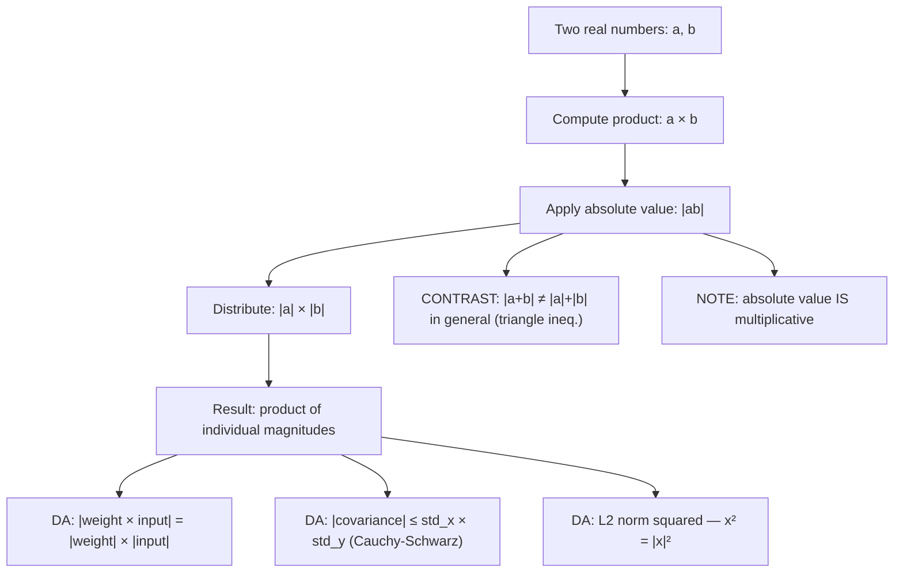

# Multiplication

$$
|ab| = |a||b|
$$

## Deep Breakdown

What it tells me *(Situation Awareness)*:
The absolute value distributes over multiplication: the absolute value of a product equals the product of the absolute values. This holds for any real numbers $a$ and $b$. In DA/DS, this property is used any time you need the magnitude of a product of signed quantities: computing the squared L2 norm as $\|x\|_2^2 = \sum_i x_i^2 = \sum_i |x_i|^2$ (each $x_i^2 = |x_i|^2$), deriving why L2 regularization penalizes large weights multiplicatively, proving that the product of two probability-scaled terms has magnitude equal to the product of their magnitudes, and constructing loss function gradients. Critically: absolute value is multiplicative ($|ab| = |a||b|$) but not additive ($|a+b| \ne |a| + |b|$ in general — that is the triangle inequality's domain). Knowing which operations preserve absolute value and which don't is essential for building correct error analysis.

## Flowchart



## Real-world use

### Where it is used

L2 norm computation: $\|x\|_2 = \sqrt{\sum_i x_i^2} = \sqrt{\sum_i |x_i|^2}$ — each squared term equals the squared absolute value. Gradient analysis: in gradient descent, the update magnitude for a weight $w$ is $|\eta \cdot g| = \eta \cdot |g|$ (learning rate times gradient magnitude), which follows from $|ab| = |a||b|$. Covariance bounding: the Cauchy-Schwarz inequality says $|\text{Cov}(X,Y)| \le \text{Std}(X) \cdot \text{Std}(Y)$, which uses the multiplicative property of absolute value in its derivation. Signal processing: amplitude of a modulated signal $|A \cdot \sin(\omega t)| = |A| \cdot |\sin(\omega t)|$.

### Problem it solves

When a quantity is expressed as a product of signed factors, computing the magnitude of the whole by analyzing each factor's sign separately is cumbersome. The multiplicative property of absolute value collapses this: the magnitude of the product is just the product of the magnitudes, with no case analysis needed. This makes gradient magnitude computations, norm calculations, and product-based error analysis straightforward.

### How it solves the problem

$|ab| = |a||b|$ because: if $a \ge 0$ and $b \ge 0$, $|ab| = ab = |a||b|$. If $a < 0$ and $b > 0$, $|ab| = |-ab| = ab' = |a||b|$ (where the negative signs cancel in the product). Similarly for the other sign combinations. In all four cases, the result is the same: $|a||b|$. The key insight: negatives come in pairs when multiplying, so the magnitude of a product is unaffected by the signs of the individual factors.

### Example in a business

A model has a weight $w = -0.4$ applied to a feature $x = 3.5$. The contribution magnitude is $|w \cdot x| = |-0.4 \cdot 3.5| = |-1.4| = 1.4$. Using the property: $|{-0.4}| \cdot |3.5| = 0.4 \cdot 3.5 = 1.4$. ✓ This is used in SHAP and feature importance analysis: the magnitude of a weight-feature product gives the raw contribution size, independent of direction. Summing $|w_j \cdot x_j|$ over all features gives a sense of total absolute contribution.

## The formula, piece by piece

Breaking the notation:

- $|ab|$: the absolute value of the product of $a$ and $b$.
- $a$: first real number — may be positive, negative, or zero.
- $b$: second real number — may be positive, negative, or zero.
- $|a|$: the magnitude of $a$.
- $|b|$: the magnitude of $b$.
- $|a||b|$: the product of the two magnitudes — the result. **Generalization to $n$ factors**: $|a_1 a_2 \cdots a_n| = |a_1||a_2| \cdots |a_n|$. **Connection to powers**: $|a^n| = |a|^n$ for any integer $n \ge 0$ (and for non-zero $a$, for negative integers too). **Why it fails for addition**: $|a + b| \le |a| + |b|$ (triangle inequality — equality only when $a, b$ have the same sign).

There is no general equality for $|a + b|$, only the upper bound. This contrast is worth memorizing: multiplication is nice; addition requires the triangle inequality. **Relation to squaring**: $a^2 = (a)(a)$, so $|a^2| = |a|^2 = a^2$. Every square is non-negative, as a consequence.

## The formula in words

"The magnitude of a product is the product of the magnitudes. Signs cancel when you multiply — two negatives give a positive, two positives give a positive, one of each gives a negative — but the magnitude doesn't care about signs, just sizes. In Python: `abs(a * b) == abs(a) * abs(b)` is always `True`. This is why $x^2 = |x|^2$, why L2 norm sums squares, and why gradient update magnitudes factor cleanly."

## Critical Concepts

1. **Multiplicative but not additive**: $|ab| = |a||b|$ (equality always), but $|a+b| \le |a| + |b|$ (only an inequality). Confusing these is a common algebra mistake. Absolute value distributes over $\times$ and $\div$ but NOT over $+$ or $-$.
2. **$|a^n| = |a|^n$**: every power of absolute value equals the absolute value of the power (for real $a$ and non-negative integer $n$). Consequence: $|a|^2 = a^2$ — squaring already removes the sign.
3. **Sign analysis shortcut**: instead of tracking which combination of signs produces a positive or negative product, just compute $|a| \cdot |b|$ for the magnitude and determine the sign of $ab$ separately if needed: positive if $a$ and $b$ have the same sign, negative otherwise.
4. **SHAP and feature attribution**: SHAP values decompose model predictions into contributions per feature. The magnitude of a contribution $|\phi_j|$ is the absolute value of the feature's attributed effect. For a linear model: $|\phi_j| = |w_j \cdot x_j| = |w_j| \cdot |x_j|$.
5. **Cauchy-Schwarz consequence**: $|\text{Cov}(X,Y)| \le \text{Std}(X) \cdot \text{Std}(Y)$, which means $|\rho| = \left|\frac{\text{Cov}(X,Y)}{\text{Std}(X)\text{Std}(Y)}\right| \le 1$.

Pearson correlation is bounded in $[-1, 1]$; the upper bound $|\rho| \le 1$ is a direct consequence of the multiplicative property and Cauchy-Schwarz.

## Step-by-step calculation (tiny example)

Task: compute the magnitude of a linear model's weight-feature product for $w = -2.5, x = -4.0$.

*Step 1: Compute the product directly*
$w \cdot x = (-2.5)(-4.0) = 10.0$.
$|w \cdot x| = |10.0| = 10.0$.

*Step 2: Apply the property*
$|w| \cdot |x| = |-2.5| \cdot |-4.0| = 2.5 \cdot 4.0 = 10.0$.

*Step 3: Confirm equality*
$10.0 = 10.0$. ✓

*Step 4: Compare to another sign combination*
$w = 2.5, x = -4.0$: $|w \cdot x| = |{-10.0}| = 10.0$. $|w| \cdot |x| = 2.5 \cdot 4.0 = 10.0$. ✓ Same magnitude regardless of signs.

## Code examples

### Beginner example (Python)

```python
# |ab| = |a||b| in Python
# Basic verification across all sign combinations
pairs = [ ( 3.0, 4.0),   # both positive
    (-3.0, 4.0),   # mixed signs
    ( 3.0, -4.0),   # mixed signs
    (-3.0, -4.0),   # both negative
    ( 0.0, 7.0),   # zero
]
print(f"{'a':>6} {'b':>6} {'|ab|':>8} {'|a|·|b|':>10} {'equal':>6}")
for a, b in pairs:
    left = abs(a * b)
right = abs(a) * abs(b)
print(f"{a:>6.1f} {b:>6.1f} {left:>8.4f} {right:>10.4f} {str(abs(left - right) < 1e-12):>6}")   # Contrast: |a+b| vs |a|+|b| (multiplicative holds; additive does NOT)
a, b = 3.0, -7.0
print(f"\nContrast with addition:")
print(f" |({a}) + ({b})| = {abs(a + b):.1f} ≤ |{a}|+|{b}| = {abs(a) + abs(b):.1f} (triangle inequality — NOT equality)")
print(f" |({a}) × ({b})| = {abs(a * b):.1f} == |{a}|×|{b}| = {abs(a) * abs(b):.1f} (always equality)")   # Weight-feature contribution magnitude (linear model)
weights = [-0.4, 1.2, -0.8, 0.5, -1.0]
features = [ 3.5, 2.1, 5.0, -0.3, 1.8]
print("\nFeature contribution magnitudes: |w_j × x_j| = |w_j| × |x_j|")
for w, x in zip(weights, features):
    contribution_magnitude = abs(w) * abs(x)   # |w||x| = |wx|
print(f" w={w:+5.2f} x={x:+5.2f} |wx|={abs(w * x):.3f} |w||x|={contribution_magnitude:.3f}")
```

### Beginner example (R)

```r
# |ab| = |a||b| in R # Basic verification
pairs <- list(c(3, 4), c(-3, 4), c(3, -4), c(-3, -4), c(0, 7))
cat(sprintf("%-6s %-6s %-8s %-10s\n", "a", "b", "|ab|", "|a|*|b|"))
for (p in pairs) { a <- p[1]; b <- p[2]
  cat(sprintf("%-6.1f %-6.1f %-8.4f %-10.4f\n", a, b, abs(a * b), abs(a) * abs(b)))
}  # Contrast with addition
a <- 3.0; b <- -7.0
cat(sprintf("\nAddition: |%g + %g| = %.1f (NOT equal to |a|+|b| = %.1f)\n", a, b, abs(a + b), abs(a) + abs(b)))
cat(sprintf("Multiplication: |%g × %g| = %.1f (EQUAL to |a|*|b| = %.1f)\n", a, b, abs(a * b), abs(a) * abs(b)))  # Feature contribution magnitudes
weights <- c(-0.4, 1.2, -0.8, 0.5, -1.0)
features <- c( 3.5, 2.1, 5.0, -0.3, 1.8)
cat("\nContribution magnitudes |w_j * x_j|:\n")
for (i in seq_along(weights)) { cat(sprintf(" w=%+5.2f x=%+5.2f |wx|=%.3f\n", weights[i], features[i], abs(weights[i] * features[i])))
}
```

### Professional example (Python)

```python
import numpy as np
import pandas as pd   # Scenario: linear model feature attribution using |w_j * x_j| = |w_j| * |x_j|
# Rank features by absolute contribution magnitude
# Show that |ab| = |a||b| is the foundation of weight-times-feature attribution
np.random.seed(42)
N_SAMPLES = 200
N_FEATURES = 6
feature_names = ["price", "discount_pct", "reviews", "age_days", "category_score", "stock_level"]   # Simulated data and weights
feature_matrix = np.random.randn(N_SAMPLES, N_FEATURES)
true_weights = np.array([-1.5, 0.8, 1.2, -0.3, 2.1, -0.9])

def compute_attribution_report( weights: np.ndarray, feature_matrix: np.ndarray, feature_names: list[str],
) -> pd.DataFrame:
    """ Compute per-feature absolute contribution magnitudes using |w_j * x_j| = |w_j| * |x_j|. Args: weights: 1-D array of model weights, shape (n_features,). feature_matrix: 2-D array of feature values, shape (n_samples, n_features). feature_names: List of feature name strings. Returns: DataFrame with feature, weight, mean_abs_feature, mean_abs_contribution, and rank. """
    abs_weights = np.abs(weights)   # |w_j|
    abs_features = np.abs(feature_matrix)   # |x_ij| for each sample
    abs_contribs = abs_features * abs_weights[np.newaxis, :]   # |w_j| * |x_ij|
    mean_abs_contrib = abs_contribs.mean(axis=0)
    df = pd.DataFrame({ "feature": feature_names, "weight": weights, "abs_weight": abs_weights, "mean_abs_feature": abs_features.mean(axis=0), "mean_abs_contribution": mean_abs_contrib, })
    df["rank"] = df["mean_abs_contribution"].rank(ascending=False).astype(int)
    return df.sort_values("rank")
report = compute_attribution_report(true_weights, feature_matrix, feature_names)
print("Feature Attribution Report: |w_j × x_j| = |w_j| × |x_j|")
print("=" * 72)
print(report.round(4).to_string(index=False))
print(f"\nTop feature by mean absolute contribution: '{report.iloc[0]['feature']}'")
```

### Professional example (R)

```r
# Feature attribution: |w_j * x_j| = |w_j| * |x_j|
set.seed(42)
N_SAMPLES <- 200
N_FEATURES <- 6
feature_names <- c("price", "discount_pct", "reviews", "age_days", "category_score", "stock_level")
X <- matrix(rnorm(N_SAMPLES * N_FEATURES), nrow = N_SAMPLES)
weights <- c(-1.5, 0.8, 1.2, -0.3, 2.1, -0.9)
abs_weights <- abs(weights)
abs_X <- abs(X)
mean_abs_contrib <- colMeans(abs_X * rep(abs_weights, each = nrow(X)))
report <- data.frame(feature = feature_names, weight = weights, mean_abs_contribution = mean_abs_contrib)
report <- report[order(-report$mean_abs_contribution), ]
report$rank <- order(-report$mean_abs_contribution)
cat("Feature Attribution: |w_j × x_j| = |w_j| × |x_j|\n")
print(round(report, 4))
cat(sprintf("\nTop feature: '%s'\n", report$feature[1]))
```

---

*Source: MRAF*
