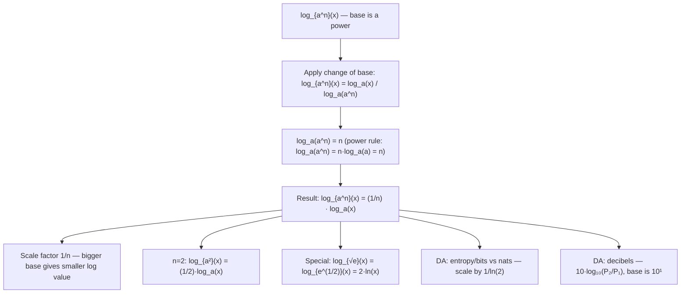

# Base power

$$
\log_{a^n} x = \frac{1}{n} \log_a x
$$

## Deep Breakdown

What it tells me *(Situation Awareness)*:
The base-power rule for logarithms states that if the base is raised to a power $n$, the logarithm is scaled by $1/n$: $\log_{a^n} x = \frac{1}{n} \log_a x$. This is a direct consequence of the change-of-base formula and the power rule for logarithms. Derivation: $\log_{a^n} x = \frac{\log_a x}{\log_a (a^n)} = \frac{\log_a x}{n}$. In DA/DS, this identity is used when working with bases that are themselves powers: interpreting information in nats ($\ln$) vs bits ($\log_2$) involves scaling by $1/\ln 2$ or $1/\log_2 e$; understanding that $\log_{\sqrt{e}} x = 2\ln x$ (since $\sqrt{e} = e^{1/2}$, so $n = 1/2$ and $1/n = 2$); working with base-$10^k$ logarithms in scientific notation or signal processing (decibels use $10\log_{10}$); and recognizing that changing the base is equivalent to scaling the log values, which affects entropy calculations, information gain, and cross-entropy loss scaling.

## Flowchart



## Real-world use

### Where it is used

Entropy base conversion: Shannon entropy in bits uses $\log_2$; in nats uses $\ln$. The relationship: $H_{\text{nats}} = \ln 2 \cdot H_{\text{bits}}$ — or equivalently, $\log_2 x = \frac{\ln x}{\ln 2}$ is the $n = \log_e 2 \approx 0.693$ special case of base change. Interpreting $\log_{10^2} x = \frac{1}{2}\log_{10} x$: a base-100 logarithm gives half the value of base-10. Audio: $\log_{10^{0.1}} x = 10 \log_{10} x$ underlies the decibel scale.

### Problem it solves

When a base is expressed as a power of another base, direct computation is awkward. The identity converts $\log_{a^n}$ to a familiar base $a$ with a simple $1/n$ scaling factor. This is cleaner than applying the full change-of-base formula twice.

### How it solves the problem

Proof via change of base: $\log_{a^n} x = \frac{\ln x}{\ln(a^n)} = \frac{\ln x}{n \ln a} = \frac{1}{n} \cdot \frac{\ln x}{\ln a} = \frac{1}{n} \log_a x$. The key step is $\ln(a^n) = n \ln a$ (the power rule for logarithms). The $1/n$ factor arises because raising the base to the $n$th power "compresses" the scale of the logarithm.

### Example in a business

A data scientist computes cross-entropy loss in nats (base $e$) but the stakeholder report requires bits (base 2). Rather than recomputing, they use the scaling: $\log_2 p = \frac{\ln p}{\ln 2}$. Since $2 = e^{\ln 2}$, this is $\log_{e^{\ln 2}} p = \frac{1}{\ln 2} \ln p$. This is the base-power rule with $n = \ln 2 \approx 0.693$, giving scale factor $1/\ln 2 \approx 1.4427$. Cross-entropy in bits = cross-entropy in nats $\times 1/\ln 2$.

## The formula, piece by piece

Breaking the notation:

- $\log_{a^n} x$: logarithm of $x$ with base $a^n$ — the base is a power.
- $a$: the underlying base ($a > 0$, $a \ne 1$).
- $n$: the exponent of the base ($n \ne 0$).
- $x$: the argument ($x > 0$).
- $\frac{1}{n}$: the scaling factor — logarithm with base $a^n$ is $1/n$ times the logarithm with base $a$.
- $\log_a x$: the logarithm of $x$ in the original base. **Key insight**: the larger the base (larger $n$), the smaller the log value. $\log_{100} x = \frac{1}{2}\log_{10} x$ — every value is halved compared to base 10. **Special cases**:
- $n = 1/2$: $\log_{\sqrt{a}} x = \log_{a^{1/2}} x = 2\log_a x$ — halving the base (square root) doubles the log value.
- $n = 2$: $\log_{a^2} x = \frac{1}{2}\log_a x$.
- $n = \ln 2$: $\log_{e^{\ln 2}} x = \log_2 x = \frac{\ln x}{\ln 2}$ — converting nats to bits. **Inverse relationship**: a bigger exponent $n$ compresses the log values (divides by $n$); a smaller exponent stretches them (multiplies by $1/n > 1$).

## The formula in words

"$\log_{a^n} x$ means: 'use $a^n$ as the base.' Since $\log_a(a^n) = n$, applying change of base gives $\log_{a^n} x = \frac{\log_a x}{n}$. Equivalently: raise the base to the $n$th power and divide the log by $n$. In Python: `math.log(x, a**n) == math.log(x, a) / n` is always `True` (for valid inputs). Use this to convert entropy from one base to another by simple multiplication."

## Critical Concepts

1. **$1/n$ scaling**: the rule is a simple rescaling. A larger base exponent compresses log values; a smaller one stretches them. This is why $\log_2 x$ values are approximately $3.32 \times \log_{10} x$ values ($1/\log_{10} 2 \approx 3.32$).
2. **Nats to bits conversion**: $\log_2 x = \frac{\ln x}{\ln 2}$. This is $\log_{e^{\ln 2}} x = \frac{1}{\ln 2}\ln x$. Scale factor $\approx 1.4427$. This conversion is fundamental in information theory when switching between natural entropy and Shannon entropy.
3. **Decibel scale**: power ratio in decibels = $10 \log_{10}(P_2/P_1)$. Here the base is $10^1$, so $n = 1$ and the $1/n = 1$ factor doesn't add anything — but the $10 \times$ multiplier comes from the convention, not from this identity.
4. **Does not apply to the argument**: $\log_a(x^n) = n \log_a x$ (power rule) is a different identity. The base-power rule applies to the base, not the argument. Confusing these is a common mistake.
5. **Valid for non-integer $n$**: $n$ can be any nonzero real (e.g., $n = \ln 2$, $n = 1/2$, $n = \pi$).

The identity holds as long as $a^n > 0$ and $a^n \ne 1$.

## Step-by-step calculation (tiny example)

Task: evaluate $\log_{100} 1000$ using the base-power rule.

*Step 1: Recognize the base as a power*
$100 = 10^2$. So $\log_{100} x = \log_{10^2} x = \frac{1}{2}\log_{10} x$.

*Step 2: Apply the rule*
$\log_{100} 1000 = \frac{1}{2}\log_{10} 1000 = \frac{1}{2} \times 3 = 1.5$.

*Step 3: Verify directly*
$100^{1.5} = (10^2)^{1.5} = 10^3 = 1000$. ✓

*Step 4: Interpret*
$\log_{100} 1000 = 1.5$ means: to get $1000$ from base $100$, you need the $1.5$th power. $100^{1.5} = 1000$. ✓

## Code examples

### Beginner example (Python)

```python
# Base-power rule: log_{a^n}(x) = (1/n) * log_a(x)
import math


def log_base_power(x: float, a: float, n: float) -> float:
    """Evaluate log_{a^n}(x) using the base-power rule.

    Args:
        x: Argument (x > 0).
        a: Underlying base (a > 0, a != 1).
        n: Exponent of the base (n != 0).

    Returns:
        (1/n) * log_a(x).
    """
    return (1 / n) * math.log(x, a)


# Verify against direct computation using the composite base
test_cases = [
    (1000.0, 10.0, 2.0),  # log_{100}(1000) = 1.5
    (64.0, 2.0, 3.0),  # log_{8}(64) = 2
    (100.0, 10.0, 0.5),  # log_{√10}(100) = 4
    (math.e, math.e, 0.5),  # log_{√e}(e) = 2
]
print(f"{'x':>8} {'a':>5} {'n':>5} {'base=a^n':>10} {'rule':>10} {'direct':>10} {'match':>6}")
for x, a, n in test_cases:
    base = a ** n
    result_rule = log_base_power(x, a, n)
    result_direct = math.log(x, base)
    print(f"{x:>8.4f} {a:>5.2f} {n:>5.2f} {base:>10.4f} {result_rule:>10.6f} {result_direct:>10.6f} {str(abs(result_rule - result_direct) < 1e-10):>6}")

# Entropy base conversion: nats to bits and vice versa
nat_entropy = 1.0  # 1 nat of entropy (example)
bits_entropy = nat_entropy / math.log(2)  # = nat / ln(2) = (1/ln2) * nat
print(f"\nEntropy conversion: 1 nat = {bits_entropy:.6f} bits")
print(f"Scale factor 1/ln(2) = {1/math.log(2):.6f}")
print(f"log_2(x) = ln(x) / ln(2) — base-power rule with a=e, n=ln2≈{math.log(2):.4f}")

# Verify: log_{e^(ln2)}(x) = (1/ln2) * ln(x) = log_2(x)
for x in [2.0, 4.0, 8.0, 16.0]:
    rule = log_base_power(x, math.e, math.log(2))
    direct = math.log2(x)
    print(f" x={x:.0f}: rule={rule:.6f} log2={direct:.6f} match={abs(rule - direct) < 1e-10}")
```

### Beginner example (R)

```r
# Base-power rule in R: log_{a^n}(x) = (1/n) * log_a(x)
log_base_power <- function(x, a, n) {
  # (1/n) * log_a(x)
  (1 / n) * log(x, base = a)
}
test_cases <- list(
  c(1000, 10, 2),  # log_{100}(1000) = 1.5
  c(64, 2, 3),     # log_{8}(64) = 2
  c(100, 10, 0.5)  # log_{√10}(100) = 4
)
cat(sprintf("%-8s %-5s %-5s %-10s %-10s %-10s %s\n", "x", "a", "n", "base=a^n", "rule", "direct", "match"))
for (tc in test_cases) {
  x <- tc[1]; a <- tc[2]; n <- tc[3]
  base <- a^n
  result_rule <- log_base_power(x, a, n)
  result_direct <- log(x, base = base)
  cat(sprintf("%-8.4f %-5.2f %-5.2f %-10.4f %-10.6f %-10.6f %s\n", x, a, n, base, result_rule, result_direct, abs(result_rule - result_direct) < 1e-10))
}

# Nats to bits
ln2 <- log(2)
cat(sprintf("\n1 nat = %.6f bits (scale = 1/ln(2) = %.6f)\n", 1 / ln2, 1 / ln2))
```

### Professional example (Python)

```python
import math
import numpy as np
import pandas as pd

# Scenario: information-theoretic entropy comparison across bases
# Compute entropy H(p) = -sum(p_k * log_{base}(p_k)) for multiple bases
# Show that H in different bases differ by the 1/n scaling factor


def entropy(probs: np.ndarray, base: float) -> float:
    """Compute Shannon entropy in a given base.

    H(p) = -sum_k p_k * log_{base}(p_k)

    Args:
        probs: Probability vector (must sum to 1, all entries > 0).
        base: Logarithm base.

    Returns:
        Entropy value in the specified base.
    """
    assert np.isclose(probs.sum(), 1.0), "probabilities must sum to 1"
    assert (probs > 0).all(), "all probabilities must be positive"
    return -float(np.sum(probs * np.log(probs) / math.log(base)))


# Uniform distribution over k categories — maximum entropy
distributions = {
    "uniform_2": np.array([0.5, 0.5]),
    "uniform_4": np.array([0.25] * 4),
    "uniform_8": np.array([0.125] * 8),
    "skewed_4": np.array([0.7, 0.1, 0.1, 0.1]),
}
BASES = {
    "nats (e)": math.e,
    "bits (2)": 2.0,
    "dits (10)": 10.0,
}
SCALE_TO_NATS = {label: 1.0 / math.log(base) for label, base in BASES.items()}

rows = []
for dist_name, probs in distributions.items():
    row = {"distribution": dist_name, "n_outcomes": len(probs)}
    h_nats = entropy(probs, math.e)
    for base_label, base in BASES.items():
        h_base = entropy(probs, base)
        predicted = h_nats * (1.0 / math.log(base))  # base-power scaling
        row[f"H_{base_label}"] = round(h_base, 6)
        row[f"predicted_{base_label}"] = round(predicted, 6)
    rows.append(row)

report = pd.DataFrame(rows)
print("Entropy across bases — H_base = (1/ln(base)) × H_nats (base-power rule)")
print("=" * 80)
print(report[["distribution", "n_outcomes", "H_nats (e)", "H_bits (2)", "H_dits (10)"]].to_string(index=False))
print(f"\nScale factors: nats→bits = 1/ln(2) ≈ {1/math.log(2):.4f} | nats→dits = 1/ln(10) ≈ {1/math.log(10):.4f}")
```

### Professional example (R)

```r
# Entropy in nats, bits, dits: H_base = (1/ln(base)) * H_nats
probs <- list(uniform = rep(0.25, 4), skewed = c(0.5, 0.3, 0.15, 0.05))
H_nats <- sapply(probs, function(p) -sum(p * log(p)))
H_bits <- H_nats / log(2)
H_dits <- H_nats / log(10)
report <- data.frame(distribution = names(probs), H_nats = H_nats, H_bits = H_bits, H_dits = H_dits)
cat("Entropy across bases: H_base = (1/ln(base)) * H_nats\n")
print(report)
cat(sprintf("nats→bits = 1/ln(2) ≈ %.4f nats→dits = 1/ln(10) ≈ %.4f\n", 1/log(2), 1/log(10)))
```

---

*Source: domain knowledge*
