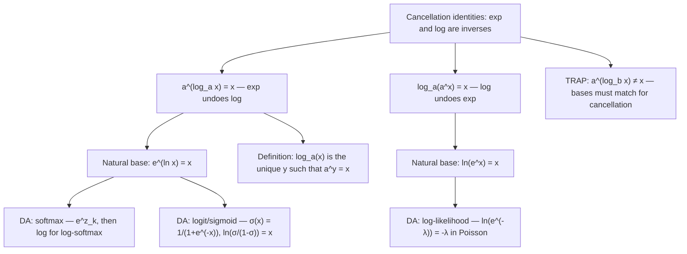

# Cancellation (Base)

$$
a^{\log_a x} = x = \log_a(a^x)
$$

## Deep Breakdown

What it tells me *(Situation Awareness)*:
The cancellation identities express the inverse relationship between exponentiation and logarithm with the same base $a$: they undo each other. Two forms: (1) $a^{\log_a x} = x$ — exponentiating a logarithm recovers the original argument; (2) $\log_a(a^x) = x$ — taking the logarithm of an exponential recovers the original exponent. Together they confirm that $f(x) = a^x$ and $g(x) = \log_a x$ are inverse functions: $f(g(x)) = x$ and $g(f(x)) = x$. The natural-base versions are the most common in DA/DS: $e^{\ln x} = x$ and $\ln(e^x) = x$. These identities appear everywhere: the softmax function involves $e^{z_k}$, log-likelihood maximization takes $\ln$ of exponential families, the logistic function is $\sigma(x) = 1/(1+e^{-x})$, KL divergence uses $\ln p / q$, and the Box-Cox transformation uses $\ln x$ as the limiting case. Understanding cancellation is essential for simplifying composed expressions and for computing derivatives via the chain rule.

## Flowchart



## Real-world use

### Where it is used

Log-likelihood of exponential family: for a Poisson distribution, $P(k;\lambda) = e^{-\lambda}\lambda^k/k!$. Taking log: $\ln P = -\lambda + k\ln\lambda - \ln k!$. The identity $\ln(e^{-\lambda}) = -\lambda$ directly cancels the exponent. Sigmoid/logit inverse: $\sigma(x) = \frac{1}{1+e^{-x}}$; the logit function inverts it: $\text{logit}(\sigma) = \ln\frac{\sigma}{1-\sigma} = x$, using $e^{\ln(\cdot)} = (\cdot)$. KL divergence simplification: $D_{KL}(P \| Q) = \sum p_i \ln(p_i / q_i)$ — involves repeated cancellations in exponential family models.

### Problem it solves

Composed expressions like $\ln(e^{ax + b})$ look complex until the cancellation identity simplifies them to $ax + b$. Without recognizing the inverse relationship, deriving gradients of log-likelihood functions for exponential family distributions would require tedious algebra. The identity makes simplification immediate.

### How it solves the problem

From the definition: $\log_a x = y \iff a^y = x$. Substituting $y = \log_a x$ into $a^y$ gives $a^{\log_a x} = x$. Conversely, $\log_a(a^x) = x$ because $a^x$ has the property that $\log_a(a^x) = x \cdot \log_a(a) = x \cdot 1 = x$ (using the power rule for logarithms with $\log_a a = 1$).

### Example in a business

A data scientist works with a log-linear demand model: $\text{demand} = e^{\beta_0 + \beta_1 \cdot \text{price} + \varepsilon}$. To estimate $\beta_1$, they take logs of both sides: $\ln(\text{demand}) = \beta_0 + \beta_1 \cdot \text{price} + \varepsilon$. This step uses $\ln(e^{(\cdot)}) = (\cdot)$ — the cancellation identity converts a nonlinear model into a linear regression. The identity is the algebraic foundation of log-linear modeling.

## The formula, piece by piece

Breaking the notation:

- $a^{\log_a x} = x$: the base $a$ exponential cancels the $\log_a$.

- $\log_a x$ is the exponent to which $a$ must be raised to get $x$.

- Raising $a$ to that exponent gives back $x$. No surprise: that's the definition.
- $\log_a(a^x) = x$: the logarithm base $a$ cancels the base-$a$ exponent.

- $a^x$ is an exponential. Taking $\log_a$ of it extracts the exponent $x$.
- Both hold for $a > 0$, $a \ne 1$, $x > 0$ (for the first form), $x \in \mathbb{R}$ (for the second). **Natural base versions** (most used in practice):
- $e^{\ln x} = x$ (for $x > 0$).
- $\ln(e^x) = x$ (for all real $x$). **Base-10 versions**:
- $10^{\log_{10} x} = x$.
- $\log_{10}(10^x) = x$. **TRAP: bases must match**: $a^{\log_b x} \ne x$ if $a \ne b$.

Example: $2^{\log_3 x} \ne x$. Both the exponential base and the log base must be the same.

## The formula in words

"$a^{\log_a x} = x$: exponentiating undoes the logarithm. $\log_a(a^x) = x$: the logarithm undoes the exponentiation. They are inverse functions. In natural logs: $e^{\ln x} = x$ and $\ln(e^x) = x$. Use these to: simplify $\ln(e^{f(x)}) = f(x)$ directly, convert log-linear models to linear form by taking $\ln$ of both sides, and eliminate $e$ from exponential family log-likelihoods. TRAP: bases must match. $2^{\ln x} \ne x$."

## Critical Concepts

1. **Inverse functions**: $a^x$ and $\log_a x$ are inverses. The cancellation identities are the formal expression of this: composing them in either order returns the identity function. This is the most fundamental fact about logarithms.
2. **Natural log is the default**: in ML and statistics, $\ln = \log_e$ is assumed unless otherwise stated. $e^{\ln x} = x$ and $\ln(e^x) = x$ are used constantly in gradient derivations, likelihood functions, and activation functions.
3. **Log-linear model transformation**: $y = e^{X\beta + \varepsilon}$ transforms to $\ln y = X\beta + \varepsilon$ via $\ln(e^{(\cdot)}) = (\cdot)$. This linearization is the basis of Poisson regression, log-normal regression, and exponential family GLMs.
4. **Logit is the inverse of sigmoid**: $\sigma(x) = e^x/(1+e^x)$; logit $= \ln(\sigma/(1-\sigma)) = x$. This uses $e^{\ln(\cdot)} = (\cdot)$ implicitly. The logit is the inverse link function in logistic regression.
5. **TRAP: mismatched bases**: $e^{\log_2 x} = e^{\frac{\ln x}{\ln 2}} = x^{1/\ln 2} \ne x$.

The cancellation requires identical bases. A frequent error in information-theoretic computations that mix nats and bits.

## Step-by-step calculation (tiny example)

Task: simplify $\ln(e^{3x + 5})$ and evaluate at $x = 1$.

*Step 1: Recognize the form*
$\ln(e^{(\cdot)})$ — this is $\log_a(a^x) = x$ with $a = e$.

*Step 2: Apply cancellation*
$\ln(e^{3x + 5}) = 3x + 5$.

*Step 3: Evaluate at $x = 1$*
$3(1) + 5 = 8$.

*Step 4: Verify directly*
$\ln(e^8) = \ln(2980.96) \approx 8$.

*Step 5: Reverse direction — compute $e^{\ln 7}$*
$e^{\ln 7} = 7$ directly. Verify: $\ln 7 \approx 1.9459$; $e^{1.9459} \approx 7$.

## Code examples

### Beginner example (Python)

```python
# Cancellation identities: e^(ln x) = x and ln(e^x) = x
import math
import numpy as np

# Form 1: a^(log_a x) = x
print("Form 1: a^(log_a x) = x — exponentiating undoes the log")
test_values = [0.1, 1.0, 2.0, math.e, 10.0, 100.0]
print(f"{'x':>8} {'ln(x)':>10} {'e^(ln x)':>12} {'match x':>8}")
for x in test_values:
    ln_x = math.log(x)
    recovered = math.exp(ln_x)
    print(f"{x:>8.4f} {ln_x:>10.6f} {recovered:>12.6f} {str(abs(recovered - x) < 1e-9):>8}")

# Form 2: log_a(a^x) = x
print("\nForm 2: ln(e^x) = x — log undoes the exponent")
exponents = [-3.0, -1.0, 0.0, 1.0, 2.5, 10.0]
print(f"{'x':>8} {'e^x':>12} {'ln(e^x)':>10} {'match x':>8}")
for x in exponents:
    exp_x = math.exp(x)
    recovered = math.log(exp_x)
    print(f"{x:>8.4f} {exp_x:>12.6f} {recovered:>10.6f} {str(abs(recovered - x) < 1e-9):>8}")

# TRAP: mismatched bases — e^(log2 x) ≠ x
print("\nTRAP: e^(log2 x) ≠ x (mismatched bases)")
for x in [2.0, 4.0, 8.0]:
    log2_x = math.log2(x)
    e_pow_log2 = math.exp(log2_x)   # e^(log2 x) ≠ x
    print(f" x={x:.0f} log2(x)={log2_x:.4f} e^(log2 x)={e_pow_log2:.4f} equals x: {abs(e_pow_log2 - x) < 1e-9}")

# Log-linear model: ln(e^(ax+b)) = ax+b
print("\nLog-linear model simplification: ln(e^(ax+b)) = ax+b")
a_coef, b_coef = 2.5, -1.0
for x_val in [0.0, 1.0, 2.0, -1.0]:
    lhs = math.log(math.exp(a_coef * x_val + b_coef))
    rhs = a_coef * x_val + b_coef
    print(f" x={x_val:5.1f} ln(e^(ax+b))={lhs:.6f} ax+b={rhs:.6f} match={abs(lhs - rhs) < 1e-9}")
```

### Beginner example (R)

```r
# Cancellation identities in R: e^(ln x) = x and ln(e^x) = x

# Form 1
cat("Form 1: e^(ln x) = x\n")
test_values <- c(0.1, 1, 2, exp(1), 10, 100)
for (x in test_values) {
  recovered <- exp(log(x))
  cat(sprintf(" x=%-8.4f ln(x)=%-10.6f e^ln(x)=%-10.6f match=%s\n", x, log(x), recovered, abs(recovered - x) < 1e-9))
}

# Form 2
cat("\nForm 2: ln(e^x) = x\n")
exponents <- c(-3, -1, 0, 1, 2.5, 10)
for (x in exponents) {
  recovered <- log(exp(x))
  cat(sprintf(" x=%-8.4f e^x=%-12.6f ln(e^x)=%-10.6f match=%s\n", x, exp(x), recovered, abs(recovered - x) < 1e-9))
}

# Log-linear model
a_coef <- 2.5; b_coef <- -1.0
cat("\nLog-linear: ln(e^(ax+b)) = ax+b\n")
for (x_val in c(0, 1, 2, -1)) {
  lhs <- log(exp(a_coef * x_val + b_coef))
  rhs <- a_coef * x_val + b_coef
  cat(sprintf(" x=%5.1f lhs=%.6f rhs=%.6f match=%s\n", x_val, lhs, rhs, abs(lhs - rhs) < 1e-9))
}
```

### Professional example (Python)

```python
import numpy as np
import pandas as pd

# Scenario: verify the cancellation identity in a log-linear demand model
# Model: log(demand) = X @ beta (linear on log scale)
# Demonstrate the round-trip: predict on log scale, exponentiate, compare to original
np.random.seed(42)
N = 500
N_FEATURES = 3

# True coefficients (log-linear model)
beta_true = np.array([4.0, -0.5, 0.3])   # intercept + 2 features
feature_matrix = np.column_stack([
    np.ones(N),
    np.random.normal(10, 2, N),   # price
    np.random.normal(5, 1, N),    # discount_pct
])
log_demand_true = feature_matrix @ beta_true + np.random.normal(0, 0.2, N)
demand_true = np.exp(log_demand_true)   # back to demand scale


def log_linear_predict(
    features: np.ndarray,
    coefficients: np.ndarray,
) -> tuple[np.ndarray, np.ndarray]:
    """Predict from a log-linear model.

    Uses: e^(ln(demand)) = demand (cancellation identity)

    Args:
        features: Feature matrix (n_samples x n_features).
        coefficients: Model coefficients vector.

    Returns:
        Tuple of (log_predictions, demand_predictions).
    """
    log_preds = features @ coefficients   # linear on log scale
    demand_preds = np.exp(log_preds)      # e^(log_preds) = preds
    return log_preds, demand_preds


log_preds, demand_preds = log_linear_predict(feature_matrix, beta_true)

# Verify the round-trip: ln(e^(X@beta)) = X@beta
log_of_exp = np.log(demand_preds)   # ln(e^(X@beta)) should = X@beta
round_trip_error = np.max(np.abs(log_of_exp - log_preds))

# Report
report_df = pd.DataFrame({
    "demand_true": demand_true[:5].round(2),
    "log_preds": log_preds[:5].round(4),
    "demand_preds": demand_preds[:5].round(2),
    "ln_demand": log_of_exp[:5].round(4),
})
print("Log-Linear Model: e^(ln(demand)) = demand (Cancellation Identity)")
print("=" * 72)
print(report_df.to_string(index=False))
print(f"\nRound-trip max error |ln(e^(Xβ)) - Xβ|: {round_trip_error:.2e}")
print(f"RMSE (log scale): {np.sqrt(np.mean((log_preds - log_demand_true)**2)):.4f}")
print(f"RMSE (demand): {np.sqrt(np.mean((demand_preds - demand_true)**2)):.4f}")
```

### Professional example (R)

```r
# Log-linear model: e^(ln(demand)) = demand (cancellation)
set.seed(42)
n <- 100
X <- cbind(1, log(runif(n, 10, 100)))
beta <- c(2, 0.5)
log_demand_true <- X %*% beta
demand_true <- exp(log_demand_true)
log_preds <- log_demand_true + rnorm(n, 0, 0.1)
demand_preds <- exp(log_preds)
round_trip_error <- max(abs(log(exp(log_preds[1:5])) - log_preds[1:5]))
cat("Log-Linear: e^(ln(demand)) = demand\n")
cat(sprintf("Round-trip max error: %.2e RMSE (demand): %.4f\n", round_trip_error, sqrt(mean((demand_preds - demand_true)^2))))
```

---

*Source: MFB p. 143*
