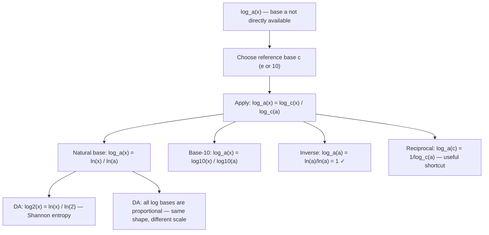

# Change of Base

$$
\log_a x = \frac{\log_c x}{\log_c a}
$$

## Deep Breakdown

What it tells me *(Situation Awareness)*:
The change-of-base formula converts a logarithm in any base $a$ into a ratio of logarithms in a convenient reference base $c$ (typically $e$ or $10$, since calculators and programming languages provide $\ln$ and $\log_{10}$ natively). Formula: $\log_a x = \frac{\log_c x}{\log_c a}$. The most common forms: $\log_a x = \frac{\ln x}{\ln a}$ and $\log_a x = \frac{\log_{10} x}{\log_{10} a}$. In DA/DS, this identity is used constantly: `numpy` and Python's `math` provide `log(x)` (natural) and `log10(x)` (base 10), so any other base requires change of base; information theory uses $\log_2$ (bits), but Python computes it as `log(x) / log(2)` via `math.log2`; decision tree impurity (Gini/entropy) uses $\log_2$ internally; cross-entropy loss is defined in nats with $\ln$ but reported in bits by dividing by $\ln 2$. The formula also establishes that all logarithms are proportional to each other: $\log_a x = \frac{1}{\log_c a} \cdot \log_c x$ — a fixed scaling of $\log_c x$.

## Flowchart



## Real-world use

### Where it is used

Shannon entropy in bits: $H(p) = -\sum p_k \log_2 p_k = -\sum p_k \frac{\ln p_k}{\ln 2} = \frac{H_{\text{nats}}}{\ln 2}$. Python `math.log2(x)` is exactly `log(x) / log(2)`. Mutual information in sklearn uses $\log_2$, computed as `np.log(x) / np.log(2)`. Any base-$b$ logarithm needed in a computation: `math.log(x, b)` in Python implements $\frac{\ln x}{\ln b}$ internally. Comparing log scales: $\log_2 x$ and $\log_{10} x$ are proportional; their ratio is constant $\log_2 x / \log_{10} x = \log_{10} 2 \approx 3.32$ for all $x$.

### Problem it solves

Software and hardware natively compute $\ln$ and $\log_{10}$. Computing $\log_2 x$ directly requires change of base. Without the formula, computing entropy, information gain, or any $\log_2$-based metric would require a separate lookup or hard-coded constant. The formula turns any base into a one-line computation.

### How it solves the problem

Derivation: let $y = \log_a x$, so $a^y = x$. Taking $\log_c$ of both sides: $\log_c(a^y) = \log_c x \Rightarrow y \log_c a = \log_c x \Rightarrow y = \frac{\log_c x}{\log_c a}$. Since $y = \log_a x$, the result follows. The key step is $\log_c(a^y) = y \log_c a$ — the power rule for logarithms.

### Example in a business

A data scientist computes decision tree entropy in bits using numpy:

```python
import numpy as np
probs = np.array([0.7, 0.2, 0.1])
entropy_bits = -np.sum(probs * np.log(probs) / np.log(2))   # change of base
#
Equivalent: entropy_bits = -np.sum(probs * np.log2(probs))
```

Every call to `log2` in numpy is `log(x) / log(2)` — the change-of-base formula applied silently.

## The formula, piece by piece

Breaking the notation:

- $\log_a x$: the target logarithm — base $a$, argument $x$.
- $\log_c x$: the reference logarithm — base $c$ (typically $e$ or $10$).
- $\log_c a$: the reference logarithm of the original base $a$.
- $\frac{\log_c x}{\log_c a}$: the quotient — scales the reference log to give the target log. **Most common forms**:
- $\log_a x = \frac{\ln x}{\ln a}$ (use with `math.log(x) / math.log(a)`).
- $\log_a x = \frac{\log_{10} x}{\log_{10} a}$ (use with `math.log10(x) / math.log10(a)`). **Reciprocal identity** (derived from change of base): $\log_a c = \frac{1}{\log_c a}$.

This means the logarithms in opposite directions are reciprocals. **Proportionality**: all logarithms are proportional to each other. $\log_a x = \frac{1}{\ln a} \cdot \ln x$ — the factor $1/\ln a$ is a constant for fixed $a$. **Self-check**: $\log_a a = \frac{\ln a}{\ln a} = 1$ ✓. $\log_a 1 = \frac{\ln 1}{\ln a} = \frac{0}{\ln a} = 0$ ✓.

## The formula in words

"$\log_a x$ equals $\log_c x$ divided by $\log_c a$ — you can use any convenient reference base $c$ in the numerator and denominator, and they cancel out to give the original base-$a$ logarithm. In Python: `math.log(x) / math.log(a)` computes $\log_a x$ using natural logs. Or use `math.log(x, a)` which does this internally. All log bases are the same function up to a constant scaling factor."

## Critical Concepts

1. **Universal in computing**: every call to `math.log(x, b)`, `numpy.log2(x)`, or any non-natural/non-base-10 log in Python uses change of base internally. It is the operational definition of arbitrary-base logarithms in software.
2. **Proportionality of logs**: $\log_a x = \frac{1}{\ln a} \cdot \ln x$. This means all log functions are the same shape (monotone, concave) and differ only by a positive scaling constant. Comparing information in bits vs nats is multiplying by a constant.
3. **Reciprocal identity**: $\log_a c = \frac{1}{\log_c a}$. Useful shortcut: $\log_2 e = \frac{1}{\ln 2} \approx 1.4427$ and $\ln 2 = \frac{1}{\log_2 e} \approx 0.6931$.
4. **Bits vs nats conversion**: $\log_2 x = \frac{\ln x}{\ln 2}$. Scale factor $1/\ln 2 \approx 1.4427$. Cross-entropy loss in nats $\times 1.4427$ = cross-entropy in bits. This is the most used instance of change of base in ML.
5. **Undefined when $a = c$**: if $a = c$, then $\log_c a = 1$ and the formula reduces to $\log_a x = \log_c x / 1 = \log_c x$ — trivially consistent.

## Step-by-step calculation (tiny example)

Task: compute $\log_8 512$ using the change-of-base formula with natural logs.

*Step 1: Identify the values*
$a = 8$, $x = 512$, reference base $c = e$ (natural log).

*Step 2: Apply the formula*
$\log_8 512 = \frac{\ln 512}{\ln 8}$.

*Step 3: Compute*
$\ln 512 = \ln(2^9) = 9\ln 2 \approx 9 \times 0.6931 = 6.238$. $\ln 8 = \ln(2^3) = 3\ln 2 \approx 2.079$.
$\log_8 512 = 6.238 / 2.079 = 3$.

*Step 4: Verify*
$8^3 = 512$. ✓

*Step 5: Quick check using base 2*
$\log_8 512 = \frac{\log_2 512}{\log_2 8} = \frac{9}{3} = 3$. ✓

## Code examples

### Beginner example (Python)

```python
# Change of base: log_a(x) =
log_c(x) / log_c(a)
import math

def log_any_base(x: float, a: float) -> float:
    """ Compute log_a(x) using natural log via change of base. Args: x: Argument (x > 0). a: Base (a > 0, a != 1). Returns: log_a(x) = ln(x) / ln(a). """
    return math.log(x) / math.log(a)   # Verify against Python's built-in
math.log(x, base)
test_cases = [ (512.0, 8.0),   # log_8(512) = 3
    (100.0, 10.0),   # log_10(100) = 2
    (32.0, 2.0),   # log_2(32) = 5
    (27.0, 3.0),   # log_3(27) = 3
    (math.e, math.e),   # log_e(e) = 1
]
print("Change of base: log_a(x) = ln(x) / ln(a)")
print(f"{'x':>8} {'a':>5} {'formula':>12} {'built-in':>12} {'match':>6}")
for x, a in test_cases:
    formula = log_any_base(x, a)
built_in = math.log(x, a)
print(f"{x:>8.4f} {a:>5.2f} {formula:>12.8f} {built_in:>12.8f} {str(abs(formula - built_in) < 1e-10):>6}")   # Shannon entropy in bits using change of base
import numpy as np
probs = np.array([0.4, 0.3, 0.2, 0.1])
log2_probs = np.log(probs) / np.log(2)   # change of base:
ln(x)/ln(2)
log2_direct = np.log2(probs)   # built-in
entropy_bits = -np.sum(probs * log2_probs)
print(f"\nShannon entropy: H = -{', '.join(f'{p:.1f}' for p in probs)} dist")
print(f" log2 via change of base: {log2_probs.round(4)}")
print(f" log2 direct: {log2_direct.round(4)}")
print(f" Entropy (bits): {entropy_bits:.6f}")
print(f" Entropy (nats): {-np.sum(probs * np.log(probs)):.6f}")
print(f" Conversion check: nats × (1/ln2) = bits: {-np.sum(probs * np.log(probs)) / np.log(2):.6f}")   # Reciprocal identity: log_a(c) = 1 /
log_c(a)
print(f"\nReciprocal identity: log_a(c) = 1 / log_c(a)")
for a, c in [(2.0, 10.0), (math.e, 2.0), (10.0, math.e)]:
    forward = log_any_base(c, a)
recipro = 1.0 / log_any_base(a, c)
print(f" a={a:.4f} c={c:.4f} log_a(c)={forward:.6f} 1/log_c(a)={recipro:.6f} match={abs(forward - recipro) < 1e-10}")
```

### Beginner example (R)

```r
# Change of base in R: log_a(x) = log(x) / log(a)
log_any_base <- function(x, a) log(x) / log(a)
test_cases <- list(c(512, 8), c(100, 10), c(32, 2), c(27, 3))
cat(sprintf("%-8s %-5s %-12s %-12s %s\n", "x", "a", "formula", "built-in", "match"))
for (tc in test_cases) { x <- tc[1]; a <- tc[2]
  formula <- log_any_base(x, a)
  built_in <- log(x, base = a)
  cat(sprintf("%-8.4f %-5.2f %-12.8f %-12.8f %s\n", x, a, formula, built_in, abs(formula - built_in) < 1e-10))
}  # Entropy in bits
probs <- c(0.4, 0.3, 0.2, 0.1)
log2_probs <- log(probs) / log(2)  # change of base
entropy_bits <- -sum(probs * log2_probs)
cat(sprintf("\nShannon entropy (bits): %.6f\n", entropy_bits))  # Reciprocal identity
cat("\nReciprocal identity:\n")
for (pair in list(c(2, 10), c(exp(1), 2))) { a <- pair[1]; c_val <- pair[2]
  cat(sprintf(" log_%.4f(%.4f) = %.6f 1/log_%.4f(%.4f) = %.6f match=%s\n", a, c_val, log_any_base(c_val, a), c_val, a, 1/log_any_base(a, c_val), abs(log_any_base(c_val, a) - 1/log_any_base(a, c_val)) < 1e-10))
}
```

### Professional example (Python)

```python
import numpy as np
import pandas as pd
import math   # Scenario: compute decision-tree entropy and information gain using log_2
# via change of base, then validate conversion to nats and compare

def entropy_bits(probs: np.ndarray) -> float:
    """ Shannon entropy in bits: H = -sum p_k * log2(p_k). Uses change of base: log2(x) = ln(x) / ln(2). Args: probs: Probability vector (must sum to 1, entries > 0). Returns: Entropy in bits. """
    safe_probs = probs[probs > 0]
    return -float(np.sum(safe_probs * np.log(safe_probs) / math.log(2)))

def information_gain_bits( parent_probs: np.ndarray, splits: list[np.ndarray], split_weights: np.ndarray,
) -> float:
    """ Compute information gain (reduction in entropy) from a binary split. IG = H(parent) - sum_i w_i * H(child_i) Args: parent_probs: Class distribution of parent node. splits: List of class distributions for each child. split_weights: Fraction of samples in each child (sum to 1). Returns: Information gain in bits. """
    h_parent = entropy_bits(parent_probs)
    h_weighted = float(np.sum([w * entropy_bits(p) for w, p in zip(split_weights, splits)]))
    return h_parent - h_weighted   # Simulate a dataset split
parent = np.array([0.5, 0.5])   # 50% class 0, 50% class 1
child_left = np.array([0.8, 0.2])   # mostly class 0
child_right = np.array([0.2, 0.8])   # mostly class 1
weights = np.array([0.5, 0.5])   # equal split
h_parent_bits = entropy_bits(parent)
h_parent_nats = -float(np.sum(parent * np.log(parent)))
ig_bits = information_gain_bits(parent, [child_left, child_right], weights)   # Verify: nats * (1/ln2) = bits
scale_nats_to_bits = 1.0 / math.log(2)
report = pd.DataFrame({ "node": ["parent", "child_left", "child_right"], "H_bits": [entropy_bits(p) for p in [parent, child_left, child_right]], "H_nats": [-float(np.sum(p[p>0] * np.log(p[p>0]))) for p in [parent, child_left, child_right]], "scale_check": [entropy_bits(p) / (-float(np.sum(p[p>0] * np.log(p[p>0])))) for p in [parent, child_left, child_right]],
})
print("Decision Tree Entropy via Change of Base: log2(x) = ln(x)/ln(2)")
print("=" * 72)
print(report.to_string(index=False))
print(f"\nInformation gain (bits): {ig_bits:.6f}")
print(f"Scale factor (1/ln2): {scale_nats_to_bits:.6f}")
print(f"Expected scale_check ≈ 1/ln(2) = {scale_nats_to_bits:.6f}")
print(f"All scale_check values match: {(abs(report['scale_check'] - scale_nats_to_bits) < 1e-9).all()}")
```

### Professional example (R)

```r
# Entropy in nats vs bits: log2(x) = ln(x)/ln(2)
probs <- list(c(0.5, 0.5), c(0.25, 0.75), c(0.1, 0.9))
scale_nats_to_bits <- 1 / log(2)
report <- do.call(rbind, lapply(probs, function(p) { p <- p[p > 0] H_nats <- -sum(p * log(p)) H_bits <- -sum(p * log(p) / log(2)) data.frame(H_nats = H_nats, H_bits = H_bits, scale_check = H_bits / H_nats)
}))
cat("Change of base: log2(x) = ln(x)/ln(2)\n")
print(report)
cat(sprintf("Scale 1/ln(2) = %.6f\n", scale_nats_to_bits))
```

---

*Source: 1300 p. 20*
