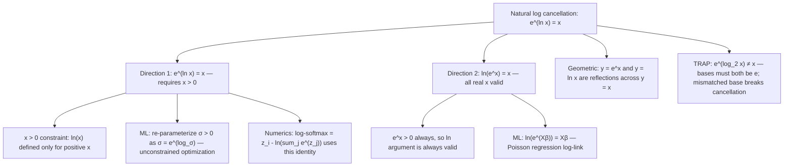

# Natural Log Cancellation

$$
e^{\ln x} = x
$$

## Deep Breakdown

What it tells me *(Situation Awareness)*:
This is the natural-base specialization of the cancellation identity: $e^{\ln x} = x$ for $x > 0$, and its symmetric counterpart $\ln(e^x) = x$ for all real $x$. These two statements say that $e^{(\cdot)}$ and $\ln(\cdot)$ are exact inverses of each other. In the context of DA/DS and ML, the natural log $\ln$ is the default logarithm because $e$ is the base of the exponential distribution, the Gaussian, and exponential family distributions generally. The identity $e^{\ln x} = x$ is used constantly in: (1) simplifying expressions in log-likelihood functions for normal and exponential distributions; (2) the softmax function $\text{softmax}(z_i) = e^{z_i}/\sum_j e^{z_j}$ and its numerically stable form involving $\ln$; (3) the parameterization of strictly positive quantities (e.g., $\sigma = e^{\ln \sigma}$ so optimizing over $\ln \sigma$ avoids the $\sigma > 0$ constraint); (4) the exponential distribution survival function $S(t) = e^{-\lambda t} = e^{t \ln e^{-\lambda}} = e^{-\lambda t}$ (circular but useful for manipulation); and (5) computing gradients of log-normal and Poisson likelihoods. The key operational difference from the general cancellation: $e^{\ln x} = x$ requires $x > 0$ (since $\ln x$ is undefined for $x \le 0$), while $\ln(e^x) = x$ works for all real $x$ (since $e^x > 0$ always, so the argument to $\ln$ is always valid).

## Flowchart



## Real-world use

### Where it is used

Softmax and log-softmax: in classification, the numerically stable log-softmax is $\text{LSM}(z)_i = z_i - \ln\!\bigl(\sum_j e^{z_j}\bigr)$. To recover probabilities from log-softmax values: $\exp(\text{LSM}(z)_i) = e^{z_i - \ln(\sum_j e^{z_j})} = e^{z_i} / \sum_j e^{z_j}$ — directly applying $e^{x - c} = e^x / e^c$ and $e^{\ln(\cdot)} = (\cdot)$. Unconstrained optimization of positive parameters: instead of constraining $\sigma > 0$, re-parameterize as $\sigma = e^\alpha$ and optimize over $\alpha \in \mathbb{R}$. At the optimum, $\hat{\sigma} = e^{\hat{\alpha}}$, using $e^{\ln x} = x$ in reverse.

### Problem it solves

Expressions involving $e^{f(x)}$ inside a logarithm (or vice versa) look complex until the identity removes the composed function entirely. For example: the log-likelihood of the exponential distribution is $\ln f(t; \lambda) = \ln(\lambda e^{-\lambda t}) = \ln \lambda + \ln(e^{-\lambda t}) = \ln \lambda - \lambda t$ — the second step uses $\ln(e^{-\lambda t}) = -\lambda t$ directly.

### How it solves the problem

From the definition: $\ln x = y \iff e^y = x$. Substituting $y = \ln x$ into $e^y$ gives $e^{\ln x} = x$ by definition. The symmetric direction: $\ln(e^x)$ — since $\ln$ is the inverse of $e^{(\cdot)}$, applying $\ln$ to $e^x$ recovers the exponent $x$. Both are just the statement that inverse functions composed in either order return the identity.

### Example in a business

A data scientist is implementing a Poisson regression model. The model is $\ln(\mu_i) = \mathbf{x}_i^T\boldsymbol{\beta}$, or equivalently $\mu_i = e^{\mathbf{x}_i^T\boldsymbol{\beta}}$. During gradient computation, they need $\partial \mu_i / \partial \boldsymbol{\beta} = e^{\mathbf{x}_i^T\boldsymbol{\beta}} \cdot \mathbf{x}_i = \mu_i \mathbf{x}_i$. The cancellation $e^{\ln(\mu_i)} = \mu_i$ is used to substitute $\mu_i$ back in, simplifying the Newton-Raphson update without needing to expand the exponential explicitly.

## The formula, piece by piece

Breaking the notation:

- $e$: Euler's number, $\approx 2.71828$. The base of the natural logarithm and the exponential function.
- $\ln x$: natural logarithm of $x$; the exponent to which $e$ must be raised to get $x$. Requires $x > 0$.
- $e^{\ln x}$: "raise $e$ to the power $\ln x$." Since $\ln x$ is the exponent of $e$ that gives $x$, raising $e$ to that exponent gives back $x$ exactly.
- $= x$: the result. The composed operation is the identity function. **Two directions**:
- $e^{\ln x} = x$ for $x > 0$: exponentiating a natural log recovers the argument.
- $\ln(e^x) = x$ for all real $x$: taking the natural log of $e^x$ recovers the exponent. **Asymmetry in domain**:
- Direction 1 requires $x > 0$ (can't take $\ln$ of non-positive numbers).
- Direction 2 has no restriction on $x$ (since $e^x > 0$ for all real $x$, $\ln(e^x)$ is always defined). **TRAP: base must be $e$**: $e^{\log_2 x} \ne x$.

Since $\log_2 x = \ln x / \ln 2$, we get $e^{\log_2 x} = e^{\ln x / \ln 2} = x^{1/\ln 2} \approx x^{1.4427} \ne x$. The cancellation only works when the exponential base and the logarithm base are the same.

## The formula in words

"$e^{\ln x} = x$: raising $e$ to the natural log of $x$ gives back $x$. The natural log and the exponential with base $e$ are exact inverses. $\ln(e^x) = x$: the natural log of $e$ to the $x$ gives back $x$. Use these to: strip $\ln$ from an expression by exponentiating both sides; strip $e^{(\cdot)}$ by taking $\ln$ of both sides; simplify $\ln(e^{f(x)}) = f(x)$ directly; re-parameterize positive quantities. TRAP: mismatched bases break the identity."

## Critical Concepts

1. **Mutual inverse functions**: $f(x) = e^x$ and $g(x) = \ln x$ satisfy $f(g(x)) = x$ and $g(f(x)) = x$. Their graphs are mirror images across $y = x$. This is the deepest geometric fact about logarithms and exponentials.
2. **Asymmetric domains**: $e^{\ln x} = x$ needs $x > 0$; $\ln(e^x) = x$ works for all real $x$. In ML, parameters that must be positive (variance, scale, rate) are often re-parameterized as $e^{(\cdot)}$ and then recovered via this identity.
3. **Log-likelihood simplification**: exponential family distributions have likelihood functions of the form $e^{T(x)\eta - A(\eta)}$. Taking $\ln$ uses $\ln(e^{f}) = f$ directly, converting the likelihood to a linear function of the natural parameter $\eta$.
4. **Numerically stable softmax**: computing $e^{z_i}/\sum_j e^{z_j}$ directly overflows for large $z$. The stable form subtracts $c = \max(z)$: $e^{z_i - c} / \sum_j e^{z_j - c}$, valid because $e^{z_i - c} = e^{z_i}/e^c$ and the $e^c$ cancels. The identity $e^{\ln(\cdot)} = (\cdot)$ underpins the equivalence.
5. **TRAP: $\ln(e^x) = x$ does not mean $\ln$ and $e^{(\cdot)}$ commute with all operations**: $\ln(e^x + e^y) \ne x + y$.

The cancellation only applies when $e^{(\cdot)}$ is the *entire* argument to $\ln$, or $\ln(\cdot)$ is the *entire* exponent.

## Step-by-step calculation (tiny example)

Task: simplify $\ln(\lambda e^{-\lambda t})$ for the exponential distribution likelihood.

*Step 1: Expand using the product rule for logs*
$\ln(\lambda e^{-\lambda t}) = \ln(\lambda) + \ln(e^{-\lambda t})$.

*Step 2: Apply $\ln(e^x) = x$ to the second term*
$\ln(e^{-\lambda t}) = -\lambda t$.

*Step 3: Final result*
$\ln(\lambda e^{-\lambda t}) = \ln \lambda - \lambda t$.

*Step 4: Verify at $\lambda = 2$, $t = 0.5$*
Direct: $\ln(2 \cdot e^{-1}) = \ln(2/e) = \ln 2 - 1 \approx 0.6931 - 1 = -0.3069$.
Formula: $\ln 2 - 2(0.5) = 0.6931 - 1 = -0.3069$. ✓

*Step 5: Reverse — reconstruct from log space*
If $\ln(\mu) = 1.5$, then $\mu = e^{1.5} \approx 4.4817$. Verify: $\ln(4.4817) \approx 1.5$. ✓

## Code examples

### Beginner example (Python)

```python
# Natural log cancellation: e^(ln x) = x and ln(e^x) = x
import math
import numpy as np

# Direction 1: e^(ln x) = x (requires x > 0)
print("Direction 1: e^(ln x) = x")
test_vals = [0.1, 1.0, math.e, 5.0, 100.0, 1e-4]
print(f"{'x':>10} {'ln(x)':>10} {'e^(ln x)':>12} {'matches x':>10}")
for x in test_vals:
    ln_x = math.log(x)
    recovered = math.exp(ln_x)
    print(f"{x:>10.6f} {ln_x:>10.6f} {recovered:>12.6f} {str(abs(recovered - x) < 1e-9):>10}")

# Direction 2: ln(e^x) = x (all real x)
print("\nDirection 2: ln(e^x) = x")
exponents = [-5.0, -1.0, 0.0, 0.5, 1.0, 3.0, 10.0]
print(f"{'x':>8} {'e^x':>14} {'ln(e^x)':>10} {'matches x':>10}")
for x in exponents:
    exp_x = math.exp(x)
    recovered = math.log(exp_x)
    print(f"{x:>8.2f} {exp_x:>14.6f} {recovered:>10.6f} {str(abs(recovered - x) < 1e-9):>10}")

# Exponential distribution log-likelihood simplification
# f(t; lambda) = lambda * e^(-lambda*t)
# ln f = ln(lambda) + ln(e^(-lambda*t)) = ln(lambda) - lambda*t
print("\nExponential distribution: ln(lambda * e^(-lambda*t))")
lam = 2.0
for t in [0.1, 0.5, 1.0, 2.0]:
    direct = math.log(lam * math.exp(-lam * t))
    formula = math.log(lam) - lam * t  # using ln(e^x) = x
    print(f" t={t:.1f}: direct={direct:.6f} formula={formula:.6f} match={abs(direct - formula) < 1e-10}")

# TRAP: mismatched base
print("\nTRAP: e^(log2 x) ≠ x (mismatched base)")
for x in [2.0, 4.0, 8.0]:
    log2_x = math.log2(x)
    e_pow_log2 = math.exp(log2_x)  # e^(log2 x) ≠ x
    print(f" x={x:.0f}: log2(x)={log2_x:.4f} e^(log2 x)={e_pow_log2:.4f} equals x: {abs(e_pow_log2 - x) < 1e-9}")
```

### Beginner example (R)

```r
# Natural log cancellation in R: e^(ln x) = x and ln(e^x) = x # Direction 1
cat("Direction 1: exp(log(x)) = x\n")
test_vals <- c(0.1, 1, exp(1), 5, 100)
for (x in test_vals) { recovered <- exp(log(x))
  cat(sprintf(" x=%-10.4f ln(x)=%-10.6f exp(ln x)=%-10.6f match=%s\n", x, log(x), recovered, abs(recovered - x) < 1e-9))
}  # Direction 2
cat("\nDirection 2: log(exp(x)) = x\n")
exponents <- c(-5, -1, 0, 0.5, 1, 3, 10)
for (x in exponents) { recovered <- log(exp(x))
  cat(sprintf(" x=%-6.2f exp(x)=%-14.6f log(exp(x))=%-10.6f match=%s\n", x, exp(x), recovered, abs(recovered - x) < 1e-9))
}  # Exponential distribution log-likelihood
lam <- 2.0
cat("\nExponential log-likelihood: ln(lambda) - lambda*t\n")
for (t in c(0.1, 0.5, 1.0, 2.0)) { direct <- log(lam * exp(-lam * t))
  formula <- log(lam) - lam * t
  cat(sprintf(" t=%.1f: direct=%.6f formula=%.6f match=%s\n", t, direct, formula, abs(direct - formula) < 1e-10))
}
```

### Professional example (Python)

```python
import numpy as np
import pandas as pd

# Scenario: unconstrained optimization of a positive parameter
# using the reparameterization sigma = exp(alpha)
# This is the core trick behind log-normal MLE and GLM scale estimation
np.random.seed(42)
N_OBS = 300
TRUE_MU = 3.5
TRUE_SIGMA = 1.2

# Generate log-normal data
raw_data = np.random.lognormal(mean=TRUE_MU, sigma=TRUE_SIGMA, size=N_OBS)


def normal_log_likelihood(data: np.ndarray, mu: float, log_sigma: float) -> float:
    """Log-likelihood of a normal distribution using the reparameterization sigma = exp(log_sigma).

    Applies e^(ln sigma) = sigma to work in unconstrained log_sigma space,
    avoiding the sigma > 0 constraint during optimization.

    Args:
        data: Array of observations (log-transformed raw data).
        mu: Mean parameter (unconstrained).
        log_sigma: Log of standard deviation (unconstrained; sigma = exp(log_sigma)).

    Returns:
        Log-likelihood value.
    """
    sigma = np.exp(log_sigma)  # e^(ln sigma) = sigma — cancellation identity
    n = len(data)
    return float(
        -n * log_sigma  # -n * ln(sigma) = ln(sigma^{-n})
        - n / 2 * np.log(2 * np.pi)
        - 0.5 * np.sum((data - mu) ** 2) / sigma**2
    )


# Evaluate on a grid to find MLE
log_data = np.log(raw_data)  # ln(x) = y such that e^y = x
mu_grid = np.linspace(3.0, 4.0, 50)
log_sig_grid = np.linspace(0.0, 1.0, 50)
best_ll, best_mu, best_log_sigma = -np.inf, 0.0, 0.0
for mu_val in mu_grid:
    for ls_val in log_sig_grid:
        ll = normal_log_likelihood(log_data, mu_val, ls_val)
        if ll > best_ll:
            best_ll, best_mu, best_log_sigma = ll, mu_val, ls_val

best_sigma = np.exp(best_log_sigma)  # recover sigma from log_sigma using e^(ln x) = x

# Report
summary = pd.DataFrame({
    "parameter": ["mu", "sigma", "log_sigma"],
    "true_value": [TRUE_MU, TRUE_SIGMA, np.log(TRUE_SIGMA)],
    "mle_estimate": [best_mu, best_sigma, best_log_sigma],
    "sample_est": [log_data.mean(), log_data.std(), np.log(log_data.std())],
})
print("Log-normal MLE with reparameterization: sigma = exp(log_sigma)")
print("Cancellation identity: exp(ln(sigma)) = sigma used at recovery step")
print("=" * 66)
print(summary.to_string(index=False))
print(f"\nBest grid log-likelihood: {best_ll:.4f}")
print(f"Recovered sigma = exp({best_log_sigma:.4f}) = {best_sigma:.4f} " f"(true: {TRUE_SIGMA:.4f})")
```

### Professional example (R)

```r
# Log-normal MLE: sigma = exp(log_sigma), exp(ln(sigma)) = sigma
set.seed(42)
TRUE_SIGMA <- 1.5
x <- exp(rnorm(200, 0, TRUE_SIGMA))
log_sigma_grid <- seq(0.1, 2, by = 0.05)
ll <- sapply(log_sigma_grid, function(ls) {
  sigma <- exp(ls)
  -sum(log(dlnorm(x, 0, sigma)))
})
best_idx <- which.max(ll)
best_log_sigma <- log_sigma_grid[best_idx]
best_sigma <- exp(best_log_sigma)
cat(sprintf("Recovered sigma = exp(%.4f) = %.4f (true: %.4f)\n", best_log_sigma, best_sigma, TRUE_SIGMA))
```

---

*Source: MFB p. 143*
