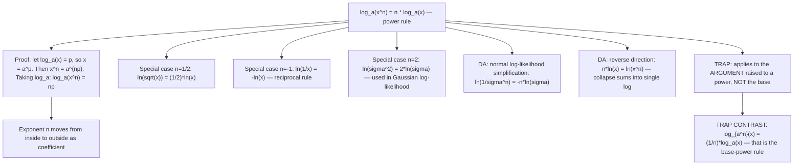

# Power

$$
\log_a(x^n) = n \log_a x
$$

## Deep Breakdown

What it tells me *(Situation Awareness)*:
The power rule for logarithms states that the exponent $n$ inside the argument of a log can be moved outside as a coefficient: $\log_a(x^n) = n \log_a x$. This is the single most frequently used log identity in statistics and machine learning. Key applications: (1) the log-likelihood of the normal distribution involves $\ln(\sigma^2) = 2\ln\sigma$ and $\ln(\sigma^{-n}) = -n\ln\sigma$; (2) the maximum likelihood estimator for variance involves $\partial \ln\sigma / \partial \sigma^2$, simplified via $\ln(\sigma^2) = 2\ln\sigma \Rightarrow \partial/\partial(\sigma^2) = 1/\sigma^2$; (3) in information theory, the Rényi entropy of order $\alpha$ uses $\ln(\sum_i p_i^\alpha)$; (4) in computing $\ln(\det\,\mathbf{A}) = \sum_i \ln\lambda_i$ for a PSD matrix (log-sum of eigenvalues), each $\lambda_i$ may itself be a power; (5) the Box-Cox transformation is $(x^\lambda - 1)/\lambda$ for $\lambda \ne 0$, and $\ln x$ as $\lambda \to 0$, which uses the power rule in deriving the limit; (6) combining terms: $n\ln x = \ln(x^n)$ is used in reverse to collapse sums back into single log arguments. The rule also implies $\ln\sqrt{x} = \ln(x^{1/2}) = (1/2)\ln x$, and $\ln(1/x) = \ln(x^{-1}) = -\ln x$ (reciprocal rule).

## Flowchart



## Real-world use

### Where it is used

Gaussian log-likelihood: $\ln f(x;\mu,\sigma) = -\frac{1}{2}\ln(2\pi\sigma^2) - \frac{(x-\mu)^2}{2\sigma^2}$. Expanding: $-\frac{1}{2}\ln(2\pi) - \frac{1}{2}\ln(\sigma^2) = -\frac{1}{2}\ln(2\pi) - \ln\sigma$, using $\ln(\sigma^2) = 2\ln\sigma$. For $n$ observations: $\ln L = -\frac{n}{2}\ln(2\pi) - n\ln\sigma - \frac{1}{2\sigma^2}\sum(x_i - \mu)^2$. The power rule turns $\ln(\sigma^2)$ into $2\ln\sigma$, making MLE differentiation straightforward. Combining log terms: multiple log terms like $3\ln x + 2\ln y = \ln(x^3 y^2)$ (reverse power + product rule), simplifying expressions in gradient descent derivations.

### Problem it solves

Without the power rule, expressions like $\ln(\sigma^{-n})$ would require treating them as $\ln$ of a complex fraction, applying the quotient rule, and then additional algebra. With the power rule: $\ln(\sigma^{-n}) = -n\ln\sigma$ directly, one step.

### How it solves the problem

Proof: let $\log_a x = p$, so $x = a^p$ by definition. Then $x^n = (a^p)^n = a^{np}$. Taking $\log_a$ of both sides: $\log_a(x^n) = \log_a(a^{np}) = np = n \cdot \log_a x$. The key step is $(a^p)^n = a^{np}$ — the power of a power rule for exponents.

### Example in a business

A data scientist is computing the MLE for the standard deviation $\sigma$ of a Gaussian model of customer spending. The log-likelihood includes $-\frac{n}{2}\ln\sigma^2$. They apply the power rule: $\ln\sigma^2 = 2\ln\sigma$, giving $-n\ln\sigma$. Differentiating with respect to $\sigma$: $\partial(-n\ln\sigma)/\partial\sigma = -n/\sigma$. Setting to zero and combining with the other derivative term gives $\hat{\sigma}^2 = \frac{1}{n}\sum(x_i - \hat{\mu})^2$. Without the power rule, the differentiation would require the chain rule through $\sigma^2$, adding an unnecessary layer.

## The formula, piece by piece

Breaking the notation:

- $\log_a$: logarithm base $a$ — the function applied to the argument $x^n$.
- $x^n$: argument — $x$ raised to the power $n$. Requires $x > 0$ (since $\log_a$ needs positive argument).
- $n$: the exponent — moves from the argument to a coefficient. Can be any real number: integer, fraction, negative.
- $n \log_a x$: the result — $n$ times the log of the base argument $x$. **Special cases**:
- $n = 1/2$: $\ln\sqrt{x} = \ln(x^{1/2}) = \frac{1}{2}\ln x$. Used in the square-root transformation of variances.
- $n = -1$: $\ln(1/x) = \ln(x^{-1}) = -\ln x$. The reciprocal rule — used in log-odds, likelihood ratios.
- $n = 2$: $\ln(x^2) = 2\ln x$ for $x > 0$. Used in variance log-parameterization.
- $n = 0$: $\ln(x^0) = \ln(1) = 0 = 0 \cdot \ln x$.

Trivially consistent. **Reverse direction (equally important)**: $n\ln x = \ln(x^n)$. Used to combine separate log terms back into a single argument. **TRAP: confuse with the base-power rule**: $\log_{a^n}(x) = \frac{1}{n}\log_a x$ is a different identity. The power rule $\log_a(x^n) = n\log_a x$ moves the exponent of the *argument*; the base-power rule moves the exponent of the *base*. Common confusion in entropy-base conversion problems. **TRAP: $x^n$ requires $x > 0$ for fractional $n$**: if $n = 1/2$ and $x < 0$, $x^{1/2}$ is not real. The rule always requires $x > 0$.

## The formula in words

"$\log_a(x^n) = n\log_a x$: the exponent on $x$ moves out to become a multiplier on the log. In plain language: 'log of $x$ to the $n$' equals '$n$ times log of $x$'. Reverse: '$n$ times log of $x$' equals 'log of $x$ to the $n$'. Use this to: pull exponents out of log arguments (simplify), push coefficients in to create a single log argument (combine). Dominant use: simplify log-likelihoods of Gaussian, exponential, and power-law distributions."

## Critical Concepts

1. **Exponent moves to coefficient**: $\log_a(x^n) = n\log_a x$. The power $n$ goes from inside the argument to outside as a multiplicative factor. The reverse is equally important: $n\log_a x = \log_a(x^n)$.
2. **Reciprocal rule is a special case**: $\ln(1/x) = \ln(x^{-1}) = -\ln x$. This is the $n = -1$ case. It is used constantly in likelihood ratios, entropy terms, and KL divergence.
3. **Gaussian MLE**: the normal log-likelihood $-\frac{n}{2}\ln(2\pi\sigma^2) = -\frac{n}{2}\ln(2\pi) - n\ln\sigma$ uses the power rule to split $\sigma^2$ as $2\ln\sigma$. This separates the $\sigma$-dependent term for clean differentiation.
4. **Contrast with base-power rule**: $\log_a(x^n) = n\log_a x$ (argument power). $\log_{a^n}(x) = \frac{1}{n}\log_a x$ (base power). These look similar but behave oppositely: argument power multiplies, base power divides.
5. **No analog for sums**: $\log_a((x+y)^n) = n\log_a(x+y)$ — this is fine (the whole sum is raised to $n$).

But $\log_a(x^n + y^n) \ne n(\log_a x + \log_a y)$ — sum of powers inside is NOT the same as power of sum.

## Step-by-step calculation (tiny example)

Task: simplify $\ln(\sigma^{-5})$ and evaluate at $\sigma = 2$.

*Step 1: Recognize the power form*
$\sigma^{-5}$ is $\sigma$ raised to the power $n = -5$.

*Step 2: Apply the power rule*
$\ln(\sigma^{-5}) = -5 \cdot \ln\sigma$.

*Step 3: Evaluate at $\sigma = 2$*
$-5 \cdot \ln 2 = -5 \times 0.6931 = -3.4657$.

*Step 4: Verify directly*
$\sigma^{-5} = 2^{-5} = 1/32 = 0.03125$. $\ln(0.03125) \approx -3.4657$.

*Step 5: Reverse direction — combine $3\ln 2 + 2\ln 3$*
$3\ln 2 = \ln(2^3) = \ln 8$. $2\ln 3 = \ln(3^2) = \ln 9$. Sum: $\ln 8 + \ln 9 = \ln(8 \times 9) = \ln 72 \approx 4.2767$.
Verify: $3 \times 0.6931 + 2 \times 1.0986 = 2.0794 + 2.1972 = 4.2766$.

## Code examples

### Beginner example (Python)

```python
# Power rule for logs: log_a(x^n) = n * log_a(x)
import math
import numpy as np


def log_power_rule(x: float, n: float, base: float = math.e) -> float:
    """
    Apply the power rule: log_base(x^n) = n * log_base(x).

    Args:
        x: Argument (x > 0).
        n: Exponent (any real number).
        base: Logarithm base (default: e for natural log).

    Returns:
        n * log_base(x).
    """
    return n * math.log(x, base)


# Verify rule: log_a(x^n) vs direct computation math.log(x**n, a)
test_cases = [
    (4.0, 2.0, math.e),    # ln(16) = 2*ln(4)
    (2.0, 3.0, 2.0),       # log_2(8) = 3
    (5.0, -1.0, math.e),   # ln(1/5) = -ln(5)
    (9.0, 0.5, math.e),    # ln(3) = 0.5*ln(9)
    (2.0, 5.0, 10.0),      # log10(32) = 5*log10(2)
]
print("Power rule: log_a(x^n) = n * log_a(x)")
print(f"{'x':>6} {'n':>5} {'base':>6} {'direct':>10} {'rule':>10} {'match':>6}")
for x, n, base in test_cases:
    direct = math.log(x**n, base)
    rule = log_power_rule(x, n, base)
    print(f"{x:>6.2f} {n:>5.1f} {base:>6.4f} {direct:>10.6f} {rule:>10.6f} {str(abs(direct - rule) < 1e-10):>6}")

# Special cases
print("\nSpecial cases:")
x = 4.0
print(f" Reciprocal: ln(1/{x}) = -ln({x}) = {math.log(1/x):.6f} = {-math.log(x):.6f}")
print(f" Sqrt: ln(sqrt({x})) = 0.5*ln({x}) = {math.log(math.sqrt(x)):.6f} = {0.5*math.log(x):.6f}")
print(f" Square: ln({x}^2) = 2*ln({x}) = {math.log(x**2):.6f} = {2*math.log(x):.6f}")

# Reverse direction: combine n*ln(x) → ln(x^n)
print("\nReverse: combine 3*ln(2) + 2*ln(3) = ln(2^3 * 3^2) = ln(72)")
combined = 3 * math.log(2) + 2 * math.log(3)
direct = math.log(72)
print(f" Computed: {combined:.6f} Direct: {direct:.6f} Match: {abs(combined - direct) < 1e-10}")

# Gaussian log-likelihood simplification
print("\nGaussian log-likelihood: -n*ln(sigma) from ln(sigma^(-n))")
sigma = 2.5
n = 100
direct_term = math.log(sigma**(-n))
rule_term = -n * math.log(sigma)
print(f" sigma={sigma}, n={n}: ln(sigma^(-n))={direct_term:.6f} -n*ln(sigma)={rule_term:.6f} match={abs(direct_term - rule_term) < 1e-9}")
```

### Beginner example (R)

```r
# Power rule in R: log_a(x^n) = n * log_a(x)
log_power_rule <- function(x, n, base = exp(1)) {
  n * log(x, base = base)
}

# Verify
test_cases <- list(
  c(x=4, n=2, base=exp(1)),
  c(x=2, n=3, base=2),
  c(x=5, n=-1, base=exp(1)),
  c(x=9, n=0.5, base=exp(1))
)
cat(sprintf("%-6s %-5s %-8s %-10s %-10s %s\n", "x", "n", "base", "direct", "rule", "match"))
for (tc in test_cases) {
  x <- tc["x"]; n <- tc["n"]; base <- tc["base"]
  direct <- log(x^n, base = base)
  rule <- log_power_rule(x, n, base)
  cat(sprintf("%-6.2f %-5.1f %-8.4f %-10.6f %-10.6f %s\n", x, n, base, direct, rule, abs(direct - rule) < 1e-10))
}

# Gaussian simplification
sigma <- 2.5; n_obs <- 100
direct_ll_term <- log(sigma^(-n_obs))
rule_ll_term <- -n_obs * log(sigma)
cat(sprintf("\nGaussian: ln(sigma^(-n)) = -n*ln(sigma)\n"))
cat(sprintf(" direct=%.6f rule=%.6f match=%s\n", direct_ll_term, rule_ll_term, abs(direct_ll_term - rule_ll_term) < 1e-9))
```

### Professional example (Python)

```python
import numpy as np
import pandas as pd
import math
from typing import NamedTuple

# Scenario: compute and decompose the normal log-likelihood using the power rule
# Demonstrates how ln(sigma^2) = 2*ln(sigma) and ln(sigma^{-n}) = -n*ln(sigma)
# simplify the MLE derivation and gradient computation
np.random.seed(42)
N_OBS = 200
TRUE_MU = 5.0
TRUE_SD = 2.0
data = np.random.normal(TRUE_MU, TRUE_SD, N_OBS)


class NormalLogLikelihood(NamedTuple):
    """Components of the normal log-likelihood, separated using the power rule."""
    constant_term: float   # -(n/2)*ln(2*pi)
    sigma_term: float      # -n*ln(sigma) via power rule: ln(sigma^{-n}) = -n*ln(sigma)
    residual_term: float   # -(1/(2*sigma^2)) * sum((xi - mu)^2)
    total: float           # sum of all terms


def compute_normal_log_likelihood(
    data: np.ndarray,
    mu: float,
    sigma: float,
) -> NormalLogLikelihood:
    """
    Compute the decomposed normal log-likelihood.

    Applies power rule:
        ln(sigma^{-n}) = -n*ln(sigma)   [n = len(data)]
        ln((2*pi*sigma^2)^{-n/2}) = -(n/2)*ln(2*pi) - n*ln(sigma)

    Args:
        data: Observed data array.
        mu: Mean parameter.
        sigma: Standard deviation parameter (sigma > 0).

    Returns:
        NormalLogLikelihood with decomposed terms and total.
    """
    n = len(data)
    constant_term = -(n / 2) * math.log(2 * math.pi)
    sigma_term = -n * math.log(sigma)   # power rule: ln(sigma^{-n}) = -n*ln(sigma)
    residual_term = -0.5 * np.sum((data - mu) ** 2) / sigma**2
    total = constant_term + sigma_term + residual_term
    return NormalLogLikelihood(constant_term, sigma_term, residual_term, total)


# Evaluate MLE grid
sigma_grid = np.linspace(0.5, 5.0, 80)
mu_hat = data.mean()   # MLE for mu = sample mean
results = [compute_normal_log_likelihood(data, mu_hat, s) for s in sigma_grid]
totals = np.array([r.total for r in results])
best_sigma = sigma_grid[np.argmax(totals)]
best_ll = results[np.argmax(totals)]

# Power rule verification: ln(sigma^2) vs 2*ln(sigma)
power_check = pd.DataFrame({
    "sigma": sigma_grid[::10].round(3),
    "ln(sigma^2)": np.log(sigma_grid[::10] ** 2).round(6),
    "2*ln(sigma)": (2 * np.log(sigma_grid[::10])).round(6),
    "difference": (np.log(sigma_grid[::10]**2) - 2*np.log(sigma_grid[::10])).round(12),
})
print("Normal log-likelihood with power rule: ln(sigma^{-n}) = -n*ln(sigma)")
print("=" * 68)
print(f" MLE mu: {mu_hat:.4f} (true: {TRUE_MU:.4f})")
print(f" MLE sigma (grid): {best_sigma:.4f} (true: {TRUE_SD:.4f})")
print(f" Sample std: {data.std(ddof=1):.4f}")
print(f"\nDecomposed log-likelihood at MLE sigma={best_sigma:.4f}:")
print(f" constant term (-(n/2)*ln(2pi)): {best_ll.constant_term:.4f}")
print(f" sigma term (-n*ln(sigma)): {best_ll.sigma_term:.4f}")
print(f" residual term: {best_ll.residual_term:.4f}")
print(f" total: {best_ll.total:.4f}")
print(f"\nPower rule verification: ln(sigma^2) = 2*ln(sigma)")
print(power_check.to_string(index=False))
```

### Professional example (R)

```r
# ln(sigma^2) = 2*ln(sigma) (power rule)
set.seed(42)
sigmas <- c(0.5, 1, 2, 5)
power_check <- data.frame(sigma = sigmas, ln_sigma_sq = log(sigmas^2), two_ln_sigma = 2*log(sigmas), match = abs(log(sigmas^2) - 2*log(sigmas)) < 1e-10)
cat("Power rule: ln(sigma^2) = 2*ln(sigma)\n")
print(power_check)
```

---

*Source: 1300 p. 20*
