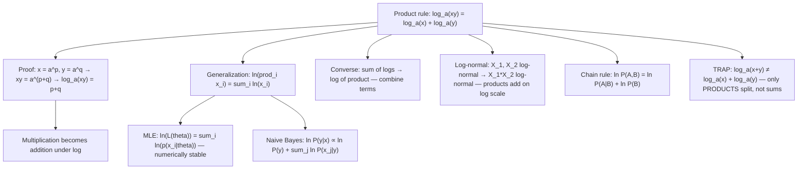

# Product

$$
\log_a(xy) = \log_a x + \log_a y
$$

## Deep Breakdown

What it tells me *(Situation Awareness)*:
The product rule for logarithms converts multiplication into addition: $\log_a(xy) = \log_a x + \log_a y$. This single identity is the algebraic foundation of why log-likelihood works in statistics. Products of probabilities are numerically catastrophic for large $n$ (floating-point underflow), but the log-likelihood $\ln \prod_{i=1}^n p(x_i | \theta) = \sum_{i=1}^n \ln p(x_i | \theta)$ is a stable sum. This appears in: maximum likelihood estimation (MLE) for any parametric distribution; the naive Bayes classifier ($\ln P(y) + \sum_j \ln P(x_j | y)$); joint probability of independent observations; entropy calculations ($-\sum p_i \ln p_i$ can be rewritten via the rule); the log-normal distribution (where $\ln X \sim \mathcal{N}$, so products of log-normal variables add on the log scale); and the chain rule of probability $\ln P(A, B) = \ln P(A|B) + \ln P(B)$. The rule generalizes to any finite product: $\ln \prod_{i=1}^n x_i = \sum_{i=1}^n \ln x_i$. The converse direction (sum of logs → log of product) is equally important for combining terms. Both directions require all arguments to be positive.

## Flowchart



## Real-world use

### Where it is used

Maximum likelihood estimation: for IID data $X_1, \ldots, X_n \sim \text{Bernoulli}(p)$, the likelihood is $L(p) = \prod_{i=1}^n p^{x_i}(1-p)^{1-x_i}$. Taking the log: $\ln L(p) = \sum_{i=1}^n [x_i \ln p + (1-x_i)\ln(1-p)]$. Each application of the product rule converts one factor $p^{x_i}(1-p)^{1-x_i}$ into a sum of log terms. Without the product rule, differentiation of the product is intractable for large $n$. Naive Bayes: $\ln P(C|x_1,\ldots,x_m) \propto \ln P(C) + \sum_{j=1}^m \ln P(x_j|C)$, assuming conditional independence (product of conditional probabilities → sum of log-conditionals).

### Problem it solves

For $n = 1000$ Bernoulli observations with $p = 0.3$: the likelihood product is approximately $0.3^{300} \times 0.7^{700} \approx 10^{-522}$, which is below the `float64` minimum of $\approx 2.2 \times 10^{-308}$ and evaluates as exactly 0. The log-likelihood sum $300\ln(0.3) + 700\ln(0.7) \approx -691.8$ is a perfectly representable float.

### How it solves the problem

Proof: let $\log_a x = p$ and $\log_a y = q$. By definition, $x = a^p$ and $y = a^q$. Then $xy = a^p \cdot a^q = a^{p+q}$ (exponent addition rule). Taking $\log_a$ of both sides: $\log_a(xy) = p + q = \log_a x + \log_a y$. The key step is the exponent addition rule for the same base.

### Example in a business

A data scientist builds a fraud detection model using naive Bayes. The posterior probability of fraud given 5 transaction features is $P(\text{fraud}|x_1,\ldots,x_5) \propto P(\text{fraud}) \prod_{j=1}^5 P(x_j|\text{fraud})$. In production, they compute log-scores: $\text{score} = \ln P(\text{fraud}) + \sum_{j=1}^5 \ln P(x_j|\text{fraud})$, using the product rule. This avoids underflow and is $O(n)$ additions instead of multiplications. Transactions with `score > threshold` are flagged.

## The formula, piece by piece

Breaking the notation:

- $\log_a$: logarithm base $a$, applied to the product $xy$.
- $xy$: the product of two positive numbers $x > 0$ and $y > 0$.
- $\log_a x$: log of the first factor alone.
- $\log_a y$: log of the second factor alone.
- $+$: addition — the core transformation: multiplication of arguments becomes addition of logs. **Generalization to $n$ factors**:

$$
\log_a(x_1 x_2 \cdots x_n) = \log_a x_1 + \log_a x_2 + \cdots + \log_a x_n = \sum_{i=1}^n \log_a x_i
$$

**Common form in statistics** (natural log of a joint likelihood):

$$
\ln \prod_{i=1}^n p_i = \sum_{i=1}^n \ln p_i
$$

**Reverse direction**: $\sum_{i=1}^n \log_a x_i = \log_a\!\left(\prod_{i=1}^n x_i\right)$. Used to combine multiple log terms into a single argument before simplification. **TRAP: only for products, not sums**: $\log_a(x + y) \ne \log_a x + \log_a y$. This is the most common log error in probability and statistics. Example: $\ln(2 + 3) = \ln 5 \approx 1.609 \ne \ln 2 + \ln 3 = \ln 6 \approx 1.792$. **TRAP: arguments must be positive**: $\log_a(xy)$ requires $x > 0$ and $y > 0$. For probabilities $p_i \in (0, 1]$, this is automatic but log-probabilities are then in $(-\infty, 0]$, not $(-\infty, \infty)$.

## The formula in words

"$\log_a(xy) = \log_a x + \log_a y$: the log of a product equals the sum of the logs. Multiplication becomes addition. This is why log-likelihood works: products of many small probabilities that underflow to zero become sums of log-probabilities that are stable. In Python: `np.log(probs).sum()` implements $\ln \prod_i p_i = \sum_i \ln p_i$ directly. TRAP: this works only for products — log of a sum does not split."

## Critical Concepts

1. **Why log-likelihood exists**: the product rule is the single reason MLE is computationally feasible. Products of thousands of probabilities underflow in floating-point; sums of log-probabilities do not. This is not just a convenience — it is computationally necessary.
2. **Generalization to n factors**: $\ln \prod_{i=1}^n p_i = \sum_{i=1}^n \ln p_i$. This is the log-likelihood formula for IID observations. Any model using MLE relies on this identity.
3. **Log-normal products**: if $X_1, X_2 \sim \text{LogNormal}$, their product $X_1 X_2$ is also log-normal, because $\ln(X_1 X_2) = \ln X_1 + \ln X_2$, the sum of two normal random variables, which is normal.
4. **Naive Bayes uses the product rule**: the conditional independence assumption means the class-conditional likelihood factors as a product. Taking log converts this to a sum of log-conditionals, which is both numerically stable and computationally $O(n \times m)$ instead of potentially catastrophic.
5. **TRAP: log of sum ≠ sum of logs**: $\ln(x + y) \ne \ln x + \ln y$.

Common confusion in mixture models, where probabilities are summed ($\ln\sum_k \pi_k p_k(x)$) and incorrectly split. The log-sum-exp trick handles this case correctly.

## Step-by-step calculation (tiny example)

Task: compute the log-likelihood of observing 3 heads and 2 tails with a coin where $p = 0.4$.

*Step 1: Write the likelihood*
$L = P(\text{HHHTT}) = 0.4^3 \times 0.6^2 = 0.064 \times 0.36 = 0.02304$.

*Step 2: Apply the product rule*
$\ln L = \ln(0.4^3 \times 0.6^2) = \ln(0.4^3) + \ln(0.6^2) = 3\ln(0.4) + 2\ln(0.6)$.

*Step 3: Compute each term*
$3\ln(0.4) = 3 \times (-0.9163) = -2.7489$.
$2\ln(0.6) = 2 \times (-0.5108) = -1.0217$.

*Step 4: Sum*
$\ln L = -2.7489 - 1.0217 = -3.7706$.

*Step 5: Verify*
$\ln(0.02304) \approx -3.7706$. ✓ No underflow: $0.02304$ is fine here, but with $n = 1000$ observations it would not be.

## Code examples

### Beginner example (Python)

```python
# Product rule for logs: log_a(xy) =
log_a(x) + log_a(y)
import math
import numpy as np   # Verify the product rule
print("Product rule verification: ln(xy) = ln(x) + ln(y)")
pairs = [(2.0, 3.0), (5.0, 7.0), (0.1, 0.9), (1.5, 4.0), (100.0, 0.01)]
print(f"{'x':>8} {'y':>8} {'ln(xy)':>10} {'ln(x)+ln(y)':>14} {'match':>6}")
for x, y in pairs:
    direct = math.log(x * y)
rule_form = math.log(x) + math.log(y)
print(f"{x:>8.4f} {y:>8.4f} {direct:>10.6f} {rule_form:>14.6f} {str(abs(direct - rule_form) < 1e-10):>6}")   # Generalization: log-likelihood of IID Bernoulli observations
print("\nBernoulli log-likelihood: ln(L) = sum_i ln(p^x_i * (1-p)^(1-x_i))")
p = 0.4
obs = np.array([1, 0, 1, 1, 0, 1, 0, 0, 1, 1])   # 10 observations
ll_product = math.log(np.prod([p**x * (1 - p)**(1 - x) for x in obs]))
ll_sum = sum(x * math.log(p) + (1 - x) * math.log(1 - p) for x in obs)
print(f" Observations: {obs.tolist()}")
print(f" Log-likelihood (product then log): {ll_product:.6f}")
print(f" Log-likelihood (sum of logs): {ll_sum:.6f}")
print(f" Match: {abs(ll_product - ll_sum) < 1e-10}")   # TRAP: ln(x + y) ≠
ln(x) + ln(y)
x_val, y_val = 3.0, 5.0
print(f"\nTRAP: ln({x_val}+{y_val}) = ln({x_val+y_val}) = {math.log(x_val + y_val):.6f}")
print(f" ln({x_val}) + ln({y_val}) = ln({x_val*y_val}) = {math.log(x_val) + math.log(y_val):.6f}")
print(f" Difference: {abs(math.log(x_val + y_val) - (math.log(x_val) + math.log(y_val))):.6f}")   # Underflow demonstration
print("\nNumerical stability: products vs log-sums")
n = 500
p_val = 0.3
print(f" {n} observations with p={p_val}")
product = p_val**n
log_sum = n * math.log(p_val)
print(f" Direct product p^n: {product} (underflows to 0: {product == 0.0})")
print(f" Log-sum n*ln(p): {log_sum:.4f} (no underflow)")
```

### Beginner example (R)

```r
# Product rule in R: log_a(xy) = log_a(x) + log_a(y) # Verify
cat("Product rule verification: ln(xy) = ln(x) + ln(y)\n")
pairs <- list(c(2,3), c(5,7), c(0.1,0.9), c(1.5,4))
cat(sprintf("%-8s %-8s %-10s %-14s %s\n", "x", "y", "ln(xy)", "ln(x)+ln(y)", "match"))
for (p in pairs) { x <- p[1]; y <- p[2]
  direct <- log(x * y)
  rule_form <- log(x) + log(y)
  cat(sprintf("%-8.4f %-8.4f %-10.6f %-14.6f %s\n", x, y, direct, rule_form, abs(direct - rule_form) < 1e-10))
}  # Bernoulli log-likelihood
p_hat <- 0.4
obs <- c(1, 0, 1, 1, 0, 1, 0, 0, 1, 1)
ll_sum <- sum(obs * log(p_hat) + (1 - obs) * log(1 - p_hat))
cat(sprintf("\nBernoulli log-likelihood (sum of logs): %.6f\n", ll_sum))  # Underflow demo
n_obs <- 500; p_val <- 0.3
product_val <- p_val^n_obs
log_sum_val <- n_obs * log(p_val)
cat(sprintf("\nUnderflow: p^%d = %g (zero: %s)\n", n_obs, product_val, product_val == 0))
cat(sprintf("Log-sum: n*ln(p) = %.4f (no underflow)\n", log_sum_val))
```

### Professional example (Python)

```python
import numpy as np
import pandas as pd
import math
from typing import Callable   # Scenario: compare three models on a binary classification task using
# log-likelihood (product rule converts product of probs to sum of log-probs)
# Demonstrate the numerical stability advantage and accuracy comparison
np.random.seed(42)
N_SAMPLES = 1000
TRUE_P = 0.35   # true positive rate (Bernoulli parameter)
labels = np.random.binomial(1, TRUE_P, N_SAMPLES)

def log_likelihood_bernoulli(labels: np.ndarray, predicted_p: float) -> float:
    """ Compute Bernoulli log-likelihood using the product rule. ln L(p) = sum_i [y_i * ln(p) + (1-y_i) * ln(1-p)] Applies: ln(prod_i p^y_i * (1-p)^(1-y_i)) = sum_i [y_i*ln(p) + (1-y_i)*ln(1-p)] Args: labels: Binary outcome array (0 or 1). predicted_p: Predicted probability (0 < p < 1). Returns: Log-likelihood value. """
    if not (0 < predicted_p < 1):
        raise ValueError("predicted_p must be strictly between 0 and 1")
    log_p = math.log(predicted_p)
    log_one_m_p = math.log(1 - predicted_p)
    return float(np.sum(labels * log_p + (1 - labels) * log_one_m_p))

def product_rule_verification(labels: np.ndarray, p: float) -> dict:
    """ Verify that the product of probabilities equals exp(sum of log-probs). Args: labels: Binary outcome array. p: Probability parameter. Returns: Dictionary with comparison data. """
    log_probs = labels * math.log(p) + (1 - labels) * math.log(1 - p)
    sum_log = float(log_probs.sum())
    exp_sum_log = math.exp(sum_log) if sum_log > -700 else 0.0   # avoid underflow in exp
    return {"sum_of_logs": sum_log, "exp_of_sum": exp_sum_log}   # Evaluate log-likelihood over a grid of p values
p_grid = np.linspace(0.1, 0.9, 200)
lls = np.array([log_likelihood_bernoulli(labels, p) for p in p_grid])
best_p = p_grid[np.argmax(lls)]   # Compare models
model_predictions = { "true_p (oracle)": TRUE_P, "MLE estimate": labels.mean(), "overestimate": 0.6, "underestimate": 0.15,
}
rows = []
for model_name, pred_p in model_predictions.items():
    ll = log_likelihood_bernoulli(labels, pred_p)
verification = product_rule_verification(labels, pred_p)
rows.append({ "model": model_name, "predicted_p": round(pred_p, 4), "log_likelihood": round(ll, 4), "rank": None, })
results_df = pd.DataFrame(rows)
results_df["rank"] = results_df["log_likelihood"].rank(ascending=False).astype(int)
results_df = results_df.sort_values("rank")
print("Bernoulli log-likelihood: product rule ln(prod p_i) = sum ln(p_i)")
print("=" * 66)
print(f" True p: {TRUE_P:.4f}")
print(f" Sample mean: {labels.mean():.4f} (MLE estimate)")
print(f" Grid MLE: {best_p:.4f}")
print()
print("Model comparison (higher log-likelihood = better fit):")
print(results_df.to_string(index=False))
print(f"\nProduct rule verification (n={N_SAMPLES} observations):")
verif = product_rule_verification(labels, labels.mean())
print(f" sum of log-probs: {verif['sum_of_logs']:.4f}")
print(f" exp(sum) = actual product: {verif['exp_of_sum']} (underflows: {verif['exp_of_sum'] == 0.0})")
print(f" Direct product (float64 result): {math.prod(labels * labels.mean() + (1-labels)*(1-labels.mean()))}")
```

### Professional example (R)

```r
# Product rule: ln(prod p_i) = sum ln(p_i)
set.seed(42)
N_SAMPLES <- 50
labels <- rbinom(N_SAMPLES, 1, 0.4)
p <- ifelse(labels == 1, mean(labels), 1 - mean(labels))
sum_of_logs <- sum(log(p))
exp_of_sum <- exp(sum_of_logs)
direct_product <- prod(p)
cat(sprintf("sum of log-probs: %.4f exp(sum) = %.6e direct product: %.6e\n", sum_of_logs, exp_of_sum, direct_product))
```

---

*Source: 1300 p. 20*
