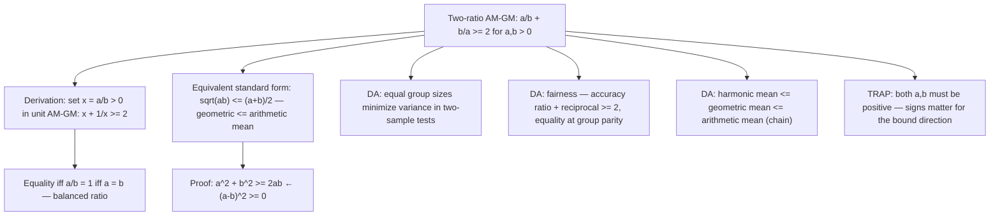

# AM-GM (two terms)

If $a > 0, b > 0$, then $\frac{a}{b} + \frac{b}{a} \ge 2$ (equality iff $a=b$)

## Deep Breakdown

What it tells me *(Situation Awareness)*:
This is the two-ratio form of the AM-GM inequality: the sum of any two positive ratio-reciprocal pairs is always at least 2. It follows directly from the unit AM-GM by substituting $x = a/b$ (with $a, b > 0$): $x + 1/x = a/b + b/a \ge 2$. Equality holds iff $x = 1$, i.e., $a/b = 1$, i.e., $a = b$. The standard two-term AM-GM $\sqrt{ab} \le (a+b)/2$ is equivalent: multiply $a/b + b/a \ge 2$ by $ab > 0$ to get $a^2 + b^2 \ge 2ab$, then $\sqrt{ab} \le (a+b)/2$ (dividing by 2). In DA/DS, this form appears in: (1) model fairness: comparing performance on two subgroups $A$ and $B$, the combined metric $\text{acc}_A/\text{acc}_B + \text{acc}_B/\text{acc}_A \ge 2$, with equality iff groups have equal accuracy; (2) comparing precision and recall: the harmonic mean satisfies $1/F_1 = (1/P + 1/R)/2 \ge \sqrt{1/(PR)}$ (related AM-GM argument); (3) the balance condition in two-sample tests: if group sizes $n_1$ and $n_2$ satisfy $n_1/n_2 + n_2/n_1 \ge 2$, the minimum variance occurs when $n_1 = n_2$ (equal allocation); (4) economics: the efficiency of any exchange or two-sided market is bounded below by this inequality; (5) the Cauchy-Schwarz inequality, whose proof uses AM-GM as a stepping stone.

## Flowchart



## Real-world use

### Where it is used

Two-sample experiment design: when comparing two groups (e.g., control vs. treatment), the variance of the difference in means is proportional to $1/n_1 + 1/n_2$. To minimize variance subject to $n_1 + n_2 = N$ fixed, the AM-GM inequality shows $1/n_1 + 1/n_2 \ge 2/\sqrt{n_1 n_2} \ge 4/N$, with equality when $n_1 = n_2 = N/2$. This directly proves that equal allocation minimizes variance (maximizes statistical power) for a fixed total sample size. Precision-recall balance: in binary classification, $P/R + R/P \ge 2$, with equality when precision equals recall. The F1 score (harmonic mean of P and R) is maximized relative to their arithmetic mean at this equality point.

### Problem it solves

Without the inequality, proving that a balanced design (equal group sizes, equal parameters) is optimal requires calculus and Lagrange multipliers. With AM-GM, the optimum and its condition are immediate: equality holds iff $a = b$.

### How it solves the problem

Direct algebraic proof: $(a - b)^2 \ge 0$ (always). Expanding: $a^2 - 2ab + b^2 \ge 0 \Rightarrow a^2 + b^2 \ge 2ab$. Dividing both sides by $ab > 0$: $a/b + b/a \ge 2$. Equality iff $(a-b)^2 = 0$ iff $a = b$.

### Example in a business

A data scientist sets up an A/B test to compare two ad campaigns. The total budget allows for $N = 1000$ ad impressions. They must allocate $n_1$ to variant A and $n_2 = 1000 - n_1$ to variant B. The variance of the estimated difference in click-through rates is $\sigma^2(1/n_1 + 1/n_2)$. Using AM-GM: $1/n_1 + 1/n_2 \ge 4/N$ with equality at $n_1 = n_2 = 500$. They conclude the equal split minimizes variance without any calculus, just the two-term AM-GM.

## The formula, piece by piece

Breaking the notation:

- $a$: first positive quantity ($a > 0$).
- $b$: second positive quantity ($b > 0$).
- $a/b$: ratio of $a$ to $b$.
- $b/a$: reciprocal ratio — $b$ to $a$.
- $a/b + b/a$: sum of the ratio and its reciprocal.
- $\ge 2$: the lower bound — always holds for positive $a$, $b$.
- Equality iff $a = b$: the minimum occurs precisely when the ratio equals 1. **Connection to standard AM-GM** (arithmetic ≥ geometric mean):

$$
\frac{a + b}{2} \ge \sqrt{ab} \quad\text{for } a, b \ge 0
$$

This is equivalent to $a/b + b/a \ge 2$ when both are positive: multiply both sides of the two-ratio form by $ab/2$ to get $\frac{a^2 + b^2}{2} \ge ab$, i.e., $\frac{a + b}{2} \ge \sqrt{ab}$ when substituting $a, b \to \sqrt{a}, \sqrt{b}$. **Mean inequality chain** (for $a, b > 0$):

$$
H(a,b) = \frac{2}{\frac{1}{a}+\frac{1}{b}} \le G(a,b) = \sqrt{ab} \le A(a,b) = \frac{a+b}{2}
$$

The two-term AM-GM $\sqrt{ab} \le (a+b)/2$ is the middle $\le$ in this chain. **TRAP: asymmetry**: $a/b + b/a = b/a + a/b$ (the sum is symmetric), but $a/b \ne b/a$ individually (unless $a = b$). The inequality is about the sum, not each term individually.

## The formula in words

"For positive $a$ and $b$: their mutual ratios always sum to at least 2. One ratio and the other ratio are reciprocals, and a number plus its reciprocal is always at least 2. Minimum sum of 2 occurs only when $a = b$ (the ratio is 1). Direct consequence of $(a-b)^2 \ge 0$. Use this to: prove that balanced allocations minimize variance; bound performance ratios; identify the equality condition for optimization without calculus."

## Critical Concepts

1. **Reduction to unit form**: $a/b + b/a \ge 2$ is just the unit AM-GM $x + 1/x \ge 2$ with $x = a/b > 0$. Memorizing one is enough — the other follows by substitution.
2. **Standard AM-GM equivalence**: $a/b + b/a \ge 2$ is equivalent to $\sqrt{ab} \le (a+b)/2$ (by multiplying by $ab$ and algebraic manipulation). All three forms (unit, two-ratio, arithmetic-geometric) are different expressions of the same fact.
3. **Equal allocation optimality**: in two-group experiments, equal group sizes minimize the sum $1/n_1 + 1/n_2$ for fixed total $n_1 + n_2 = N$. This follows from $1/n_1 + 1/n_2 \ge 4/N$, via AM-GM with $a = n_1$, $b = n_2$.
4. **Harmonic ≤ geometric ≤ arithmetic**: for two positive numbers, $H \le G \le A$. The AM-GM is the $G \le A$ part. The $H \le G$ part follows from AM-GM applied to $1/a$ and $1/b$.
5. **Proof from $(a-b)^2 \ge 0$**: the cleanest derivation.

Expand, divide by $ab$. One algebraic step gives the inequality with the equality condition as a free bonus.

## Step-by-step calculation (tiny example)

Task: show that for a two-group experiment with $N = 100$ total samples, equal allocation minimizes $1/n_1 + 1/n_2$.

*Step 1: Set up the problem*
$n_1 + n_2 = 100$; want to minimize $f = 1/n_1 + 1/n_2$.

*Step 2: Apply AM-GM to $1/n_1$ and $1/n_2$*
By AM-GM: $\frac{1/n_1 + 1/n_2}{2} \ge \sqrt{\frac{1}{n_1 n_2}}$. Actually, simpler: use the two-ratio form with $a = n_1$, $b = n_2$: $n_1/n_2 + n_2/n_1 \ge 2$. Multiply by $1/(n_1 + n_2)$: related but let's use the direct approach.

*Step 3: Direct lower bound*
By AM-HM inequality (which uses AM-GM): $\frac{n_1 + n_2}{2} \ge \frac{2}{\frac{1}{n_1} + \frac{1}{n_2}}$, so $\frac{1}{n_1} + \frac{1}{n_2} \ge \frac{4}{n_1 + n_2} = \frac{4}{100} = 0.04$.

*Step 4: Equality check*
Equality at $n_1 = n_2 = 50$: $1/50 + 1/50 = 0.02 + 0.02 = 0.04$. ✓

*Step 5: Verify the unequal case is worse*
$n_1 = 20, n_2 = 80$: $1/20 + 1/80 = 0.050 + 0.0125 = 0.0625 > 0.04$. ✓

## Code examples

### Beginner example (Python)

```python
# Two-ratio AM-GM: a/b + b/a >= 2 for a,b > 0, equality iff
a=b
import math
import numpy as np

def two_ratio_am_gm(a: float, b: float) -> float:
    """ Compute a/b + b/a. By AM-GM: always >= 2 when a, b > 0. Equality iff a == b. Args: a: First positive quantity. b: Second positive quantity. Returns: a/b + b/a (always >= 2). """
    if a <= 0 or b <= 0:
        raise ValueError("Both a and b must be positive")
    return a / b + b / a   # Verify across pairs
print("Two-ratio AM-GM: a/b + b/a >= 2, equality iff a=b")
pairs = [(1.0, 1.0), (2.0, 1.0), (3.0, 2.0), (0.5, 0.8), (10.0, 0.1), (100.0, 100.0)]
print(f"{'a':>8} {'b':>8} {'a/b+b/a':>10} {'>=2?':>6} {'gap':>8}")
for a, b in pairs:
    val = two_ratio_am_gm(a, b)
print(f"{a:>8.4f} {b:>8.4f} {val:>10.6f} {str(val >= 2 - 1e-12):>6} {val-2:>8.6f}")   # Proof via (a-b)^2 >= 0
print("\nProof: (a-b)^2 >= 0 => a/b + b/a >= 2")
for a, b in [(3.0, 2.0), (5.0, 5.0), (0.5, 2.0)]:
    sq_diff = (a - b) ** 2
lhs = a ** 2 + b ** 2
rhs = 2 * a * b
ratio_sum = two_ratio_am_gm(a, b)
print(f" a={a}, b={b}: (a-b)^2={sq_diff:.4f} a^2+b^2={lhs:.4f} 2ab={rhs:.4f} a/b+b/a={ratio_sum:.4f}")   # Experiment design: equal allocation minimizes 1/n1 + 1/n2
N_TOTAL = 1000
print(f"\nTwo-group experiment (N={N_TOTAL}): minimize 1/n1 + 1/n2")
splits = [(50, 950), (100, 900), (250, 750), (400, 600), (500, 500)]
print(f"{'n1':>6} {'n2':>6} {'1/n1+1/n2':>12} {'above_min':>12}")
min_val = 4 / N_TOTAL
for n1, n2 in splits:
    val = 1/n1 + 1/n2
print(f"{n1:>6} {n2:>6} {val:>12.6f} {val - min_val:>12.6f}")
print(f" Theoretical minimum (equal split): {min_val:.6f}")   # Precision-recall balance
print("\nPrecision-recall: P/R + R/P >= 2, equality when P=R")
pr_pairs = [(0.8, 0.4), (0.6, 0.6), (0.9, 0.3), (0.7, 0.7)]
for p, r in pr_pairs:
    val = p/r + r/p
print(f" P={p:.1f} R={r:.1f} P/R+R/P={val:.4f} balanced: {abs(p-r) < 1e-9}")
```

### Beginner example (R)

```r
# Two-ratio AM-GM in R: a/b + b/a >= 2
two_ratio_am_gm <- function(a, b) { if (any(a <= 0) || any(b <= 0)) stop("Both must be positive") a / b + b / a
}  # Verify
cat("Two-ratio AM-GM: a/b + b/a >= 2\n")
pairs <- list(c(1,1), c(2,1), c(3,2), c(0.5,0.8), c(10,0.1))
cat(sprintf("%-8s %-8s %-10s %-6s\n", "a", "b", "a/b+b/a", ">=2?"))
for (p in pairs) { a <- p[1]; b <- p[2]
  val <- two_ratio_am_gm(a, b)
  cat(sprintf("%-8.4f %-8.4f %-10.6f %s\n", a, b, val, val >= 2 - 1e-12))
}  # Experiment design
N_total <- 1000
cat(sprintf("\nEqual allocation minimizes 1/n1 + 1/n2 (N=%d):\n", N_total))
for (n1 in c(50, 200, 500, 800)) { n2 <- N_total - n1
  val <- 1/n1 + 1/n2
  cat(sprintf(" n1=%d n2=%d: 1/n1+1/n2=%.6f (min=%.6f)\n", n1, n2, val, 4/N_total))
}
```

### Professional example (Python)

```python
import numpy as np
import pandas as pd
from itertools import product as iterproduct   # Scenario: demonstrate that equal group allocation maximizes statistical power
# in an A/B test, using the two-ratio AM-GM as theoretical justification.
np.random.seed(42)
TOTAL_BUDGET = 2000   # total number of impressions
TRUE_CTR_A = 0.05   # true click-through rate for variant A
TRUE_CTR_B = 0.07   # true click-through rate for variant B
SIGMA_SQUARED = TRUE_CTR_A * (1 - TRUE_CTR_A)   # approximate variance (Bernoulli)

def variance_of_difference(n1: int, n2: int, sigma_sq: float) -> float:
    """ Variance of the estimated difference in means between two groups. Var(x_bar1 - x_bar2) = sigma^2 * (1/n1 + 1/n2) By AM-GM: 1/n1 + 1/n2 >= 4/(n1+n2), minimized at n1 = n2. Args: n1: Sample size for group 1. n2: Sample size for group 2. sigma_sq: Common variance (Bernoulli approximation). Returns: Variance of the estimated difference. """
    return sigma_sq * (1 / n1 + 1 / n2)

def am_gm_lower_bound(n_total: int, sigma_sq: float) -> float:
    """ AM-GM lower bound on variance: sigma^2 * 4/N, achieved at n1 = n2 = N/2. Args: n_total: Total sample size. sigma_sq: Common variance. Returns: Theoretical minimum variance (from AM-GM). """
    return sigma_sq * 4 / n_total   # Evaluate variance over all splits
splits = [(n1, TOTAL_BUDGET - n1) for n1 in range(100, TOTAL_BUDGET, 100)]
rows = []
for n1, n2 in splits:
    var_val = variance_of_difference(n1, n2, SIGMA_SQUARED)
ratio_sum = n1 / n2 + n2 / n1   # AM-GM value (>= 2)
rows.append({ "n1": n1, "n2": n2, "ratio_sum": round(ratio_sum, 4),   # a/b + b/a >= 2
    "variance": round(var_val, 8), "above_min": round(var_val - am_gm_lower_bound(TOTAL_BUDGET, SIGMA_SQUARED), 8), })
results_df = pd.DataFrame(rows)
optimal = results_df.loc[results_df["variance"].idxmin()]
am_gm_min = am_gm_lower_bound(TOTAL_BUDGET, SIGMA_SQUARED)
print("Two-ratio AM-GM: a/b + b/a >= 2 (equality at a=b)")
print("Application: equal allocation minimizes variance in A/B test")
print("=" * 70)
print(f" Total budget: N = {TOTAL_BUDGET}")
print(f" True CTR A: {TRUE_CTR_A}")
print(f" True CTR B: {TRUE_CTR_B}")
print(f" AM-GM lower bound: sigma^2 * 4/N = {am_gm_min:.8f}")
print(f" Optimal split: n1={int(optimal.n1)}, n2={int(optimal.n2)} " f"(variance={optimal.variance:.8f})")
print(f" Ratio sum at optimum: {optimal.ratio_sum:.4f} (theoretical minimum: 2.0000)")
print()
print("Sample splits (showing variance increases away from equal):")
print(results_df.iloc[[0, 3, 9, 14, 19, -1]].to_string(index=False))
print(f"\nAll variances >= AM-GM bound: {(results_df['above_min'] >= -1e-10).all()}")
```

### Professional example (R)

```r
# A/B test: equal allocation minimizes Var(x_bar1 - x_bar2) via AM-GM (1/n1 + 1/n2 >= 4/N)
N_TOTAL <- 2000
SIGMA_SQ <- 0.05 * 0.95
am_gm_min <- SIGMA_SQ * 4 / N_TOTAL
n1 <- c(100, 500, 1000, 1000, 1500)
n2 <- N_TOTAL - n1
var_diff <- SIGMA_SQ * (1/n1 + 1/n2)
optimal_n1 <- N_TOTAL / 2
optimal_var <- SIGMA_SQ * 4 / N_TOTAL
results_df <- data.frame(n1 = n1, n2 = n2, variance = var_diff, above_min = var_diff - am_gm_min)
cat(sprintf("AM-GM lower bound: sigma^2 * 4/N = %.8f Optimal n1=n2=%d variance=%.8f\n", am_gm_min, N_TOTAL/2, optimal_var))
print(head(results_df, 5))
```

---

*Source: domain knowledge*
