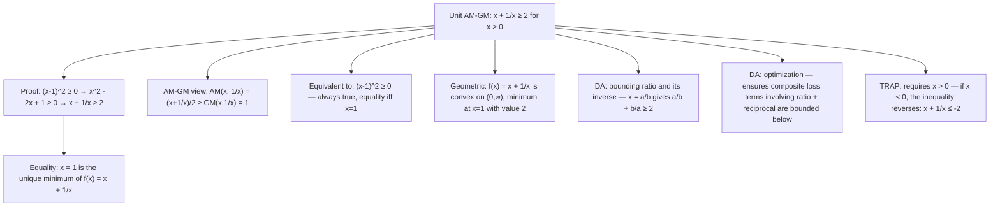

# AM-GM (unit)

If $x > 0$, then $x + \frac{1}{x} \ge 2$ (equality at $x=1$)

## Deep Breakdown

What it tells me *(Situation Awareness)*:
This is the unit form of the AM-GM (Arithmetic Mean–Geometric Mean) inequality specialized to the pair $\{x, 1/x\}$. The arithmetic mean of $x$ and $1/x$ is $(x + 1/x)/2$, and their geometric mean is $\sqrt{x \cdot (1/x)} = 1$. AM-GM states that AM ≥ GM, so $(x + 1/x)/2 \ge 1$, which gives $x + 1/x \ge 2$, with equality exactly when $x = 1/x$, i.e., $x = 1$. The direct algebraic proof: $(x - 1)^2 \ge 0 \Rightarrow x^2 - 2x + 1 \ge 0 \Rightarrow x^2 + 1 \ge 2x$. Dividing by $x > 0$ gives $x + 1/x \ge 2$. In DA/DS, this inequality appears in: (1) convexity arguments — the function $f(x) = x + 1/x$ is convex on $(0, \infty)$ with global minimum $2$ at $x = 1$; (2) bounding terms in optimization — showing that a ratio and its reciprocal always sum to at least 2 is used in saddle-point analysis; (3) the softplus lower bound — $\ln(e^x + 1) \ge x/2 + \ln 2$ (related argument); (4) deriving the AM-GM inequality for two arbitrary positive numbers $a$ and $b$: set $x = a/b$, getting $a/b + b/a \ge 2$, which gives $\sqrt{ab} \le (a+b)/2$; (5) economic models where the ratio of two quantities (e.g., supply to demand) and its inverse both appear, bounding their combined effect.

## Flowchart



## Real-world use

### Where it is used

Bounding regularization terms: in some formulations of elastic net regularization or ratio-based penalties, a model involves terms of the form $\alpha/\beta + \beta/\alpha$ where $\alpha, \beta > 0$ are positive parameters. The unit AM-GM guarantees this is always at least 2, preventing the loss from going to zero through cancellation. Ratio analysis in A/B testing: when comparing conversion rate $p_A$ to $p_B$, the sum $p_A/p_B + p_B/p_A$ is always at least 2, regardless of which group performs better — this is a sanity check on symmetry.

### Problem it solves

Given that two positive quantities appear as a ratio and its reciprocal in a loss or objective function, the unit AM-GM immediately gives a tight lower bound of 2, achieved only when the two quantities are equal. This tells you the minimum value of that component of the objective and where equality holds.

### How it solves the problem

Starting from the always-true inequality $(x - 1)^2 \ge 0$:
$x^2 - 2x + 1 \ge 0$. Adding $2x$ to both sides: $x^2 + 1 \ge 2x$. Since $x > 0$, divide by $x$: $x + 1/x \ge 2$. Equality holds iff $(x-1)^2 = 0$, i.e., $x = 1$. The proof is elementary but the result is tight (the bound 2 is achieved).

### Example in a business

A data scientist analyzes a pricing optimization problem where the revenue-to-cost ratio and cost-to-revenue ratio both appear in the objective. If $r = \text{revenue}/\text{cost}$ and the objective includes $f = r + 1/r$, the unit AM-GM guarantees $f \ge 2$ with equality when revenue equals cost (break-even). This immediately shows the minimum attainable value of $f$ without calculus, and reveals that any deviation from break-even (either profit or loss) increases $f$.

## The formula, piece by piece

Breaking the notation:

- $x$: any positive real number ($x > 0$ is required).
- $1/x$: the reciprocal of $x$.
- $x + 1/x$: the sum of a number and its reciprocal.
- $\ge 2$: the lower bound — the sum is always at least 2.
- Equality at $x = 1$: the unique point where $x = 1/x = 1$, so the sum reaches exactly 2. **Connection to general AM-GM** for two positive terms $a$ and $b$: let $x = a/b$ (with $b > 0$). Then $x + 1/x = a/b + b/a \ge 2$, giving $a/b + b/a \ge 2$. Multiplying both sides by $ab/2$: $(a^2 + b^2)/2 \ge ab$, or equivalently $\sqrt{ab} \le (a+b)/2$, which is the standard two-term AM-GM. **The curve $f(x) = x + 1/x$** for $x > 0$:
- $f(1) = 2$ (minimum).
- $f(0.5) = 0.5 + 2 = 2.5$.
- $f(2) = 2 + 0.5 = 2.5$.
- $f(0.1) = 0.1 + 10 = 10.1$.
- Symmetric under $x \mapsto 1/x$: $f(x) = f(1/x)$. **TRAP: if $x < 0$**, the inequality reverses: $x + 1/x \le -2$ for $x < 0$.

The proof fails at the division step because dividing by negative $x$ flips the inequality. The unit AM-GM applies only to $x > 0$.

## The formula in words

"For any positive $x$: $x$ plus its reciprocal is always at least 2. Minimum is exactly 2, achieved only at $x = 1$. Proof: $(x-1)^2 \ge 0$, expand, divide by $x > 0$. Use this to: immediately bound a sum of a ratio and its inverse; identify the break-even or balanced point (where both are equal to 1); recognize convex bowl shape with minimum at $x=1$. TRAP: $x > 0$ required."

## Critical Concepts

1. **Proof from perfect square**: $(x-1)^2 \ge 0$ is the simplest path. Always nonnegative. Expanding and dividing by $x > 0$ gives the result in two lines. This is the prototypical "subtract then square" technique for proving inequalities.
2. **Minimum value and location**: the global minimum of $f(x) = x + 1/x$ on $(0, \infty)$ is $2$, achieved at $x = 1$. This can be confirmed by calculus: $f'(x) = 1 - 1/x^2 = 0 \Rightarrow x = 1$; $f''(x) = 2/x^3 > 0$ (concave up, so $x = 1$ is a minimum).
3. **Symmetry under reciprocal**: $f(x) = f(1/x)$ — replacing $x$ with $1/x$ gives the same value. So $f(2) = f(0.5) = 2.5$, $f(3) = f(1/3) \approx 3.33$.
4. **Link to general AM-GM**: substituting $x = \sqrt{a/b}$ into the unit form gives $\sqrt{a/b} + \sqrt{b/a} \ge 2$, and multiplying by $\sqrt{ab}$ gives $a + b \ge 2\sqrt{ab}$ — the standard two-term AM-GM.
5. **Convexity implication**: $f$ is strictly convex on $(0, \infty)$.

This matters in optimization: any objective that includes $x + 1/x$ has a unique minimum at $x = 1$ and guarantees no local minima other than the global one.

## Step-by-step calculation (tiny example)

Task: verify $x + 1/x \ge 2$ for $x = 3$ and find where equality holds.

*Step 1: Compute for $x = 3$*
$3 + 1/3 = 9/3 + 1/3 = 10/3 \approx 3.33 \ge 2$.

*Step 2: Compute for $x = 0.5$*
$0.5 + 1/0.5 = 0.5 + 2 = 2.5 \ge 2$.

*Step 3: Check equality condition*
$x + 1/x = 2 \Rightarrow x^2 - 2x + 1 = 0 \Rightarrow (x-1)^2 = 0 \Rightarrow x = 1$.
Verify: $1 + 1/1 = 2$.

*Step 4: Trace the proof for $x = 3$*
$(x - 1)^2 = (3 - 1)^2 = 4 \ge 0$.
$x^2 + 1 \ge 2x \Rightarrow 10 \ge 6$.
Dividing by $x = 3$: $10/3 \ge 2$.

## Code examples

### Beginner example (Python)

```python
# Unit AM-GM: x + 1/x >= 2 for x > 0, equality at
x = 1
import math
import numpy as np
import matplotlib
matplotlib.use("Agg")
import matplotlib.pyplot as plt

def unit_am_gm(x: float) -> float:
    """ Compute x + 1/x and verify the AM-GM lower bound. Args: x: Positive real number (x > 0). Returns: x + 1/x. """
    if x <= 0:
        raise ValueError("x must be positive")
    return x + 1 / x   # Verify across a range of values
print("Unit AM-GM: x + 1/x >= 2")
test_vals = [0.01, 0.1, 0.5, 0.9, 1.0, 1.1, 2.0, 5.0, 10.0, 100.0]
print(f"{'x':>8} {'1/x':>8} {'x+1/x':>8} {'>=2?':>6} {'gap':>8}")
for x in test_vals:
    val = unit_am_gm(x)
gap = val - 2.0
print(f"{x:>8.4f} {1/x:>8.4f} {val:>8.4f} {str(val >= 2 - 1e-12):>6} {gap:>8.6f}")   # Prove via perfect square
print("\nProof via (x-1)^2 >= 0:")
for x in [0.5, 1.0, 3.0]:
    sq = (x - 1) ** 2
lhs = x ** 2 + 1
rhs = 2 * x
ratio = unit_am_gm(x)
print(f" x={x}: (x-1)^2={sq:.4f} >= 0; x^2+1={lhs:.4f} >= 2x={rhs:.4f}; x+1/x={ratio:.4f} >= 2")   # Symmetry: f(x) = f(1/x)
print("\nSymmetry: f(x) = f(1/x)")
for x in [2.0, 3.0, 0.25, 7.0]:
    print(f" f({x}) = {unit_am_gm(x):.6f} f(1/{x}) = {unit_am_gm(1/x):.6f} equal: {abs(unit_am_gm(x) - unit_am_gm(1/x)) < 1e-10}")   # TRAP: x < 0 reverses the inequality
print("\nTRAP: x < 0 reverses inequality (x + 1/x <= -2)")
for x in [-0.5, -1.0, -2.0, -5.0]:
    val = x + 1/x
print(f" x={x:5.1f}: x+1/x = {val:.4f} (>= -2: {val >= -2}; <= -2: {val <= -2})")
```

### Beginner example (R)

```r
# Unit AM-GM in R: x + 1/x >= 2 for x > 0
unit_am_gm <- function(x) { if (any(x <= 0)) stop("x must be positive") x + 1 / x
}  # Verify
test_vals <- c(0.01, 0.1, 0.5, 1.0, 2.0, 5.0, 10.0)
cat(sprintf("%-8s %-8s %-8s %s\n", "x", "1/x", "x+1/x", ">=2?"))
for (x in test_vals) { val <- unit_am_gm(x)
  cat(sprintf("%-8.4f %-8.4f %-8.4f %s\n", x, 1/x, val, val >= 2 - 1e-12))
}  # Proof check
cat("\nProof: (x-1)^2 >= 0\n")
for (x in c(0.5, 1.0, 3.0)) { cat(sprintf(" x=%.1f: (x-1)^2=%.4f x^2+1=%.4f 2x=%.4f x+1/x=%.4f\n", x, (x-1)^2, x^2+1, 2*x, unit_am_gm(x)))
}  # Minimum at
x = 1
x_grid <- seq(0.1, 5, by=0.01)
f_vals <- unit_am_gm(x_grid)
cat(sprintf("\nMinimum of x+1/x: %.4f at x = %.4f\n", min(f_vals), x_grid[which.min(f_vals)]))
```

### Professional example (Python)

```python
import numpy as np
import pandas as pd   # Scenario: bounding a ratio-based objective in a supply-chain optimization
# where both supply/demand and demand/supply ratios appear
# Unit AM-GM gives an immediate lower bound without calculus
np.random.seed(42)
N_PRODUCTS = 50   # Simulate supply and demand for 50 products
supply = np.random.uniform(100, 500, N_PRODUCTS)
demand = np.random.uniform(80, 600, N_PRODUCTS)

def ratio_plus_reciprocal(supply: np.ndarray, demand: np.ndarray) -> np.ndarray:
    """ Compute x + 1/x where x = supply / demand. By unit AM-GM: x + 1/x >= 2 for all x > 0, with equality iff supply == demand (balanced). Args: supply: Array of supply quantities (> 0). demand: Array of demand quantities (> 0). Returns: Array of supply/demand + demand/supply values (each >= 2). """
    ratio = supply / demand
    return ratio + 1 / ratio   # equiv: supply/demand + demand/supply

def imbalance_score(supply: np.ndarray, demand: np.ndarray) -> np.ndarray:
    """ Imbalance score: how far each product deviates from the AM-GM minimum. Score = (x + 1/x) - 2 >= 0, with 0 indicating perfect balance. Args: supply: Supply array. demand: Demand array. Returns: Array of imbalance scores (all >= 0). """
    return ratio_plus_reciprocal(supply, demand) - 2.0
ratios = supply / demand
am_gm_values = ratio_plus_reciprocal(supply, demand)
imbalance_scores = imbalance_score(supply, demand)
report_df = pd.DataFrame({ "supply": supply[:10].round(1), "demand": demand[:10].round(1), "ratio_s_d": ratios[:10].round(4), "s_d_plus_d_s": am_gm_values[:10].round(4), "imbalance": imbalance_scores[:10].round(4), "above_2": (am_gm_values[:10] >= 2 - 1e-10),
})
print("Unit AM-GM: supply/demand + demand/supply >= 2 (equality iff balanced)")
print("=" * 72)
print(report_df.to_string(index=False))
print(f"\nAll values >= 2: {(am_gm_values >= 2 - 1e-10).all()}")
print(f"Min value: {am_gm_values.min():.6f} (theoretical minimum: 2.0)")
print(f"Mean imbalance: {imbalance_scores.mean():.4f}")
print(f"Most balanced: product #{np.argmin(imbalance_scores)+1} " f"(supply={supply[np.argmin(imbalance_scores)]:.1f}, " f"demand={demand[np.argmin(imbalance_scores)]:.1f})")
print(f"Least balanced: product #{np.argmax(imbalance_scores)+1} " f"(imbalance score = {imbalance_scores.max():.4f})")
print(f"\nAM-GM lower bound check: sum(above-min values) = " f"{(am_gm_values - 2).sum():.4f} >= 0 ({(am_gm_values - 2 >= 0).all()})")
```

### Professional example (R)

```r
# AM-GM unit: x + 1/x >= 2 for x > 0 (supply/demand balance score)
supply <- c(50, 80, 30)
demand <- c(50, 40, 60)
am_gm_values <- supply / demand + demand / supply
imbalance_scores <- am_gm_values - 2
cat("AM-GM: supply/demand + demand/supply >= 2\n")
print(data.frame(supply = supply, demand = demand, am_gm = am_gm_values, imbalance = imbalance_scores))
cat(sprintf("Most balanced: product #%d Least: #%d\n", which.min(imbalance_scores), which.max(imbalance_scores)))
```

---

*Source: domain knowledge*
