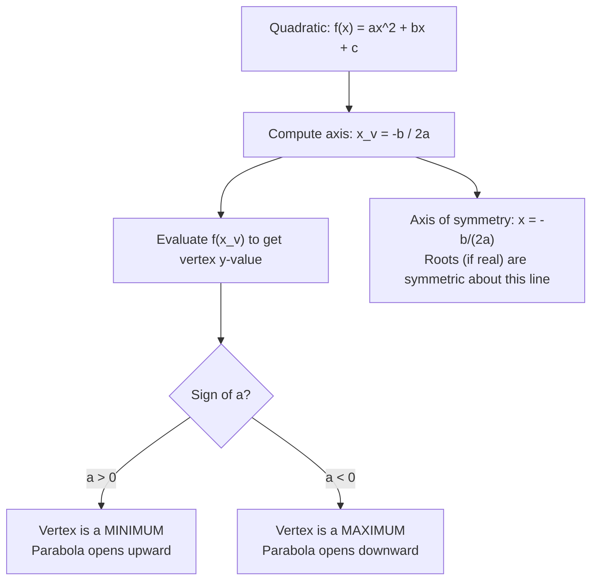

# Axis of symmetry

$$
x = -\frac{b}{2a}
$$

## Deep Breakdown

What it tells me *(Situation Awareness)*:
For a quadratic $f(x) = ax^2 + bx + c$, the axis of symmetry is the vertical line $x = -\frac{b}{2a}$ that passes through the vertex of the parabola. The vertex is the maximum (if $a < 0$) or minimum (if $a > 0$) of the function. In optimization, this directly gives the $x$-value that maximizes or minimizes the quadratic — no calculus needed.

## Flowchart



## Real-world use

### Where it is used

Revenue optimization (find the price that maximizes revenue), cost minimization (find the quantity that minimizes cost), and finding the midpoint between two break-even prices without solving the full quadratic formula.

### Problem it solves

In business optimization, if revenue is modeled as a downward-opening quadratic of price, the maximum revenue occurs at $p = -b/(2a)$ — no derivatives, no quadratic formula, just this single expression.

### How it solves the problem

The axis of symmetry formula comes from setting the derivative to zero ($f'(x) = 2ax + b = 0$) and solving for $x$ — but you can derive it without calculus by noting it is the average of the two roots: $\frac{x_1 + x_2}{2} = \frac{-b/a}{2} = -\frac{b}{2a}$ (using Vieta's sum of roots).

### Example in a business

Revenue model: $R(p) = -3p^2 + 120p$ (price-demand quadratic). $a = -3$, $b = 120$. Optimal price: $p^* = -\frac{120}{2(-3)} = \frac{120}{6} = 20$. Maximum revenue: $R(20) = -3(400) + 120(20) = -1200 + 2400 = 1200$. No calculus needed.

## The formula, piece by piece

- $x$: the $x$-coordinate of the vertex (the optimal input value)
- $-\frac{b}{2a}$: negative $b$ divided by twice $a$
- $a$: leading coefficient (determines direction of parabola: up if $a > 0$, down if $a < 0$)
- $b$: linear coefficient
- Note: the vertex $y$-value is $f\!\left(-\frac{b}{2a}\right) = c - \frac{b^2}{4a}$ Full formula: $x_{\text{vertex}} = -\frac{b}{2a}$

## The formula in words

"The $x$-coordinate of the vertex (and axis of symmetry) of any parabola is negative $b$ over twice $a$." $f(x) = 2x^2 - 12x + 5$: vertex at $x = -\frac{-12}{2 \cdot 2} = \frac{12}{4} = 3$.

## Critical Concepts

- **The axis of symmetry is always exactly between the two real roots.** If roots are $x_1$ and $x_2$, then $\frac{x_1 + x_2}{2} = -\frac{b}{2a}$.
- **Works even when there are no real roots.** The axis of symmetry (and vertex) still exists; the parabola just doesn't cross the $x$-axis.
- **Vertex $y$-value:** substitute $x_v = -\frac{b}{2a}$ back into $f(x)$: $f(x_v) = c - \frac{b^2}{4a}$.
- **Optimization shortcut:** avoid calculus for quadratic optimizations by using this formula directly.
- **Connection to quadratic formula:** the two roots are $x_v \pm \frac{\sqrt{\Delta}}{2a}$ — equidistant from the axis.

## Step-by-step calculation (tiny example)

*Step 1: Read off a and b from the quadratic*
Function: $f(x) = -3p^2 + 120p$. $a = -3$, $b = 120$.

*Step 2: Apply the axis of symmetry formula*
$x_v = -\frac{b}{2a} = -\frac{120}{2(-3)} = -\frac{120}{-6} = 20$.

*Step 3: Evaluate the function at the vertex*
$f(20) = -3(20)^2 + 120(20) = -1200 + 2400 = 1200$. Maximum revenue is $\$1200$ at price $p = 20$.

## Code examples

### Beginner example (Python)

```python
def find_vertex(a: float, b: float, c: float) -> tuple:
    """ Find the vertex (axis of symmetry and max/min value) of ax^2 + bx + c. Args: a: coefficient of x^2 (non-zero) b: coefficient of x c: constant term Returns: Tuple (x_vertex, y_vertex, direction) """
    x_v = -b / (2 * a)
    y_v = a * x_v**2 + b * x_v + c
    direction = "minimum" if a > 0 else "maximum"
    return x_v, y_v, direction   # Revenue model: R(p) = -3p^2 + 120p
a, b, c = -3, 120, 0
x_v, y_v, direction = find_vertex(a, b, c)
print(f"Revenue model: R(p) = {a}p^2 + {b}p + {c}")
print(f"Axis of symmetry: p = -{b} / (2 * {a}) = {x_v}")
print(f"Vertex: ({x_v}, {y_v}) -- this is a {direction}")
print(f"Max revenue: ${y_v:,.2f} at price p = {x_v}")
```

### Beginner example (R)

```r
find_vertex <- function(a, b, c) {  #' Find the vertex of ax^2 + bx + c. #' @return List with x_vertex, y_vertex, direction
  x_v <- -b / (2 * a)
  y_v <- a * x_v^2 + b * x_v + c
  direction <- if (a > 0) "minimum"
  else "maximum" list(x_v = x_v, y_v = y_v, direction = direction)
}
vertex <- find_vertex(a = -3, b = 120, c = 0)
cat(sprintf("Revenue model: R(p) = -3p^2 + 120p\n"))
cat(sprintf("Axis of symmetry: p = %.2f\n", vertex$x_v))
cat(sprintf("Vertex: (%.2f, %.2f) -- %s\n", vertex$x_v, vertex$y_v, vertex$direction))
cat(sprintf("Max revenue: $%.2f at price p = %.2f\n", vertex$y_v, vertex$x_v))
```

### Professional example (Python)

```python
import numpy as np
import pandas as pd
import matplotlib
matplotlib.use("Agg")
import matplotlib.pyplot as plt   # Scenario: revenue optimization across multiple product lines
# Each product has a quadratic revenue-price relationship: R(p) = a*p^2 + b*p + c
np.random.seed(42)
products = pd.DataFrame({ "product": ["Widget", "Gadget", "Doohickey"], "a": [-2.0, -0.5, -1.5], "b": [80.0, 30.0, 60.0], "c": [0.0, 0.0, 0.0],
})
products["optimal_price"] = -products["b"] / (2 * products["a"])
products["max_revenue"] = ( products["a"] * products["optimal_price"]**2 + products["b"] * products["optimal_price"] + products["c"] )
products["direction"] = np.where(products["a"] < 0, "maximum", "minimum")
print("Revenue Optimization via Axis of Symmetry")
print("x* = -b / (2a) | R(x*) = c - b^2 / (4a)")
print()
print(products[["product", "a", "b", "optimal_price", "max_revenue", "direction"]].to_string(index=False))
print()
print("Optimal prices and maximum revenues found without calculus or quadratic formula.")
```

### Professional example (R)

```r
# Revenue optimization: x* = -b/(2a), R(x*) = c - b^2/(4a)
products <- data.frame( product = c("Widget", "Gadget", "Doohickey"), a = c(-2, -0.5, -1.5), b = c(80, 30, 60), c = c(0, 0, 0)
)
products$optimal_price <- -products$b / (2 * products$a)
products$max_revenue <- with(products, a * optimal_price^2 + b * optimal_price + c)
products$direction <- ifelse(products$a < 0, "maximum", "minimum")
cat("Revenue Optimization: x* = -b/(2a)\n")
print(products[c("product", "a", "b", "optimal_price", "max_revenue", "direction")])
```

---

*Source: domain knowledge*
